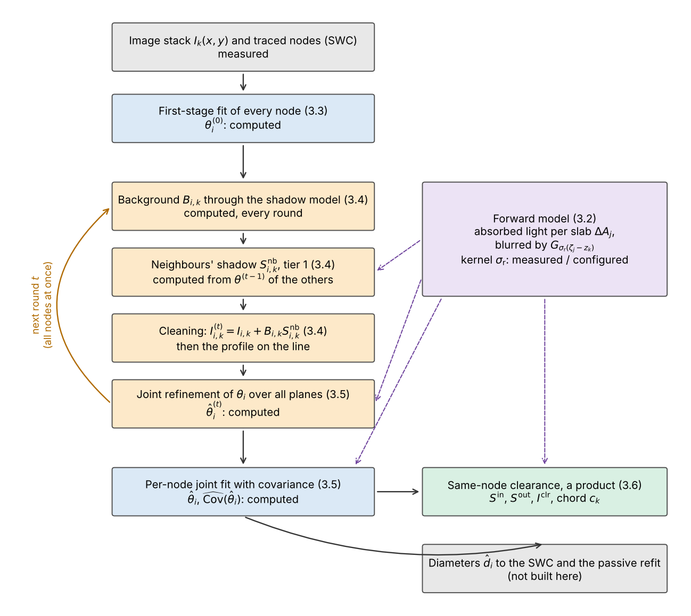
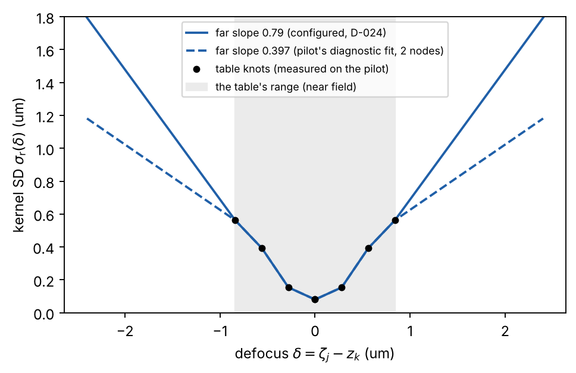
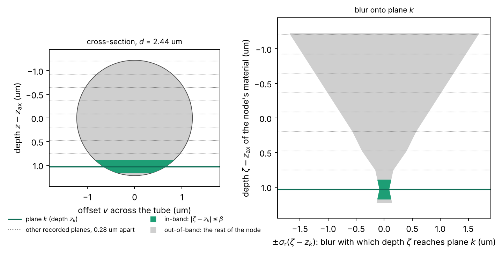
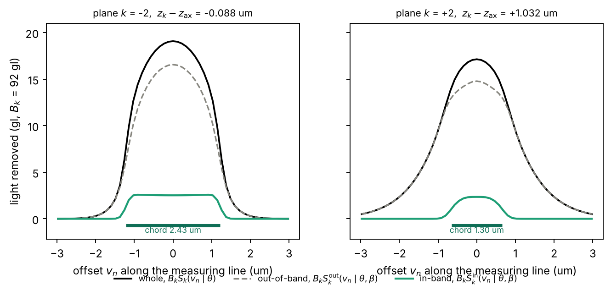

# Re-measuring a dendrite's diameter from a brightfield stack: the theory of the main route (forward model, neighbours' cleaning, joint per-node fit, same-node clearance)

**Date:** 2026-11-17

| Date | Change |
|---|---|
| 2026-11-17 | Created at the user's request (17:20: "Write, deliver and push also a theory document on the whole pipeline"), after D-156. |

**Abstract.** The question: given Allen's brightfield image stack of a biocytin-filled neuron and its traced
skeleton, how is the diameter of the dendrite at each traced node estimated, and what does each step of the estimate
rest on? The document covers the main route of the diameter re-measurement (decisions D-129, D-130, D-132, D-144,
D-156): the forward model of what one recorded plane shows (section 3.2), the first-stage fit that starts every
node (3.3), the removal of the neighbouring dendrites' shadows, round by round (3.4), the joint fit of a node's
parameters over all its planes (3.5), and the same-node clearance, which splits the node's own shadow by depth after
the fit and is a check, not a correction (3.6). Deliberately excluded: the secondary route (the in-silico inversion
table, placed in one paragraph of 3.7), the calibration of the defocus kernel (its result is used, its method is
not derived), the camera chain and the noise model, the cluster runs, and the use of the diameters in the passive
refit. Sources consulted: the repository's `specs/SPEC.md` (sections 1 to 2.3, Blocks 4, 21, 23, 25, 26, 28, 29, 30,
32, 35, 36, 37, 38), the decision log (D-024, D-129, D-130, D-132, D-144, D-148, D-149, D-151, D-156), the handoff
`TEEG_same_node_clearance_handoff_2026-11-17.md`, `docs/TEEG_diameter_optics_notes.md`, the code
(`model/line_fast.py`, `config.py`); PubMed: four abstracts (PMIDs 18163845, 19220694, 11106952, 40376420), none with
a full text retrievable through the connector (PMC12075049 returned an empty text); two numerical checks run in
this session. Searches that returned nothing: PubMed, "brightfield microscopy three-dimensional image formation
absorbing object defocus point spread function z-stack", "dendrite diameter measurement light microscopy biocytin
reconstruction bias optical resolution", "brightfield deconvolution point spread function absorbing specimen
three-dimensional" (0 results each); a fourth query was refused by the connector's rate limit and not repeated.
The bioRxiv connector has no keyword search (date and category only) and was not queried. No data repository was
queried: the document makes no claim about a dataset beyond the project's own records.

## 1. Notation and Symbols

The table is long because the pipeline has many objects; the symbols are those of `specs/SPEC.md` and of D-151 and
D-156, with three deviations flagged in the rows concerned and in "Conventions".

| Symbol | Name / Meaning | Type & domain | Units | First used in § | Status |
|---|---|---|---|---|---|
| $i$ | a traced node (the node being measured) | index in the set of traced nodes | -- | 3.1 | measured (the trace) |
| $q$ | a neighbour of node $i$: a traced segment or soma disc outside the node's own stretch | index in $Q_i$ | -- | 3.4 | measured (the trace) |
| $Q_i$, $Q^{(1)}_i$ | the neighbours of node $i$; those of tier 1 | finite sets | -- | 3.4 | computed |
| $(x, y)$ | position in the image plane | $\mathbb R^2$ | um | 3.2 | -- |
| $z$, $\zeta$ | depth along the optical axis; $\zeta$ is used for the depth of the node's material, $z$ for a focal depth | $\mathbb R$ | um | 3.2 | -- |
| $k$ | index of a recorded plane | $\mathbb Z$ | -- | 3.1 | configured |
| $z_k$ | focal depth of plane $k$, $z_k = k\,\Delta z$ | $\mathbb R$ | um | 3.1 | configured |
| $\Delta z$ | spacing of the recorded planes, 0.28 | $\mathbb R_{>0}$ | um | 3.1 | configured (acquisition) |
| $p_{\rm x}$ | pixel pitch, 0.1144 | $\mathbb R_{>0}$ | um | 3.2 | configured (acquisition) |
| $K_i$ | the planes of node $i$ offered to the fits: $k^*_i - 4, \dots, k^*_i + 4$ | set of 9 integers | -- | 3.3 | configured |
| $k^*_i$ | the node's sharpest plane (first stage) | $\mathbb Z$ | -- | 3.3 | computed |
| $\hat y_i$ | measuring axis of node $i$: the unit vector in the image plane at right angles to the branch's projection | $\mathbb R^2$, unit | -- | 3.2 | computed |
| $v_n$ | offset of sample $n$ along the measuring line, $n = 1..N$, $v_n \in [-3, 3]$ in steps of 0.1144 | $\mathbb R$ | um | 3.2 | configured |
| $N$ | number of samples on the line, 53 | integer | -- | 3.5 | configured |
| $\theta_i$ | the node's actual parameters $(d, \mu, v_0, z_{\rm ax})$ (the object level: unknown) | $\mathbb R_{>0}^2 \times \mathbb R^2$ | um, 1/um, um, um | 3.2 | never held |
| $\hat\theta_i$, $\hat\theta^{(t)}_i$, $\theta^{(0)}_i$ | estimates of $\theta_i$ computed from the data (the estimate level): the per-node fit's; round $t$'s; the first stage's | as $\theta_i$ | as $\theta_i$ | 3.3 | computed |
| $d$, $r$ | the tube's diameter; its radius $r = d/2$ | $\mathbb R_{>0}$ | um | 3.2 | component of $\theta$ |
| $\mu$ | absorption coefficient of the stained dendrite | $\mathbb R_{>0}$ | 1/um | 3.2 | component of $\theta$ |
| $v_0$ | lateral shift of the tube's axis along $\hat y_i$, about the traced position | $\mathbb R$ | um | 3.2 | component of $\theta$ |
| $z_{\rm ax}$ | depth of the tube's axis where it crosses the measuring line | $\mathbb R$ | um | 3.2 | component of $\theta$ |
| $\varphi$ | tilt of the tube's axis out of the image plane | $[0, \pi/2)$ | rad | 3.2 | computed (first stage), then fixed |
| $\psi$ | heading of the axis' projection in the image plane (SPEC writes $\theta_i$; renamed here, where $\theta$ is the parameter vector) | $(-\pi, \pi]$ | rad | 3.2 | computed (first stage), then fixed |
| $U$ | half-length of the straight tube that stands for the node's stretch | $\mathbb R_{>0}$ | um | 3.2 | computed from the trace |
| $j$ | index of a depth slab of the tube | integer | -- | 3.2 | -- |
| $\zeta_j$, $\Delta\zeta$ | centre and thickness of slab $j$; $\Delta\zeta$ = 0.02 | $\mathbb R$; $\mathbb R_{>0}$ | um | 3.2 | configured |
| $z_{\rm lo}(x, y)$, $z_{\rm hi}(x, y)$ | lower and upper depth of the tube on the vertical line through $(x, y)$ | functions $\mathbb R^2 \to \mathbb R$ | um | 3.2 | computed |
| $a_j(x, y \mid \theta)$ | absorbance of slab $j$ on the vertical line through $(x, y)$ | function $\mathbb R^2 \to \mathbb R_{\ge 0}$ | dimensionless | 3.2 | computed |
| $\bar\zeta_j(x, y)$ | depth of the midpoint of the part of slab $j$ that lies inside the tube on the vertical line through $(x, y)$ | function $\mathbb R^2 \to \mathbb R$ | um | 3.2 | computed |
| $T_{<j}(x, y \mid \theta)$ | fraction of the light left when it reaches slab $j$, vertical-ray model | function $\mathbb R^2 \to (0, 1]$ | dimensionless | 3.2 | computed |
| $\eta(P \mid \theta)$ | the hybrid's factor at a point $P \in \mathbb R^3$ of the tube: the cone average of (light left on the ray) / (ray's vertical direction cosine) (SPEC writes $h$; renamed, $h$ being a layer thickness here) | function $\mathbb R^3 \to \mathbb R_{>0}$ | dimensionless | 3.2 | computed |
| $\hat s$, $s_z$, $W$ | a ray direction of the condenser's cone, its vertical component, the cone's measure (average $\langle\cdot\rangle_W$) | unit vector; $(0, 1]$; probability measure | -- | 3.2 | configured |
| $\ell_{\rm back}(P; \hat s)$ | length inside the tube of the ray of direction $\hat s$ before it reaches $P$ | $\mathbb R_{\ge 0}$ | um | 3.2 | computed |
| $\Delta A_j(x, y \mid \theta)$ | fraction of the incoming light absorbed in slab $j$ at $(x, y)$ | function $\mathbb R^2 \to [0, 1)$ | dimensionless | 3.2 | computed |
| $\delta$ | defocus: the depth of a piece of material minus the focal depth of a plane, $\delta = \zeta_j - z_k$ | $\mathbb R$ | um | 3.2 | -- |
| $\sigma_{\rm r}(\delta)$ | standard deviation of the defocus kernel at defocus $\delta$, even in $\delta$ | function $\mathbb R \to \mathbb R_{>0}$ | um | 3.2 | measured for $\lvert\delta\rvert \le \delta_{\max}$ (pilot calibration) / configured beyond |
| $\delta_{\max}$, $\gamma$ | last knot of the kernel table, 0.84; slope of its linear continuation, 0.79 | $\mathbb R_{>0}$ | um; um per um | 3.2 | configured |
| $G_\sigma$ | the normalised circular 2-D Gaussian of standard deviation $\sigma$ | function $\mathbb R^2 \to \mathbb R_{>0}$, unit integral | 1/um$^2$ | 3.2 | analytic |
| $*$ | convolution over the image plane $(x, y)$ | operator | -- | 3.2 | -- |
| $S_k(x, y \mid \theta)$, $S_k(v_n \mid \theta)$ | the node's own shadow at plane $k$: the fraction of the background light missing because of the node, as an image and as read at line sample $v_n$ (model level: a function of $\theta$) | functions to $[0, 1)$ | dimensionless | 3.2 | computed |
| $I_{i,k}(x, y)$, $I_{i,k}(v_n)$ | recorded grey level of plane $k$ around node $i$: image, and profile on the line (data level) | $\mathbb R_{\ge 0}$ | gl | 3.1 | measured |
| $B_{i,k}$ | background of plane $k$ at node $i$'s line | $\mathbb R_{>0}$ | gl | 3.2 | computed, every round |
| $b_{i,k}(x, y)$, $b_0, b_x, b_y$ | the fitted background plane and its three coefficients (D-144 writes $\beta_0, \beta_x, \beta_y$; renamed, $\beta$ being the band here) | affine function $\mathbb R^2 \to \mathbb R$ | gl; gl; gl/um; gl/um | 3.4 | computed |
| $(c_x, c_y)$ | centre of node $i$'s patch | $\mathbb R^2$ | um | 3.4 | configured |
| $\Omega_{i,k}$ | the pixels of the patch used to fit the background | set of pixels | -- | 3.4 | computed |
| $e_{i,k}(v_n)$ | what the model of one node leaves out of the profile: noise, the neighbours' shadows not removed, model error | $\mathbb R$ | gl | 3.2 | never held |
| $s_{q,k}(x, y)$ | shadow of neighbour $q$ in plane $k$, from the neighbour's current parameters | function to $[0, 1)$ | dimensionless | 3.4 | computed |
| $S^{\rm nb}_{i,k}(x, y)$ | summed shadow of node $i$'s tier-1 neighbours in plane $k$ | function to $\mathbb R_{\ge 0}$ | dimensionless | 3.4 | computed |
| $S^{\rm all}_{i,k}(x, y)$ | shadow predicted for every traced segment and soma disc on the patch, node $i$'s own stretch included | function to $\mathbb R_{\ge 0}$ | dimensionless | 3.4 | computed |
| $t$ | round of the cleaning, $t = 1, 2, \dots$ | integer | -- | 3.4 | -- |
| $I^{(t)}_{i,k}$ | plane $k$ of node $i$ after round $t$'s cleaning (neighbours' shadows added back): image, and profile $I^{(t)}_{i,k}(v_n)$ | $\mathbb R$ | gl | 3.4 | computed |
| $w_{k,n}$ | weight of plane $k$, sample $n$ in the joint fit's sum of squares: $w_n$ in the refinement, $1/\sigma_I^2$ in the per-node fit | $\mathbb R_{>0}$ | dimensionless or 1/gl$^2$ | 3.5 | configured / measured |
| $w_n$, $\lambda_w$ | weights of the refinement, $w_n = e^{-\lvert v_n\rvert/\lambda_w}$; their length (SPEC writes $\lambda$) | $(0, 1]$; $\mathbb R_{>0}$ | dimensionless; um | 3.5 | configured |
| $\sigma_I$ | standard deviation of the noise of one profile sample (SPEC writes $\sigma$) | $\mathbb R_{>0}$ | gl | 3.5 | measured per node |
| $J$ | Jacobian of the fit's residuals with respect to $\theta$, at $\hat\theta$ | $\mathbb R^{9N \times 4}$ | per unit of each parameter | 3.5 | computed |
| $\widehat{\rm Cov}(\hat\theta)$ | estimated covariance matrix of $\hat\theta$ | $\mathbb R^{4 \times 4}$, symmetric | products of the parameters' units | 3.5 | computed |
| $\beta$ | half-thickness of a plane's band in the same-node clearance, 0.14 | $\mathbb R_{\ge 0}$ | um | 3.6 | configured |
| $w_{j,k}$ | share of slab $j$ in plane $k$'s band | $[0, 1]$ | dimensionless | 3.6 | computed |
| $S^{\rm in}_k(v_n \mid \theta, \beta)$, $S^{\rm out}_k(v_n \mid \theta, \beta)$ | the in-band and the out-of-band part of $S_k(v_n \mid \theta)$ | functions to $[0, 1)$ | dimensionless | 3.6 | computed |
| $I^{\rm clr}_{i,k}(v_n)$ | cleared profile: the profile with the predicted out-of-band shadow added back | $\mathbb R$ | gl | 3.6 | computed |
| $c_k$ | chord: length of the measuring line inside the tube at the depth of plane $k$ | $[0, d]$ | um | 3.6 | computed |
| $h$, $m$, $L_{m,k}(v_n)$ | thickness of a depth layer (0.1), its index, and the layer's part of the own shadow at plane $k$ | $\mathbb R_{>0}$; $\mathbb Z$; function to $[0, 1)$ | um; --; dimensionless | 3.6 | configured; --; computed |
| $J^{\rm in}$, $J^{\rm out}$ | derivatives of $S^{\rm in}_k(v_n \mid \theta, \beta)$ and $S^{\rm out}_k(v_n \mid \theta, \beta)$ in $\theta$, stacked over $k$ and $n$ | $\mathbb R^{9N \times 4}$ | per unit of each parameter | 3.6 | computed in the check only |
| $\theta^*$ | a fixed point of clear-then-fit: a parameter vector the pass maps onto itself | as $\theta_i$ | as $\theta_i$ | 3.6 | computed in the check only |
| $M$ | matrix that multiplies an error of the estimate in one pass of clear-then-fit | $\mathbb R^{4 \times 4}$ | mixed | 3.6 | computed in the check only |

Statuses read from `specs/SPEC.md`, `config.py`, `line_fast.py` and the handoff [CODE]; the rows of 3.6 are specified
(SPEC Blocks 35 amendment 2, 37) and, at the time of writing, being implemented.

### Conventions

- **Levels.** $\theta_i$ is the node's actual parameter vector (never known); every hatted or superscripted
  $\theta$ is a number computed from the data. A model quantity is written as a function of the parameter,
  $S_k(v_n \mid \theta)$; evaluated at an estimate it is a prediction, $S_k(v_n \mid \hat\theta)$. $I$ is always
  data.
- **Deviations from the project's symbols**, each to avoid one letter with two meanings in this document: the
  heading is $\psi$ (SPEC: $\theta_i$); the hybrid's factor is $\eta$ (SPEC: $h$); the background plane's
  coefficients are $b_0, b_x, b_y$ (D-144: $\beta_0, \beta_x, \beta_y$); the weights' length is $\lambda_w$ and
  the noise SD $\sigma_I$ (SPEC: $\lambda$, $\sigma$).
- **Sign.** A shadow is a non-negative fraction of missing light; removing a shadow adds light:
  $I + B\,S$. Grey levels are abbreviated gl.
- **Depth.** $z$ increases along the optical axis in stage units; plane $k$ is at $z_k = k\,\Delta z$.
- **Index of the node.** Where one node is discussed alone, the index $i$ is kept on data and background and
  dropped on $\theta$, $S$ and $c_k$ ("dropping the $i$ for readability" applies to those three only).
- **Tags.** Source class and rating as in section 4's key: `[CODE: ...]` read in the repository, `[KB: ...]` a
  project document, `[ABS: ...]` an abstract only, `[RUN: ...]` verified by running the named script here,
  `[OWN]` this document's reasoning, `[TXT]` textbook from memory; ratings [Certain], [Likely], [Guessing].

## 2. Glossary / Jargon

Ordering: by first appearance.

- **Brightfield (transmitted-light) stack** -- the specimen is lit from below and imaged from above; a dark
  object is seen by the light it removes. The microscope is refocused in steps and one image is recorded per
  step: the stack of recorded planes. Operative in §3.1.
- **Node** -- one point of the traced skeleton (the SWC file) of the neuron, with a position and Allen's radius.
  Everyday sense differs: not a graph-theory node in general, but a sample point along a dendrite. Operative in
  §3.1.
- **Recorded plane** -- one image of the stack, focused at depth $z_k$. Not to be confused with a slab. Operative
  in §3.1.
- **Slab** -- a thin depth slice of the dendrite itself, used by the model to add up absorbed light; 0.02 um
  thick. Operative in §3.2.
- **Measuring line, profile, dip** -- the short line across the dendrite through the node; the grey levels read
  along it; the dark trough the dendrite makes in them. Operative in §3.2.
- **Shadow** -- the fraction of the background light missing at a point of a plane because of an object.
  Operative in §3.2.
- **Defocus kernel** -- the blur with which a piece of material at distance $\delta$ from the focal depth
  appears in that plane's image; here a Gaussian of standard deviation $\sigma_{\rm r}(\delta)$. Operative in
  §3.2.
- **Near field / far field (of the kernel)** -- the defocus range covered by the calibrated table
  ($|\delta| \le 0.84$ um) / the range beyond, where the kernel is a configured linear continuation. Two live
  senses of "field" exist in optics; this is the only one used here. Operative in §3.2.
- **Hybrid (absorption)** -- the project's absorption model: the light absorbed in each slab is computed from
  the condenser's cone of oblique rays, and the result is then blurred by the kernel. Operative in §3.2.
- **Forward model** -- the map from a node's parameters to the profiles it predicts in all its planes.
  Operative in §3.2.
- **First-stage fit ("the pilot")** -- the per-node fit at the sharpest plane that gives every node its starting
  parameters. "Pilot" has two senses in the project: this fit, and the pilot cell (specimen 529878215); the
  document writes "first stage" for the fit. Operative in §3.3.
- **Features (table)** -- the current parameters of every traced node of the cell, updated round by round.
  Operative in §3.4.
- **Neighbour; own stretch** -- any traced segment or soma disc outside the node's own stretch; the own stretch
  is the piece of the node's branch around the node that its straight tube stands for. Operative in §3.4.
- **Tier 1 / tier 2** -- a neighbour that is distant or out of focus (its shadow is subtracted) / one that is
  close and in focus or overlapping (kept for a joint fit, not subtracted; D-132). Operative in §3.4.
- **Cleaning** -- adding back to a node's planes the shadows predicted for its tier-1 neighbours. Operative in
  §3.4.
- **Jacobi round** -- one pass of the cleaning in which every node is updated from the previous round's values
  of all the nodes, so that the order of the nodes does not matter. Operative in §3.4.
- **Joint fit** -- one least-squares fit of the node's four parameters to the profiles of all its planes
  together. Operative in §3.5.
- **Band; in-band / out-of-band** -- the depth interval $[z_k - \beta, z_k + \beta]$ around plane $k$; the
  node's material inside / outside it. Operative in §3.6.
- **Same-node clearance** -- the split of the node's own shadow by depth and the profile with the out-of-band
  part added back; since D-156 a product computed after the fit. "Clearance" (the node's own shadow) and
  "cleaning" (the neighbours' shadows) are different operations. Operative in §3.6.
- **Chord** -- the length of the measuring line that lies inside the tube at a given depth. Operative in §3.6.

## 3. The main route

### 3.1 What a recorded plane contains, and why a diameter cannot be read off it

This section states the problem the whole route answers. One would expect the image focused at depth $z_k$ to
show the slice of the dendrite at $z_k$, so that the width of the dark dip across the dendrite at its sharpest
plane is its diameter. Three things make this false.

First, a brightfield microscope does not section. The light crosses the whole thickness of the dendrite, so
every recorded plane shows the darkening of the entire dendrite: the slice in focus sharply, the slices above
and below blurred, the more so the farther they are from the focal depth. In this pipeline that statement is the
forward model itself (eq. (4) of §3.2 sums over every slab of the tube, in focus or not)
[CODE: specs/SPEC.md §2.3, eqs. (5-6)] [Certain]. The same difficulty is the starting point of the literature on
tracing biocytin-filled neurons from transmitted-light stacks: Oberlaender and colleagues state that the blurred
contribution of out-of-focus light usually prohibits three-dimensional quantitative analysis of such stacks and
remove it by deconvolution with a model point spread function before tracing
[ABS: 10.1111/j.1365-2818.2009.03118.x; ABS: 10.1117/1.2815693] [Likely] (abstracts only; Full text not accessible
for DOI 10.1111/j.1365-2818.2009.03118.x -- this looks important because it models the brightfield point spread
function for biocytin-stained cortex in Mowiol under an oil objective, the preparation family of Allen's stacks;
upload the PDF and it is incorporated). Blind deconvolution of transmitted-light stacks of stained neurons is an
earlier member of the same family [ABS: 10.1046/j.1365-2818.2000.00751.x] [Likely] (abstract only), and a 2025
review places such methods among the inverse-imaging approaches to brightfield
[ABS: 10.1007/s12551-025-01301-1] [Likely] (abstract only). The route described here belongs to the other family:
it does not deblur the image; it fits a physical model of the blurred image to the data (model-based estimation).

Second, the measuring line is polluted: other dendrites, the axon and the soma of the same cell pass above,
below and beside the node and add their own blurred shadows to its profile [KB: decision log, D-129, the user's
statement of the problem] [Certain].

Third, the dip is measured against a background that is neither known nor flat, and the shadows are fractions
of it.

The route answers the three in turn (Figure 1): a forward model that includes the out-of-focus material (§3.2),
a cleaning that removes the neighbours' predicted shadows and refits the background each round (§3.4), and a fit
of the node's parameters to all its planes at once (§3.5).

Where this sits in the project: the passive fit of the neuron models gave a membrane capacitance two to three
times the reference value, and the working hypothesis is that Allen's traced radii are too thin; this code
re-measures the diameters from the image stacks [CODE: specs/SPEC.md §1] [Certain]. The stacks were acquired with
a 63x oil objective of numerical aperture 1.4, an oil condenser, and focal steps of 0.28 um
[KB: docs/TEEG_diameter_optics_notes.md, which records these as read in the full text of Berg et al. 2021
(PMC8494638) on 2026-10-04; not re-read in this session] [Likely]; the pipeline uses $\Delta z$ = 0.28 um and a
pixel pitch $p_{\rm x}$ = 0.1144 um [CODE: specs/SPEC.md §2.1] [Certain].

*Figure 1 -- The chain of the main route: the first-stage fit starts every node; each round refits the
backgrounds, removes the tier-1 neighbours' shadows and refines every node jointly over its planes; the per-node
fit and the same-node clearance follow; the forward model (right) feeds the neighbours' shadows, both fits and the
clearance [CODE: specs/SPEC.md Blocks 25, 28, 29, 30, 32, 35, 37] [Certain]; statuses as in §1; schematic:
scripts/fig01_pipeline_chain.py.*

### 3.2 The forward model: from a node's parameters to the profiles it predicts

This section establishes the map every later step uses. The problem it answers: to compare a candidate diameter
with the data one must be able to say what a dendrite of that diameter would look like in each recorded plane,
out-of-focus material included.

**The object.** Near a node the dendrite is modelled as a straight round tube: diameter $d$, absorption
coefficient $\mu$ (how much light the stained material removes per unit path), heading $\psi$ and tilt $\varphi$
(from the first stage, then fixed), and half-length $U$ (from the trace). Two more parameters place it: the
shift $v_0$ of its axis along the measuring axis $\hat y_i$, and the depth $z_{\rm ax}$ of its axis where it
crosses the measuring line. The four free parameters are collected in $\theta = (d, \mu, v_0, z_{\rm ax})$
[CODE: specs/SPEC.md Block 36; node_inputs.local_tube] [Certain]. A vertical line through the image position
$(x, y)$ is inside the tube between two depths $z_{\rm lo}(x, y)$ and $z_{\rm hi}(x, y)$ (empty outside the
tube's footprint) [CODE: specs/SPEC.md §2.3, (S3)] [Certain].

**The absorbed light, slab by slab.** The tube is cut into slabs of thickness $\Delta\zeta$ = 0.02 um centred
at depths $\zeta_j$. The absorbance of slab $j$ on the vertical line through $(x, y)$ is the coefficient times
the length of that line inside both the tube and the slab:

$$a_j(x, y \mid \theta) = \mu\,\max\Big\{0,\ \min\big(z_{\rm hi}(x, y),\ \zeta_j + \tfrac{\Delta\zeta}{2}\big) - \max\big(z_{\rm lo}(x, y),\ \zeta_j - \tfrac{\Delta\zeta}{2}\big)\Big\}. \tag{1}$$

Reading: for each fixed slab $j$ and position $(x, y)$, the bracket is the overlap (um) of the slab's depth
interval with the tube's depth interval on that vertical line, zero when they do not meet; multiplied by $\mu$
(1/um) it is a dimensionless absorbance. $z_{\rm lo}$ and $z_{\rm hi}$ depend on $\theta$ through the tube's
position and diameter. It is the Beer-Lambert exponent of the slab [TXT]; source [CODE: specs/SPEC.md §2.3, (S4)]
[Certain].

How much of the incoming light slab $j$ actually absorbs depends on how much is left when the light reaches it.
With vertical rays only, the light left is $T_{<j}$ and the absorbed fraction is the first form below; the
pipeline's fits use the second, the hybrid, which accounts for the condenser's cone of oblique rays:

$$\Delta A_j(x, y \mid \theta) = T_{<j}(x, y \mid \theta)\,\big(1 - e^{-a_j(x, y \mid \theta)}\big) \quad \text{(vertical rays)}, \qquad \Delta A_j(x, y \mid \theta) = a_j(x, y \mid \theta)\ \eta\big(x, y, \bar\zeta_j(x, y) \mid \theta\big) \quad \text{(hybrid)}, \tag{2}$$

$$\eta(P \mid \theta) = \Big\langle \frac{e^{-\mu\,\ell_{\rm back}(P;\,\hat s)}}{s_z} \Big\rangle_W . \tag{3}$$

Reading of (2): in both forms $\Delta A_j$ is the fraction of the background light removed in slab $j$ at
$(x, y)$. In the vertical-ray form, $T_{<j} = \exp(-\mu \times$ the tube's length on the vertical line before
slab $j)$ is the light that survives the material upstream, and $1 - e^{-a_j}$ the share of it the slab
removes. In the hybrid form the slab's absorbance $a_j$ is multiplied by the factor $\eta$ at the midpoint
$\bar\zeta_j(x, y)$ of the slab's part inside the tube. Reading of (3): for a point $P$ of the tube, each ray
direction $\hat s$ of the condenser's cone arrives at $P$ carrying the light it has left after its own path
$\ell_{\rm back}$ inside the tube, $e^{-\mu \ell_{\rm back}}$, and travels $1/s_z$ of path per unit depth
($s_z$ its vertical direction cosine); $\langle\cdot\rangle_W$ averages over the cone. What the notation hides:
the cone's measure $W$ (uniform on a disc of direction sines, radius set by the numerical aperture and the
oil's index) and the light's direction along the axis. For a faint tube ($\mu \to 0$) the factor tends to
$\langle 1/s_z\rangle_W$ = 1.447: oblique rays see more material than vertical ones. Source for (2), (3) and the
limit: [CODE: specs/SPEC.md §2.3, (5-6) and (H); Block 21] [Certain] for the statement, [Likely] for the value
1.447 (the SPEC's record, not recomputed here). The choice of the hybrid for the fits is the user's
[KB: decision log, D-130.O10] [Certain].

**The planes.** A slab at depth $\zeta_j$ is out of focus by $\delta = \zeta_j - z_k$ in plane $k$, and its
absorbed light appears there blurred by the defocus kernel at that defocus. The node's own shadow in plane $k$
is the sum of the blurred slabs, and the image the model predicts is the background reduced by it:

$$S_k(x, y \mid \theta) = \sum_j \Big(\Delta A_j(\cdot \mid \theta) * G_{\sigma_{\rm r}(\zeta_j - z_k)}\Big)(x, y), \qquad I_{i,k}(v_n) = B_{i,k}\,\big(1 - S_k(v_n \mid \theta_i)\big) + e_{i,k}(v_n). \tag{4}$$

Reading of the first equation: for each fixed plane $k$, each slab's absorbed-light image $\Delta A_j$ is
convolved over $(x, y)$ with a normalised Gaussian whose standard deviation is the kernel's value at that
slab's defocus, and the results are added over all slabs $j$ of the tube; the sum is a dimensionless fraction of
missing light. Reading of the second: $S_k(v_n \mid \theta)$ is that image read at sample $v_n$ of the
measuring line (pixel means, interpolated as the pipeline reads any profile); the recorded profile is the
background $B_{i,k}$ (gl) times one minus the shadow at the node's actual parameters $\theta_i$, plus $e_{i,k}$,
everything a one-node model leaves out. What the notation hides: the blur acts on absorbed light, not on
transmitted light, and each slab has its own blur, which is why the sum cannot be collapsed into one
convolution of the whole tube. Source: [CODE: specs/SPEC.md §2.3, eqs. (5-6); Block 35] [Certain]. The second
equation is the model's claim about the data and holds only as far as the node is a straight uniform tube, the
kernel is right and the neighbours are accounted for; that hypothesis is what §3.6's product is built to check.

**The kernel.** $\sigma_{\rm r}(\delta)$ is even in $\delta$, a table interpolated linearly up to its last
knot $\delta_{\max}$ = 0.84 um, and beyond it the straight line
$\sigma_{\rm r}(\delta_{\max}) + \gamma\,(|\delta| - \delta_{\max})$ [CODE: specs/SPEC.md Block 4; model/kernel.py]
[Certain]. On the pilot cell the table's knots are 0.080, 0.154, 0.392, 0.562 um at $|\delta|$ = 0, 0.28, 0.56,
0.84 um, and the far slope is the configured $\gamma$ = 0.79, not a calibrated value (a diagnostic fit on two
far nodes gave 0.397) [KB: the handoff, section 5, data inspected by the handing-over chat] [Likely]. Figure 2
shows both. The blur therefore grows from 0.08 um in focus to more than a micrometre two micrometres away:
material far from the focal depth is not invisible, it is spread wide. On davinci the table and the slope are
refitted on all cells; the code reads them from the configuration (D-151.6) [KB: decision log] [Certain].

*Figure 2 -- The defocus kernel's standard deviation $\sigma_{\rm r}(\delta)$ (um) against the defocus
$\delta = \zeta_j - z_k$ (um) as the pilot's runs use it: the calibrated table inside $|\delta| \le 0.84$ um and
its linear continuation beyond, for the configured slope and for the pilot's diagnostic one
[CODE: model/kernel.py; KB: the handoff, section 5] [Certain] for the curve as a function of the table, [Likely]
for the table's values; status: measured inside the table, configured beyond; plotted:
scripts/fig02_kernel.py.*

**The cost, and the fast evaluation.** The fits evaluate (4) only on the pixels the measuring line reads, and
exploit that a straight tube away from its ends looks the same in every cross-section: the absorbed light is
computed once in one cross-section and carried along the axis (`line_fast`, SPEC Block 35). The price is a
validity condition: the line must be far enough from the tube's ends (3 um along the axis, provisional), or the
node is flagged and skipped [CODE: specs/SPEC.md Block 35, amendment 1] [Certain].

### 3.3 The first-stage fit: where every node starts

The joint fit of §3.5 is a local optimisation and the cleaning of §3.4 needs parameters for every neighbour
before any node has been refined; both need a start. This section says where it comes from.

For each node the stack is scanned for the sharpest plane $k^*_i$ (the plane where the profile's gradient
energy is largest), the centre and the direction of the branch are refined from the neighbouring nodes'
centres, and at that one plane a three-parameter model of the dip (a tube's transmittance, blurred by one fixed
Gaussian) is fitted for the diameter, the coefficient and the lateral shift; the depth comes from a sub-plane
interpolation of the focus score [CODE: specs/SPEC.md §2.2, eqs. (1) to (3)] [Certain]. The result is
$\theta^{(0)}_i$, and the node's planes are $K_i = \{k^*_i - 4, \dots, k^*_i + 4\}$: nine planes, $\pm 1.12$ um
[CODE: config.py, `cleaning.plane_half_range`] [Certain]. The first stage reads one plane and one blur; it does
not contain the out-of-focus slabs of eq. (4). It is a start, not the estimate (D-130.O2: "Start by fitting the
nodes by the pilot fit, then just refine") [KB: decision log] [Certain]. Whether the first stage runs the
variant of SPEC Block 13 (a different one-plane kernel) on the pilot was not read for this document
[not verified: `analysis/node_pipeline.py`].

### 3.4 The neighbours' cleaning: removing other dendrites' shadows, round by round

This section establishes how the pollution of §3.1 is removed before a node is fitted. The fit of §3.5 comes
after it, on the cleaned profiles (the user, 2026-11-17: "this fitting will come AFTER the clearance procedure
of nearby nodes") [KB: decision log, D-156.6] [Certain].

**The problem.** The model of eq. (4) is for one tube. A profile that also contains a neighbour's shadow is fitted
by a tube that is too wide, too dark or displaced. The neighbour's shadow cannot be measured separately; it can
only be predicted from the neighbour's own parameters, which are themselves unknown and polluted by their
neighbours in turn.

**The move.** Keep a table of the current parameters of every traced node of the cell (the features), predict
every neighbour's shadow from it, add those shadows back to the node's planes, refit the node, and repeat for
all nodes together until nothing changes.

In symbols, for round $t$ and node $i$, using only the features of round $t - 1$:

$$S^{\rm nb}_{i,k}(x, y) = \sum_{q \in Q^{(1)}_i} s_{q,k}(x, y), \qquad I^{(t)}_{i,k}(x, y) = I_{i,k}(x, y) + B_{i,k}\ S^{\rm nb}_{i,k}(x, y). \tag{5}$$

Reading: $s_{q,k}$ is the shadow of neighbour $q$ in plane $k$, computed with the forward model of §3.2 from
$q$'s parameters of the previous round; the sum runs over the tier-1 neighbours $Q^{(1)}_i$ of node $i$ only.
The cleaned plane is the recorded plane plus the background times that summed shadow: the light the neighbours
took is put back. The profile $I^{(t)}_{i,k}(v_n)$ is then read on the measuring line. What the notation hides:
$S^{\rm nb}_{i,k}$ and $B_{i,k}$ both depend on the round through the features; there is no clipping. Source:
[CODE: specs/SPEC.md Blocks 25, 28, 32] [Certain].

**The tiers.** A neighbour that is distant or out of focus is tier 1 and is subtracted. A neighbour that is
close and in focus, or whose footprint overlaps the node's own stretch, is tier 2: it is not subtracted, because
under the hybrid the shadows of two tubes do not add when oblique rays cross both; it is left for a joint fit of
the two tubes, which is not built yet [KB: decision log, D-132; CODE: specs/SPEC.md Block 28] [Certain]. In the
refinement of §3.5 tier-2 neighbours are today neither subtracted nor modelled (open)
[CODE: specs/SPEC.md Block 32, status] [Certain].

**The background.** The shadows are fractions of the background, so the background has to be estimated in the
presence of the shadows. For node $i$ and plane $k$ a plane $b_{i,k}(x, y) = b_0 + b_x (x - c_x) + b_y (y - c_y)$
is fitted through the shadow model:

$$(b_0, b_x, b_y) = \arg\min \sum_{(x, y) \in \Omega_{i,k}} \Big[I_{i,k}(x, y) - b_{i,k}(x, y)\,\big(1 - S^{\rm all}_{i,k}(x, y)\big)\Big]^2, \qquad B_{i,k} = b_{i,k} \text{ at the line's origin}. \tag{6}$$

Reading: $S^{\rm all}_{i,k}$ is the shadow predicted for every traced segment and soma disc on the patch, the
node's own stretch included, from the previous round's features; the affine background that best explains the
patch's pixels $\Omega_{i,k}$ when multiplied by one minus that shadow is found by least squares; its value at
the measuring line is $B_{i,k}$. It is refitted in every round, because the predicted shadows change
[KB: decision log, D-144] [Certain].

**The rounds.** Every node of the work list is refined from the previous round's features, then all rows of the
table are replaced at once (a Jacobi round), so the result does not depend on the order of the nodes. The
rounds stop when every refined diameter changed by less than 1 % and the example nodes' cleaned profiles changed
by less than the noise SD, or at a maximum number of rounds [CODE: specs/SPEC.md Block 32; D-130.O6] [Certain].

**Why it works, and how far.** Under vertical-ray absorption the deficits of two tubes whose projections do not
overlap add exactly, so adding back a neighbour's separately rendered shadow returns the node's own image; the
project's test finds the cleaned profile equal to the node rendered alone to 1.1e-13 gl. Under the hybrid the
residual is bounded by the product of the two shadows and was 0.34 gl at 1 um separation for two flat 0.5 um
tubes at $\mu$ = 3 /um, falling to 1e-3 gl at 2 um [CODE: specs/SPEC.md Block 28, status; the implementers' runs,
not repeated here] [Likely]. On a closed synthetic loop (two parallel flat tubes 3 um apart, each the other's
neighbour, started 30 % off in diameter) the rounds return both diameters to the truth within 1.2e-6 in four
rounds [CODE: specs/SPEC.md Block 32, status; not repeated here] [Likely]. These establish that the iteration is
correct when the shadow model is the truth; they say nothing about real neighbours whose shape the trace
misrepresents.

**A worked case from the pilot.** In the run of 2026-11-17 on the pilot cell, after round 1 the cleaning added
back under 0.1 gl on the line of node 8089, 1 to 2 gl on node 7081's and a ramp of 6 to 12 gl on node 7448's
(the soma), with the dips unchanged in shape; round 1 changed some diameters by up to 24.6 %
[KB: the handoff, sections 7 (d) and 8, data inspected by the handing-over chat] [Likely]. The user judged the
improvement small and kept the procedure (D-150).

**The failure modes.** (i) A neighbour whose first-stage parameters are badly wrong is subtracted wrongly in
round 1; the rounds correct it only if the neighbour itself is on the work list and its own fit improves.
(ii) A tier-2 neighbour stays in the profile and biases the fit until the joint fit exists. (iii) An untraced
object (a neighbouring cell, debris) is in no table and is never removed. (iv) A background fitted through a
wrong shadow model is wrong by a matching amount, and the shadows are scaled by it.

**Not to be confused with** the same-node clearance of §3.6: the cleaning removes other objects' shadows before
the fit and changes what the fit reads; the clearance splits the node's own shadow after the fit and changes no
estimate.

### 3.5 The joint fit: one set of parameters for all the node's planes

This section establishes the estimator. It picks up the cleaned profiles $I^{(t)}_{i,k}(v_n)$ of §3.4 and the
forward model of §3.2.

**The problem.** A dip in one plane does not determine a diameter. A wide faint tube in focus and a narrow dark
tube out of focus can produce similar single profiles, and by eq. (4) every plane contains the whole tube anyway.
What distinguishes candidates is how the dip changes from plane to plane.

**The move.** Fit the four parameters once, to the profiles of all nine planes together, with the whole own
shadow as the model:

$$\hat\theta_i = \arg\min_{\theta}\ \sum_{k \in K_i}\ \sum_{n=1}^{N}\ w_{k,n}\ \Big[I^{(t)}_{i,k}(v_n) - B_{i,k}\,\big(1 - S_k(v_n \mid \theta)\big)\Big]^2 . \tag{7}$$

Reading: for a candidate $\theta = (d, \mu, v_0, z_{\rm ax})$ the bracket is, for each plane $k$ of the node
and each line sample $n$, the cleaned grey level minus the grey level the model predicts (background times one
minus the node's whole shadow, eq. (4)); the squares are weighted and summed over all planes and samples, and the
$\theta$ that makes the sum smallest, within bounds, is the estimate. The pipeline uses (7) twice, with
different weights $w_{k,n}$. In each round of the cleaning (the coarse refinement, SPEC Block 29),
$w_{k,n} = w_n = e^{-|v_n|/\lambda_w}$, which favours the centre of the line, the model is evaluated on a
coarser grid and the tolerances are loose; the result is $\hat\theta^{(t)}_i$. After the rounds (the per-node
fit, SPEC Block 30), $w_{k,n} = 1/\sigma_I^2$ with $\sigma_I$ the noise SD of one profile sample, several
starts are tried, and planes whose predicted dip is too faint against the noise are left out
[CODE: specs/SPEC.md Blocks 29, 30; D-148] [Certain]. Under independent Gaussian noise of standard deviation
$\sigma_I$ on every sample, the minimiser of (7) with $w_{k,n} = 1/\sigma_I^2$ is the maximum-likelihood estimate
[TXT] [Likely]. The verdict: this is the estimator of the route, and since D-156 it is the only one; no fit reads
a profile from which the node's own out-of-focus shadow has been removed
[KB: decision log, D-156.1, D-156.3] [Certain].

**The uncertainty.** With $J$ the Jacobian of the residuals of (7) divided by $\sigma_I$, evaluated at
$\hat\theta_i$,

$$\widehat{\rm Cov}(\hat\theta_i) = \big(J^\top J\big)^{-1}. \tag{8}$$

Reading: $J$ has one row per (plane, sample) and one column per parameter; each entry says how much one
predicted grey level, in units of the noise SD, moves per unit of one parameter. $J^\top J$ measures how
sharply the sum of squares rises around its minimum, and its inverse is the covariance of the estimate in the
linear approximation; its diagonal gives the squared standard errors. It is the standard Gauss-Newton
covariance [TXT] [Likely]; source [CODE: specs/SPEC.md Block 30] [Certain]. Its hypotheses travel with it: the
model is right, the noise is independent between samples with the stated SD, and no parameter sits on a bound.
On 300 simulated data sets with a stand-in forward model the project's test found the interval $\hat d \pm$ one
standard error covering the truth in 74.3 % of them (nominal 68 %) [CODE: specs/SPEC.md Block 30, status; not
repeated here] [Likely].

**How precise it is when the model holds (checked here).** For a flat tube at the parameters the pilot's round 1
gave three nodes, with the pilot's kernel, nine planes, $B_{i,k}$ = 92 gl and white noise of 1 gl per sample (the
pilot's profile noise SD is 0.85 to 1.31 gl, D-149.3), eq. (8) evaluated by finite differences of the pipeline's
own forward model gives a standard error of $d$ of 0.52 % (node 8089: $d$ = 2.441 um), 1.09 % (7448: 1.288 um) and
0.55 % (4924: 4.454 um). Offering 17 planes in place of 9 changes these to 0.50 %, 1.07 % and 0.45 %: the planes
beyond $\pm 1.12$ um add little for $d$, more for $z_{\rm ax}$ (8089: 0.019 to 0.013 um). The estimates of $d$
and $\mu$ are strongly anticorrelated ($-0.79$ to $-0.91$ with 9 planes): a wider, fainter tube and a narrower,
darker one are nearly exchangeable, which is the single-plane ambiguity of the opening paragraph surviving in
weakened form [RUN: scripts/check02_plane_range_se.py] [Certain] for these configurations (flat tube, hybrid,
far slope 0.79, unweighted sums, white noise). That real nodes behave so is an inference [OWN] [Likely]: it
needs the model to hold for them.

**The failure mode, and the open question it leaves.** Eq. (8) says how well the parameters of the model are
determined, not whether the model describes the node. On the pilot's ten work-list nodes the fits returned
diameters of 1.29 to 4.45 um where Allen's trace has 0.45 to 0.55 um, with coefficients of 0.026 to 0.13 /um, and
moved the axis by up to 1.83 um in depth from the trace [KB: the handoff, section 8, data inspected by the
handing-over chat] [Likely]. With standard errors near 1 % under the model, a discrepancy of that size is not
noise: either these nodes are much thicker than traced, or the model fails on them (a neighbour not removed, a
tube that is not straight and uniform, a kernel that is wrong far from focus, a background that is off). Which
of the two holds is open; the joint fit cannot answer it from its own covariance. The product of §3.6 is the
instrument for that question.

**Not to be confused with** the first-stage fit of §3.3 (one plane, one blur, three parameters, a start), nor
with the inversion table of §3.7 (no fit of a physical model to the planes at all).

### 3.6 The same-node clearance: the node's own shadow split by depth, as a check

This section establishes what the same-node clearance is since D-156, and why it is computed after the fit
and not before. It picks up the estimate $\hat\theta_i$ of §3.5.

**The problem.** By eq. (4) the dip in plane $k$ mixes the node's material at the depth of plane $k$ with all
the rest of the node, blurred. The uncleared dip therefore looks almost the same in every plane (for the 2.44 um
test tube its full width at half maximum is 2.06 to 2.29 um on all seven planes that cut it), and it does not
show where the tube's top and bottom are [RUN: checks/own_shadow_clearance_check.py] [Certain] for that
configuration. One would like to see, plane by plane, the slice of the node that lies at that plane.

**The move.** Split the sum of eq. (4) by depth. For a band half-thickness $\beta$ (0.14 um, half the plane
spacing, so that the bands of neighbouring planes tile the depth), each slab's term is shared between "in-band"
and "out-of-band" according to the fraction of the slab that lies within $\beta$ of the plane:

$$w_{j,k} = \frac{1}{\Delta\zeta}\max\Big\{0,\ \min\big(\zeta_j + \tfrac{\Delta\zeta}{2},\ z_k + \beta\big) - \max\big(\zeta_j - \tfrac{\Delta\zeta}{2},\ z_k - \beta\big)\Big\}, \tag{9}$$

$$S^{\rm in}_k(v_n \mid \theta, \beta) = \sum_j w_{j,k}\ \Big(\Delta A_j(\cdot \mid \theta) * G_{\sigma_{\rm r}(\zeta_j - z_k)}\Big)(v_n), \qquad S^{\rm out}_k(v_n \mid \theta, \beta) = S_k(v_n \mid \theta) - S^{\rm in}_k(v_n \mid \theta, \beta). \tag{10}$$

Reading of (9): for each fixed slab $j$ and plane $k$, the bracket is the overlap (um) of the slab's depth
interval with the band $[z_k - \beta, z_k + \beta]$; divided by the slab's thickness it is a share between 0
(slab outside the band) and 1 (slab inside). Reading of (10): the in-band shadow is the sum of eq. (4) with each
slab's term multiplied by its share, read at line sample $v_n$; the out-of-band shadow is the remainder, so
the two add up to the whole shadow exactly, for every $\theta$ and $\beta$. Nothing is approximated: the split
is a regrouping of terms the forward model already computes. The share by overlap, instead of "in or out by the
slab's centre", keeps the in-band shadow from jumping by one slab in fourteen with the position of the slab grid
on the planes [KB: decision log, D-156.5, the orchestrator's choice, provisional; CODE: specs/SPEC.md Block 35,
amendment 2] [Certain] for the definition.

Then, at the estimate, put the predicted out-of-band light back into the profile:

$$I^{\rm clr}_{i,k}(v_n) = I^{(t)}_{i,k}(v_n) + B_{i,k}\ S^{\rm out}_k\big(v_n \mid \hat\theta_i, \beta\big). \tag{11}$$

Reading: the cleared profile is the (neighbour-cleaned) profile plus the background times the out-of-band
shadow predicted at the estimate $\hat\theta_i$; $B_{i,k}$ converts the fraction into grey levels, and the plus
sign is the convention of eq. (5). What the notation hides, and it is the central point: $S^{\rm out}_k$ is
evaluated at the estimate, not at the node's actual parameters, because the out-of-band shadow cannot be
observed separately from the in-band one. Source: [CODE: specs/SPEC.md Block 37] [Certain].

**What the cleared profile is (why it is a check and not a correction).** Substituting eq. (4) into (11), for
the node's actual parameters $\theta_i$ and any estimate $\hat\theta_i$:

$$I^{\rm clr}_{i,k}(v_n) = B_{i,k}\Big(1 - S^{\rm in}_k(v_n \mid \theta_i, \beta)\Big) + B_{i,k}\Big[S^{\rm out}_k(v_n \mid \hat\theta_i, \beta) - S^{\rm out}_k(v_n \mid \theta_i, \beta)\Big] + e_{i,k}(v_n), \tag{12}$$

$$I^{\rm clr}_{i,k}(v_n) - B_{i,k}\Big(1 - S^{\rm in}_k(v_n \mid \hat\theta_i, \beta)\Big) = I^{(t)}_{i,k}(v_n) - B_{i,k}\Big(1 - S_k(v_n \mid \hat\theta_i)\Big). \tag{13}$$

Reading of (12): the first term is what one wants to see, the dip of the in-band slice of the real node. The
bracket is the error of the prediction; it vanishes only if the estimate equals the node's actual parameters,
and otherwise it enters the cleared profile undiminished, with coefficient 1. Reading of (13): for every
$\hat\theta_i$, the cleared profile minus its own in-band model equals the joint fit's residual; both sides
follow by adding and subtracting $B_{i,k} S^{\rm out}_k(v_n \mid \hat\theta_i, \beta)$ and using (10). So the
cleared planes carry no misfit that the joint fit does not already have; they display the model's in-band slice
plus that misfit [OWN: eqs. (4), (10), (11)] [Certain] (an identity, proved by the substitution stated).

**The chord.** What the in-band slice should look like is known in closed form. For a round tube of diameter $d$
and tilt $\varphi$ whose axis is at depth $z_{\rm ax}$ where it crosses the measuring line, the part of the
line inside the tube at the depth of plane $k$ has length

$$c_k = 2\sqrt{\max\Big\{\frac{d^2}{4} - (z_k - z_{\rm ax})^2\cos^2\varphi,\ 0\Big\}}. \tag{14}$$

Reading: a point at offset $v$ on the line and at depth $z_k$ is at distance
$\sqrt{v^2 + (z_k - z_{\rm ax})^2\cos^2\varphi}$ from the axis; it is inside the tube when that distance is at
most $d/2$, which gives the half-length of the chord; the maximum with 0 covers planes that miss the tube. For
a flat tube ($\varphi$ = 0) it is the chord of a circle at height $z_k - z_{\rm ax}$. Because the in-band
material is blurred by at most $\sigma_{\rm r}(\beta)$ = 0.117 um (the pilot table interpolated at 0.14 um), the
in-band shadow is nearly a sharp cut of that width [OWN: geometry; KB: decision log, D-156.5] [Likely]; eq. (14)
itself agrees within 1.0e-4 um (the reference's grid step) with an independent reference, the extent of the
offsets at which a point lies within $d/2$ of the axis by the cross-product distance, on 54 cases ($d$ = 0.5 and
2.44 um, tilt 0, 30, 60 degrees, nine depths) [RUN: tests/smoke/test_smoke_own_clearance.py, in the workstream]
[Certain] for those cases.

*Figure 3 -- Most of a thick node lies outside the band of any one plane, and reaches that plane blurred far
more than the band's own material: left, the cross-section of the test tube ($d$ = 2.44 um) with the recorded
planes and the band of plane $k$ ($\beta$ = 0.14 um; plane $k$ is 1.03 um from the axis); right, for each depth
$\zeta$ of the node's material, the blur $\pm\sigma_{\rm r}(\zeta - z_k)$ with which it reaches plane $k$
[CODE: model/kernel.py; KB: the handoff, section 5] [Likely]; hypothesis: the pilot's table, far slope 0.79;
schematic drawn to scale by code: scripts/fig03_band_cross_section.py.*

**A worked case.** Take the flat-tube test at node 8089's round-1 parameters ($d$ = 2.441 um, $\mu$ = 0.0751 /um,
$z_{\rm ax}$ = $-0.472$ um, $B_{i,k}$ = 92 gl, the pilot's kernel with slope 0.79). At plane $k$ = +2, which is
1.03 um from the axis, the node removes 17.14 gl at the dip's centre; the out-of-band part is 14.79 gl and the
in-band part 2.35 gl. At plane $k$ = $-2$, 0.09 um from the axis: 19.08 = 16.56 + 2.52 gl. The in-band profile
is 1.14 um wide at half maximum at $k$ = +2 (chord 1.30 um) and 2.29 um at $k$ = $-2$ (chord 2.43 um), while the
whole dip is 2.06 and 2.29 um wide (Figure 4) [RUN: checks/own_shadow_clearance_check.py;
scripts/fig04_split_profiles.py] [Certain] for this configuration. A first-order estimate agrees: a band of
thickness $2\beta$ = 0.28 um through the middle of a faint tube removes about
$\mu \cdot 2\beta \cdot \langle 1/s_z\rangle_W$ = 0.0751 x 0.28 x 1.447 = 0.030 of the light, 2.8 gl at 92 gl,
reduced by the light already absorbed upstream (at most $e^{-\mu d}$ = 0.83), so between 2.3 and 2.8 gl
[OWN: eqs. (1) to (3)] [Likely]. Over the three test nodes the out-of-band part is 72 to 93 % of the dip at its
peak, and what is left is 0.9 to 4.5 gl against a profile noise SD of 0.85 to 1.31 gl on the pilot
[RUN: checks/own_shadow_clearance_check.py; KB: decision log, D-149.3] [Certain] for the split, [Likely] for the
noise.

*Figure 4 -- The own shadow on the measuring line is mostly out-of-band, and only its in-band part follows the
tube's chord from plane to plane: $B_k S_k(v_n \mid \theta)$, $B_k S^{\rm out}_k(v_n \mid \theta, \beta)$ and
$B_k S^{\rm in}_k(v_n \mid \theta, \beta)$ (gl) at two planes of the flat-tube test of node 8089, with the chord
of eq. (14) drawn as a bar [RUN: scripts/fig04_split_profiles.py] [Certain]; hypothesis: flat tube, hybrid,
$\beta$ = 0.14 um, pilot table, far slope 0.79, $B_k$ = 92 gl; model level (no data); plotted:
scripts/fig04_split_profiles.py.*

**Why the fit does not read the cleared profile.** The original plan (D-151.1) was to clear first and then fit
the cleared profile with the in-band model, repeating as the estimate changed. Eq. (12) shows the weakness: the
quantity added back is several times the quantity left (14.8 against 2.35 gl in the worked case), so a small
error of the estimate leaves a prediction error that the small in-band model must absorb with a correction
several times larger and of opposite sign. Linearised about a fixed point $\theta^*$, one pass multiplies the
error of the estimate by

$$M = -\big(J^{{\rm in}\top} J^{\rm in}\big)^{-1} J^{{\rm in}\top} J^{\rm out}. \tag{15}$$

Reading: $J^{\rm in}$ and $J^{\rm out}$ are the derivatives of the in-band and out-of-band shadows in $\theta$
at $\theta^*$, stacked over planes and samples; an error of the estimate changes the predicted out-of-band
shadow by $J^{\rm out}$ times the error, and the least-squares fit of the in-band model converts that change
into a parameter change through $(J^{{\rm in}\top} J^{\rm in})^{-1} J^{{\rm in}\top}$, with the minus sign of
an over-correction; the iteration converges only if every eigenvalue of $M$ is below 1 in modulus. For the test
tubes of nodes 8089 and 7448 the largest eigenvalue moduli are 5.77 and 3.03: undamped, clear-then-fit diverges
with alternating sign. With a damping (moving only a share of the way to each new fit) of 0.2 to 0.25 it
converges by a factor of about 0.8 per pass, and its fixed point has standard errors 1.17 to 1.82 times those of
the joint fit under white noise [RUN: checks/own_shadow_clearance_check.py] [Certain] for these two
configurations (flat tube, noise-free linearisation, unweighted sums); eq. (15) itself is this document's
derivation [OWN: eqs. (10), (11)] [Likely]. The joint fit of eq. (7) has none of this: it lets the out-of-band
shadow move with $\theta$ during the fit. On this evidence the user dropped clear-then-fit, without a
comparison, and made the clearance a product of the joint fit's estimate [KB: decision log, D-156] [Certain].

**What the product is used for.** After each round's refinement and after the per-node fit, the pipeline
computes for each node the split at the estimate, the cleared profile (11), the in-band model, the residual, the
chord (14) per plane, and, for the example nodes, the shadow of each depth layer of thickness $h$ = 0.1 um
($L_{m,k}(v_n)$, layers centred at $z_{\rm ax} + m h$; the user's "sub-planes", D-151.2) and a figure
[CODE: specs/SPEC.md Blocks 35 amendment 2, 37, 38; Block 36 amendment 11] [Certain] for the specification; when
this was written Blocks 37 and 38 were implemented and tested and the split of Block 35 was being implemented. If the model holds for a node, its cleared profiles show,
plane by plane, a section as wide as the chord of the fitted tube, vanishing on the planes that miss it; where
they do not, the model fails on that node. By (13) this is the joint fit's residual shown where its meaning is
geometric. It is the route's answer to the open question of §3.5, as a diagnostic: it can show that the model
fails on a node; it cannot by itself say what the node's diameter is.

**The failure modes.** (i) The cleared profile inherits every error of the estimate through the bracket of
(12); it must never be read as a measurement. (ii) The out-of-band shadow uses the kernel far from focus, where
it is not calibrated on the pilot: replacing the slope 0.79 by 0.397 raises the out-of-band peak by 0 to 14 % on
planes that cut the test tubes and by up to 28 % on planes that miss them, 1.35 gl at node 8089's plane +2
beside an in-band signal of 2.35 gl [RUN: checks/own_shadow_clearance_check.py] [Certain] for those
configurations. (iii) For thin nodes the in-band signal is of the order of the noise.

**Not to be confused with** a deconvolved or optically sectioned image (the literature's route of §3.1): those
are computed from the data and a point spread function alone, whereas the cleared profile needs the fitted tube.

### 3.7 The secondary route, and what the main route delivers

The alternative the project holds in reserve is the inversion table: render phantoms of known diameter through
the forward model and the camera, measure them with the first-stage fit exactly as real nodes are measured,
tabulate the measured-to-true relation, and invert a real node's first-stage diameter through the table
[CODE: specs/SPEC.md §2.4] [Certain]. It needs no fit of the planes, but the table is built on clean phantoms
while real lines are polluted, which is what led to the main route; the user's order is the main route first,
the table only if the main route is not satisfactory (D-129, restated on 2026-11-17: "a secondary one is the
inversion table building that we will tackle if neccessary in a second moment")
[KB: decision log, D-129, D-156.6] [Certain].

The main route delivers, per node: the estimate $\hat\theta_i$ with its covariance (8), the per-plane misfit,
and the same-node clearance product of §3.6. Whether its diameters can replace Allen's radii in the passive
refit depends on the open question of §3.5, which the pilot's product figures are meant to settle node by node.

## 4. References / further reading

Key to the tags: `[CODE: file]` read in the repository `Leonardodm00/Towards-EEG`, branch
`sci/diameter-pipeline`; `[KB: document]` a project document (the decision log on `main`, the handoff and the
optics notes beside the code); `[ABS: DOI]` peer-reviewed, abstract only, flagged, no number taken from it;
`[RUN: script]` verified by running the script in this session; `[OWN]` this document's reasoning; `[TXT]`
textbook, from memory.

1. `specs/SPEC.md`, sections 1 to 2.4 and Blocks 4, 21, 23, 25, 26, 28, 29, 30, 32, 35 (with amendments 1, 2), 36
   (with amendment 11), 37, 38. [CODE: specs/SPEC.md]
2. `docs/project/TEEG_decisions_and_ideas_log.md` (branch `main`): D-024, D-129, D-130, D-132, D-144, D-148, D-149,
   D-150, D-151, D-156. [KB]
3. `Passive Features/Diameter Re-measurement/docs/TEEG_same_node_clearance_handoff_2026-11-17.md`, sections 4, 5,
   8, 12, 13. [KB]
4. `Passive Features/Diameter Re-measurement/docs/TEEG_diameter_optics_notes.md` (acquisition parameters, as read
   there in the full texts of Berg et al. 2021, PMC8494638, and Gouwens et al. 2019, PMC8078853; not re-read in
   this session). [KB]
5. `Passive Features/Diameter Re-measurement/src/allen_diameter/model/line_fast.py`, `model/kernel.py`,
   `config.py`, `analysis/node_inputs.py`. [CODE]
6. Oberlaender M, Broser PJ, Sakmann B, Hippler S. Shack-Hartmann wave front measurements in cortical tissue for
   deconvolution of large three-dimensional mosaic transmitted light brightfield micrographs. J Microsc 2009;
   233(2):275-89. https://doi.org/10.1111/j.1365-2818.2009.03118.x (via PubMed, PMID 19220694)
   [ABS: 10.1111/j.1365-2818.2009.03118.x]
7. Oberlaender M, Bruno RM, Sakmann B, Broser PJ. Transmitted light brightfield mosaic microscopy for
   three-dimensional tracing of single neuron morphology. J Biomed Opt 2007;12(6):064029.
   https://doi.org/10.1117/1.2815693 (via PubMed, PMID 18163845) [ABS: 10.1117/1.2815693]
8. Holmes TJ, O'Connor NJ. Blind deconvolution of 3D transmitted light brightfield micrographs. J Microsc 2000;
   200(2):114-27. https://doi.org/10.1046/j.1365-2818.2000.00751.x (via PubMed, PMID 11106952)
   [ABS: 10.1046/j.1365-2818.2000.00751.x]
9. Gutierrez-Medina B. Making sense of blobs, whorls, and shades: methods for label-free, inverse imaging in
   bright-field optical microscopy. Biophys Rev 2025;17(2):335-345. https://doi.org/10.1007/s12551-025-01301-1
   (via PubMed, PMID 40376420; PMC12075049 returned an empty full text through the connector)
   [ABS: 10.1007/s12551-025-01301-1]
10. Beer-Lambert absorption; least squares as maximum likelihood under independent Gaussian noise; the
    Gauss-Newton covariance $(J^\top J)^{-1}$. [TXT] (stated from memory; any text on optics and on nonlinear
    regression)

### Figure sources

Run from `Passive Features/Diameter Re-measurement/docs/TEEG_diameter_pipeline_theory_2026-11-17/scripts/`
inside the repository (the scripts import the package `allen_diameter` of the workstream); no randomness, no
seed.

- Figure 1: `scripts/fig01_pipeline_chain.py`; data: none (a schematic; the boxes are the blocks of ref. 1).
- Figure 2: `scripts/fig02_kernel.py`; data: none: `kernel.sigma_r` with the table (0, 0.28, 0.56, 0.84 um;
  0.0800, 0.1536, 0.3924, 0.5620 um) and the slopes 0.79 and 0.397.
- Figure 3: `scripts/fig03_band_cross_section.py`; data: none: a circle of diameter 2.441 um, planes 0.28 um
  apart, band 0.14 um, the same kernel with slope 0.79.
- Figure 4: `scripts/fig04_split_profiles.py`; data: none: the forward model `line_fast` at
  $(d, \mu, v_0, z_{\rm ax})$ = (2.441 um, 0.0751 /um, 0, $-0.472$ um), flat tube, hybrid, 8 x 16 directions, line
  fine factor 4, band 0.14 um, $B_k$ = 92 gl.

### Check sources

- Check 1 (§3.6: the split, eq. (10); the share of the dip; the widths; the gain of eq. (15); the fixed point's
  standard errors; the far slope's effect): `checks/own_shadow_clearance_check.py` in the workstream (output
  `checks/own_shadow_clearance_check.out`); parameters: flat capped tube of half-length 10 um, hybrid, the pilot's
  table, far slopes 0.79 and 0.397, $\beta$ = 0.14 um, planes $-4..4$, 53 line samples, $B_k$ = 92 gl, nodes 8089,
  7448, 4924 at their round-1 parameters; no seed (deterministic); result: $S = S^{\rm in} + S^{\rm out}$ to
  2e-16; the numbers quoted in §3.6.
- Check 2 (§3.5: the joint fit's standard errors by eq. (8) and their change with the plane range):
  `scripts/check02_plane_range_se.py` (output `scripts/check02_plane_range_se.out`); parameters: as check 1 with
  slope 0.79, planes $\pm 4$, $\pm 6$, $\pm 8$, white noise 1 gl, central differences with steps 0.02 um, 2 % of
  $\mu$, 0.02 um, 0.02 um; no seed; result: the numbers quoted in §3.5.
- Check 3 (§3.6, eq. (14), the chord): `tests/smoke/test_smoke_own_clearance.py` in the workstream (Block 37's
  smoke test, run after the block's merge); parameters: $d$ = 0.5 and 2.44 um, tilt 0, 30, 60 degrees, nine depths
  each, the reference on a grid of 1e-4 um; seed 20261117 (used only for the test's random identity cases);
  result: largest deviation 1.0e-4 um against a bound of 2e-4 um.
