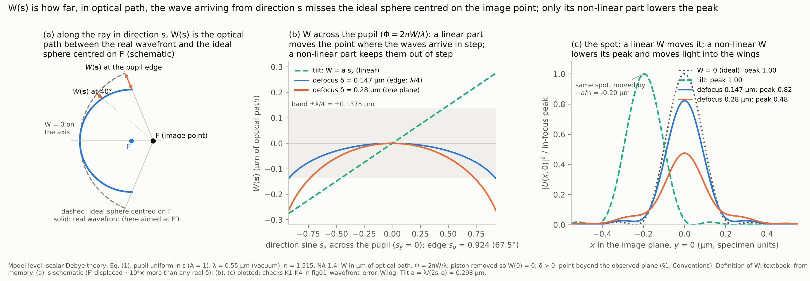
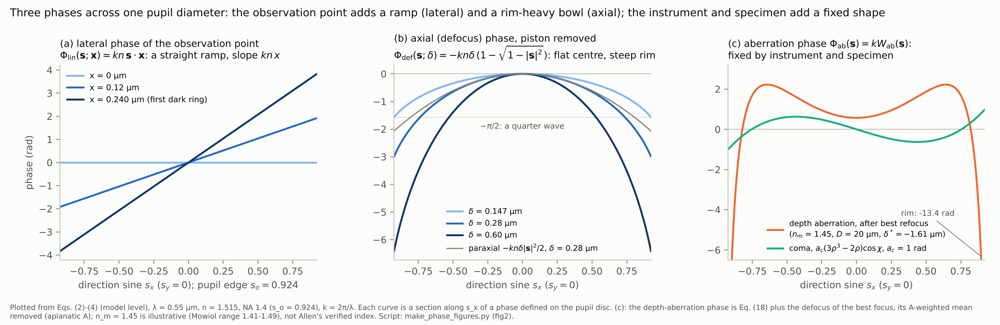
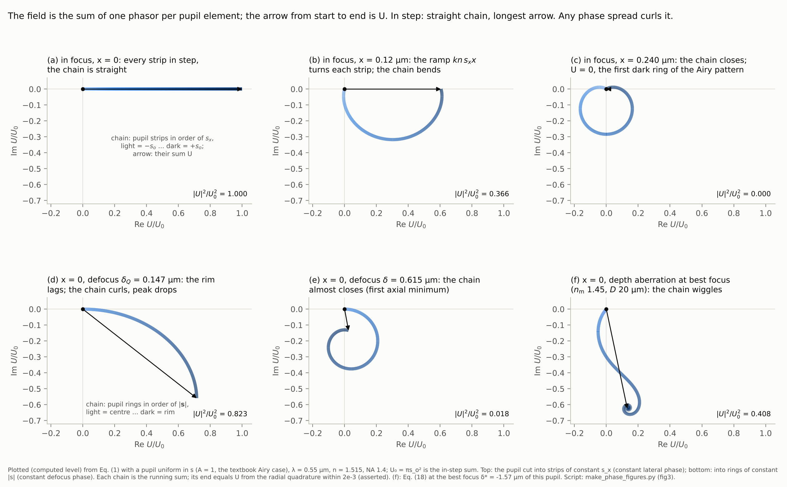
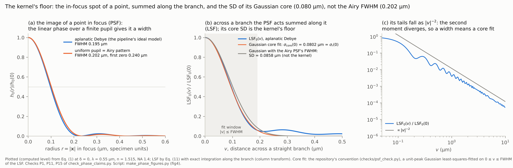
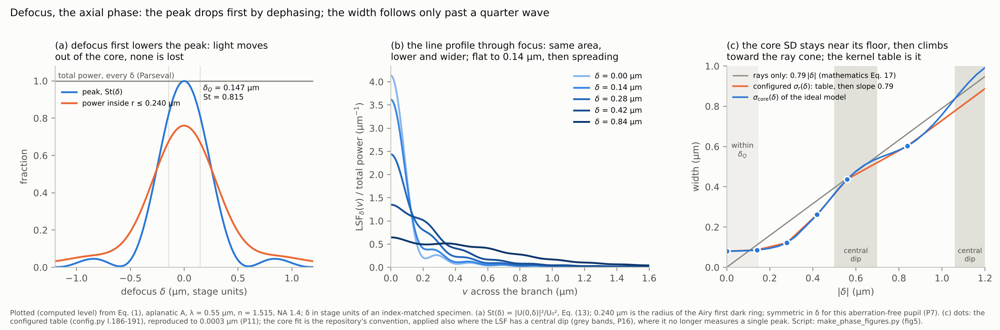
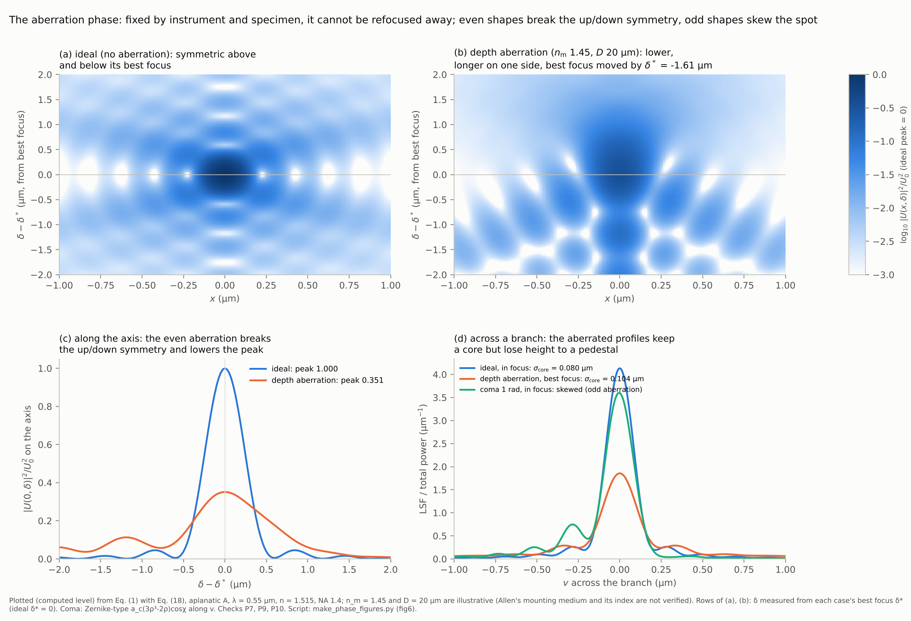
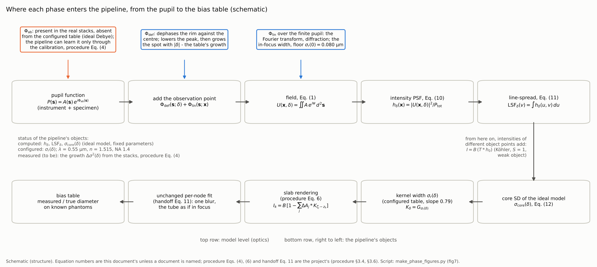

# The phase in the pupil: how aberration, defocus and the lateral phase shape the image of a point, and what they make of diffraction, blur and the defocus kernel

**Date:** 2026-11-04

**Project:** Towards EEG, diameter re-measurement from the Allen 63× brightfield stacks. Theory topic **T7** (optics of the microscope, the renderers and the defocus kernel; open). **Where this file lives:** `Passive Features/Diameter Re-measurement/docs/TEEG_diameter_pupil_phase_2026-11-04/` (branch `theory/pupil-phase-2026-11-04`, on top of the 2026-11-02 presentation handoff), with `figures/` beside it. The `scripts/` named in §4 are standalone checks and figure makers, not pipeline code. They were delivered with the document as files and, by the topic-document rule, are not committed to the repository.

**Abstract.** The camera records intensity, yet the image of a point is decided by phases: the image is a sum of plane waves, one per point of the objective's pupil, and the intensity of a sum depends on how the phases of its terms differ. Three phases add across the pupil:

- the **aberration phase** that the instrument and the specimen impose;
- the **defocus phase** set by how far the observed plane lies from the point along the axis;
- the **linear phase** set by where in the plane the field is evaluated.

This document answers one question: what does each of the three do to the image of a point, and how do they make the diffraction-limited spot, the blur of a dendrite's image and the pipeline's defocus kernel $K_\delta$?

Covered:

- the scalar Debye model with the three phases written apart;
- the phasor picture of "in step" and "out of step";
- the linear phase as a Fourier transform, the Airy pattern and the shift theorem;
- the defocus phase and why it lowers the peak before it widens the spot;
- the Strehl ratio, the Maréchal approximation and the quarter-wave tolerance;
- energy conservation, the axial minima and the geometric limit;
- the aberration phase: what refocusing can and cannot remove, even against odd shapes, and the depth (index-mismatch) aberration with its focal shift;
- the step from the image of a point to the image of a dendrite (incoherent blur, the line-spread function, the slab rendering);
- where each phase enters the configured kernel table and its calibration.

Deliberately excluded:

- vector (polarisation) effects, which matter at NA 1.4 and which the scalar model ignores;
- partial coherence beyond the incoherent limit (optics document §3.6);
- the specimen's own phase, its refractive-index structure (phase contrast);
- the spectrum of the lamp, which enters only through the wavelength scaling;
- the camera chain;
- the statistics of the bias table.

Sources consulted:

- project documents: the optics document (v1.5), the bias-table mathematics and procedure documents, the optics notes, the user's handoff, the decision log, the 2026-11-02 presentation handoff, and the code `config.py` and `model/kernel.py`;
- full texts read through PubMed Central: Booth et al. 2015, Kner et al. 2010, McGorty et al. 2014, Fouquet et al. 2015;
- one abstract (Zheng et al. 2013, flagged);
- checks by computation run for this document: 21 checks (P0–P16 and K1–K4), all passed (§4, Check sources).

Searches that returned nothing usable:

- PubMed: "aberrations adaptive optics microscopy pupil phase point spread function review" (0 records); "high numerical aperture point spread function defocus Debye integral computation microscopy" (0); "adaptive optics high-resolution imaging primer aberrations Zernike" (0); "depth of field defocus quarter wave Rayleigh criterion microscope" (0).
- PubMed, records found but none in PubMed Central, so not used: "Marechal approximation Strehl ratio" (1 record); "optical transfer function autocorrelation pupil function aberration" (3); "Gibson Lanni point spread function model" (3).
- bioRxiv: the connector has no keyword search; one category query (bioengineering, last 60 days, 30 records) returned nothing on optics.

---

## 1. Notation and Symbols

Two spaces are connected throughout: the **pupil** ($\mathbf s$-space, the objective's back focal plane, one point per plane-wave direction) and the **image** ($\mathbf x$-space, the observed plane in specimen units). The map from the first to the second is Eq. (1); at focus it is a two-dimensional Fourier transform. The column "Status" is the object's status in the pipeline (Provenance model): *analytic* (closed form), *configured* (a set value), *measured*, *computed* (a deterministic function of the others), *derivation-only* (appears in the justification, never evaluated by the pipeline), *not verified*.

| Symbol | Name / Meaning | Type & domain | Units | First used in § | Status |
|---|---|---|---|---|---|
| $\lambda$ | vacuum wavelength of the light; model value 0.55 µm | $\lambda \in \mathbb R_{>0}$ | µm | 3.1 | configured; the effective wavelength of Allen's LED through DAB is not known |
| $k$ | vacuum wavenumber, $2\pi/\lambda$ | $\mathbb R_{>0}$ | rad µm⁻¹ | 3.1 | computed |
| $n$ | refractive index of the immersion oil, and of a specimen matched to it; 1.515 | $\mathbb R_{>0}$ | dimensionless | 3.1 | configured (oil type not reported) |
| NA | numerical aperture of the objective, $n\sin\theta_o$ = 1.4 | $\mathbb R_{>0}$ | dimensionless | 3.1 | configured from Allen's reported objective |
| $\theta_o$ | half-angle of the objective's cone in the oil, $\arcsin(\mathrm{NA}/n)$ = 67.5° | $(0, \pi/2)$ | rad (or °) | 3.1 | computed |
| $\mathbf s = (s_x, s_y)$ | direction sines of one plane wave in the oil (the lateral components of its unit direction); one point of the pupil | $\mathbf s \in \mathbb R^2$, $\lvert\mathbf s\rvert \le s_o$; pupil space | dimensionless | 3.1 | analytic (a coordinate) |
| $s_o$ | radius of the pupil in direction sines, $\mathrm{NA}/n$ = 0.924 | $(0, 1)$ | dimensionless | 3.1 | computed |
| $\vartheta$ | tilt of the plane wave $\mathbf s$ to the optical axis, $\sin\vartheta = \lvert\mathbf s\rvert$, $\cos\vartheta = \sqrt{1 - \lvert\mathbf s\rvert^2}$ | $[0, \theta_o]$ | rad | 3.1 | analytic |
| $\rho$, $\chi$ | polar coordinates of the pupil: $\rho = \lvert\mathbf s\rvert/s_o$, $\chi$ the azimuth of $\mathbf s$ | $\rho \in [0,1]$, $\chi \in [0, 2\pi)$; pupil space | dimensionless; rad | 3.4 | analytic |
| $\mathbf x = (x, y)$, $r$ | lateral position of the observation point in the observed plane, in specimen units; $r = \lvert\mathbf x\rvert$ | $\mathbf x \in \mathbb R^2$; image space | µm | 3.1 | analytic |
| $\delta$ | axial offset of the observed plane from the point, in stage units; sign in Conventions | $\delta \in \mathbb R$ | µm | 3.1 | analytic; in the renderer $\delta = \zeta_j - z_k$ |
| $A(\mathbf s)$ | pupil amplitude: aperture and apodisation. Three forms are used. Aplanatic $(1-\lvert\mathbf s\rvert^2)^{-1/4}$ is the pipeline's ideal model ($\sqrt{\cos\vartheta}$ per unit solid angle). Uniform, $A = 1$, gives the Airy pattern. Isotropic, $(1-\lvert\mathbf s\rvert^2)^{-1/2}$, is used for one closed form | map $\{\lvert\mathbf s\rvert \le s_o\} \to \mathbb R_{>0}$ | dimensionless | 3.1 | configured (aplanatic); whether it describes the shadow of a condenser-lit absorber is not established |
| $P(\mathbf s)$ | pupil function, $A(\mathbf s)\,e^{i\Phi_{\rm ab}(\mathbf s)}$ | map pupil $\to \mathbb C$ | dimensionless | 3.1 | not verified (Allen's real $\Phi_{\rm ab}$ is unknown) |
| $\Phi_{\rm lin}(\mathbf s;\mathbf x)$ | lateral (linear) phase, Eq. (2) | for each fixed $\mathbf x$, map pupil $\to \mathbb R$ | rad | 3.1 | analytic |
| $\Phi_{\rm def}(\mathbf s;\delta)$ | defocus (axial) phase, Eq. (3), with its constant part removed | for each fixed $\delta$, map pupil $\to \mathbb R$ | rad | 3.1 | analytic |
| $\Phi_{\rm ab}(\mathbf s)$ | aberration phase of instrument and specimen, Eq. (4) | map pupil $\to \mathbb R$ | rad | 3.1 | not verified; absent from the configured kernel |
| $\Psi(\mathbf s;\mathbf x,\delta)$ | total phase of the plane wave $\mathbf s$ at the observation point, $\Phi_{\rm ab} + \Phi_{\rm def} + \Phi_{\rm lin}$ | for each $(\mathbf x, \delta)$, map pupil $\to \mathbb R$ | rad | 3.1 | analytic |
| $W_{\rm def}(\mathbf s;\delta)$, $W_{\rm ab}(\mathbf s)$ | wavefront errors in optical path: $\Phi_{\rm def} = kW_{\rm def}$, $\Phi_{\rm ab} = kW_{\rm ab}$ | maps pupil $\to \mathbb R$ | µm of optical path | 3.1 | analytic / not verified |
| $W(\mathbf s)$ | a wavefront error of any cause (Figure 1); $W_{\rm def}$ and $W_{\rm ab}$ are its two kinds here | map pupil $\to \mathbb R$ | µm of optical path | 3.1 | analytic |
| F, F′ | Figure 1 only: the image point (centre of the reference sphere); the point on which a defocused wavefront is centred | points of object space | — | 3.1 | analytic |
| $a$ | Figure 1 only: tilt coefficient of $W = a\,s_x$, $a = \lambda/(2s_o)$ = 0.298 µm of path; the spot moves by $-a/n$, so $a = n\lvert\mathbf a\rvert$ with $\mathbf a$ of Eq. (8) | $\mathbb R$ | µm of optical path | 3.1 | analytic (illustrative) |
| $d\Omega$ | element of solid angle of directions, $d^2\mathbf s = \cos\vartheta\,d\Omega$ | measure on directions | sr | 3.1 | analytic |
| $\nu$ | spatial frequency conjugate to $\mathbf x$, $\nu = n\mathbf s/\lambda$ | $\mathbb R^2$; pupil space rescaled | cycles µm⁻¹ | 3.2 | analytic |
| $r_1$ | radius of the first dark ring of the in-focus spot | $\mathbb R_{>0}$ | µm | 3.2 | computed |
| $U(\mathbf x,\delta)$ | complex amplitude (scalar field) of the image of a point, Eq. (1); a functional of the pupil function $P$ | for each $\delta$, map image plane $\to \mathbb C$ | field units ($A \cdot$ area of $\mathbf s$) | 3.1 | computed here; derivation-only in the pipeline, whose renderer uses $\sigma_r$ only |
| $U_0$ | the in-step sum $\iint A\,d^2\mathbf s$, which is $U(\mathbf 0, 0)$ for an aberration-free pupil | $\mathbb R_{>0}$ | as $U$ | 3.1 | computed |
| $P_{\rm tot}$ | total power of the spot, $\iint \lvert U\rvert^2 d^2\mathbf x$, Eq. (9) | $\mathbb R_{>0}$ | $\lvert U\rvert^2$ µm² | 3.2 | computed |
| $h_\delta(\mathbf x)$ | intensity point-spread function at offset $\delta$, normalised to unit power, Eq. (10) | for each $\delta$, map image plane $\to \mathbb R_{\ge 0}$ with $\iint h_\delta\,d^2\mathbf x = 1$ | µm⁻² | 3.2 | computed (here and by the repository's `checks/`); derivation-only in the renderer |
| $u$, $v$ | coordinates in the observed plane along and across a straight branch | $\mathbb R$; image space | µm | 3.2 | analytic |
| $\mathrm{LSF}_\delta(v)$ | line-spread function, $\int h_\delta(u, v)\,du$, Eq. (11) | for each $\delta$, map $\mathbb R \to \mathbb R_{\ge 0}$, unit area | µm⁻¹ | 3.2 | computed; derivation-only in the renderer |
| $\sigma_{\rm core}(\delta)$ | Gaussian-core width of $\mathrm{LSF}_\delta$, Eq. (12): an SD, a property of the ideal optical model | $\mathbb R_{>0}$ | µm | 3.2 | computed |
| $v_n$, $\mathrm{FWHM}[\cdot]$ | sample points of $v$ in Eq. (12); full width at half maximum of a profile | $v_n \in \mathbb R_{\ge 0}$; FWHM maps a profile to $\mathbb R_{>0}$ | µm | 3.2 | analytic |
| $\sigma_r(\delta)$ | the renderer's kernel SD. Configured equal to $\sigma_{\rm core}$ at six offsets, linear between them, slope 0.79 beyond 0.84 µm | for each $\delta$, $\mathbb R_{>0}$ | µm | 3.2 | configured; $\sigma_r(0)$ is never identified by the stacks |
| $K_\delta$, $G_\sigma$ | the renderer's kernel $K_\delta = G_{\sigma_r(\delta)}$; $G_\sigma$ is the unit-integral circular 2-D Gaussian of SD $\sigma$ | maps image plane $\to \mathbb R_{>0}$ | µm⁻² | 3.5 | configured |
| $\beta$ | dimensionless radius $2\pi\,\mathrm{NA}\,r/\lambda$ of the Airy formula | $\mathbb R_{\ge 0}$ | dimensionless | 3.2 | analytic |
| $J_0$, $J_1$ | Bessel functions of the first kind, orders 0 and 1 | $\mathbb R \to \mathbb R$ | dimensionless | 3.2 | analytic |
| $\mathbf a$ | lateral displacement in the shift theorem, Eq. (8) | $\mathbb R^2$; image space | µm | 3.2 | analytic |
| $\mathrm{St}(\delta;\Phi_{\rm ab})$ | Strehl ratio at $\mathbf x = \mathbf 0$: $\lvert U(\mathbf 0,\delta)\rvert^2/U_0^2$ for the pupil with aberration phase $\Phi_{\rm ab}$, Eq. (13). Written $\mathrm{St}(\delta)$ when $\Phi_{\rm ab} = 0$ (Conventions) | $[0, 1]$ | dimensionless | 3.3 | computed |
| $\Phi_{\rm rms}$ | RMS of a pupil phase about its mean, weighted by $A$ over the pupil | $\mathbb R_{\ge 0}$ | rad | 3.3 | computed |
| $\langle\cdot\rangle$ | average over the pupil with weight $A$, $\langle f\rangle = \iint A f\,d^2\mathbf s/\iint A\,d^2\mathbf s$ | maps functions on the pupil to $\mathbb R$ or $\mathbb C$ | as $f$ | 3.3 | analytic |
| $\mathrm{sinc}$ | $\mathrm{sinc}(q) = \sin q/q$ | $\mathbb R \to \mathbb R$ | dimensionless | 3.3 | analytic |
| $\delta_Q$ | quarter-wave defocus: the rim lags the centre by $\pi/2$, Eq. (15) | $\mathbb R_{>0}$ | µm | 3.3 | computed (0.147 µm) |
| $m$ | order of an axial minimum | $m \in \{1, 2, \dots\}$ | dimensionless | 3.3 | analytic |
| $\sigma_{\rm geo}(\delta)$, $\gamma$ | RMS width of the line profile in the ray picture, $\sigma_{\rm geo} = \gamma\lvert\delta\rvert$ (mathematics doc Eq. 17); $\gamma$ = 0.79 for the aplanatic weighting | $\mathbb R_{\ge 0}$; $\mathbb R_{>0}$ | µm; dimensionless | 3.3 | analytic; $\gamma$ configured as the kernel's far slope |
| $n_{\rm m}$ | refractive index of the mounting medium and specimen around the point | $\mathbb R$, here $n_{\rm m} \ge$ NA | dimensionless | 3.4 | not verified; 1.45 is illustrative |
| $\theta_{\rm m}$ | angle in the medium of the ray belonging to $\mathbf s$, $n_{\rm m}\sin\theta_{\rm m} = n\lvert\mathbf s\rvert$ | $[0, \pi/2)$ | rad | 3.4 | analytic |
| $D$ | true depth of the point below the coverslip | $\mathbb R_{\ge 0}$ | µm of tissue | 3.4 | not verified |
| $z_f$ | nominal depth of the focal plane, in stage units (the optics document's $s$ in its Eq. 9) | $\mathbb R$ | µm (stage) | 3.4 | measured (stage position) |
| $\Phi_{\rm SA}(\mathbf s;D)$ | depth (index-mismatch) aberration phase, Eq. (18) | for each $D$, map pupil $\to \mathbb R$ | rad | 3.4 | analytic formula; its parameters are not verified |
| $\delta^*$ | best focus: the $\delta$ that maximises $\lvert U(\mathbf 0,\delta)\rvert$ for a given $\Phi_{\rm ab}$ | $\mathbb R$ | µm | 3.4 | computed |
| $a_c$ | coefficient of the coma phase $a_c(3\rho^3 - 2\rho)\cos\chi$ | $\mathbb R$ | rad | 3.4 | analytic (illustrative) |
| $\Delta\sigma^2(\delta)$ | growth of the squared core width with defocus, calibrated from the stacks (procedure Eq. 4) | for each $\delta$, $\mathbb R$ | µm² | 3.4 | measured (pilot only; no production kernel) |
| $T$, $B$, $I$ | transmittance of the specimen; background grey level; image grey level | $T$: image plane $\to [0, 1]$; $B \in \mathbb R_{>0}$; $I$: image plane $\to \mathbb R_{\ge 0}$ | dimensionless; grey level | 3.5 | model objects (the renderer's $B$ is configured) |
| $S$ | coherence parameter, condenser NA over objective NA | $\mathbb R_{\ge 0}$ | dimensionless | 3.5 | not verified (Allen's aperture-diaphragm setting is unknown) |
| $\zeta_j$, $z_k$, $\Delta A_j$, $J$, $I_k$ | in procedure Eq. (6): depth of slab $j$; depth of rendered plane $k$; fraction of the light absorbed in slab $j$; number of slabs; the rendered plane | $\zeta_j, z_k \in \mathbb R$; $\Delta A_j$: image plane $\to [0, 1]$; $J \in \mathbb N$ | µm (stage); dimensionless | 3.5 | as in the procedure |
| $\sigma_{\rm fit}$ | fixed blur SD of the per-node fit (handoff Eq. 11), 0.099 µm | $\mathbb R_{>0}$ | µm | 3.5 | configured (D-023, provisional) |
| $g_{\sigma_{\rm fit}}$ | the per-node fit's one-dimensional Gaussian of SD $\sigma_{\rm fit}$ | $\mathbb R \to \mathbb R_{>0}$ | µm⁻¹ | 2 | configured |
| $d$ | diameter of a dendrite (a tube) | $\mathbb R_{>0}$ | µm | 3.2 | the quantity the pipeline estimates |
| $*$ | convolution over the image plane (or along $v$) | operator | — | 3.5 | — |

### Conventions

- **Units and spaces.** Lateral positions $\mathbf x$, $u$, $v$ are in specimen (object-space) µm; the camera's 0.1144 µm pixel is already in these units. Axial offsets $\delta$, $z_f$, $z_k$, $\zeta_j$ are in **stage units**. For an index-matched specimen these equal tissue depth; otherwise they do not (§3.4).
- **Direction sines** $\mathbf s$ are measured in the oil. A plane wave with direction sines $\mathbf s$ travels along $(\mathbf s, \sqrt{1-\lvert\mathbf s\rvert^2})$.
- **Sign of $\delta$.** $\delta > 0$ when the point lies beyond the observed plane along the direction of travel of the plane waves in Eq. (1). For a point at true depth $D$ observed with the nominal focal plane at $z_f$, both measured from the coverslip away from the objective, $\delta = D - z_f$ (index-matched case). The renderer's $\delta = \zeta_j - z_k$ has the same form; whether Allen's plane index increases away from the objective is not verified (procedure §3.6). For an aberration-free pupil the sign does not matter (§3.3); with an even aberration it does (§3.4).
- **Phase convention.** Fields carry $e^{+i\Psi}$; the time factor $e^{-i\omega t}$ multiplies every plane wave alike and is dropped. The camera records the time average $\propto \lvert U\rvert^2$.
- **Pieces of the defocus phase.** The constant $kn\delta$ is removed from $\Phi_{\rm def}$; a phase constant over the pupil (piston) changes nothing measurable (§3.1).
- **Strehl ratio** is evaluated at $\mathbf x = \mathbf 0$, the point where an aberration-free pupil puts all waves in step, not at the maximum of the spot. $\mathrm{St}(\delta)$ without a second argument means $\Phi_{\rm ab} = 0$. This abbreviation is used in §3.3 only. In §3.4 the aberration is always written, $\mathrm{St}(\delta;\Phi_{\rm SA})$.
- **One pupil at a time.** $U$, $h_\delta$, $\mathrm{LSF}_\delta$, $\sigma_{\rm core}$, $P_{\rm tot}$ are functionals of the pupil function $P$. Each section states which $A$ and $\Phi_{\rm ab}$ it uses; where two pupils are compared, the case is named at each use.
- **Operators and orders.** An overline is the complex conjugate; $\nabla_{\mathbf s}$ is the gradient with respect to $\mathbf s$; $O(\Phi^3)$ collects terms of third and higher order in the phase. In the time factor $e^{-i\omega t}$, $\omega$ is the angular frequency of the light (rad s⁻¹) and $t$ the time (s); both appear only to be dropped.
- **Scalar approximation** throughout; numbers are at $\lambda$ = 0.55 µm, $n$ = 1.515, NA 1.4. Lengths scale linearly with $\lambda$ (0.45–0.65 µm moves them by −18 % / +18 %).
- **Notation clashes with other project documents.** $W$ is a wavefront error here; in the renderers and sine-condition documents $W$ is the ray world's measure of directions. $s$ is the stage depth in the optics document's Eq. (9); here it is $z_f$, and $\mathbf s$ is a direction. $S$ is the coherence parameter; the Strehl ratio is $\mathrm{St}$.

---

## 2. Glossary / Jargon

Ordering: by first appearance, because the terms build on each other.

- **Pupil (back focal plane)**: the plane behind the objective where each point corresponds to one direction of light at the specimen. "The pupil" in this document is that set of directions, the disc $\lvert\mathbf s\rvert \le s_o$. Operative in §3.1.
- **Direction sines**: the two lateral components $(s_x, s_y)$ of a unit direction vector. They label plane waves by their tilt and azimuth, and they are the natural coordinates of the pupil of an aplanatic objective. Operative in §3.1.
- **Plane-wave (angular-spectrum) decomposition; Debye integral**: writing the field near focus as a sum of plane waves, one per pupil direction, each weighted by the pupil function. The Debye integral, Eq. (1), is that sum for a high-NA objective. It is valid when the focal region is small compared with the distance to the pupil. Operative in §3.1.
- **Phasor**: a complex number drawn as an arrow, its length the amplitude and its angle the phase. Adding waves is adding arrows head to tail. Operative in §3.1.
- **In step**: all phasors of a sum have the same phase; the arrows line up and the sum is as long as it can be. Operative in §3.1.
- **Piston**: a phase that is the same for every pupil point. It rotates all arrows together and changes no intensity. Operative in §3.1.
- **Optical path; wavefront error**: optical path is refractive index times geometric length. The wavefront error $W(\mathbf s)$ is how much optical path the wave from direction $\mathbf s$ has gained or lost relative to an ideal spherical wave centred on the chosen image point (the **reference sphere**); its phase is $kW$. Operative in §3.1.
- **Apodisation; aplanatic; sine condition**: apodisation is a non-uniform amplitude $A(\mathbf s)$ across the pupil. An aplanatic objective obeys the sine condition (pupil position proportional to $\sin\vartheta$, the sine-condition document). For a point source it gives amplitude $\sqrt{\cos\vartheta}$ per unit solid angle, which is $(1-\lvert\mathbf s\rvert^2)^{-1/4}$ per unit area of $\mathbf s$. Operative in §3.1.
- **Fourier transform; shift theorem; Parseval (Plancherel) theorem**: at focus, Eq. (1) is a Fourier transform of the pupil function. A linear phase in the pupil shifts the image (shift theorem, Eq. 8). The total power of the image equals that of the pupil, whatever the phases (Parseval, Eq. 9). Operative in §3.2.
- **Diffraction**: the spreading of a wave that a finite aperture lets through. It is not refraction and not scattering, and it happens in a perfect, uniform medium. "Diffraction-limited" describes a system whose only blur is this one, with $\Phi_{\rm ab} = 0$. Operative in §3.2.
- **Airy pattern**: the in-focus intensity image of a point through a uniformly filled circular pupil, $[2J_1(\beta)/\beta]^2$: a bright disc and faint rings. Operative in §3.2.
- **Point-spread function (PSF)**: the image of a point. The amplitude PSF is $U$; the intensity PSF is $h_\delta = \lvert U\rvert^2$ normalised to unit power. Unqualified, "PSF" here means the intensity PSF. Operative in §3.2.
- **Line-spread function (LSF)**: the image of a thin straight line, the PSF summed along the line. It is the blur profile across a straight branch. Operative in §3.2.
- **Gaussian-core width**: the SD of a unit-peak Gaussian least-squares-fitted to the peak-normalised LSF within one LSF FWHM of the axis (the repository's convention). It is not a second moment and not a FWHM. Operative in §3.2.
- **Defocus**: the observed plane lies an axial distance $\delta$ from the point. In the pupil this appears as the phase $\Phi_{\rm def}$, Eq. (3). Operative in §3.3.
- **Paraxial approximation**: keeping only the lowest order in the tilt, $\sqrt{1-\lvert\mathbf s\rvert^2} \approx 1 - \lvert\mathbf s\rvert^2/2$. At NA 1.4 it underestimates the defocus phase at the rim by a factor 1.45 (§3.3). Operative in §3.3.
- **Strehl ratio**: the intensity at the ideal image point relative to that of the aberration-free spot, Eq. (13). It measures how far the phasors are from being in step. Operative in §3.3.
- **Maréchal approximation**: for small phase errors, $\mathrm{St} \approx \exp(-\Phi_{\rm rms}^2)$, Eq. (14). It fails for large ones (§3.4). Operative in §3.3.
- **Quarter-wave (Rayleigh) tolerance**: a wavefront error of at most a quarter wavelength peak to valley. It is traditionally the limit of "practically perfect" imaging. Operative in §3.3.
- **Encircled power (energy)**: the fraction of a spot's power inside a radius. Operative in §3.3.
- **Stationary phase; geometric (ray) limit**: for large phase variation across the pupil, the integral of Eq. (1) is dominated by the pupil points where the total phase is stationary. Those points are the rays, and the wave spot approaches the ray spot. Operative in §3.3.
- **Aberration**: three senses are live in this document.
  1. The deviation of the real wavefront from the reference sphere caused by the instrument and the specimen, $W_{\rm ab}$. This is the sense used unless stated.
  2. Any wavefront error relative to a chosen reference point, including defocus and tilt.
  3. One of the standard modes into which a wavefront error is decomposed (Zernike modes).

  Operative in §3.4. Everyday sense differs: not "a defect" but a precise phase map.
- **Zernike modes (tilt, defocus, spherical aberration, coma, astigmatism)**: an orthogonal set of polynomials on the unit disc used to describe wavefront errors. Spherical aberration is rotationally symmetric and even. Coma is odd and has one azimuthal period. Operative in §3.4.
- **Even and odd aberrations**: even aberrations are unchanged by $\mathbf s \to -\mathbf s$ (spherical, astigmatism); odd ones change sign (tilt, coma). Even ones break the up/down symmetry of focus; odd ones skew or shift the spot. Operative in §3.4.
- **Depth (index-mismatch) aberration; focal shift**: when the specimen's index $n_{\rm m}$ differs from the oil's, the optical path from a point at depth $D$ depends on the direction. This adds a depth-dependent phase, Eq. (18), mostly of spherical shape. Its defocus-like part moves the best focus away from the nominal one (focal shift). Operative in §3.4.
- **Best focus**: the observed-plane offset $\delta^*$ that maximises the intensity on the axis of the point's image. Operative in §3.4.
- **Pedestal**: a broad, low skirt of light around the central peak, made by aberrations that move power out of the peak without much widening the peak itself. Operative in §3.4.
- **Shift invariance (isoplanatism)**: the blur is the same function at every lateral position. The pipeline's kernel assumes it. Operative in §3.4.
- **Incoherent imaging; Köhler illumination; weak object**: in Köhler illumination each point of the condenser aperture lights the specimen with one plane wave, and different points are mutually incoherent. With the aperture filled ($S$ = 1) and a weakly absorbing specimen, the image is the transmittance blurred by the intensity PSF: intensities, not fields, of different object points add. Operative in §3.5.
- **Blur**: two senses.
  1. The operation: convolution of the object with the intensity PSF.
  2. The spread itself, the width of the PSF or LSF.

  In §3.5 the operation is meant; elsewhere the spread. Operative in §3.5.
- **Kernel**: two senses in the pipeline.
  1. The per-node fit's single fixed Gaussian $g_{\sigma_{\rm fit}}$ (handoff Eq. 11).
  2. The renderer's defocus kernel $K_\delta = G_{\sigma_r(\delta)}$ (procedure §3.4).

  "The kernel" unqualified means the second. Operative in §3.5.
- **Stage units**: axial positions read from the focus drive. They equal tissue depth only for an index-matched specimen. Operative in §3.4.

---

## 3. Main body

### 3.1 The image of a point is a sum of plane waves, and only differences of their phases shape it

*This section establishes the model the rest uses: the field of the image of a point as a sum over the pupil, Eq. (1), with its phase split into the three parts the question names, Eqs. (2)–(4). It also establishes the one inequality that turns every later effect into "the waves are, or are not, in step", Eq. (5).*

A single plane wave has the same intensity everywhere, so its phase cannot be seen by a camera, and it is tempting to think the phase of the light is irrelevant to a brightfield image. Yet three observations about the Allen objective say otherwise:

- the in-focus image of a point has a width of about 0.2 µm that no lens can remove;
- a point 0.15 µm out of focus loses about a fifth of its peak while its width hardly changes;
- a mismatch between the mounting medium and the oil lowers the peak and moves the focus.

The resolution of the paradox is that the image of a point is not one wave but a sum of many, and the intensity of a sum depends on how the phases of its terms differ.

**The move, in words.** The objective accepts plane waves from every direction inside its cone. Label each direction by its direction sines $\mathbf s$, a point of the pupil disc $\lvert\mathbf s\rvert \le s_o = \mathrm{NA}/n = 0.924$. The field at an observation point is the sum of these plane waves, each with an amplitude $A(\mathbf s)$ and a phase. The observation point is the lateral position $\mathbf x$ in a plane that lies $\delta$ from the point along the axis. The phase of the wave from $\mathbf s$ has three parts:

- one fixed by the instrument and the specimen;
- one fixed by $\delta$;
- one fixed by $\mathbf x$.

In symbols [TXT: the Debye integral of a high-NA objective, Richards & Wolf 1959; the same form as the model of the 2026-11-02 presentation handoff, KB: presentation handoff §6.2]:

$$U(\mathbf x,\delta) = \iint_{\lvert\mathbf s\rvert\le s_o} A(\mathbf s)\,\exp\!\Big\{i\big[\Phi_{\rm ab}(\mathbf s) + \Phi_{\rm def}(\mathbf s;\delta) + \Phi_{\rm lin}(\mathbf s;\mathbf x)\big]\Big\}\,d^2\mathbf s. \tag{1}$$

Reading of Eq. (1):

- **What it returns.** $U(\mathbf x,\delta)$ is the complex amplitude of the image of a point at the lateral position $\mathbf x$ (µm, specimen units) of a plane offset by $\delta$ (µm, stage units). It is a complex number for each fixed $(\mathbf x,\delta)$. The camera records $\lvert U\rvert^2$.
- **The domain of the integral, $\lvert\mathbf s\rvert \le s_o$.** These are the directions the objective accepts. That it is a bounded disc is the origin of diffraction (§3.2).
- **$A(\mathbf s)$** weights each direction. The pipeline's ideal model uses the aplanatic weight $(1-\lvert\mathbf s\rvert^2)^{-1/4}$, which is $\sqrt{\cos\vartheta}$ per unit solid angle: the change of variables is $d^2\mathbf s = \cos\vartheta\,d\Omega$ [OWN] [Certain]. The Airy pattern of textbooks uses $A = 1$. That the aplanatic weight describes the shadow of a condenser-lit absorber is not established [KB: optics doc §1, l.96–100].
- **The exponent** is the total phase $\Psi(\mathbf s;\mathbf x,\delta)$ of the wave from $\mathbf s$ at the observation point, the sum of the three phases below.
- **What the notation hides:**
  - a constant phase $kn\delta$, dropped from $\Phi_{\rm def}$ because it is the same for every $\mathbf s$;
  - the polarisation of light (the scalar approximation);
  - the Debye approximation (the focal region is small compared with the distance to the pupil);
  - the field units, which never matter because only ratios of $\lvert U\rvert^2$ are used.
- **Where it comes from.** Textbook wave optics [TXT]. Booth et al. write the point-spread function of a widefield microscope, in the scalar approximation, through the Fourier transform of the pupil function [FT: Booth 2015, DOI 10.1093/jmicro/dfv033] [Certain]. Their equation itself is not legible in the PubMed Central text. Eq. (1) at $\delta = 0$ is that transform (§3.2).

The three phases are

$$\Phi_{\rm lin}(\mathbf s;\mathbf x) = kn\,\mathbf s\cdot\mathbf x, \tag{2}$$

$$\Phi_{\rm def}(\mathbf s;\delta) = -kn\delta\,\Big(1-\sqrt{1-\lvert\mathbf s\rvert^2}\Big) = k\,W_{\rm def}(\mathbf s;\delta), \qquad W_{\rm def}(\mathbf s;\delta) = -n\delta\,\Big(1-\sqrt{1-\lvert\mathbf s\rvert^2}\Big), \tag{3}$$

$$\Phi_{\rm ab}(\mathbf s) = k\,W_{\rm ab}(\mathbf s). \tag{4}$$

Reading of Eqs. (2)–(4), each a map from the pupil to the reals, in radians:

- **Eq. (2), the lateral phase.** $kn$ is the wavenumber in the oil (17.31 rad µm⁻¹ [RUN: `scripts/numbers_in_text.py`] [Certain]). $\mathbf s\cdot\mathbf x$ is the extra path a wave tilted by $\mathbf s$ travels to reach $\mathbf x$ rather than the axis. For each fixed $\mathbf x$, Eq. (2) is linear in $\mathbf s$: a straight ramp across the pupil whose slope is $kn\mathbf x$ (Figure 2a).
- **Eq. (3), the axial (defocus) phase.** $\sqrt{1-\lvert\mathbf s\rvert^2} = \cos\vartheta$ is the axial component of the wave's direction. $kn\delta\cos\vartheta$ is the phase the wave gains in travelling $\delta$ along the axis. Removing the constant $kn\delta$ leaves Eq. (3).
  - It is zero on the axis ($\mathbf s = \mathbf 0$) and largest at the rim, where it is $-kn\delta\,(1-\cos\theta_o) = -10.69$ rad µm⁻¹ × $\delta$ [RUN: `scripts/numbers_in_text.py`; KB: optics doc Eq. 6a, "≈ 10.7"] [Certain].
  - Near the axis it is $\approx -kn\delta\lvert\mathbf s\rvert^2/2$; at the rim the exact value is 1.45 times this paraxial one (§3.3).
  - $W_{\rm def}$ is the same thing in µm of optical path.
- **Eq. (4), the aberration phase.** $W_{\rm ab}(\mathbf s)$ is the optical path by which the real wave from direction $\mathbf s$ misses the ideal spherical wave centred on the image point (the reference sphere; Figure 1a). Multiplying by $k$ turns path into phase. Booth et al. describe aberrations exactly so: a deviation of the wavefront expressed as an optical-path difference, whose phase varies inversely with the wavelength for a fixed path [FT: Booth 2015] [Certain]. Nothing about the observation point enters Eq. (4).

*Figure 1 — A wavefront error $W(\mathbf s)$ is the optical path by which the wave from direction $\mathbf s$ misses the ideal sphere centred on the image point. A linear $W$ (tilt) moves the spot unchanged; a curved $W$ (defocus) lowers its peak and puts light into the wings. [TXT: definition of $W$; RUN: `scripts/fig01_wavefront_error_W.py`, checks K1–K4] [Certain]. Scalar Debye model, pupil uniform in $\mathbf s$ ($A$ = 1), λ = 0.55 µm, $n$ = 1.515, NA 1.4. In (a), F is the image point and F′ the point a defocused wavefront is centred on. In (b) the tilt is $W = a\,s_x$ with $a = \lambda/(2s_o)$ = 0.298 µm of path, so the spot moves by $-a/n$ (Eq. 8). (a) schematic; (b), (c) plotted.*

**Where the lateral and axial phases come from, and why the split matters.**

1. *One object, two components.* A plane wave with wavevector $kn(\mathbf s, \cos\vartheta)$ has, at the point $(\mathbf x, \delta)$, the phase $kn(\mathbf s\cdot\mathbf x + \cos\vartheta\,\delta)$: its wavevector dotted with the position [TXT]. The lateral part is Eq. (2); the axial part, minus a constant, is Eq. (3). So $\Phi_{\rm lin}$ and $\Phi_{\rm def}$ are the two components of one object, the propagation phase from the focus to the observation point [OWN: Eqs. (1)–(3)] [Certain].
2. *What moving the observation point can do.* Moving the observation point changes $\Phi_{\rm lin}$ and $\Phi_{\rm def}$ and never $\Phi_{\rm ab}$. Hence any part of $\Phi_{\rm ab}$ with the shape of Eq. (2) or Eq. (3) can be cancelled by looking elsewhere, and no other part can (§3.4).
3. *Each phase across the pupil.* Figure 2 draws the three on one pupil diameter.

*Figure 2 — Across the pupil the three phases have three shapes: the lateral phase is a straight ramp whose slope grows with $\lvert\mathbf x\rvert$; the defocus phase is a bowl, flat in the centre and steep at the rim; the aberration phase is a fixed shape that the observation point cannot change. [OWN: Eqs. (2)–(4), (18); RUN: `scripts/make_phase_figures.py` fig2] [Certain]. Plotted for λ = 0.55 µm, $n$ = 1.515, NA 1.4. In (c) the depth aberration ($n_{\rm m}$ = 1.45, $D$ = 20 µm, illustrative) is shown after refocusing to its best focus $\delta^* = -1.61$ µm, with its $A$-weighted mean removed; its rim value, −13.4 rad, is off the scale.*

**The inequality behind every effect below.** The modulus of a sum is at most the sum of the moduli, with equality only when all terms point the same way. Applied to Eq. (1), with $A > 0$:

$$\lvert U(\mathbf x,\delta)\rvert \;\le\; \iint_{\lvert\mathbf s\rvert\le s_o} A(\mathbf s)\,d^2\mathbf s \;\equiv\; U_0, \qquad \text{with equality if and only if } \Psi(\mathbf s;\mathbf x,\delta) \text{ is constant (mod } 2\pi) \text{ on the pupil.} \tag{5}$$

Reading of Eq. (5):

- **What it bounds.** It bounds the field at any observation point, for any pupil, by $U_0$, the sum of the amplitudes alone. $U_0$ depends only on the aperture and the apodisation.
- **The equality clause** is the precise meaning of "the waves arrive in step": every phasor of the sum points the same way.
- **Proof.** The triangle inequality for integrals [OWN] [Certain]. For an aberration-free pupil the bound is reached only at $(\mathbf x,\delta) = (\mathbf 0, 0)$: on a grid of 101 radii × 61 offsets the largest $\lvert U\rvert/U_0$ is 1.000, at $r = 0$, $\delta = 0$ [RUN: `scripts/check_phase_claims.py` P2] [Certain].

A phase that is the same for every $\mathbf s$, a piston, multiplies $U$ by a unit complex number and changes no intensity. It is why the constant $kn\delta$ could be dropped, and it is the sense in which only phase *differences across the pupil* matter. Adding a piston of 0.123 µm of path changed $\lvert U\rvert^2$ by 3.7 × 10⁻¹⁶ of the peak [RUN: `scripts/fig01_wavefront_error_W.py` K3] [Certain].

Figure 3 draws Eq. (5) at work. The pupil is cut into elements, each a phasor; the phasors are laid head to tail. The arrow from the start of the chain to its end is $U$. In step, the chain is straight and the arrow longest; any spread of phases curls the chain and shortens the arrow. The top row curls it with the lateral phase, the bottom row with the axial phase and with an aberration. These are the next three sections.

*Figure 3 — The field is the sum of one phasor per pupil element. Lined up (in step), they give the longest resultant; the lateral ramp, the defocus bowl and an aberration each curl the chain and shorten it. [OWN: Eqs. (1), (5); RUN: `scripts/make_phase_figures.py` fig3, each chain's end asserted equal to $U$ from the radial quadrature within 2 × 10⁻³] [Certain]. Plotted for a pupil uniform in $\mathbf s$ ($A$ = 1, the Airy case), λ = 0.55 µm, $n$ = 1.515, NA 1.4. Top: strips of constant $s_x$ at the lateral offsets $x$ = 0, 0.12 and 0.240 µm in focus. Bottom, at $\mathbf x = \mathbf 0$: rings of constant $\lvert\mathbf s\rvert$ at $\delta = \delta_Q$ = 0.147 µm and at the first axial minimum, 0.615 µm for this pupil; then the depth aberration ($n_{\rm m}$ = 1.45, $D$ = 20 µm, illustrative) at its best focus.*

### 3.2 The lateral phase: why the spot has a width (diffraction)

*This section establishes that, at focus, the lateral phase makes the image of a point the Fourier transform of the pupil, Eqs. (6)–(7). It shows that the finite pupil is what gives the spot its width, and that a linear phase in the pupil only moves the spot, Eq. (8). It then follows the spot to the quantity the pipeline uses, the core width of the line-spread function, Eqs. (9)–(12).*

Geometric optics says that the rays from a point meet again in a point, so a perfect lens should image a point as a point. Eq. (1) says something else. Take the focal plane ($\delta = 0$) and an aberration-free pupil ($\Phi_{\rm ab} = 0$). At $\mathbf x = \mathbf 0$ the waves are in step. A little way off the axis each wave carries the ramp of Eq. (2): the waves from opposite sides of the pupil drift apart in phase and begin to cancel. In symbols:

$$U(\mathbf x, 0)\big|_{\Phi_{\rm ab}=0} = \iint_{\lvert\mathbf s\rvert\le s_o} A(\mathbf s)\,e^{\,ikn\,\mathbf s\cdot\mathbf x}\,d^2\mathbf s. \tag{6}$$

Reading of Eq. (6):

- **What it returns.** The in-focus field at the lateral position $\mathbf x$.
- **The integral** is a two-dimensional Fourier transform. It maps the pupil (the function $A$ on the disc, in $\mathbf s$-space) to the image plane ($\mathbf x$-space). The kernel $e^{ikn\mathbf s\cdot\mathbf x}$ is Eq. (2): the lateral phase is the Fourier kernel.
- **$\mathbf x$ and $kn\mathbf s$ are conjugate variables.** A pupil that extends to $s_o$ produces structure in $\mathbf x$ down to lengths of order $1/(kn s_o) = \lambda/(2\pi\,\mathrm{NA})$.
- **What it hides.** The scaling between the pupil coordinate and spatial frequency, $\nu = n\mathbf s/\lambda$ cycles per µm [OWN] [Certain].

For the uniformly filled circular pupil ($A = 1$) the transform has a closed form, the Airy amplitude [TXT]:

$$\frac{U(r, 0)}{U_0} = \frac{2J_1(\beta)}{\beta}, \qquad \beta = kn\,s_o\,r = \frac{2\pi\,\mathrm{NA}\,r}{\lambda}, \qquad \text{so} \qquad \frac{\lvert U(r,0)\rvert^2}{U_0^2} = \Big[\frac{2J_1(\beta)}{\beta}\Big]^2. \tag{7}$$

Reading of Eq. (7):

- **What it returns.** The in-focus field relative to its in-step value, as a function of the radius $r$ only (the pupil is round).
- **$\beta$** is the radius in units of $\lambda/(2\pi\mathrm{NA})$. It is also the lateral phase at the rim, $kn s_o r$: the ramp of Eq. (2) spans $2\beta$ across the pupil's diameter.
- **$2J_1(\beta)/\beta$** is the Fourier transform of a uniform disc. It is 1 at $\beta = 0$ and first vanishes at $\beta$ = 3.8317, where the ramp spans $2\beta$ = 7.66 rad, 1.22 turns, across the diameter.

Numbers at λ = 0.55 µm, NA 1.4:

| Spot | First zero | FWHM | Evidence |
|---|---|---|---|
| uniform pupil (Airy), Eq. (7) | $r_1$ = 0.6098 λ/NA = 0.2396 µm | 0.5145 λ/NA = 0.2021 µm | [RUN: `scripts/check_phase_claims.py` P1; quadrature agrees with Eq. (7) to 3 × 10⁻¹⁴] [Certain] |
| aplanatic pupil (the pipeline's ideal model) | 0.227 µm | 0.195 µm | [RUN: `scripts/numbers_in_text.py`, `scripts/make_phase_figures.py` fig4] [Certain] |

**Why the spot has a width: the finite pupil.** Figure 3a–c shows the mechanism with the pupil cut into strips of constant $s_x$; each strip has one lateral phase.

- *At $x = 0$:* all strips are in step and the chain is straight.
- *At $x$ = 0.12 µm:* the ramp turns successive strips by successive angles and the chain bends into an arc; $\lvert U\rvert^2/U_0^2$ = 0.366.
- *At $x$ = 0.240 µm:* the ramp spans 1.22 turns and the chain closes on itself: $U = 0$, the first dark ring [RUN: `scripts/make_phase_figures.py` fig3] [Certain].

The ramp's slope grows with $\lvert\mathbf x\rvert$, but its span is capped by the pupil's extent. A pupil reaching only $s_o$ needs a lateral distance of order $\lambda/\mathrm{NA}$ before its ramp can wind once. A pupil with no edge would need no distance at all, and the image would be a point [OWN: Eqs. (6)–(7)] [Certain]. Diffraction is this: the finite set of directions the objective accepts. The rings come from the pupil's sharp edge, the abrupt end of $A$ at $s_o$; a softly tapered pupil gives weaker rings [TXT] [Likely]. The aplanatic weight raises the rim against the centre, which narrows the central lobe a little (0.195 µm against 0.202 µm). The numbers are [RUN]; the causal reading is [OWN] [Likely].

So the user's formulation, "the linear phase acquired off $x = 0$ gives rise to the Airy pattern", is half of the mechanism.

- *The linear phase* is how the field changes with $\mathbf x$: it is the Fourier kernel.
- *The finite, uniformly filled circular pupil* is what the kernel transforms, and the Airy shape is its transform.

Without the linear phase there is no dependence on $\mathbf x$; without the finite pupil there is no width [OWN: Eqs. (6)–(7)] [Certain].

**A linear phase in the pupil only moves the spot.** Multiply the pupil function by a ramp $e^{ikn\mathbf s\cdot\mathbf a}$. In Eq. (1) the ramp joins the lateral phase, $kn\mathbf s\cdot(\mathbf x + \mathbf a)$:

$$P(\mathbf s)\;\to\;P(\mathbf s)\,e^{\,ikn\,\mathbf s\cdot\mathbf a} \quad\Longrightarrow\quad U(\mathbf x,\delta)\;\to\;U(\mathbf x+\mathbf a,\delta)\quad\text{for every }\mathbf x\text{ and }\delta. \tag{8}$$

Reading of Eq. (8):

- **What it says.** Eq. (8) is the shift theorem of the Fourier transform. A tilt of the wavefront, $W_{\rm ab} = n\,\mathbf s\cdot\mathbf a$, translates the image by $-\mathbf a$ and changes nothing else.
- **$\mathbf a$** is a displacement in the image plane (µm). The substitution holds for each fixed $\delta$, so it holds through focus.
- **Check.** It holds to 1.2 × 10⁻¹⁵ of the peak for $\mathbf a$ = (0.3, 0) µm at $\delta$ = 0.25 µm [RUN: `scripts/check_phase_claims.py` P3] [Certain]. In Figure 1c a tilt with $\pm\lambda/2$ of path at the rim moves the spot by −0.196 µm with its peak unchanged (0.99999) [RUN: `scripts/fig01_wavefront_error_W.py` K2] [Certain]. Booth et al. use the same fact for structured illumination: a tilt in the pupil shifts the illumination pattern [FT: Booth 2015] [Certain].

A tilt is therefore not a blur. The point "where all waves are in step" is simply wherever the ramps cancel.

**Power is only redistributed.** Whatever the phases, the total power in the image plane equals that of the pupil:

$$\iint_{\mathbb R^2}\lvert U(\mathbf x,\delta)\rvert^2\,d^2\mathbf x \;=\; \Big(\frac{\lambda}{n}\Big)^2\iint_{\lvert\mathbf s\rvert\le s_o} A(\mathbf s)^2\,d^2\mathbf s \;\equiv\; P_{\rm tot}\qquad\text{for every }\delta\text{ and every }\Phi_{\rm ab}. \tag{9}$$

Reading of Eq. (9):

- **What it states.** Eq. (9) is Parseval's theorem applied to Eq. (1) with the frequency $\nu = n\mathbf s/\lambda$. The factor $(\lambda/n)^2$ converts the area of the pupil to the area of frequency space.
- **The phases do not appear on the right.** All three phases have modulus one inside the exponential, so they drop out of $\lvert P\rvert^2$ [OWN] [Certain].
- **Check.** For the uniform pupil, the power inside 20 µm equals Rayleigh's closed form $1 - J_0^2 - J_1^2$ to 3 × 10⁻⁶. It changes by at most 3 × 10⁻⁵ between $\delta$ = 0, 0.147, 0.5 and 1.0 µm [RUN: `scripts/check_phase_claims.py` P5] [Certain]. Kner et al. make the same point experimentally: aberrations redistribute a point's energy without removing it [FT: Kner 2010, DOI 10.1111/j.1365-2818.2009.03315.x] [Certain].

The camera sees power density, so the image of a point is described by the intensity point-spread function, normalised to unit power:

$$h_\delta(\mathbf x) = \frac{\lvert U(\mathbf x,\delta)\rvert^2}{P_{\rm tot}}, \qquad \iint h_\delta(\mathbf x)\,d^2\mathbf x = 1. \tag{10}$$

Reading of Eq. (10): $h_\delta$ is a probability-like density over the image plane (µm⁻²) for each fixed $\delta$, and a functional of the whole pupil function. The phases shape it; Eq. (9) fixes its area.

**From the spot to the profile across a branch.** A dendrite is not a point. Across a straight branch, what acts is the PSF summed along the branch, the line-spread function. With $u$ along the branch and $v$ across it [KB: mathematics doc Eq. (9)]:

$$\mathrm{LSF}_\delta(v) = \int_{-\infty}^{\infty} h_\delta(u, v)\,du. \tag{11}$$

Reading of Eq. (11):

- **What it returns.** For each fixed $\delta$, a profile across the branch (µm⁻¹) with unit area.
- **The integral over $u$** adds up the spots of all the points along a straight line.
- **What it hides.** The branch is assumed straight and long compared with the spot. In Fourier terms, the LSF is the one-dimensional transform of a central slice of the spot's two-dimensional transfer function [TXT]. Computing the LSF both ways, by exact integration along $u$ and from the slice, agrees to 2 × 10⁻¹⁰ for the uniform pupil [RUN: `scripts/check_phase_claims.py` P15] [Certain].
- **Its tails.** The LSF's tails fall as $\lvert v\rvert^{-2}$, so its second moment is infinite (Figure 4c) [KB: optics doc l.441–442; mathematics doc §3.3; RUN: fig4] [Certain].
- **The consequence for widths.** A width of the LSF means a fit to its core, not a variance.

The repository's convention [KB: optics doc l.437–440; CODE: `checks/psf_check.py`] is

$$\sigma_{\rm core}(\delta) = \arg\min_{\sigma>0}\;\sum_{n:\;0\le v_n\le \mathrm{FWHM}[\mathrm{LSF}_\delta]}\Big[\frac{\mathrm{LSF}_\delta(v_n)}{\mathrm{LSF}_\delta(0)} - e^{-v_n^2/(2\sigma^2)}\Big]^2. \tag{12}$$

Reading of Eq. (12):

- **What it returns.** The SD (µm) of the unit-peak Gaussian that best matches the central part of the peak-normalised LSF.
- **The sum** runs over the sample points $v_n$ within one LSF full width at half maximum of the axis. The LSF is symmetric here, so one side suffices.
- **What it hides.**
  - The core width depends on the window: halving it (0 ≤ $v$ ≤ FWHM/2) moves the in-focus value from 0.0802 to 0.0817 µm [RUN: `scripts/numbers_in_text.py`] [Certain].
  - It assumes the LSF's maximum is at $v = 0$, which fails at some defocus (§3.3).
  - It is a property of the ideal optical model, not of the real microscope.

At focus, for the aplanatic model:

- $\sigma_{\rm core}(0)$ = 0.0802 µm [RUN: `scripts/check_phase_claims.py` P11] [Certain]. This is the configured $\sigma_r(0)$ = 0.080 µm, the floor of the renderer's kernel [CODE: `config.py` l.188, l.191].
- The LSF's FWHM is 0.191 µm [RUN: `scripts/numbers_in_text.py`] [Certain].
- Reading the Airy PSF's FWHM as a Gaussian FWHM would give an SD of 0.2021/2.355 = 0.0858 µm, 7 % wider (Figure 4b) [RUN: fig4] [Certain].

That $\sigma_r(0)$ is configured rather than measured is a provenance finding. The stacks cannot identify it: in the calibration of procedure Eq. (4) the in-focus part cancels into each node's constant [KB: procedure §3.4, l.333–334, l.366–368]. Its wavelength range, 0.066–0.095 µm over 450–650 nm, is propagated by rebuilding a reduced table at both ends [KB: procedure §3.10, l.637].

*Figure 4 — The floor of the defocus kernel is the SD of the Gaussian core of the in-focus spot summed along the branch, 0.080 µm, not the Airy FWHM, 0.202 µm. [RUN: `scripts/make_phase_figures.py` fig4; checks P1, P11, P15] [Certain]. Scalar Debye model at δ = 0, λ = 0.55 µm, $n$ = 1.515, NA 1.4; the LSF by Eq. (11) with exact integration along the branch; the core fit of Eq. (12). Plotted.*

**A worked case from the pipeline.** For a dendrite of diameter $d$ = 0.3 µm, the squared width of the tube's own profile is about 0.0056 µm². The squared in-focus core is 0.080² = 0.0064 µm² [KB: procedure §3.4, l.377–379]. The blur is as wide as the object, which is why the floor matters for thin dendrites and why its value is propagated as a systematic error.

**What it is confused with.** The width of a spot is not the resolution [KB: optics doc §3.4, l.411–428].

- The Airy FWHM (0.20 µm) describes how wide the image of one point is.
- The Rayleigh separation (0.24 µm, the first dark ring) describes when two points can be told apart.
- The original handoff's "FWHM ≈ 0.24 µm" was the first dark ring [KB: optics doc l.370–371] [corrected 2026-10-04 there].
- For the diameter of one tube of known shape, neither is a limit: it is an estimation problem [KB: optics doc l.430–435].

### 3.3 The axial phase: defocus lowers the peak before it widens the spot

*This section establishes what the defocus phase does to the image of a point, in order. First it dephases the rim against the centre and lowers the peak, Eqs. (13)–(15), while the width stays nearly flat and no power is lost. Then it darkens the centre at the axial minima, Eq. (16). Far from focus it approaches the ray cone, Eq. (17). This growth is what the kernel table holds.*

The ray picture of defocus predicts something simple. A point that lies $\delta$ from the observed plane images as a disc of radius $\lvert\delta\rvert\tan\theta_o$; one plane step (0.28 µm) gives 0.68 µm [KB: optics doc §3.5, Eq. 6]. The disc shrinks to nothing as $\delta \to 0$. The wave picture disagrees near focus. There the disc would be smaller than the diffraction spot of §3.2, the spot cannot shrink below that, and what changes first is not the width but the peak. This is the user's "the defocus lowers the peak due to the interferences", and the section makes it precise.

**The move.** On the axis ($\mathbf x = \mathbf 0$) the lateral phase vanishes, and an aberration-free pupil leaves only Eq. (3) in the exponent of Eq. (1).

- Rings of the pupil at different $\lvert\mathbf s\rvert$ now carry different phases: the rim lags the centre by $kn\lvert\delta\rvert(1-\cos\theta_o)$ = 10.69 rad µm⁻¹ × $\lvert\delta\rvert$.
- The chain of ring phasors curls (Figure 3d) and, by Eq. (5), the field at the image point falls.

The measure of that fall is the Strehl ratio:

$$\mathrm{St}(\delta) = \frac{\lvert U(\mathbf 0,\delta)\rvert^2}{U_0^2}\qquad(\Phi_{\rm ab} = 0). \tag{13}$$

Reading of Eq. (13):

- **What it returns.** A number in $[0,1]$: the intensity at the point where an in-focus, aberration-free spot has its peak, relative to that peak.
- **Its meaning.** By Eq. (5) it is 1 if and only if the phases are in step.
- **What it hides.** It is evaluated at $\mathbf x = \mathbf 0$, not at the maximum of the spot; for a tilted wavefront the two differ (§3.6).

For small phase spreads it follows from a second-order expansion. Write $\langle\cdot\rangle$ for the average over the pupil with weight $A$. Then $\langle e^{i\Phi}\rangle = 1 + i\langle\Phi\rangle - \langle\Phi^2\rangle/2 + O(\Phi^3)$, so $\lvert\langle e^{i\Phi}\rangle\rvert^2 = 1 - (\langle\Phi^2\rangle - \langle\Phi\rangle^2) + O(\Phi^3)$ [OWN] [Certain]. Maréchal's exponential form extends this [TXT]:

$$\mathrm{St} \approx 1 - \Phi_{\rm rms}^2 \approx \exp\!\big(-\Phi_{\rm rms}^2\big), \qquad \Phi_{\rm rms}^2 = \langle\Phi^2\rangle - \langle\Phi\rangle^2. \tag{14}$$

Reading of Eq. (14):

- **What it returns.** An estimate of the Strehl ratio from one number, the weighted variance of the pupil phase.
- **The weight $A$** is the field amplitude. It is the weight under which the expansion holds.
- **The piston $\langle\Phi\rangle$** is subtracted, consistent with its invisibility.
- **Where it holds.** For small $\Phi_{\rm rms}$ only; §3.4 shows it failing.

The traditional tolerance is a quarter wavelength of path at the rim, a rim lag of $\pi/2$. For defocus that happens at

$$\delta_Q = \frac{\lambda}{4n(1-\cos\theta_o)} = 0.1469\ \text{µm}. \tag{15}$$

Reading of Eq. (15): the defocus at which the edge ray's phase lag, Eq. (3) at $s_o$, reaches $\pi/2$; set by $\lambda$, $n$ and the cone angle alone [RUN: `scripts/numbers_in_text.py`; KB: optics doc §3.5, "≈ 0.15 µm"] [Certain].

**The numbers.**

1. *At the tolerance:* $\mathrm{St}(\delta_Q)$ = 0.815 for the aplanatic pupil and 0.823 for the uniform one. Eq. (14) gives 0.818 and 0.825 [RUN: `scripts/check_phase_claims.py` P4] [Certain].
2. *Further out:* the aplanatic $\mathrm{St}$ is 0.831 at 0.14 µm, 0.455 at one plane (0.28 µm) and 0.134 at 0.42 µm [RUN: `scripts/numbers_in_text.py`] [Certain].
3. *Where the power goes.* No power is lost (Eq. 9). The fraction inside the radius of the Airy first dark ring (0.240 µm) falls from 0.760 to 0.672 at $\delta_Q$ (aplanatic; 0.838 to 0.748 for the uniform pupil) [RUN: `scripts/numbers_in_text.py`, P5] [Certain]. The light that leaves the peak goes into the rings (Figure 5a).
4. *The width barely moves.* Over the same range the core width of Eq. (12) grows by only 8.3 %, from 0.0802 to 0.0868 µm [RUN: `scripts/check_phase_claims.py` P12] [Certain].

Within the quarter-wave tolerance, then, the peak drops by 18.5 % while the core widens by 8 %. Defocus lowers the peak before it widens the spot.

Both changes are even in $\delta$, so both start quadratically. That the width's coefficient is the smaller one is what the computation shows, not something derived here [OWN] [Likely]. For the uniform pupil the 50 %-energy radius grows by 16 % at $\delta_Q$, so "the spot is unchanged" holds for the core only, not for the energy [KB: presentation handoff §13, checks D3/D3b].

**The defocus phase is not quadratic at NA 1.4.** The paraxial form $-kn\delta\lvert\mathbf s\rvert^2/2$ is drawn in Figure 2b.

- At the rim, the exact Eq. (3) is 1.447 times it [RUN: `scripts/numbers_in_text.py`] [Certain].
- The paraxial quarter-wave defocus would be $\lambda/(2ns_o^2)$ = 0.213 µm instead of 0.147 µm [RUN: `scripts/numbers_in_text.py`] [Certain].

Paraxial depth-of-focus rules therefore overstate the tolerance of this objective by about 45 %.

**Up and down are the same, without aberration.** With $A$ real and $\Phi_{\rm ab} = 0$, Eq. (3) is odd in $\delta$. Hence $U(\mathbf x,-\delta) = \overline{U(-\mathbf x,\delta)}$, and for a round pupil $h_{-\delta} = h_\delta$ [OWN] [Certain]. Numerically the two agree to round-off at δ = 0.14, 0.42 and 0.84 µm [RUN: `scripts/check_phase_claims.py` P7] [Certain]. This is why the configured kernel is even in $\delta$ [CODE: `model/kernel.py`, "Even in delta"].

**When the rim lags by whole waves, the centre goes dark.** For the isotropic weighting the on-axis integral has a closed form [OWN: at $\mathbf x = \mathbf 0$, Eq. (1) becomes an integral over $\cos\vartheta$ with constant weight]:

$$\mathrm{St}(\delta)\big|_{A\,=\,(1-\lvert\mathbf s\rvert^2)^{-1/2}} = \mathrm{sinc}^2\!\Big(\frac{kn\delta\,(1-\cos\theta_o)}{2}\Big), \qquad \text{zero at}\quad \delta_m = \frac{m\,\lambda}{n(1-\cos\theta_o)} = 0.5876\,m\ \text{µm},\; m = 1, 2, \dots \tag{16}$$

Reading of Eq. (16):

- **The symbols.** $\mathrm{sinc}(q) = \sin q/q$. Its argument is half the rim lag.
- **What it says.** The centre is dark whenever the rim lags by a whole number $m$ of waves: the ring chain then closes on itself (Figure 3e).
- **What it hides.** The weighting. For the aplanatic pupil the first minimum is at 0.597 µm, where $\mathrm{St}$ = 0.005 rather than 0 [RUN: `scripts/check_phase_claims.py` P6, the closed form verified to 10⁻¹³] [Certain]. The optics document gives 0.60 µm [KB: optics doc l.449–452].

Near these offsets the spot is a ring with a dim centre, and its line-spread function has a dip in the middle.

- At $\delta$ = 0.56 and 0.60 µm the aplanatic LSF's maximum is 14 % above its central value, at $\lvert v\rvert$ ≈ 0.17 µm; at 1.16 µm it is 10 % above [RUN: `scripts/check_phase_claims.py` P16] [Certain]. Found while making Figure 5 and then tested; the dip ranges are the grey bands of Figure 5c.
- The "Gaussian core" of Eq. (12) is no longer a single peak there. The configured table's node at 0.56 µm (0.438 µm) was computed on such a profile [RUN: `scripts/check_phase_claims.py` P11, P16] [Certain].
- This agrees with the earlier note that the core is defined up to $\lvert\delta\rvert$ = 0.42 µm and merges with the first ring beyond [KB: presentation handoff §6.3].
- Whether a Gaussian standing in for a dipped profile matters for the bias factor is the kernel-shape check of procedure §3.10 [KB: procedure l.639]; its size here is not known [Guessing].

**Far from focus, the rays take over.** Where the phase varies by many turns across the pupil, the integral of Eq. (1) is dominated by the pupil points where the total phase is stationary [TXT: stationary phase]. With $\Psi = kn(\mathbf s\cdot\mathbf x + \sqrt{1-\lvert\mathbf s\rvert^2}\,\delta)$:

$$\nabla_{\mathbf s}\Psi = kn\Big(\mathbf x - \frac{\mathbf s}{\sqrt{1-\lvert\mathbf s\rvert^2}}\,\delta\Big) = \mathbf 0 \quad\Longleftrightarrow\quad \lvert\mathbf x\rvert = \lvert\delta\rvert\tan\vartheta. \tag{17}$$

Reading of Eq. (17):

- **What it returns.** The condition says which wave dominates the field at $\mathbf x$: the one whose ray, leaving the point at tilt $\vartheta$, crosses the observed plane at radius $\lvert\delta\rvert\tan\vartheta$.
- **What it reproduces.** This is the geometric cone of the ray picture [OWN] [Certain].

The wave spot approaches the ray spot with distance from focus.

- *Radius containing half the power:* 9.5 % below the ray value at 0.84 µm, 0.6 % above it at 2.0 µm [RUN: `scripts/check_phase_claims.py` P13] [Certain].
- *Ray slope:* for the aplanatic weighting the RMS width of the ray picture's line profile grows as $\gamma\lvert\delta\rvert$ with $\gamma$ = 0.79 [KB: mathematics doc Eq. (17)]. This is the configured continuation of the kernel beyond 0.84 µm [CODE: `config.py` l.190].

**This growth is the kernel table.** The six configured widths (0.080, 0.086, 0.122, 0.262, 0.438, 0.603 µm at $\lvert\delta\rvert$ = 0, 0.14, 0.28, 0.42, 0.56, 0.84 µm) are the core widths of the ideal model at those offsets. Computed independently here they are 0.0802, 0.0861, 0.1223, 0.2617, 0.4377 and 0.6028 µm [RUN: `scripts/check_phase_claims.py` P11, largest difference 0.0003 µm] [Certain]. Figure 5c draws the whole curve: flat within $\delta_Q$, steep between 0.28 and 0.56 µm, then near the ray slope.

*A worked case in the pipeline's terms.* A slab one plane (0.28 µm) away from the rendered plane:

- its rim lags by 2.99 rad, 0.48 waves, about twice the quarter-wave tolerance;
- its peak keeps 0.455 of the in-focus value;
- its core width is 0.122 µm, 1.5 times the floor [RUN: `scripts/numbers_in_text.py`, P11] [Certain].

*Figure 5 — Defocus first lowers the peak by dephasing the rim against the centre, with no power lost; the core width stays near its floor within the quarter-wave defocus and then climbs toward the ray cone, and the configured kernel table follows it. [RUN: `scripts/make_phase_figures.py` fig5; checks P4, P5, P7, P11–P13, P16] [Certain]. Scalar Debye model, aplanatic pupil, λ = 0.55 µm, $n$ = 1.515, NA 1.4, aberration-free and index-matched. In (c) the core fit of Eq. (12) is applied everywhere, including the grey bands where the LSF has a central dip and the fit no longer measures one peak. Plotted.*

**What the real stacks say.** The stacks have been used once to measure the growth (Block 10's pilot, 30 nodes, with $\sigma_r(0)$ fixed at 0.080 µm because it is not identified):

| $\lvert\delta\rvert$ (µm) | 0.28 | 0.56 | 0.84 |
|---|---|---|---|
| $\sigma_r$, pilot (µm) | 0.143 | 0.384 | 0.547 |
| $\sigma_r$, ideal model (µm) | 0.122 | 0.438 | 0.603 |

The pilot's anchor at 0.84 µm has a bootstrap SE of 0.041 µm; without three nodes whose dip is not one Gaussian core it is 0.484 µm; no production kernel was written [KB: decision log, row of 2026-10-30, l.139] [Likely].

The real microscope's growth differs from the ideal model's, and §3.4 names one physical reason it may. What causes the difference is not known: aberration, the condenser setting, the apodisation and the non-Gaussian profiles are not separated by these numbers [Guessing].

### 3.4 The aberration phase: what the instrument and the specimen add, and what refocusing cannot remove

*This section establishes three things. First, which parts of an aberration phase the observation point can undo (tilt and defocus) and which it cannot (everything else); the rest always lowers the peak at best focus. Second, what even and odd aberrations do to the image. Third, for the aberration this pipeline is most exposed to, the depth (index-mismatch) aberration, its phase, Eq. (18), its focal shift and its size.*

The ideal model of §3.2–3.3 has $\Phi_{\rm ab} = 0$. A real objective focusing through a real specimen has not.

- Fouquet et al., imaging beads with a 63×/1.4 oil objective through mounting media of lower index, list three consequences of the mismatch: the PSF broadens, its peak falls with depth, and the focus shifts, which distorts the $z$ scale [FT: Fouquet 2015, DOI 10.1371/journal.pone.0121096] [Certain].
- Kner et al. note that high-NA objectives are well corrected only just below the coverslip [FT: Kner 2010] [Certain].

The question is which part of this the phase picture explains, and which part no refocusing can undo.

**The move.** $\Phi_{\rm ab}(\mathbf s) = kW_{\rm ab}(\mathbf s)$ adds to the exponent of Eq. (1). Being a property of the pupil, it is the same for every observation point. For the depth aberration this is literally true: Kner et al. correct it in the back pupil plane because its path differences depend only on the angle of the light, not on the position in the field [FT: Kner 2010] [Certain]. McGorty et al. measure a pupil function that "contains all intrinsic aberrations" of their microscope and add the sample-induced ones to it [FT: McGorty 2014, DOI 10.1364/OL.39.000275] [Certain]: phases from different causes add in the pupil.

Decompose $W_{\rm ab}$ into four parts:

1. a constant (piston);
2. a linear part (tilt);
3. a part with the shape of Eq. (3) (defocus);
4. the rest.

By Eq. (8), the tilt is undone by evaluating the image elsewhere; by Eq. (3), the defocus part is undone by moving the observed plane; the piston needs nothing. **The rest cannot be undone by any $(\mathbf x,\delta)$, so by the strict case of Eq. (5) the best attainable intensity is below $U_0^2$** [OWN: Eqs. (2), (3), (5), (8)] [Certain].

At NA 1.4 "the shape of Eq. (3)" is the shape $1-\sqrt{1-\lvert\mathbf s\rvert^2}$, not the paraxial $\lvert\mathbf s\rvert^2$ of the textbook defocus mode. A wavefront error shaped like the paraxial mode is therefore not fully removable by refocusing at this aperture [OWN] [Likely].

**How much a small aberration costs.** For small aberrations Eq. (14) holds whatever the shape. Primary spherical aberration and coma, each scaled to $\Phi_{\rm rms}$ = 0.3 rad, give Strehl ratios 0.913 and 0.914 against $\exp(-0.09)$ = 0.914 [RUN: `scripts/check_phase_claims.py` P14] [Certain]. Kner et al. use the same rule to estimate what imperfect mirrors cost their system [FT: Kner 2010] [Certain].

For large aberrations the rule fails, and the depth aberration below is an example:

- its residual at best focus has $\Phi_{\rm rms}$ = 3.35 rad, for which Eq. (14) predicts $\exp(-11.2) \approx 10^{-5}$;
- the actual Strehl ratio is 0.351 [RUN: `scripts/numbers_in_text.py`] [Certain].

The large error sits in a thin band at the rim (Figure 2c). The rest of the pupil stays roughly in step and carries the peak; the rim contributes little more than noise [OWN] [Likely].

**Even and odd aberrations do different things.**

- *Even aberrations break the up/down symmetry.* An even aberration phase, a function of $\lvert\mathbf s\rvert$ alone like spherical aberration, survives the reflection $\delta \to -\delta$ that made $h_{-\delta} = h_\delta$ in §3.3. $U(\mathbf x,-\delta)$ is no longer the conjugate of a defocused field, and the spot differs above and below its best focus [OWN] [Certain]. For the depth aberration below, the on-axis intensity at equal distances above and below best focus differs by a relative 0.28 [RUN: `scripts/check_phase_claims.py` P7] [Certain].
- *Odd aberrations skew the spot.* An odd aberration, coma, $a_c(3\rho^3 - 2\rho)\cos\chi$ with $\rho = \lvert\mathbf s\rvert/s_o$ and $\chi$ the pupil azimuth, skews the spot instead. With $a_c$ = 1 rad its LSF across the coma direction is asymmetric by a relative 0.25 while its peak moves by only −0.005 µm (Figure 6d) [RUN: `scripts/check_phase_claims.py` P7] [Certain].

Kner et al. observed a PSF whose shape differed above and below the focal plane when the residual pattern of their deformable mirror was not symmetric along the axis [FT: Kner 2010] [Certain]. The optics document records the same by-product for index mismatch [KB: optics doc §3.7, l.754–755].

**The depth aberration, from the ray picture to the phase.** The optics document traces, for a point at true depth $D$ in a medium of index $n_{\rm m}$ and the focus drive at nominal depth $z_f$, where each ray crosses the nominal focal plane [KB: optics doc §3.7, Eq. (9), l.714]: $x(\vartheta) = D\tan\theta_{\rm m} - z_f\tan\vartheta$, with $n_{\rm m}\sin\theta_{\rm m} = n\sin\vartheta$. The pupil phase whose rays these are is the extra optical path in the medium,

$$\Phi_{\rm SA}(\mathbf s;D) = kD\Big[\sqrt{n_{\rm m}^2 - n^2\lvert\mathbf s\rvert^2} - n\sqrt{1-\lvert\mathbf s\rvert^2}\Big], \tag{18}$$

and the total phase of the point seen with the focus at $z_f$ is $\Phi_{\rm SA}(\mathbf s;D) + \Phi_{\rm def}(\mathbf s;\delta) + \Phi_{\rm lin}(\mathbf s;\mathbf x)$ plus a constant, with $\delta = D - z_f$.

Reading of Eq. (18):

- **What it returns.** For each depth $D$, a phase on the pupil (rad).
- **$kD$** makes it grow linearly with depth: the aberration is zero at the coverslip.
- **The bracket.** $\sqrt{n_{\rm m}^2 - n^2\lvert\mathbf s\rvert^2} = n_{\rm m}\cos\theta_{\rm m}$ is the axial optical path per unit depth in the medium for the direction $\mathbf s$; $n\cos\vartheta$ is the same in the oil. The bracket is their difference: zero for every $\mathbf s$ when $n_{\rm m} = n$.
- **What it hides.**
  - It contains a piston, a defocus-like part (which moves the best focus: the focal shift) and the remainder that refocusing cannot remove, mostly spherical in shape.
  - It assumes $n_{\rm m} \ge$ NA, so that no accepted direction is evanescent in the medium. For $n_{\rm m}$ < 1.4 the usable NA drops to $n_{\rm m}$ [KB: optics doc §3.3].
  - It omits the Fresnel losses at the interface, which McGorty et al. include as an amplitude factor [FT: McGorty 2014].
- **Where it comes from.** It is derived here [OWN]. McGorty et al.'s Eq. (1) writes the same optical-path difference in the form $d\,(n_2\cos\theta_2 - n_1\cos\theta_1)$ [FT: McGorty 2014] [Certain]. The claim is about the form only: which index carries subscript 1 is not legible in the PubMed Central text.

That Eq. (18) is the wave form of the ray tracing is a one-line computation. With the lateral phase added, the total phase is stationary in $\mathbf s$ where

$$\mathbf x = \big(D\tan\theta_{\rm m} - z_f\tan\vartheta\big)\,\frac{\mathbf s}{\lvert\mathbf s\rvert}, \tag{19}$$

Reading of Eq. (19):

- **What it is.** The optics document's Eq. (9), in vector form: each pupil point's wave dominates the field where that ray lands.
- **Derivation.** Use $\nabla_{\mathbf s}\sqrt{n_{\rm m}^2 - n^2\lvert\mathbf s\rvert^2} = -n\tan\theta_{\rm m}\,\mathbf s/\lvert\mathbf s\rvert$ and $\nabla_{\mathbf s}\,n\sqrt{1-\lvert\mathbf s\rvert^2} = -n\tan\vartheta\,\mathbf s/\lvert\mathbf s\rvert$ [OWN] [Certain].
- **Check.** By finite differences the identity holds to 10⁻⁸ µm [RUN: `scripts/check_phase_claims.py` P8] [Certain].
- **What it hides.** Two things optics §3.7 found by rays.
  - *Per stage micrometre the defocus phase is the oil's.* The stage enters only through $\delta = D - z_f$ in $\Phi_{\rm def}$, so the spot grows as in oil [KB: optics doc §3.7, item 2].
  - *The aberration is fixed by the point.* It depends on $D$, a property of the point, not on the stage.

**Its size, for an illustrative medium.** Take $n_{\rm m}$ = 1.45, inside the range 1.410–1.490 that Fouquet et al. give for one Mowiol preparation [FT: Fouquet 2015, Table 1] [Certain]. Allen's mountant for our cell, and its index after drying, are not verified [KB: optics doc §3.7].

| Depth $D$ (µm) | Best focus $\delta^*$ (µm) | Stage depth at best focus / $D$ | $\mathrm{St}(\delta^*;\Phi_{\rm SA})$ |
|---|---|---|---|
| 5 | −0.572 | 1.114 | 0.727 |
| 20 | −1.607 | 1.080 | 0.351 |
| 50 | −3.298 | 1.066 | 0.191 |

All rows: [RUN: `scripts/check_phase_claims.py` P9] [Certain] for $n_{\rm m}$ = 1.45, NA 1.4, λ = 0.55 µm, aplanatic pupil.

- **The focal shift.** The best focus lies deeper on the stage than the point lies in the tissue. The ratio sits between the paraxial value $n/n_{\rm m}$ = 1.045 and the marginal-ray value 1.534 of Eq. (19), as predicted before the run. The direction agrees with McGorty et al.: the physical distance of an emitter from the coverslip is shorter than the distance the objective must move to refocus on it [FT: McGorty 2014] [Certain].
- **The peak falls with depth.** At $D$ = 20 µm the raw phase differs by −31.2 rad between the pupil's rim and its centre; after the best refocus a residual remains whose rim value is −13.4 rad [RUN: `scripts/numbers_in_text.py`] [Certain].
- **A pedestal at $D$ = 20 µm (Figure 6d).**
  - The LSF's core width grows from 0.080 to 0.104 µm (+30 %) while its peak falls by 65 %.
  - The fraction of the line's power beyond $\lvert v\rvert$ = 0.3 µm rises from 0.13 to 0.49 [RUN: `scripts/check_phase_claims.py` P10] [Certain].
  - Kner et al. describe the same pattern: depth aberrations "create a broad pedestal upon which the central peak sits", without much widening the central peak [FT: Kner 2010] [Certain].
  - That sentence is true of their configuration (NA 1.285, 67 µm into an index-1.42 medium, the lateral FWHM of a fluorescent bead). In ours the core does widen, by 30 %, but much less than the peak falls.
- **The size, from the literature.** Fouquet et al. found the axial resolution with a 63×/1.4 objective doubled at 58 µm in Vectashield (index 1.454) while the lateral one stayed at 220–240 nm. At the coverslip none of the media they tested impaired either [FT: Fouquet 2015] [Certain].

*Figure 6 — An aberration phase cannot be refocused away. The even depth aberration lowers the peak, lengthens the spot on one side of its best focus and moves that focus; the odd coma skews the profile; both move light from the core into a pedestal. [RUN: `scripts/make_phase_figures.py` fig6; checks P7, P9, P10] [Certain]. Scalar Debye model with Eq. (18), aplanatic pupil, λ = 0.55 µm, $n$ = 1.515, NA 1.4; $n_{\rm m}$ = 1.45 and $D$ = 20 µm are illustrative, not Allen's verified values. In (a) and (b) the offset is measured from each case's own best focus. Plotted.*

**What this means for the Allen stacks.** Whether the depth aberration is large in these stacks depends on two numbers that are not verified: the index of the mounted, dried tissue, and the depths of the measured nodes.

- *Depths.* The slices were cut at 350 µm [KB: handoff l.52]. A stack spans about 520 × 0.28 ≈ 145 µm of stage travel; that the stack spans the whole mounted slice is itself unverified [KB: handoff l.288]. Depths of tens of µm are therefore plausible for some nodes.
- *Index.* Fixed brain sections became transparent in a 1.518 medium in Fouquet et al.'s hands, which they read as fixed tissue matching that index [FT: Fouquet 2015]. The relevant $n_{\rm m}$ is that of the infiltrated tissue, not of the mountant alone.

If $n_{\rm m}$ were near 1.45, nodes 20 µm or more below the coverslip would carry a depth aberration of the size of Figure 6 [Guessing].

The literature results above are from fluorescence microscopes. The aberration arises on the path from the specimen to the objective, which transmitted brightfield shares, so the transfer is reasonable but not checked [KB: optics doc §3.7] [Likely].

**Where the pipeline would meet it.** The configured kernel table is the ideal, aberration-free model [CODE: `config.py` l.187–188, "ideal Debye, 550 nm; NOT calibrated"]. The calibration of procedure Eq. (4) measures the real growth $\Delta\sigma^2(\delta)$, which contains whatever $\Phi_{\rm ab}$ the calibration nodes carry, averaged over their depths [KB: procedure §3.4]. Two of the procedure's checks are aimed at exactly the two signatures of Figure 6 [KB: procedure §3.10, l.641–642; optics doc §3.7 table] [Likely]:

- calibrating $\delta > 0$ and $\delta < 0$ separately (asymmetry);
- comparing shallow with deep nodes (depth dependence).

Two related statements from the literature are not transplanted here.

- *Field dependence.* Instrument aberrations can also vary across the field: Zheng et al. recover location-dependent pupil functions over the field of a standard microscope [ABS: PMID 23842300, abstract only] [Likely]. The pipeline's kernel assumes shift invariance in $(x, y)$ [KB: procedure §3.4].
- *The condenser.* Booth et al. state that aberrations in the condenser path of a conventional microscope do not affect the final image. Their context is fluorescence with flood illumination [FT: Booth 2015]. In transmitted brightfield the condenser shapes the illumination cone (§3.5). Whether its aberrations matter for these stacks is not established here.

### 3.5 From the spot to the image of a dendrite: blur, and the defocus kernel

*This section establishes how the image of a point becomes the image of a dendrite: intensities of different object points add, Eq. (20), and each slab of a three-dimensional absorber is blurred by its own defocus, Eq. (21). It shows where each of the three phases enters the pipeline's kernel, and what the Gaussian kernel cannot carry.*

Everything so far concerned one point. The stacks image a dendrite, a three-dimensional absorber lit by the condenser, and the question is how its points combine.

**The move: the phases act inside each point's image, and between points only intensities add.** In Köhler illumination each point of the condenser aperture lights the specimen with one plane wave, and different aperture points are mutually incoherent [KB: optics doc §3.6]. With the aperture filled ($S$ = 1) and a weakly absorbing specimen, the image of a thin specimen of transmittance $T$ is [KB: optics doc §3.6, l.600–613; the form of handoff Eq. 11]

$$I(\mathbf x) = B\,\big(T * h_0\big)(\mathbf x). \tag{20}$$

Reading of Eq. (20):

- **What it returns.** The in-focus grey level at $\mathbf x$.
- **The pieces.**
  - $B$ is the background, the light with no specimen.
  - $T$ is the fraction of light the specimen transmits at each point, a map from the image plane to $[0,1]$.
  - $*$ is convolution: the image is a sum of copies of $h_0$, one per object point, weighted by $T$.
- **This is "blur" in its operational sense,** and all three phases enter it through $h_0$ alone.
- **What it hides: the conditions.**
  - It holds to first order in the absorbance. At $S$ = 1 the exact difference for a thin object is minus the dark-field image of the illumination directions outside the objective's aperture. Dark DAB dendrites are not weak objects, so for them Eq. (20) is an approximation of unchecked size [KB: optics doc §3.6, l.613–627, from Zuo et al. 2017, full text read there on 2026-10-08] [Likely].
  - A partly closed condenser ($S$ < 1) makes the illumination more coherent and the form fails. Allen's diaphragm setting is not reported [KB: optics doc §3.6].

Across a straight branch the convolution with $h_0$ becomes a convolution of the branch's profile with $\mathrm{LSF}_0$ [KB: mathematics doc Eq. (9)]. A tube that spans several depths is cut into thin slabs, and each slab's absorbed light is blurred by the kernel of its own defocus from the rendered plane [KB: procedure §3.6, Eqs. (5)–(6)]:

$$I_k(x, y) = B\,\Big[\,1 - \sum_{j=1}^{J}\big(\Delta A_j * K_{\zeta_j - z_k}\big)(x, y)\Big], \qquad K_\delta = G_{\sigma_r(\delta)}. \tag{21}$$

Reading of Eq. (21), the procedure's Eq. (6):

- **What it returns.** The model grey level of plane $k$ at $(x, y)$, before the camera chain.
- **The pieces.**
  - $\Delta A_j(x, y) \in [0, 1]$ is the fraction of the light absorbed in slab $j$, procedure Eq. (5).
  - $K_{\zeta_j - z_k}$ is a unit-integral circular Gaussian whose SD $\sigma_r$ is taken at the slab's own signed defocus $\zeta_j - z_k$ (stage units).
  - The sum adds the $J$ blurred shadows.
- **What it hides.** Each slab is blurred independently along vertical rays; this is a proposal, not a validated model of thick absorbers [KB: procedure l.504–508].

The phases are gone from Eq. (21). They survive only in the numbers $\sigma_r(\delta)$, which the configuration took from the ideal model's $\sigma_{\rm core}(\delta)$ [CODE: `config.py` l.186–191, `model/kernel.py`; KB: procedure §3.4].

**Where each phase enters (Figure 7).**

- **The lateral phase, over the finite pupil,** makes the width of $h_0$ and of $\mathrm{LSF}_0$, hence the floor $\sigma_r(0)$ = 0.080 µm (§3.2). It is configured, not identified by the stacks, and assumes λ = 0.55 µm [KB: procedure l.285].
- **The defocus phase** makes the growth of $\sigma_r(\delta)$ (§3.3): flat within $\delta_Q$, steep beyond, then the ray slope 0.79 [RUN: `scripts/check_phase_claims.py` P11–P13] [Certain].
- **The aberration phase** is absent from the configured table. The calibration from the stacks would carry it, through a statistic matched to the core (procedure Eq. 4) [KB: procedure §3.4].

A Gaussian matched to the core cannot represent a pedestal. At $D$ = 20 µm in the illustrative medium the core widens by 30 % while half of the line's power sits beyond 0.3 µm [RUN: `scripts/check_phase_claims.py` P10] [Certain]. Part of what an aberration does to the shadow therefore falls outside the Gaussian family whatever its width. The procedure's comparison of the Gaussian with empirical kernels (§3.10, "Kernel shape") is the check that would see it [KB: procedure l.639] [Likely]. Whether it changes the bias factor beyond its standard error is not known [Guessing].

**The per-node fit is a different kernel.** The fit (handoff Eq. 11) blurs the whole tube once with one fixed Gaussian of SD $\sigma_{\rm fit}$ = 0.099 µm [CODE: `config.py` l.116; KB: handoff l.221–232]. It treats every depth of the tube as if it were in focus.

- Its width is a heuristic budget: the optical core plus the camera's pixel integration and interpolation [KB: optics doc l.467–472].
- The renderer's $\sigma_r(0)$ is the optical part alone, and the camera chain is applied after Eq. (21) [KB: procedure §3.4, §3.6].
- The bias table measures, on rendered phantoms, the error the fit makes by ignoring the defocus of Eq. (21), together with the other systematic errors of the chain [KB: procedure abstract].

**What the Gaussian kernel loses, by section.**

| Feature of the true kernel | Cause | Lost by $G_{\sigma_r(\delta)}$? | Where shown |
|---|---|---|---|
| $\lvert v\rvert^{-2}$ tails, infinite second moment | the pupil's sharp edge (diffraction) | yes; the core fit ignores them by design | §3.2, Figure 4c |
| central dip near $\lvert\delta\rvert$ ≈ 0.52–0.68 µm and ≈ 1.1–1.2 µm | the rim lagging by whole waves | yes | §3.3, Figure 5c, P16 |
| up/down asymmetry, focal shift | even aberrations (depth) | yes in the configured table; partly in a calibration fitted per sign | §3.4, Figure 6c |
| pedestal; skew | aberrations (even; odd) | yes | §3.4, Figure 6d |

*Figure 7 — Where each phase enters the pipeline: the lateral phase over the finite pupil sets the in-focus width and the floor $\sigma_r(0)$; the defocus phase sets the growth of $\sigma_r(\delta)$; the aberration phase is absent from the configured table and could enter only through the calibration from the stacks. [OWN; KB: procedure §3.4, §3.6; CODE: `config.py`] [Likely]: the configured objects are read from the code; the calibration arrow is the procedure's plan, not yet a production kernel. Schematic (structure); `scripts/make_phase_figures.py` fig7.*

### 3.6 What the three phases are commonly confused with

*This section establishes the distinctions that the previous sections rely on, each stated once.*

- **The phase of the field and the phase of the specimen.**
  - This document is about the phase that the instrument and the geometry give each plane wave of the image of a point.
  - A dendrite also has a refractive index of its own: it is partly a phase object, which a microscope can render as contrast. That is a different phase, and it is excluded here.
  - At $S$ = 1 the specimen's phase enters the image only at second order, even out of focus; at $S$ = 0.75 it enters at first order (check C6b of the 2026-11-02 handoff) [KB: presentation handoff §13] [Likely].
- **The spatial phase and the temporal phase.** Every plane wave also oscillates as $e^{-i\omega t}$. That factor is common to all terms of Eq. (1), so it factors out of $\lvert U\rvert^2$. Only the spatial phase across the pupil decides the image [OWN] [Certain].
- **Interference within a point's image, not between points.**
  - The plane waves of one point's image have fixed phase relations, so they interfere: Eqs. (1) and (5).
  - Light from different object points under Köhler illumination at $S$ = 1 adds in intensity: Eq. (20).
  - Confusing the two predicts fringes that the incoherent image does not have [KB: optics doc §3.6].
- **"The linear phase causes the Airy pattern."** Half right (§3.2). The linear phase is the Fourier kernel that makes the field depend on $\mathbf x$. The finite, uniformly filled circular pupil is what it transforms; the Airy shape is that transform.
- **"Defocus blurs."** Near focus, defocus dephases more than it blurs. Within $\delta_Q$ the peak falls by 18.5 % while the core widens by 8 % (aplanatic ideal model, §3.3). Blur in the sense of a widened core takes over only beyond about one plane.
- **The Strehl ratio and the peak of the spot.**
  - $\mathrm{St}$ is measured at the ideal image point $\mathbf x = \mathbf 0$.
  - A pure tilt moves a perfect spot away, so $\mathrm{St}(0)$ falls although nothing is blurred (Eq. 8). Evaluated at the moved spot's centre, the peak is unchanged [OWN: Eq. (8)] [Certain].
  - Aberration budgets therefore remove tilt (and defocus) before quoting a Strehl ratio.
- **Width.** Three senses are in use; they differ by more than rounding at the same focus (Figure 4b).
  1. A full width at half maximum (FWHM: Airy 0.202 µm).
  2. The SD of a fitted Gaussian core ($\sigma_{\rm core}$: 0.080 µm).
  3. A root-mean-square width, infinite for the LSF.
- **PSF and LSF.** The PSF is the image of a point and the LSF the image of a line. A dendrite's profile is governed by the LSF.
- **Aberration.** Three senses (Glossary).
  - In sense 1 (the instrument and specimen's $W_{\rm ab}$), defocus is not an aberration of the instrument.
  - In sense 2 (any wavefront error about a chosen point) it is, which is why Figure 1 can draw tilt and defocus as wavefront errors.
  - Neither sense makes defocus and spherical aberration the same thing at NA 1.4: their pupil shapes differ (Figure 2).
- **The two kernels of the pipeline.** The fit's single in-focus Gaussian $g_{\sigma_{\rm fit}}$ is one object. The renderer's family $K_\delta = G_{\sigma_r(\delta)}$ is another (§3.5). Only the second carries the defocus phase.

---

## 4. References / further reading

**Retrieved through PubMed, full text read in PubMed Central (2026-11-04):**

1. Booth M. J., Andrade D., Burke D., Patton B., Zurauskas M. (2015). Aberrations and adaptive optics in super-resolution microscopy. *Microscopy (Oxford)* 64:251–261. PMC4711293. [DOI](https://doi.org/10.1093/jmicro/dfv033). Pupil function as amplitude and phase; phase aberration from optical-path differences, inversely proportional to λ; Zernike modes; the scalar PSF through the Fourier transform of the pupil function (the equation is not legible in the PMC text); a pupil tilt shifts an illumination pattern; condenser-path aberrations do not affect the final image in conventional fluorescence microscopes. [FT: Booth 2015]
2. Kner P., Sedat J. W., Agard D. A., Kam Z. (2010). High-resolution wide-field microscopy with adaptive optics for spherical aberration correction and motionless focusing. *J Microsc* 237:136–147. PMC2897157. [DOI](https://doi.org/10.1111/j.1365-2818.2009.03315.x). Depth aberration from the index mismatch, correctable in the back pupil plane because it depends on angle, not field position; peak loss with depth; the pedestal; energy spread, not removed; the Maréchal criterion; a PSF different above and below focus. [FT: Kner 2010]
3. McGorty R., Schnitzbauer J., Zhang W., Huang B. (2014). Correction of depth-dependent aberrations in 3D single-molecule localization and super-resolution microscopy. *Opt Lett* 39:275–278. PMC4030053. [DOI](https://doi.org/10.1364/OL.39.000275). Focal shift (actual depth shorter than nominal); spherical aberration broadening the PSF with depth; the pupil function containing the intrinsic aberrations, with sample-induced ones added; the optical-path-difference form of their Eq. (1); the scalar model as a possible source of error. [FT: McGorty 2014]
4. Fouquet C. et al. (2015). Improving axial resolution in confocal microscopy with new high refractive index mounting media. *PLoS One* 10:e0121096. PMC4379090. [DOI](https://doi.org/10.1371/journal.pone.0121096). The three consequences of index mismatch; no impairment at the coverslip; axial resolution doubled at 58 µm in Vectashield with a 63×/1.4 oil objective; Mowiol (Tris-MWL 4–88) index 1.410–1.490 (Table 1); fixed brain sections transparent in a 1.518 medium. Confocal fluorescence, not brightfield. [FT: Fouquet 2015]

**Retrieved through PubMed, abstract only (flagged; no numbers used):**

5. Zheng G., Ou X., Horstmeyer R., Yang C. (2013). Characterization of spatially varying aberrations for wide field-of-view microscopy. *Opt Express* 21:15131–15143. PMID 23842300. [DOI](https://doi.org/10.1364/OE.21.015131). Location-dependent pupil functions recovered across the field of a standard microscope. [ABS: PMID 23842300]

**Cited through the project's documents (full text read by an earlier chat, not re-read here):**

6. Zuo C. et al. (2017). High-resolution transport-of-intensity quantitative phase microscopy with annular illumination. *Sci Rep* 7:7654. PMC5550517. [DOI](https://doi.org/10.1038/s41598-017-06837-1). Köhler image as an incoherent sum of coherent images; at $S \ge 1$ absorption is transferred as by an incoherent microscope. [KB: optics doc §3.6, §6]

**Textbook material, from memory (not checked against the sources in this session):**

7. Richards B., Wolf E. (1959). Electromagnetic diffraction in optical systems II. *Proc R Soc A* 253:358–379. The Debye integral of an aplanatic system; the $\sqrt{\cos\vartheta}$ apodisation. [TXT]
8. Born M., Wolf E. *Principles of Optics*, chapters 8–9: the Airy pattern; the Strehl ratio; the Maréchal approximation; the Rayleigh quarter-wave tolerance; Zernike polynomials. [TXT]
9. Goodman J. W. *Introduction to Fourier Optics*: the pupil function; the Fourier-transform relation between pupil and amplitude PSF; the shift and Parseval theorems; incoherent imaging as convolution with the intensity PSF. [TXT]

**Project documents (knowledge base, repository `Leonardodm00/Towards-EEG`):**

10. "optics doc": `Passive Features/Diameter Re-measurement/docs/TEEG_microscope_optics_oil_immersion_2026-10-04.md` (main, fdce497, v1.5). [KB]
11. "mathematics doc": `.../docs/TEEG_diameter_bias_table_mathematics_2026-10-04.md` (main, 589a0de). [KB]
12. "procedure": `.../docs/TEEG_diameter_bias_table_procedure_2026-10-04.md` (`sci/diameter-pipeline`, 76365a3). [KB]
13. "handoff": `.../docs/handoff_diameter_remeasurement.md` (the user's handoff of 2026-09-30; main, 589a0de). [KB]
14. "decision log": `docs/project/TEEG_decisions_and_ideas_log.md` (`sci/diameter-pipeline`), row of 2026-10-30 (later), l.139. [KB]
15. "presentation handoff": `TEEG_diameter_theory_presentation_handoff_2026-11-02.md` (branch `theory/presentation-handoff-2026-11-02`, not yet pushed), §6.2, §6.3, §13. [KB]
16. Code: `.../src/allen_diameter/config.py` l.116, l.186–191 and `.../src/allen_diameter/model/kernel.py` (`sci/diameter-pipeline`, 5015806); `.../checks/psf_check.py` (the core-fit convention). [CODE]

### Figure sources

- Figure 1: `scripts/fig01_wavefront_error_W.py` (made on 2026-11-03 in the chat that wrote this document; copied with its footer re-worded); data: none, formula Eq. (1) with $A$ = 1, λ = 0.55 µm, $n$ = 1.515, NA 1.4; output log `scripts/fig01_wavefront_error_W.log`.
- Figures 2–7: `scripts/make_phase_figures.py` (functions `fig2` … `fig7`), using `scripts/phase_model.py`. Data: none, formulas Eqs. (1)–(4), (10)–(12), (18) with the parameters in each caption. Figure 7 is a schematic. Palette: the dataviz reference palette (categorical slots 1–3 validated all-pairs; blue ordinal ramp validated with `--ordinal`).

### Check sources

All in `scripts/`, deterministic (no random numbers). The predictions and tolerances were fixed in each script before its first run; P16 was found while making Figure 5 and then tested.

- `check_phase_claims.py`, output `check_phase_claims.out` and `.json` (about 10 min; any subset with `python3 check_phase_claims.py P4 P16`):
  - P0: quadrature converged, 2 × 10⁻¹³.
  - P1: Airy pattern, first zero 0.2396 µm, FWHM 0.2021 µm.
  - P2: in-step bound; best Strehl with depth aberration 0.351.
  - P3: shift theorem, 10⁻¹⁵.
  - P4: $\mathrm{St}(\delta_Q)$ 0.823 / 0.815 with Maréchal within 0.003.
  - P5: Parseval; core power 0.838 → 0.748.
  - P6: isotropic sinc² exact; aplanatic first axial minimum 0.597 µm.
  - P7: symmetry and its breaking (0.28, 0.25).
  - P8: Eq. (19) to 10⁻⁸ µm.
  - P9: focal shift and Strehl at $D$ = 5, 20, 50 µm.
  - P10: core +30 % against peak −65 %, pedestal 0.13 → 0.49.
  - P11: the kernel table reproduced to 0.0003 µm.
  - P12: core +8.3 % within $\delta_Q$.
  - P13: wave against ray 50 % radius, −9.5 % and +0.6 %.
  - P14: Maréchal for spherical aberration and coma at 0.3 rad.
  - P15: two routes to the LSF, 2 × 10⁻¹⁰.
  - P16: central dip of the LSF at δ = 0.56, 0.60, 1.16 µm.
  - Parameters: λ = 0.55 µm, $n$ = 1.515, NA 1.4, aplanatic pupil unless stated; $n_{\rm m}$ = 1.45 (illustrative).
  - Result: 17 of 17 PASS.
- `fig01_wavefront_error_W.py`, log `fig01_wavefront_error_W.log`:
  - K1: Strehl at the quarter-wave defocus, uniform pupil, 0.8227.
  - K2: tilt moves the spot by −a/n.
  - K3: piston invisible.
  - K4: sphere gap Δ(1 − cos θ).
  - Result: 4 of 4 PASS.
- `numbers_in_text.py`, output `numbers_in_text.out`: the remaining numbers quoted in the text (rim phase per µm, paraxial ratio, Strehl ratios at 0.14 / 0.28 / 0.42 µm, the aplanatic first zero and core power, the depth aberration's raw and residual phases, the window sensitivity of the core fit). These are reports, not checks.
- Run everything: `cd scripts && python3 check_phase_claims.py && python3 numbers_in_text.py && python3 fig01_wavefront_error_W.py && python3 make_phase_figures.py` (NumPy, SciPy, Matplotlib; about 25 min in total).
