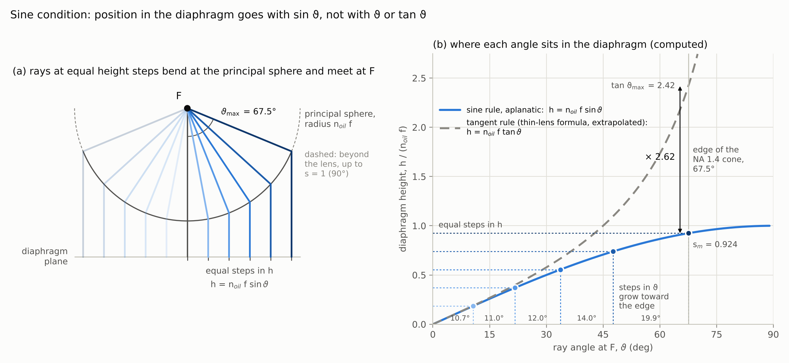
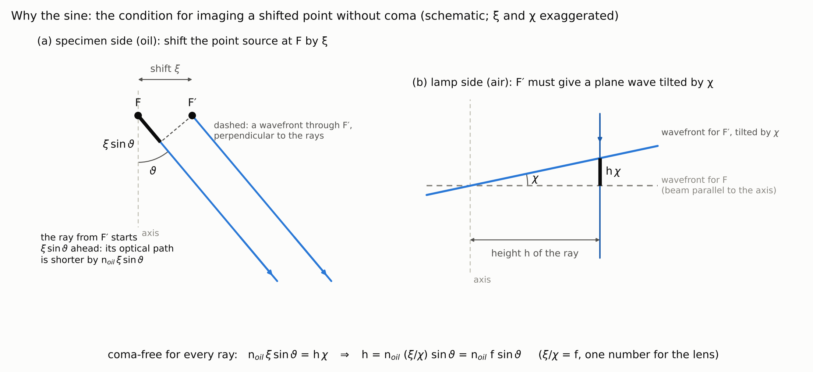
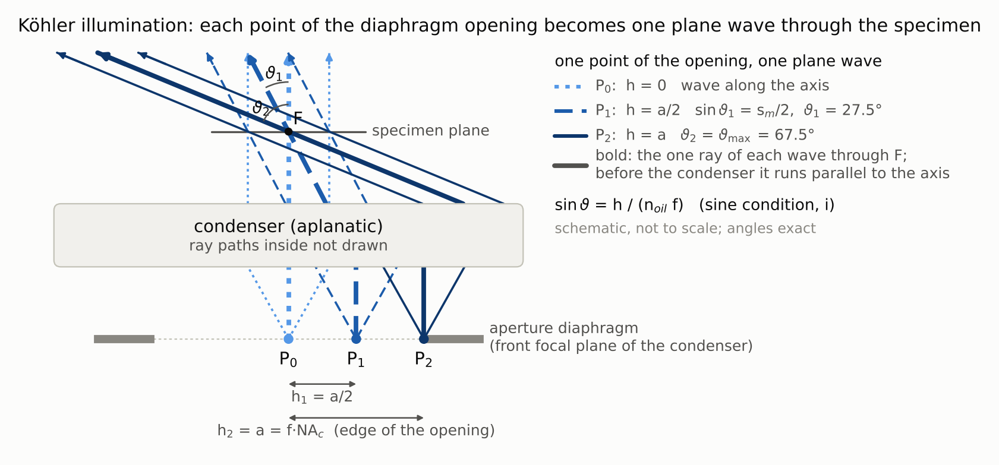
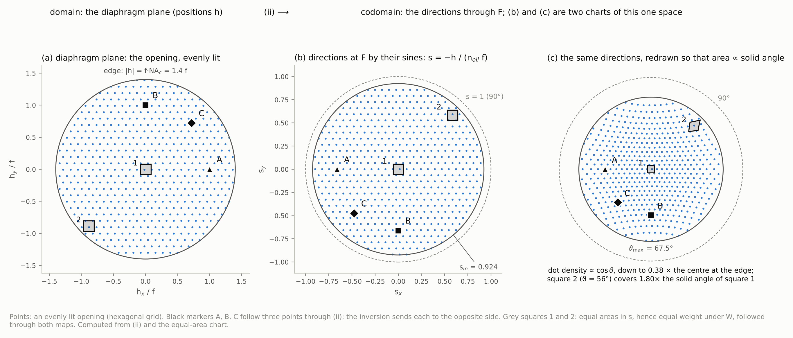
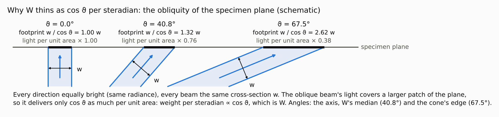
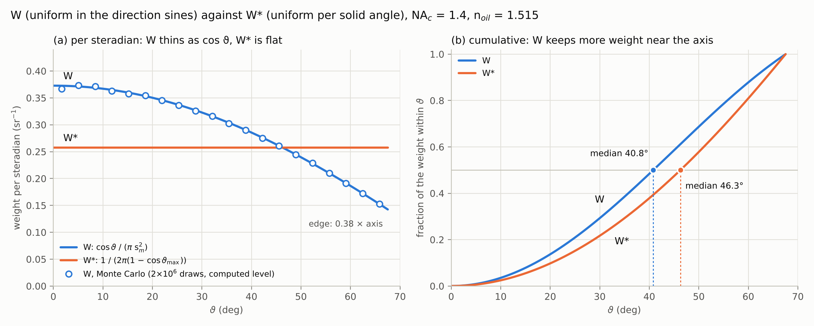
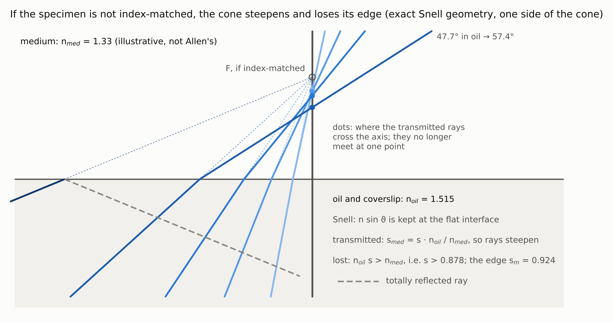

# The sine condition, Köhler illumination and the ray world's measure $W$

**Date:** 2026-10-12

**Repository copy.** The figures are in
`figures/TEEG_diameter_sine_condition_and_W_2026-10-12/` of this workstream.
The scripts this document names as `scripts/…` (three checks and the figure
script) were delivered with it as files on 2026-10-12 and are not in the
repository (§4, Figure sources).

**Abstract.** The ray world is the geometric-optics reference renderer of the
diameter re-measurement. It averages Beer–Lambert transmission over the
directions of the condenser's light cone, with a weight $W$ (renderers
document, Eq. (3)). This document answers one question: why $W$ is uniform in
the direction sines $(s_x,s_y)$ on a disc of radius
$s_m=\mathrm{NA}_c/n_{\rm oil}$, and therefore weights each solid angle by
$\cos\vartheta$. The answer is the sine condition of an aplanatic condenser,
used under Köhler illumination.

Covered:
- what aplanatism and the sine condition are, in the general and in the
  infinite-conjugate form;
- a derivation of the sine condition from the requirement that a slightly
  shifted point be imaged without coma;
- Köhler illumination as a map from positions in the aperture diaphragm to
  directions at the specimen;
- that map's Jacobian, and its physical meaning: equal radiance seen through
  an oblique plane;
- what $s_m$ represents, and how it depends on the condenser setting;
- $W$ against the isotropic measure $W^*$;
- how the project's code implements $W$;
- when the construction fails.

Deliberately excluded:
- wave optics (the Debye and Richards–Wolf integrals, the
  $\sqrt{\cos\vartheta}$ amplitude apodisation, partial coherence);
- the calibration of the defocus kernel;
- the hybrid renderer;
- chromatic effects.

Sources consulted:
- project documents: renderers, optics v1.5, mathematics, implementation
  handoff;
- project code: `model/ray_world.py` and `config.py` on
  `sci/diameter-pipeline` at 3084991;
- PubMed, full texts read: PMC10674246 and PMC4030053;
- PubMed, abstracts only, flagged where used: PMIDs 34807061, 34613310,
  38437410 and 31465391;
- textbook optics, from memory;
- three checks by computation, run in this session.

Searches that returned nothing:
- PubMed "aplanatic apodization "high numerical aperture" point spread
  function";
- PubMed ""refractive index mismatch" focal shift spherical aberration
  microscopy";
- PubMed "total internal reflection fluorescence microscopy critical angle
  objective numerical aperture greater than refractive index";
- bioRxiv could not be searched by topic, because its connector has no
  keyword search.

---

## 1. Notation and Symbols

Status (Provenance model) is given where the project's code or instrument
holds, or deliberately does not hold, a value for the object: *analytic*,
*configured*, *computed*, *derivation-only*, *not measured*, *not
reported*. Two settings are separated by "/" where they differ: the model,
and the microscope that took Allen's stacks.

| Symbol | Name / Meaning | Type & domain | Units | First used in § | Status |
|---|---|---|---|---|---|
| $I^{\rm ray}_k(\mathbf x)$ | intensity the ray world renders in plane $k$ at lateral point $\mathbf x$ | for each fixed $k$, a function of $\mathbf x\in\mathbb R^2$ into $\mathbb R_{\ge0}$ | grey levels | 3.1 | computed (renderer output) |
| $k$, $z_k$ | index of a rendered plane; its depth | $k\in\mathbb Z$; $z_k\in\mathbb R$ | —; µm | 3.1 | configured (plane grid) |
| $\mathbf x$ | lateral position in a plane | $\mathbb R^2$ | µm | 3.1 | — |
| $B$ | background intensity of the rendered plane | $\mathbb R_{>0}$ | grey levels | 3.1 | see renderers document §1 |
| $\mu$ | absorption coefficient of the stain in a phantom; model level | $\mathbb R_{\ge0}$ | µm⁻¹ | 3.1 | phantom parameter |
| $L(\mathbf x,z_k,\hat s)$ | length inside the tube of the line through $(\mathbf x,z_k)$ with direction $\hat s$ | for each fixed $(\mathbf x,z_k,\hat s)$, a number in $\mathbb R_{\ge0}$ | µm | 3.1 | computed |
| $\hat s$ | unit direction of one ray, $s_z>0$ | upper unit hemisphere of $\mathbb R^3$ | dimensionless | 3.1 | computed (one quadrature node) |
| $\langle g\rangle_W$ | average of a function $g$ of the direction under the measure $W$ (also $\langle g\rangle_{W^*}$) | functional, for each $g$ integrable under the measure | units of $g$ | 3.1 | — |
| $W$ | the ray world's measure over the directions through $F$: $\mathbf s$ uniform on $\lvert\mathbf s\rvert\le s_m$, Eq. (8); **model level** | probability measure on direction space | — | 3.1 | analytic (model) |
| $W_{\rm mic}$ | the microscope's own distribution of illumination directions through a specimen point; the object $W$ models | probability measure on direction space | — | 3.1 | not measured; not reported |
| $W^*$ | the renderers document's obliquity-weighted measure, $dW^*=(1/\cos\vartheta)\,dW/\langle1/\cos\vartheta\rangle_W$; by Eq. (9), uniform per solid angle | probability measure on direction space | — | 3.1 | analytic |
| $F$ | the specimen point the rays pass through; in (RW) it is the point $(\mathbf x,z_k)$ | point of specimen space | — | 3.1 | — |
| $\vartheta$ | angle of $\hat s$ from the optical axis, in the oil (unless subscripted) | $[0,\pi/2)$ | rad (degrees in prose and figures) | 3.1 | computed per node |
| $\mathbf s=(s_x,s_y)$ | direction sines: the sideways components of $\hat s$; $\lvert\mathbf s\rvert=\sin\vartheta$; the renderers document's $\rho=\lvert\mathbf s\rvert$ | closed unit disc of $\mathbb R^2$ | dimensionless | 3.1 | computed (quadrature nodes) |
| $\mathrm{NA}_c$ | numerical aperture of the lit condenser cone, $n_{\rm oil}\sin\vartheta_{\max}$. The renderers document writes NA; the subscript is added here to keep it apart from the objective's 1.4 | $(0,n_{\rm oil})$ | dimensionless | 3.1 | configured 1.4 (`ray_na`) / microscope: diaphragm setting not reported |
| $n_{\rm oil}$ | refractive index of the immersion oil, and of the specimen under H4 | $\mathbb R_{>0}$ | dimensionless | 3.1 | configured 1.515 (`ray_n_oil`) / microscope: oil not reported; ZEISS Immersol 518 F has index 1.518 at the e line |
| $s_m$, $\vartheta_{\max}$ | edge of the lit disc in direction sines, Eq. (6), and its angle, $\sin\vartheta_{\max}=s_m$ | $s_m\in(0,1)$; $\vartheta_{\max}\in(0,\pi/2)$ | dimensionless; rad | 3.1 | computed from `ray_na`, `ray_n_oil` |
| $\gamma_W$, $\gamma_{W^*}$ | per-axis RMS sideways slope of the rays, $\sqrt{\langle\tan^2\vartheta\rangle/2}$, under $W$ and under $W^*$, Eq. (11). Not the defocus kernel's bare $\gamma$ (D-024 (i)), a configured slope | $\mathbb R_{>0}$ | dimensionless | 3.1 | analytic |
| $O$, $O'$ | an axial object point and its image (general form of the sine condition) | points on the optical axis | — | 3.2 | — |
| $n$, $n'$ | refractive indices of object space and image space (general form) | $\mathbb R_{>0}$ | dimensionless | 3.2 | — |
| $\theta$, $\theta'$ | a ray's angles with the axis in object space and in image space (general form) | $[0,\pi/2)$ | rad | 3.2 | — |
| $m$ | paraxial lateral magnification: one number for the whole system | $\mathbb R\setminus\{0\}$ | dimensionless | 3.2 | — |
| $r$ | radius of the glass sphere of Check 1 (its interior is object space, $n=1.5$) | $\mathbb R_{>0}$ | arbitrary length unit | 3.2 | configured in the check |
| $\mathbf h=(h_x,h_y)$, $h=\lvert\mathbf h\rvert$ | a point of the condenser's front focal plane (the aperture diaphragm), measured from the axis in the same lateral axes as $\mathbf s$. Not the renderers document's $h$ (a height above the skin, §3.5 there) | $\mathbf h\in\mathbb R^2$; $h\in\mathbb R_{\ge0}$ | mm | 3.2 | derivation-only (the code samples $\mathbf s$ directly) |
| $f$ | effective focal length of the condenser; $n_{\rm oil}f$ is its focal length measured in the oil. Not the generic function in the renderers document's $\langle f\rangle_W$ | $\mathbb R_{>0}$ | mm | 3.2 | derivation-only; not reported for Allen's condenser |
| $\xi$, $F'$ | a small sideways shift of a point source at $F$; the shifted point | $\xi\in\mathbb R$; $F'$ a point | mm; — | 3.3 | derivation-only |
| $\chi$ | tilt of the plane wave that the shifted point must produce on the lamp side | $\mathbb R$ | rad | 3.3 | derivation-only |
| $P_0$, $P_1$, $P_2$ | three points of the diaphragm opening, drawn in Fig. 1 | points of the diaphragm plane | — | 3.4 | — |
| $a$ | radius of the diaphragm opening, $a=f\,\mathrm{NA}_c$ (Fig. 1) | $\mathbb R_{>0}$ | mm | 3.4 | derivation-only |
| $h_1$, $h_2$; $\vartheta_1$, $\vartheta_2$ | heights of $P_1$, $P_2$ in Fig. 1, and the angles of their plane waves | $\mathbb R_{\ge0}$; $[0,\pi/2)$ | mm; rad | 3.4 | — |
| H1–H5 | the hypotheses under which $W=W_{\rm mic}$, listed in §3.4 | labels | — | 3.4 | — |
| $\psi$ | azimuth of $\hat s$ about the optical axis (the code's `psi`) | $[0,2\pi)$ | rad | 3.5 | computed per node |
| $dA_{\mathbf h}$ | area element of the diaphragm plane | measure on $\mathbb R^2$ | mm² | 3.5 | derivation-only |
| $d\Omega$ | solid-angle element of direction space | measure on the unit sphere | sr | 3.5 | — |
| $\Lambda(\mathbf s)$ | equal-area (Lambert azimuthal) chart of the directions: $\Lambda(\mathbf s)=2\sin(\vartheta/2)\,\mathbf s/\lvert\mathbf s\rvert$, with $\sin\vartheta=\lvert\mathbf s\rvert$ and $\Lambda(\mathbf 0)=\mathbf 0$ | map from the closed unit disc onto the disc of radius $\sqrt2$ | dimensionless | 3.5 | — |
| A, B, C; squares 1, 2 | labels in Fig. 3: three points followed through the map, and two patches of equal area in $\mathbf s$ | labels | — | 3.5 | — |
| $w$ | cross-section of a beam (Fig. 5) | $\mathbb R_{>0}$ | µm | 3.6 | — |
| $\vartheta_{{\rm med},W}$, $\vartheta_{{\rm med},W^*}$ | median angle of the weight under $W$ and under $W^*$, Eq. (12) | $(0,\vartheta_{\max})$ | rad | 3.8 | analytic |
| $\hat s_j$, $w_j$, $N_q$ | nodes and weights of the code's quadrature of $W$, $j=1,\dots,N_q$, $N_q=n_\rho n_\psi$; **computed level** (a finite rule that approximates $W$) | $\hat s_j$ on the hemisphere; $w_j>0$, $\sum_jw_j=1$ | dimensionless | 3.9 | computed in `directions()` |
| $n_\rho$, $n_\psi$ | number of Gauss–Legendre nodes in $\rho^2$ and of azimuths | positive integers | — | 3.9 | configured 16 and 32 (`ray_n_rho`, `ray_n_psi`, provisional) |
| $n_{\rm med}$ | refractive index of the specimen's mounting medium, when it differs from $n_{\rm oil}$ | $\mathbb R_{>0}$ | dimensionless | 3.10 | not reported here; 1.33 in Fig. 7 is illustrative |
| $\vartheta_{\rm med}$, $\mathbf s_{\rm med}$ | ray angle and direction sines inside the medium | $[0,\pi/2)$; unit disc | rad; dimensionless | 3.10 | — |

### Conventions

- **Depth and light direction.** $z$ increases in the direction the light
  travels, from the condenser to the objective, as in the renderers document;
  every $\hat s$ has $s_z>0$.
- **Lateral axes.** $\mathbf h$ and $\mathbf s$ are measured in the same
  lateral axes, which is what puts the minus sign in Eq. (5).
- **Angles.** $\vartheta$ is measured in the oil unless subscripted
  ($\vartheta_{\rm med}$). Angles are in radians in formulas and in degrees in
  prose and figures.
- **Focal length.** $f$ is the effective focal length; the focal length
  measured in the oil is $n_{\rm oil}f$.
- **"Evenly lit"** means the same radiance at every point of the diaphragm
  opening (H3).
- **Equation numbers.** Equations (1)–(13) are this document's. The renderers
  document's Eq. (3) is reproduced as (RW).
- **Source tags and ratings** follow the topic-document template:
  - **[KB: …]** project document;
  - **[CODE: …]** project code;
  - **[FT: …]** full text read;
  - **[ABS: …]** abstract only, so no numbers from it;
  - **[RUN: …]** verified by running the named script here;
  - **[TXT]** textbook, from memory;
  - **[OWN]** this document's own reasoning.

  Ratings are **[Certain]**, **[Likely]** and **[Guessing]**. [TXT] and
  [ABS] cap a claim at [Likely].

---

## 2. Glossary / Jargon

Ordering: by first appearance, because the concepts build on each other.

- **Ray world** — the project's geometric-optics reference renderer: it
  follows straight rays through the phantom tube and averages their
  Beer–Lambert transmission over the condenser's cone (RW). It tests how the
  partition renderer treats absorption; it is not used to give an absolute
  diameter. Operative in §3.1.
- **Measure (over directions)** — a rule that gives every set of directions a
  weight, with total weight 1; here, how much of the light crosses the
  specimen point in each direction. Operative in §3.1.
- **Condenser** — the lens below the specimen that sends the lamp's light
  through it. Operative in §3.1.
- **Aplanatic** — free of spherical aberration and of coma for points on and
  near the axis. For a lens already free of spherical aberration, it is
  equivalent to obeying the sine condition. Operative in §3.2.
- **Spherical aberration** — rays from one axial point, passing through
  different zones of the aperture, meet the axis at different places. A lens
  without it is *stigmatic* on the axis. Operative in §3.2.
- **Coma** — the blur of a point slightly off the axis that appears when
  different zones of the aperture magnify differently. It grows linearly with
  the distance from the axis, to first order. Operative in §3.2.
- **Sine condition (Abbe)** — the design condition that makes a stigmatic
  lens free of coma: every ray from the axial object point images with the
  same magnification, Eq. (1). For an object at infinity, the ray height
  goes with the sine of the angle at the focus, Eq. (2). Operative in §3.2.
- **Principal sphere** — for an aplanatic lens imaging infinity onto a point,
  the surface where the incoming parallel rays and the outgoing converging
  rays meet: a sphere centred on the focus, with radius equal to the focal
  length on that side. Operative in §3.2.
- **Tangent rule** — the paraxial thin-lens relation $h=n_{\rm oil}f\tan\vartheta$,
  applied (wrongly) at large angles. It agrees with the sine rule only for
  small $\vartheta$. Operative in §3.2.
- **Optical path length** — geometric length times refractive index, summed
  along a ray. The rays that form a perfect image of a point all have the
  same optical path length. Operative in §3.3.
- **Köhler illumination** — the standard alignment for transmitted light:
  - the lamp is imaged into the condenser's aperture diaphragm, which sits in
    the condenser's front focal plane;
  - a field diaphragm is imaged onto the specimen;
  - so every point of the field is lit by the whole opening.

  Operative in §3.4.
- **Aperture diaphragm** — the condenser's adjustable iris; its opening sets
  $\mathrm{NA}_c$. *Two live senses of "aperture":* the physical opening (a
  length, in mm) and the numerical aperture (dimensionless). This document
  always says which. Operative in §3.4.
- **Front and back focal planes** — the focal planes on the lamp side and on
  the far side of a lens. A point in the front focal plane becomes a plane
  wave on the far side. For the condenser, the diaphragm is in the front
  focal plane. The objective's analogue of that plane is its back focal
  plane, which obeys the same Eq. (2). Operative in §3.4.
- **Plane wave** — light travelling in one direction everywhere: a bundle of
  parallel rays. Operative in §3.4.
- **Numerical aperture (NA)** — $n\sin\vartheta_{\max}$ of a cone of light. It
  is the same in every flat layer the cone crosses (for the part of it that
  crosses), because Snell's law keeps
  $n\sin\vartheta$. Operative in §3.4.
- **Direction sines** — the two sideways components $(s_x,s_y)$ of a unit
  direction; their length is $\sin\vartheta$. They label directions the way
  latitude and longitude label points. Operative in §3.4.
- **Equal-area (Lambert azimuthal) chart** — a way of drawing the directions
  flat so that area on the page is proportional to solid angle. Operative in
  §3.5.
- **Radiance** — power per unit projected area per unit solid angle. It is
  carried unchanged along a ray through lossless optics, after dividing by
  $n^2$. *Everyday sense differs:* "brightness" usually means the light
  falling on a surface, which is the irradiance. Operative in §3.6.
- **Irradiance** — power per unit area arriving on a surface. Operative in
  §3.6.
- **Gauss–Legendre quadrature** — a standard rule for computing an integral
  as a weighted sum over chosen nodes. Operative in §3.9.
- **Index-matched** — specimen and oil have the same refractive index, so rays
  cross between them without bending. Operative in §3.10.
- **Snell's law; total internal reflection** — at a flat interface
  $n\sin\vartheta$ is kept. When the medium beyond has a lower index, the
  directions with $n_{\rm oil}\sin\vartheta>n_{\rm med}$ cannot cross, and they
  are reflected back. Operative in §3.10.
- **Focal shift** — with an index mismatch, the rays meet closer to (or
  further from) the interface than the nominal focus, at depths that depend
  on their angle. Operative in §3.10.

---

## 3. Main body

### 3.1 What the ray world needs from the optics

*Establishes: what $W$ is, why its form is not obvious, and why the form
matters in the project.*

The ray world renders a synthetic image plane by following straight rays
through each image point and averaging their Beer–Lambert transmission
[KB: renderers document §3.3]. For each fixed plane index $k$ and each
lateral point $\mathbf x\in\mathbb R^2$, the intensity is
$$I^{\rm ray}_k(\mathbf x)=B\,\big\langle e^{-\mu L(\mathbf x,z_k,\hat s)}\big\rangle_W ,\tag{RW}$$
where:
- $B$ is the background intensity;
- $\mu$ is the stain's absorption coefficient;
- $L(\mathbf x,z_k,\hat s)$ is the length inside the tube of the straight
  line through the specimen point $F=(\mathbf x,z_k)$ with unit direction
  $\hat s$;
- the average runs over directions $\hat s$ weighted by the measure $W$.

The formula needs exactly one thing from the optics: which directions cross
$F$, and with what weight. That is $W$.

**The naive picture** is a lamp that sprays light into its cone equally in
every direction, up to the steepest angle $\vartheta_{\max}$: the isotropic
cone. The renderers document carries this measure as $W^*$. It defines
$W^*$ differently, as $W$ reweighted by the oblique path length
$1/\cos\vartheta$ through a flat layer [KB: renderers document §1 and
§3.5]. §3.5 shows that the two descriptions give the same measure.

**What actually happens** is different. A condenser does not choose
directions. Under Köhler illumination it converts positions in its aperture
diaphragm into directions, one for one (§3.4). So $W$ is the light of the
diaphragm, carried over by that conversion. The rule of the conversion is the
sine condition, and it makes $W$ differ from $W^*$ in ways that matter here.
At the configured $\mathrm{NA}_c=1.4$ and $n_{\rm oil}=1.515$:
- half of $W$'s weight lies within 40.8° of the axis, against 46.3° under
  $W^*$;
- the per-axis RMS sideways slope of the rays is $\gamma_W=0.7915$, against
  $\gamma_{W^*}=0.8991$.

[KB: renderers document §3.5; RUN: scripts/check02_W_measure.py,
scripts/check03_charts_and_code_quadrature.py] [Certain]. The slope sets how
fast the cone's geometric blur grows with defocus, which is what the
renderers document compares between the ray world and the partition
(renderers document §3.6) [KB].

$W$ is a model. The microscope's own distribution of directions,
$W_{\rm mic}$, is a different object. It depends on the condenser's design and
on how far its diaphragm was open, and Allen reports neither beyond "an NA
1.4 oil condenser" [KB: optics document v1.5, §3.1 and §3.6]. $W$ equals
$W_{\rm mic}$ only under hypotheses H1–H5, listed in §3.4 [OWN].

### 3.2 Aplanatism and the sine condition

*Establishes: what an aplanatic lens is; the sine condition in the general
and in the infinite-conjugate form; the principal sphere.*

**The problem it solves.** A lens can image the axial point perfectly and
still blur a point slightly off the axis, because the zones of its aperture
may not all magnify by the same amount. That blur is coma [TXT]. The
paraboloidal mirror is the classic case:
- every ray parallel to its axis meets the focus, so it is stigmatic;
- yet an off-axis beam focuses with a zone-dependent focal length.

In the ray trace of Check 1, its zone focal length $h/\sin\theta'$ (the
quantity the sine condition requires to be constant) runs from $1.0006f$ to $1.25f$ as the ray height $h$ goes from $0.05f$ to
$f$, and it equals $f+h^2/(4f)$ to $10^{-9}$. Here $\theta'$ is the angle of the reflected ray at the focus
(image space). The tangential landing positions of an
off-axis beam spread over a factor of 2 across the zones
[RUN: scripts/check01_aplanatic_sine_condition.py] [Certain] (for the configuration run).

**The move.** An *aplanatic* system is free of both spherical aberration and
coma for points on and near the axis. For a system already free of
spherical aberration, the absence of coma is Abbe's condition: every ray from
the axial point must image with the same magnification. A full text states
Abbe's result for an object at infinity: in a system free of spherical
aberration, coma is also removed when every incoming ray parallel to the axis
has the same effective focal length, whatever its height [FT: PMID 38005659]
[Certain]. In the abstract of an
optical-design paper, "aplanatic" is defined in the same sense, as free of
spherical aberration and of linear coma [ABS: PMID 34807061, abstract only]
[Likely].

In general form, for a system with object space of index $n$ and image space
of index $n'$, the condition holds for every ray from the axial object point
$O$ to its image $O'$:
$$n\sin\theta=m\,n'\sin\theta'\qquad\text{for every ray from }O,\tag{1}$$
where:
- $\theta$ and $\theta'$ are the ray's angles with the axis on the two sides;
- $m$ is the paraxial lateral magnification, one number for the whole
  system.

[TXT] [Likely]

The condenser uses the infinite-conjugate form. The object is at infinity on
the lamp side, and the image is the specimen point $F$ in oil. A ray
travelling parallel to the axis at height $h$ is bent towards $F$, and the
condition fixes its angle there:
$$h=n_{\rm oil}\,f\,\sin\vartheta .\tag{2}$$

**Transplant check.** The full text states the condition for an image
in air: height $=f\sin\theta'$, with the principal surface "a spherical
surface of a radius $f$ for a very far object" [FT: PMID 38005659]. (The equation itself is not rendered in the retrieved text; its symbols
are defined there in words, and the form written here is reconstructed from
those words and the textbook statement [TXT].) For an image in oil, the focal length measured on the
image side is $n_{\rm oil}f$. So the principal sphere has radius $n_{\rm
oil}f$, and Eq. (2) follows [TXT] [Likely].

**Geometrically,** the rays bend on that sphere, centred on $F$ (Fig. 2a).
Equal steps in $h$ are therefore equal steps in $\sin\vartheta$, and the
steps in $\vartheta$ grow toward the edge. For five equal steps up to the
NA 1.4 edge they are 10.7°, 11.0°, 12.0°, 14.0° and 19.9°
[RUN: scripts/make_W_figures.py, printed output] [Certain].

*Figure 2: position in the diaphragm goes with $\sin\vartheta$.*
- *(a) Rays parallel to the axis at equal height steps bend on the principal
  sphere of radius $n_{\rm oil}f$ and meet at $F$, at angles whose steps grow
  toward the edge. This is exact geometry under H1 [FT: PMID 38005659 for
  the construction; TXT for the radius $n_{\rm oil}f$] [Likely].*
- *(b) $h/(n_{\rm oil}f)$ against $\vartheta$ for the sine rule (2) and the
  tangent rule (3), with the angle steps marked
  [RUN: scripts/make_W_figures.py] [Certain]. At the NA 1.4 edge the tangent
  rule would need an opening 2.62 times wider.*
- *Plotted from the formulas, $\mathrm{NA}_c=1.4$, $n_{\rm oil}=1.515$.*

**A tempting alternative, wrong at this NA.** The paraxial thin-lens formula
gives the same answer as Eq. (2) only for small angles. Extrapolated to large
angles, it becomes the tangent rule:
$$h=n_{\rm oil}\,f\,\tan\vartheta .\tag{3}$$
At $\vartheta_{\max}=67.5°$, $\tan\vartheta_{\max}=2.42$ while
$\sin\vartheta_{\max}=0.924$, a factor of 2.62 [RUN:
scripts/check02_W_measure.py] [Certain]. Both rules agree to first order in
$\vartheta$, $h\approx n_{\rm oil}f\vartheta$ [OWN] [Certain]. The abstract
of a lens-modelling paper reports the practical consequence: a paraxial
thin-lens stand-in for a microscope objective is not consistent with the sine
condition, and it typically gives the wrong NA for a given pupil diameter
[ABS: PMID 38437410, abstract only] [Likely].

**Check 1 tests both sides of the theorem**
[RUN: scripts/check01_aplanatic_sine_condition.py] [Certain] (for the configurations run):
- *The aplanatic points of a glass sphere* ($n=1.5$). The point at
  distance $r/n$ from the centre images onto the point at $nr$, and the pair
  obeys Eq. (1). Every zone from 5° to 60° has the same zone magnification,
  $n^2=2.25$, to within $2\times10^{-10}$. So a slightly off-axis point lands
  in one place: no coma.
- *The paraboloid* described above: stigmatic, but it violates Eq. (2), and
  it shows coma.

That spherical refracting surfaces are rigorously aplanatic at these points
is stated in the abstract of a design paper [ABS: PMID 34613310, abstract
only] [Likely].

**Verdict.** For an aplanatic condenser (H1), Eq. (2) fixes the angle at $F$
of the ray that travelled at height $h$. §3.3 says why it is a sine.

### 3.3 Why a sine: the shifted-source argument

*Establishes: Eq. (2) follows from asking that a slightly shifted point still
be imaged perfectly.*

§3.2 stated the condition. This section derives it, because the derivation is
what makes "sine, not angle" inevitable rather than arbitrary.

Rays are reversible, so run the light backwards [TXT]. A point source at $F$
comes out of the aplanatic condenser as a beam parallel to the axis on the
lamp side, in air. A perfect image of a point means equal optical path
lengths along all its rays [TXT].

Now shift the source sideways by a small $\xi$, to $F'$. A coma-free lens
must still deliver a plane wave, only tilted by a small angle $\chi$.

Follow one ray leaving at angle $\vartheta$. From $F'$, it starts
$\xi\sin\vartheta$ further along its own direction, because
$\xi\sin\vartheta$ is the projection of the shift onto the ray (Fig. 6a).
Its optical path to a far wavefront is therefore shorter by
$n_{\rm oil}\xi\sin\vartheta$, to first order in $\xi$ [OWN] [Likely].

On the lamp side, a plane wave tilted by $\chi$ is, at height $h$, ahead of
the untilted one by $h\chi$, to first order in $\chi$ (Fig. 6b) [OWN]
[Likely]. A perfect image of $F'$ needs the two to agree for every ray:
$$n_{\rm oil}\,\xi\,\sin\vartheta=h\,\chi\quad\text{for every ray}
\quad\Longrightarrow\quad h=n_{\rm oil}\,\frac{\xi}{\chi}\,\sin\vartheta .\tag{4}$$

The ratio $\xi/\chi$ is one number for the whole lens: one shifted point,
one tilt. The near-axis rays give its value. Paraxially Eq. (4) reads
$n_{\rm oil}\xi\vartheta=h\chi$, with $h=n_{\rm oil}f\vartheta$ for those
rays, so $\xi/\chi=f$. Eq. (4) is then Eq. (2) [OWN: eq. (4); TXT for the
equal-path premise] [Likely]. The argument holds to first order in $\xi$,
that is for points near the axis. That is exactly the range in which an
aplanatic lens is coma-free.

*Figure 6: imaging the shifted source $F'$ as a plane wave tilted by $\chi$
forces $n_{\rm oil}\xi\sin\vartheta=h\chi$ for every ray, i.e. Eq. (2).*
- *(a) Specimen side, in oil: the ray from $F'$ starts $\xi\sin\vartheta$
  ahead.*
- *(b) Lamp side, in air: the tilted wavefront is $h\chi$ ahead at height
  $h$.*
- *Schematic; $\xi$ and $\chi$ exaggerated; first order in $\xi$ [OWN: eq.
  (4); TXT] [Likely].*

**The converse.** If $h/\sin\vartheta$ varies with $h$, the shifted point
cannot come out as a plane wave, and the residual is coma. In Check 1 the
paraboloid's tangential zone focal length runs from $1.00f$ to $2.08f$ across
the zones [RUN: scripts/check01_aplanatic_sine_condition.py] [Certain] (for the configuration run).

**The same relation from energy.** Conservation of radiance between the
diaphragm and the cone at $F$ (étendue) also gives Eq. (2) [TXT] [Likely]:
equal areas of the diaphragm must carry equal power into the matching
directions. §3.5 and §3.6 use exactly this.

### 3.4 Köhler illumination: from positions in the diaphragm to directions

*Establishes: the map, Eq. (5), from the diaphragm (domain) to the
directions through $F$ (codomain); its sign; and the hypotheses H1–H5 under
which $W=W_{\rm mic}$.*

§3.2–§3.3 gave the angle of one ray per height. Köhler illumination is what
makes every point of the diaphragm opening a source of exactly such rays.
In Köhler alignment, the lamp is imaged into the aperture diaphragm, which
sits in the condenser's front focal plane, and a field diaphragm is imaged
onto the specimen [TXT]. A lens turns each point of its front focal plane
into a plane wave on the far side [TXT]. So each point of the opening becomes
one direction through the specimen (Fig. 1).

*Figure 1: each point of the diaphragm opening becomes one plane wave across
the specimen field.*
- *$P_0$ on the axis gives the wave along the axis.*
- *$P_1$ at $h_1=a/2$ gives $\sin\vartheta_1=s_m/2$, $\vartheta_1=27.5°$.*
- *$P_2$ at the edge, $h_2=a=f\,\mathrm{NA}_c$, gives
  $\vartheta_2=\vartheta_{\max}=67.5°$.*
- *Bold: the one ray of each wave through $F$; before the condenser it runs
  parallel to the axis.*
- *Hypotheses H1 and H2 [TXT; angles from Eq. (2), RUN:
  scripts/make_W_figures.py] [Likely]. Schematic, not to scale; angles
  exact.*

**What $W$ uses, stated precisely.** Each diaphragm point at height $h$ sends
exactly one ray through $F$: the one that was travelling parallel to the axis
before the condenser. An aplanatic condenser has no spherical aberration
for this conjugate pair, so it sends every such ray through $F$, and every
ray through $F$ was such a ray. Eq. (2) fixes the angle [OWN: from H1 and Eq.
(2)] [Likely]. In components:
$$\mathbf s=-\,\frac{\mathbf h}{n_{\rm oil}\,f}.\tag{5}$$
The minus sign is the crossing at $F$: a point to the right of the axis
sends its wave to the left. The map has three parts:
- **Domain:** the opening $\{\lvert\mathbf h\rvert\le f\,\mathrm{NA}_c\}$, a
  disc of the diaphragm plane, in mm.
- **Codomain:** the directions through $F$, labelled by their sines $\mathbf
  s$ in the unit disc (dimensionless).
- **The map (5):** a uniform rescaling by $1/(n_{\rm oil}f)$, composed with
  the inversion $\mathbf s\mapsto-\mathbf s$.

[OWN] [Likely]. The edge of the opening maps to the edge of the lit cone:
$$s_m=\frac{\mathrm{NA}_c}{n_{\rm oil}}=\sin\vartheta_{\max}.\tag{6}$$
$s_m$ is therefore a number in $(0,1)$, neither an angle nor a length: the
sine of the steepest illuminating ray in the oil [OWN: eqs. (5)–(6)]
[Certain] (given Eq. (5)).

**The plane-wave picture is needed for the field, not for $F$.** The ray world
applies the same $W$ at every point $\mathbf x$ of every plane (RW) [KB:
renderers document §3.3]. That needs the same diaphragm point to send rays of
the same direction through every point of the field.
- For an ideal lens with the diaphragm in its front focal plane, this is
  exactly the plane-wave statement above [TXT] [Likely].
- For a real condenser, it holds while the field is small compared with $f$.
  How small the residual is for Allen's condenser is not established
  [Guessing].

**The hypotheses under which $W=W_{\rm mic}$** [OWN]:
- **H1** — the condenser is aplanatic. Allen's NA 1.4 oil condenser is not
  described in the ZEISS pages read; the only aplanatic condenser listed there
  is an NA 0.9 model [KB: optics document v1.5, §3.1] [Guessing] (that H1 holds).
- **H2** — Köhler alignment, with the diaphragm in the condenser's front focal
  plane, and a field small compared with $f$.
- **H3** — the opening is evenly lit: the same radiance at every point of it.
- **H4** — the specimen is index-matched to the oil. This is assumed by the
  ray world ((S6)) [KB: renderers document, Conventions].
- **H5** — geometric optics: no diffraction and no interference [KB:
  renderers document §3.3].

$\mathrm{NA}_c=1.4$ is not a hypothesis on the form of $W$. It is a
configured parameter, the fully open setting (§3.7).

### 3.5 The weights: uniform in $\mathbf s$, $\cos\vartheta$ per steradian

*Establishes: under H1–H3, $W$ is uniform on the disc of direction sines;
the Jacobian, Eq. (7); and that $W^*$ is the isotropic cone.*

§3.4 placed each diaphragm point at one direction. This section turns that
placement into weights.

A uniform rescaling maps equal areas to equal areas. By Eq. (5), an area
element of the opening is $dA_{\mathbf h}=(n_{\rm oil}f)^2\,ds_x\,ds_y$
[OWN: Eq. (5)] [Certain] (given Eq. (5)). An evenly lit opening (H3) sends
equal power through equal areas, so it gives equal weight per unit area of
$\mathbf s$.

Equal areas of $\mathbf s$ are not equal solid angles, though. Write the
direction sines in polar form, $\mathbf s=\sin\vartheta\,(\cos\psi,\sin\psi)$.
The Jacobian of $(\vartheta,\psi)\mapsto(s_x,s_y)$ is $\sin\vartheta\cos\vartheta$.
Since $d\Omega=\sin\vartheta\,d\vartheta\,d\psi$,
$$ds_x\,ds_y=\sin\vartheta\cos\vartheta\,d\vartheta\,d\psi=\cos\vartheta\;d\Omega
\qquad\text{for every direction with }\vartheta<\pi/2 .\tag{7}$$
[OWN: proof written out] [Certain]

So $W$, written first in direction sines and then per solid angle, is
$$dW=\frac{ds_x\,ds_y}{\pi s_m^2}=\frac{\cos\vartheta\,d\Omega}{\pi s_m^2}\quad\text{on }\lvert\mathbf s\rvert\le s_m,\qquad dW=0\ \text{elsewhere.}\tag{8}$$
[OWN: eqs. (5), (7) under H1–H3] [Likely] (it rests on H1–H3)

In words: near 90° the sine flattens out. A ring of $\mathbf s$ of fixed width
covers a wider band of angles there, so the same weight is spread over more
solid angle. Per steradian, $W$'s weight is
$\cos\vartheta/(\pi s_m^2)$. It falls to $\cos\vartheta_{\max}=0.382$ of its
on-axis value at the edge [OWN: eqs. (7)–(8); RUN:
scripts/check02_W_measure.py] [Certain].

Two checks confirm Eq. (7) numerically, at $\mathrm{NA}_c=1.4$ and
$n_{\rm oil}=1.515$ [Certain] (for the configurations run):
- **Check 2:** $2\times10^6$ Monte Carlo directions uniform on the disc. All
  20 angle bins lie within 2.3 standard errors of
  $\cos\vartheta/(\pi s_m^2)$ per steradian [RUN:
  scripts/check02_W_measure.py, seed 20261012].
- **Check 3:** the equal-area chart $\Lambda$ has area element equal to solid
  angle, so by Eq. (7) its area scale $\lvert\det\partial\Lambda/\partial\mathbf
  s\rvert$ must be $1/\cos\vartheta$. Finite differences at 2000 random points
  of the disc agree to $2\times10^{-10}$ [RUN:
  scripts/check03_charts_and_code_quadrature.py].

*Figure 3: the map (5) and its Jacobian.*
- *(a)→(b): (5) takes the evenly lit opening (domain, in units of $f$) to the
  disc of direction sines (codomain). It is a rescaling and an inversion:
  the markers A, B and C swap sides, and the points stay uniform in
  $\mathbf s$.*
- *(b)→(c): the same directions redrawn with area ∝ solid angle (the chart
  $\Lambda$). The points thin as $\cos\vartheta$. Square 2 ($\vartheta=56°$)
  carries the same weight as square 1 on the axis, but covers 1.80× its solid
  angle ($1/\cos56°=1.78$ for a point).*
- *Hypotheses H1–H3 [OWN: eqs. (5), (7); RUN: scripts/make_W_figures.py,
  scripts/check03_charts_and_code_quadrature.py] [Certain] (for the drawn configuration). Computed: $\mathrm{NA}_c=1.4$, $n_{\rm oil}=1.515$.*

**$W^*$ is the isotropic cone (a theorem, stated where it is first used).** The
renderers document defines $dW^*=(1/\cos\vartheta)\,dW/\langle1/\cos\vartheta\rangle_W$
[KB: renderers document §1]. By Eqs. (7)–(8),
$(1/\cos\vartheta)\,dW\propto d\Omega$ on the cap $\vartheta\le\vartheta_{\max}$.
Normalising,
$$dW^*=\frac{d\Omega}{2\pi\,(1-\cos\vartheta_{\max})}\quad\text{on }\vartheta\le\vartheta_{\max},\tag{9}$$
which is uniform per solid angle [OWN: eqs. (7)–(9), proof written out]
[Certain]. The normalising constant of $W^*$ follows from Eq. (8):
$$\Big\langle\frac{1}{\cos\vartheta}\Big\rangle_W=\frac{1}{\pi s_m^2}\int_0^{2\pi}\!\!\int_0^{s_m}\frac{\rho\,d\rho\,d\psi}{\sqrt{1-\rho^2}}
=\frac{2}{s_m^2}\Big(1-\sqrt{1-s_m^2}\Big)=1.447,\tag{10}$$
with $\rho=\lvert\mathbf s\rvert$ [OWN: proof written out; KB: implementation
handoff; RUN: scripts/check03_charts_and_code_quadrature.py] [Certain].

### 3.6 What $\cos\vartheta$ means physically: equal radiance through an oblique plane

*Establishes: $W$ is the weighting that an equally bright cone delivers to the
horizontal specimen plane.*

§3.5 derived the $\cos\vartheta$ from geometry. Its physical meaning makes it
less surprising.

Radiance is carried unchanged along rays through lossless optics [TXT]. So,
under H1–H3, an evenly lit opening makes every direction of the cone at $F$
equally bright, in the sense of equal radiance [OWN] [Likely]. The light that
the directions in $d\Omega$ deliver per unit area of a plane is proportional
to radiance $\times\cos\vartheta\,d\Omega$ [TXT] [Likely]. Equivalently, a
beam of cross-section $w$ arriving at angle $\vartheta$ spreads over a
footprint $w/\cos\vartheta$ of the plane (Fig. 5). So an equally bright cone
weights its directions by $\cos\vartheta\,d\Omega$ at a horizontal plane, and
by Eq. (7) that is $W$ [OWN] [Likely].

To produce $W^*$ instead, a condenser would have to make its oblique
directions brighter by $1/\cos\vartheta$ [OWN] [Likely].

*Figure 5: with equal radiance in every direction, a beam of cross-section
$w$ at angle $\vartheta$ covers a footprint $w/\cos\vartheta$. It therefore
delivers $\cos\vartheta$ times the on-axis light per unit area: ×0.76 at
$W$'s median (40.8°) and ×0.38 at the edge (67.5°). This is $W$'s
$\cos\vartheta$. Hypotheses H1–H3 and lossless optics [TXT; OWN] [Likely].
Schematic; the footprint factors are exact.*

**Is this the right weight for a camera pixel?** The pixel conjugate to $F$
collects the light crossing a small area of the specimen plane around $F$.
The power that crosses it in direction $\hat s$ is proportional to radiance
$\times\cos\vartheta\,d\Omega\times$ area [TXT] [Likely]. So the recorded
signal weights each direction's transmission $e^{-\mu L}$ by
$\cos\vartheta\,d\Omega$, which is $W$. This needs the objective to accept
the whole illumination cone: its NA must be at least $\mathrm{NA}_c$. Both
are 1.4 here [KB: optics document v1.5] [Likely].

### 3.7 What $s_m$ represents, and the condenser setting

*Establishes: $s_m$ is the edge of the lit opening, written in direction
sines; its value depends on the diaphragm, which is not reported.*

By Eq. (6), $s_m=\mathrm{NA}_c/n_{\rm oil}$. It is the sine of the steepest
illuminating ray in the oil. It equals the objective's own edge, 0.924, only
when the condenser is fully open. The geometry of $W$ is sensitive to the
setting. Check 3 gives, with $n_{\rm oil}=1.515$ [RUN:
scripts/check03_charts_and_code_quadrature.py] [Certain]:

| $\mathrm{NA}_c$ | $s_m$ | $\vartheta_{\max}$ | $\cos\vartheta_{\max}$ | $\gamma_W$ |
|---|---|---|---|---|
| 1.40 (fully open) | 0.9241 | 67.53° | 0.3822 | 0.7915 |
| 1.12 (80 %) | 0.7393 | 47.67° | 0.6734 | 0.4728 |
| 1.05 (75 %) | 0.6931 | 43.87° | 0.7209 | 0.4259 |

The optics document computed the same slopes with $n=1.518$ (0.79, 0.47 and
0.42) [KB: optics document v1.5, §3.6]. The 1.05 row differs in the second
decimal because of that index [RUN].

ZEISS's guidance for transmitted brightfield is to close the condenser
aperture stop by 20–25 % of the back-focal-plane diameter for visual work, and
to open it further for digital imaging [KB: optics document v1.5, §3.6,
ZEISS page read through the web-fetch tool]. Converting "per cent of the
back-focal-plane diameter" into $\mathrm{NA}_c$ uses the same sine condition,
this time for the objective. Its back-focal-plane radius goes with the NA,
which is how the 75–80 % rows above were obtained [KB: optics document; TXT]
[Likely]. An apertometer method reads the NA off the back focal plane by the
same condition [ABS: PMID 31465391, abstract only] [Likely].

Allen does not report the setting [KB: optics document v1.5]. If they
followed the visual default, the microscope's $s_m$ would be 0.69–0.74;
fully open, 0.924. The stacks themselves do not say which [Guessing].

Status, separating model and microscope:
- $\mathrm{NA}_c$ is configured at 1.4 in the model, and not reported for the
  microscope.
- $s_m$ is computed from it in the code (§3.9).

### 3.8 $W$ against $W^*$: the consequences

*Establishes: the quantitative differences between $W$ and $W^*$, and where
the project uses them.*

§3.5 showed that the two measures differ by the factor $\cos\vartheta$ per
steradian. Two summaries make the difference concrete (Fig. 4).

**The per-axis RMS sideways slope.** A ray at angle $\vartheta$ drifts
sideways by $\tan\vartheta$ per unit of depth, split over two axes by its
azimuth. Its per-axis RMS slope is therefore $\sqrt{\langle\tan^2\vartheta\rangle/2}$.
Under Eqs. (8) and (9):
$$\gamma_W=\sqrt{\tfrac12\Big(-1-\tfrac{\ln(1-s_m^2)}{s_m^2}\Big)},\qquad
\gamma_{W^*}=\sqrt{\frac{1/\cos\vartheta_{\max}+\cos\vartheta_{\max}-2}{2\,(1-\cos\vartheta_{\max})}} .\tag{11}$$
[OWN: integrals of eqs. (8)–(9)] [Certain] (checked below)

**The medians.** The cumulative weights within $\vartheta$ are
$\sin^2\vartheta/s_m^2$ under $W$ and $(1-\cos\vartheta)/(1-\cos\vartheta_{\max})$
under $W^*$. Setting each to $1/2$:
$$\vartheta_{{\rm med},W}=\arcsin\frac{s_m}{\sqrt2},\qquad
\vartheta_{{\rm med},W^*}=\arccos\frac{1+\cos\vartheta_{\max}}{2}.\tag{12}$$
[OWN] [Certain] (checked below)

At $\mathrm{NA}_c=1.4$, $n_{\rm oil}=1.515$:
- $\gamma_W=0.7915$ and $\gamma_{W^*}=0.8991$;
- $\vartheta_{{\rm med},W}=40.8°$ and $\vartheta_{{\rm med},W^*}=46.3°$.

The slopes are the renderers document's §3.5 values [KB]; the medians are
new here [OWN]. Each closed form agrees
with its Monte Carlo estimate to $4\times10^{-4}$ ($2\times10^6$ draws,
seed 20261012) [RUN: scripts/check02_W_measure.py] [Certain] (for the configuration run).

*Figure 4: $W$ against $W^*$.*
- *(a) Per steradian, $W$ falls as $\cos\vartheta$ to 0.38 of its on-axis
  value, while $W^*$ is flat.*
- *(b) Cumulatively, $W$ keeps more weight near the axis: its median is
  40.8°, against 46.3° for $W^*$.*
- *Lines: closed forms (8) and (9), model level. Open circles: Monte Carlo of
  $W$, computed level ($2\times10^6$ draws, seed 20261012).*
- *[OWN: eqs. (7)–(12); RUN: scripts/make_W_figures.py,
  scripts/check02_W_measure.py] [Certain] (for $\mathrm{NA}_c=1.4$, $n_{\rm oil}=1.515$). Plotted.*

**Where the project uses this.** The renderers document compares the cone's
geometric spread with the production defocus kernel, under $W$ and under
$W^*$, using $\gamma_W$ and $\gamma_{W^*}$ (renderers document §3.5 and §3.6)
[KB]. The kernel's own continuation slope is a different object, even
though its value is numerically equal to $\gamma_W$ at two decimals. That
slope is the bare $\gamma=0.79$ of D-024 (i), a configured parameter [KB:
renderers document §1].

### 3.9 How the project's code implements $W$

*Establishes: the code samples $W$ directly in $\mathbf s$, and its quadrature
reproduces $W$'s moments.*

The code never holds $\mathbf h$ or $f$. It works in direction sines from the
start [CODE: model/ray_world.py at 3084991]. Its `directions()`:
- computes $s_m=\mathrm{NA}/n_{\rm oil}$ from `ray_na` and `ray_n_oil`;
- places $n_\rho$ Gauss–Legendre nodes in $\rho^2$ on $[0,s_m^2]$;
- takes $n_\psi$ equally spaced azimuths $\psi$, offset by half a step from
  $\psi=0$;
- builds the directions
  $\hat s_j=(\rho\cos\psi,\rho\sin\psi,\sqrt{1-\rho^2})$;
- gives each node the weight $w_j$ = (Gauss–Legendre weight)$/(2n_\psi)$,
  normalised so that $\sum_jw_j=1$.

Uniform in $\rho^2$ times uniform in $\psi$ is uniform on the disc, so this is
a quadrature of Eq. (8) [OWN] [Certain]. The defaults are $n_\rho=16$ and
$n_\psi=32$, so $N_q=512$; they are marked provisional [CODE: config.py].

The nodes and weights are the computed-level object; $W$ is the model-level
one. Check 3 runs a verbatim copy of `directions()`, which matched the
branch function bit for bit. At the defaults, the quadrature gives the
following, each agreeing with its closed form in all eight printed decimals
(the test's tolerance is $10^{-6}$ relative) [RUN:
scripts/check03_charts_and_code_quadrature.py] [Certain]:
- $\langle1/\cos\vartheta\rangle_W=1.44700095$, matching Eq. (10);
- $\gamma_W=0.79145913$, matching Eq. (11);
- $\gamma_{W^*}=0.89906695$ from the same nodes reweighted by
  $1/\cos\vartheta$, matching Eq. (11).

The light's sense of travel never enters the code: absorption is reciprocal,
so $e^{-\mu L}$ is the same both ways along a line. The disc is also
symmetric under $\mathbf s\mapsto-\mathbf s$. So the minus sign of Eq. (5)
does not affect the renderer [CODE: model/ray_world.py, module docstring;
OWN] [Certain].

### 3.10 When the construction fails

*Establishes: what each broken hypothesis does to $W$.*

§3.4 listed the hypotheses. Here is what breaks without each.

- **H1 fails** (the condenser is not aplanatic). With spherical aberration,
  rays from different heights miss $F$. With coma, the cone changes across
  the field. With a different height–angle law in place of Eq. (2), an evenly
  lit opening is no longer uniform in $\mathbf s$ [OWN] [Likely].
- **H3 fails** (the opening is unevenly lit). $W$ is that unevenness carried
  through Eq. (5) [OWN] [Likely].
- **The diaphragm is partly closed.** This is not a failure of the form. The
  disc stays uniform but shrinks to $s_m=\mathrm{NA}_c/n_{\rm oil}$ (§3.7)
  [OWN: Eq. (6)] [Certain] (given eqs. (5)–(6)).
- **H2 fails** (the field is not small, or the alignment is off). The cone
  can change from point to point of the field; the ray world assumes it does
  not [OWN] [Guessing] (about the size for Allen's condenser).
- **H4 fails** (the specimen is not index-matched). At a flat interface Snell's
  law keeps $n\sin\vartheta$:
  $$n_{\rm oil}\sin\vartheta=n_{\rm med}\sin\vartheta_{\rm med},\qquad
  \mathbf s_{\rm med}=\frac{n_{\rm oil}}{n_{\rm med}}\,\mathbf s,\qquad
  \text{transmitted only if }n_{\rm oil}\lvert\mathbf s\rvert\le n_{\rm med}.\tag{13}$$
  [TXT] [Likely]. With $n_{\rm med}<n_{\rm oil}$, three things happen. They
  are drawn for an illustrative $n_{\rm med}=1.33$, not Allen's mounting
  medium, which this document does not address (Fig. 7):
  - *The rays steepen.* The ray at 47.7° in oil travels at 57.4° in the
    medium.
  - *The edge is lost.* The directions with $\lvert\mathbf s\rvert>n_{\rm
    med}/n_{\rm oil}=0.878$, which include the edge $s_m=0.924$, are totally
    reflected.
  - *The rays no longer meet at one point.* They cross the axis at 0.70 to
    0.87 of the depth the index-matched focus would have.

  [RUN: scripts/make_W_figures.py, exact Snell geometry] [Certain] (for the configuration drawn). For an oil objective imaging into an aqueous medium,
  a full text documents both the focal shift and the depth-dependent
  spherical aberration [FT: PMID 24562125] [Certain]; by reversibility the same
  ray geometry holds for the illumination cone [TXT]. The focal shift: the
  physical depth of an emitter is shorter than the nominal one, which is the
  direction of the crossings in Fig. 7.

*Figure 7: when the specimen's index is below $n_{\rm oil}$:*
- *the transmitted rays steepen ($\mathbf s_{\rm med}=\mathbf s\,n_{\rm
  oil}/n_{\rm med}$);*
- *the directions with $\lvert\mathbf s\rvert>n_{\rm med}/n_{\rm oil}$,
  including the cone's edge, are totally reflected;*
- *the rays cross the axis at different depths, short of $F$.*

*Snell's law (13) [TXT] with the illustrative $n_{\rm med}=1.33$; exact
geometry computed by scripts/make_W_figures.py [RUN] [Certain] (for the configuration drawn); one side of the cone.*

- **H5 fails** (diffraction matters). Near focus the ray world's blur is the
  rays' own geometric spread, which is too wide there. The renderers document
  treats this separately (renderers document §3.6) [KB], and it is outside
  this document.

### 3.11 What the sine condition is commonly confused with

*Establishes: the distinctions that keep the objects above apart.*

- **Three "uniform" cones.** Uniform in $\vartheta$, uniform per solid angle
  ($W^*$) and uniform in direction sines ($W$) are three different measures.
  Under H1–H3, an evenly lit aplanatic condenser gives only the third (§3.5).
- **Three objects, three types.**
  - $\mathrm{NA}_c=n\sin\vartheta_{\max}$ is a property of the cone, the same
    in every flat layer it crosses.
  - $s_m$ is the sine of the cone's half-angle in the oil.
  - $f\,\mathrm{NA}_c$ is a length: the radius of the diaphragm opening.

  They are tied together by Eq. (5) and Eq. (6).
- **The sine condition and Snell's law** both keep something with a sine.
  Snell's law is refraction at one interface. The sine condition is a design
  property of a whole lens: every zone images with the same magnification.
- **"Aperture"** names two things here: the aperture diaphragm (a physical
  opening, in mm) and the numerical aperture (dimensionless).
- **Front and back focal planes.** The condenser's diaphragm is in its front
  focal plane, on the lamp side. The objective's corresponding plane is its
  back focal plane, on the camera side. The same Eq. (2) maps directions to
  positions in both.
- **Sine rule and tangent rule** agree to first order in $\vartheta$ and part
  at large angles: a factor of 2.62 at the NA 1.4 edge (§3.2).
- **$W$, its quadrature and $W_{\rm mic}$** live at different levels:
  - $W$ is the model's measure (analytic);
  - $\{\hat s_j,w_j\}$ is the code's finite approximation of it (computed);
  - $W_{\rm mic}$ is the microscope's actual distribution (not measured).

  $W$ stands for $W_{\rm mic}$ only under H1–H5.

---

## 4. References / further reading

1. Han W, Jeong J, Kim J, Kim S-J. Aberration theory of a flat, aplanatic
   metalens doublet and the design of a meta-microscope objective lens.
   *Sensors* 2023;23:9273. [FT: PMID 38005659; DOI
   [10.3390/s23229273](https://doi.org/10.3390/s23229273)]. Read through PubMed
   Central (PMC10674246). The Abbe condition's equation is not rendered in the
   retrieved text; its symbols are defined there in words.
2. McGorty R, Schnitzbauer J, Zhang W, Huang B. Correction of depth-dependent
   aberrations in 3D single-molecule localization and super-resolution
   microscopy. *Opt Lett* 2014;39:275–278. [FT: PMID 24562125; DOI
   [10.1364/OL.39.000275](https://doi.org/10.1364/OL.39.000275)]. Read through
   PubMed Central (PMC4030053).
3. González-Acuña RG. Exact equations to design aplanatic sequential optical
   systems. *Appl Opt* 2021;60:9263–9268. [ABS: PMID 34807061; DOI
   [10.1364/AO.437739](https://doi.org/10.1364/AO.437739)]. Abstract only; full
   text not accessible through the connectors.
4. Silva-Lora A, Torres R. Rigorously aplanatic Descartes ovoids. *J Opt Soc
   Am A* 2021;38:1160–1169. [ABS: PMID 34613310; DOI
   [10.1364/JOSAA.422809](https://doi.org/10.1364/JOSAA.422809)]. Abstract only.
5. Wilde JP. Ray-tracing model of a perfect lens compliant with Fermat's
   principle: the Cardinal Lens. *Appl Opt* 2024;63:1110–1124. [ABS: PMID
   38437410; DOI [10.1364/AO.507605](https://doi.org/10.1364/AO.507605)].
   Abstract only.
6. Zhang B, Xiao T. Avenue for apertometer using spectral plane and Fourier
   correlation analysis. *Opt Lett* 2019;44:4315–4318. [ABS: PMID 31465391;
   DOI [10.1364/OL.44.004315](https://doi.org/10.1364/OL.44.004315)]. Abstract
   only.
7. Born M, Wolf E. *Principles of Optics*: the sine condition and aplanatism,
   Köhler illumination, radiance [TXT]. From memory, not re-read.
8. Project documents [KB]:
   - `TEEG_diameter_renderers_partition_ray_world_hybrid_2026-10-09.md` (§1,
     §3.3, §3.5, §3.6, Conventions);
   - `TEEG_microscope_optics_oil_immersion_2026-10-04.md`, v1.5 (§3.1, §3.6);
   - `TEEG_diameter_bias_table_mathematics_2026-10-04.md` (Eq. 17 row);
   - `TEEG_diameter_implementation_handoff_2026-10-06.md` ((S6), the
     $\langle1/\cos\vartheta\rangle$ formula).
9. Project code [CODE]: `src/allen_diameter/model/ray_world.py` (`directions()`,
   `mean_inverse_cos()`, module docstring) and `src/allen_diameter/config.py`
   (`ray_na`, `ray_n_oil`, `ray_n_rho`, `ray_n_psi`), on
   `sci/diameter-pipeline` at 3084991.

### Figure sources

The figures are in `figures/TEEG_diameter_sine_condition_and_W_2026-10-12/` of this workstream. The scripts named
`scripts/…` in this document were delivered with it as files on 2026-10-12
(package `TEEG_diameter_sine_condition_and_W_2026-10-12.zip`) and are not in the repository.

- Figures 1–7: `scripts/make_W_figures.py`. No data: formulas, with
  parameters in its `CFG`: $\mathrm{NA}_c=1.4$, $n_{\rm oil}=1.515$,
  illustrative $n_{\rm med}=1.33$, five equal steps in $h$. Figure 4's Monte
  Carlo uses $2\times10^6$ draws, seed 20261012.
  - Figures 1, 5 and 6 are schematic.
  - Figure 2 has exact geometry in (a) and is plotted in (b).
  - Figures 3, 4 and 7 are computed.

  Run `python3 scripts/make_W_figures.py` from the document's folder.

### Check sources

- **Check 1** (§3.2, §3.3; eqs. (1), (2), (4)):
  `scripts/check01_aplanatic_sine_condition.py`.
  - Systems: a sphere's aplanatic points ($r=1$, $n=1.5$, 12 zones from 5° to
    60°) and a paraboloid ($f=1$, 12 zones from $0.05f$ to $f$).
  - Offset or field angle $10^{-6}$; deterministic.
  - Result: zone magnification $n^2$ to $2\times10^{-10}$ for the sphere.
    For the paraboloid, $h/\sin\theta'=f+h^2/(4f)$ to $10^{-9}$, and the
    tangential zone focal length runs from $1.00f$ to $2.08f$. Six tests,
    all PASS.
- **Check 2** (§3.1, §3.5, §3.8; eqs. (7), (8), (11), (12)):
  `scripts/check02_W_measure.py`.
  - $\mathrm{NA}_c=1.4$, $n_{\rm oil}=1.515$; $2\times10^6$ Monte Carlo
    draws; seed 20261012; 20 bins.
  - Tolerances: 5 standard errors per bin; $2\times10^{-3}$ relative for the
    medians and slopes.
  - Result: all bins within 2.3 standard errors. Medians 40.80° and 46.28°,
    and slopes 0.7915 and 0.8991, each within $4\times10^{-4}$ of its closed
    form. Five tests, all PASS.
- **Check 3** (§3.5, §3.7, §3.9; eqs. (7), (10), (11)):
  `scripts/check03_charts_and_code_quadrature.py`.
  - Equal-area chart: 2000 random points, seed 20261012, step $10^{-6}$. The
    area scale equals $1/\cos\vartheta$ to $2\times10^{-10}$.
  - Condenser table: $\mathrm{NA}_c=1.40$, 1.12 and 1.05.
  - Code quadrature: a verbatim copy of `directions()` at 3084991 (matched to
    the branch function bit for bit), with $16\times32$ nodes. Its moments match Eqs. (10)–(11) in all eight printed decimals
    (tolerance $10^{-6}$ relative).
  - Four tests, all PASS.
