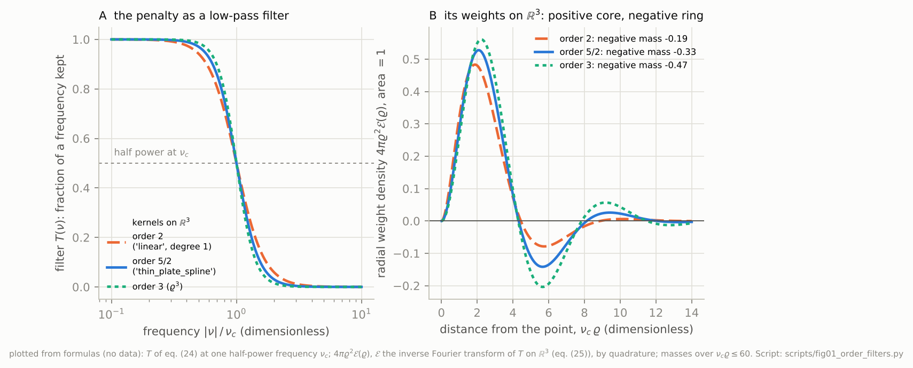
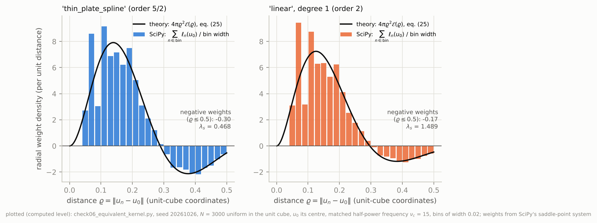
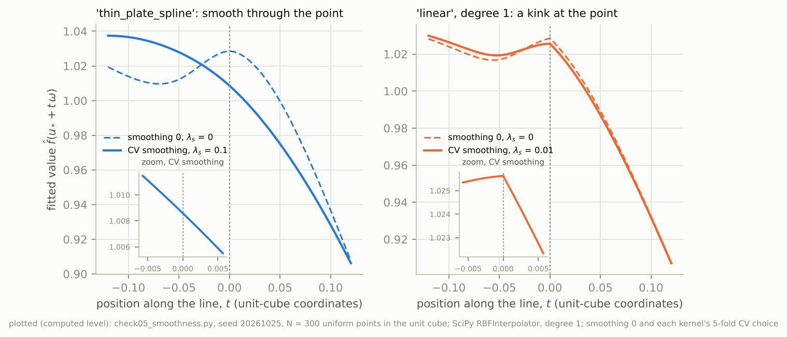
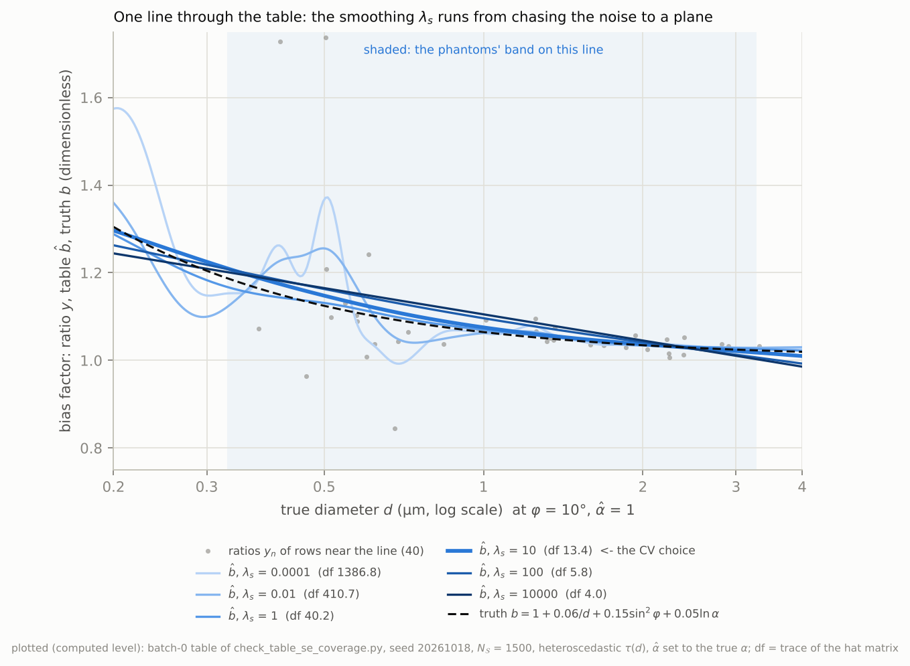
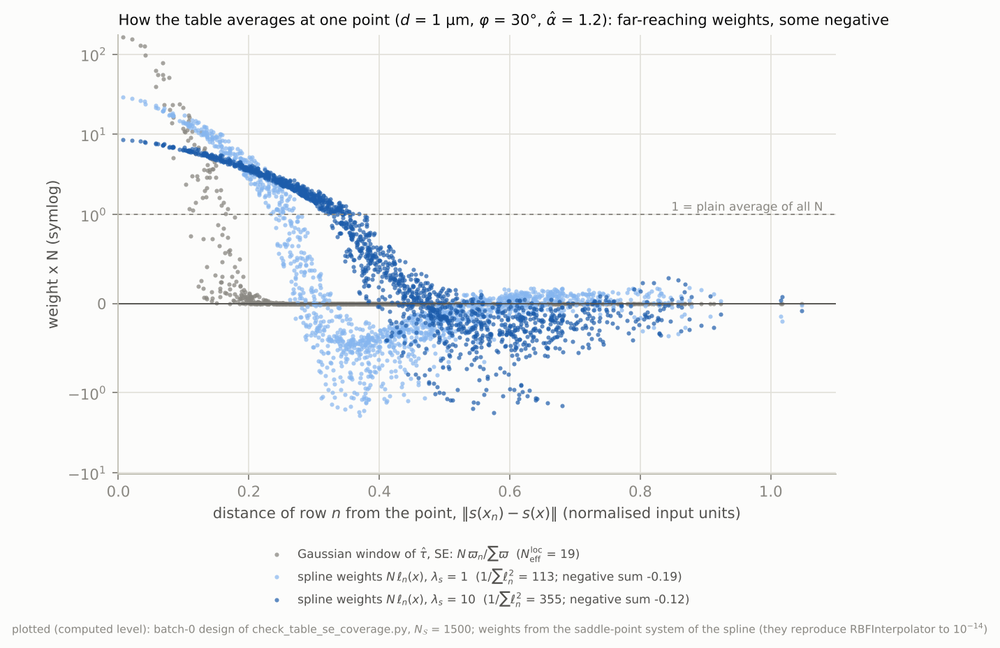

# The thin-plate spline in three dimensions: from the bending plate to SciPy's $\varrho^2\ln\varrho$

**Date:** 2026-10-18

**Abstract.** The bias table of the diameter pipeline (Step 4, `analysis/table.py`) is a smoothing spline fitted with SciPy's `RBFInterpolator(kernel="thin_plate_spline")`. Block 14 will add a third input axis, $\ln\hat\alpha$ (D-053.3), on range-normalised coordinates (D-054 (i)). The thin-plate spline takes its name from an elastic plate, an object of the plane. The statistics textbooks carry it to $p$ dimensions by keeping its derivative penalty, which changes the kernel; SciPy carries it by keeping the kernel, $\varrho^2\ln\varrho$. This document asks what the same call fits when its points live in three dimensions, and builds the answer from the beginning:

- what any smoothing spline solves;
- the cubic spline on the line and the thin plate in the plane;
- the polyharmonic family in any dimension;
- how a kernel's Fourier transform gives the order of the roughness it penalises, and why the kernel does not decide which polynomials stay free;
- what $\varrho^2\ln\varrho$ penalises in three dimensions: a roughness of order 5/2, not the 3-D bending energy;
- how SciPy's linear system follows from the variational problem;
- what the order does to the fitted table: smoothness at the data, the shape and width of the weights, the meaning of the smoothing parameter;
- whether the choice matters for the bias table, on a one-realization fixture of its design.

Deliberately excluded:
- how cross-validation chooses the smoothing (only its consequences appear);
- the table's local statistics and the inversion (Step 5);
- spherical splines;
- tensor-product and B-splines;
- the Gaussian-process reading of splines.

Sources consulted:
- **Project knowledge:** decision log D-024, D-053, D-054, D-059, D-060; SPEC §2.4 and §8.
- **The project's code** at `d643aaf` (`analysis/table.py`, `config.py`).
- **SciPy 1.18.1:** the `RBFInterpolator` docstring and source.
- **PubMed, 14 queries.** Full texts read: PMID 27315105, 39534229, 38098855. Abstracts only: PMID 11437112, 19278914, 16279181, 12662802, 2431869, 2464490, 21851276, 10909925.
- **bioRxiv:** bioinformatics, last 14 days, 30 records.
- **Checks by computation:** eleven scripts run for this document (`check01` to `check10`, and `check07b`, a paired reading of `check07`'s output), plus two earlier scripts of the same day.

Searches that returned nothing:
- PubMed `"radial basis function" AND ("fractional Laplacian" OR "native space" OR "reproducing kernel") AND spline`: 0 records.
- PubMed `"thin plate spline" AND ("higher dimensions" OR "arbitrary dimension" OR multidimensional OR "d dimensions") AND (smoothing OR interpolation)`: 0 records.
- PubMed `Duchon spline fractional seminorm`: 0 records.
- PubMed `("higher-order kernel" OR "higher order kernels") AND (bias OR "negative weights") AND (smoothing OR "kernel estimator")`: 0 records.
- PubMed `"equivalent kernel" AND ("smoothing spline" OR "spline smoothing" OR "thin plate")`: 3 records, none on the subject (the words matched separately).
- PubMed for Duchon's and Meinguet's papers: no matching record (the author search returned only name collisions).
- bioRxiv: nothing relevant among the 30 records.

No claim here concerns a dataset, so no data repository was queried.

---

## 1. Notation and Symbols

The Status column is the pipeline's (Provenance model). "Derivation-only" means the pipeline never evaluates the object; several are evaluated in this document's checks, which is said where it happens.

| Symbol | Name / Meaning | Type & domain | Units | First used in § | Status |
|---|---|---|---|---|---|
| $p$ | dimension of the spline's input space (not $d$, which is the tube diameter in this project) | integer $p\ge1$; the examples use $p\in\{1,2,3\}$ | — | 3.1 | configured: $p=2$ at `d643aaf`, $p=3$ from Block 14 (D-053.3) |
| $x=(\ln d,\ \varphi,\ \ln\hat\alpha)$; $x_n$ | a point of the table's raw input space $\mathcal X$; $x_n=(\ln d_n,\varphi_n,\ln\hat\alpha_n)$ that of row $n$ | $x\in\mathcal X\subset\mathbb R^3$ | $\ln(\mu\text{m})$, rad, — | 3.1 | $d,\varphi$ configured (drawn) / $\hat\alpha$ measured |
| $s$ | range normalisation of D-054 (i); a map $s:\mathcal X\to[0,1]^3$ (not the scale factor $\gamma$ of eq. (23)) | map | — | 3.1 | computed (Block 14, not yet in code) |
| $u,\ u'$; $u_1,\dots,u_p$ | points of the spline's input space, and the components of $u$; in the table $u=s(x)$ | $u\in\mathbb R^p$ (a scalar when $p=1$) | dimensionless | 3.1 | computed |
| $u_n$; $n,n'\in\{1,\dots,N\}$ | data sites (in the table, the phantoms' $s(x_n)$), and the indices of the data | $u_n\in\mathbb R^p$ | dimensionless | 3.2 | computed |
| $N$ | number of data (in the table, $N_{\mathcal S}$, the rows in $\mathcal S$) | positive integer | — | 3.2 | computed |
| $y_n$; $y$; $y(u)$ | datum at $u_n$ (in the table the ratio $\hat d_{g,r}/d_g$ of D-060.1), a realized value; $y=(y_1,\dots,y_N)$ the data vector in eqs. (19)–(20); $y(u)$ the data as a field in the continuum argument of eqs. (24)–(25) | $y_n\in\mathbb R$; $y\in\mathbb R^N$; a distribution on $\mathbb R^p$ | dimensionless | 3.2 | computed |
| $f$ | a candidate function | $f:\mathbb R^p\to\mathbb R$ | as $y$ | 3.2 | — |
| $\hat f$ | the smoothing spline, an estimate (computed level); in the table $\hat b(x\mid\mathcal C,\mathcal S)=\hat f(s(x))$ | $\hat f:\mathbb R^p\to\mathbb R$ | as $y$ | 3.2 | computed |
| $b(x\mid\mathcal C,\mathcal S)$ | the table's target, the conditional mean ratio (analytic level, D-060.1); $\hat b$ estimates it | $\mathcal X\to\mathbb R$ | dimensionless | 3.1 | derivation-only (closed form in check fixtures) |
| $\mathcal C,\ \mathcal S$ | configuration; selection of counted rows (project symbols) | dict; event | — | 3.1 | configured |
| $d,\ \varphi,\ \hat\alpha$ | a phantom's true diameter, tilt, and fitted optical depth (project symbols) | $d>0$; $\varphi\in[0,\pi/2)$; $\hat\alpha>0$ | µm; rad; — | 3.1 | configured (drawn) / measured ($\hat\alpha$) |
| $\alpha$, $\mu$ | a phantom's true optical depth and its attenuation coefficient, $\alpha=\mu d/\cos\varphi$ (project symbols, D-024 (iii)) | $\alpha>0$; $\mu>0$ | —; µm⁻¹ | 3.10 | configured (drawn) |
| $\hat d_{g,r}$, $d_g$; $g$, $r$ | fitted and true diameter of realization $r$ of draw $g$ (D-059); a row $n$ of the spline is one $(g,r)$ | $>0$; integers | µm | 1 (table) | measured; configured |
| $\hat\tau$, SE | local scatter of the ratio about $\hat b$ and its standard-error proxy (SPEC §2.4) | $\ge0$ | dimensionless | 3.10 | computed |
| $J(f)$ | a roughness penalty (a squared seminorm), zero on its null space | $J(f)\in[0,\infty]$ | $[y]^2$ (in eq. (1)) | 3.2 | derivation-only |
| $\lambda_J$ | the multiplier of $J$ in eq. (1) | $\lambda_J\ge0$ | — | 3.2 | derivation-only |
| $\lambda_s$ | SciPy's `smoothing`, the multiplier of $c^\top Kc$ in eq. (19) | $\lambda_s\ge0$ (scalar) | — | 3.3 | computed (CV over a configured grid) |
| $\lambda_n$ | per-point smoothing, `smoothing` passed as an array | $\lambda_n>0$, $n=1..N$ | — | 3.8 | not used by `table.py` (scalar) |
| $\varepsilon$, $\eta$ | size and direction of a perturbation in the variational argument | $\varepsilon\in\mathbb R$; $\eta$ a smooth function on $\mathbb R^p$ | —; as $y$ | 3.3 | — |
| $m$ | order of a penalty: an integer for a derivative penalty, $5/2$ for SciPy's kernel on $\mathbb R^3$; $m=\kappa+\sigma$ for a Duchon pair | $m\in\{1,\tfrac32,2,\tfrac52,3,\dots\}$ | — | 3.3 | — |
| $m_0$ | order of conditional positive definiteness of a kernel (eq. (16)) | positive integer | — | 3.6 | — |
| $(\kappa,\sigma)$ | a Duchon pair: $\kappa$ whole derivatives, then a fractional order $\sigma$; it fixes the frequency weight $\lvert\nu\rvert^{2(\kappa+\sigma)}$ and the free polynomials $\mathbb P_{\kappa-1}$ | $\kappa\in\{1,2,\dots\}$; $-p/2<\sigma<p/2$; $\kappa+\sigma>p/2$ | — | 3.6 | derivation-only |
| $\Delta$, $\Delta_\nu$ | the Laplacian on $\mathbb R^p$, acting on $u$ ($\Delta_\nu$: acting on the frequency $\nu$); $\Delta^k$ its $k$-th power; $(-\Delta)^m$ for non-integer $m$ is defined in frequency, as multiplication by $\lvert\nu\rvert^{2m}$ | operator | — | 3.3 | — |
| $k$ | a generic non-negative integer: a power in $\Delta^k$, a polynomial degree in $\mathbb P_k$ | integer | — | 3.5 | — |
| $\delta$ | Dirac delta at the origin | distribution on $\mathbb R^p$ | — | 3.3 | — |
| $\varrho$ | Euclidean distance, $\varrho=\lVert u-u'\rVert$ (on the line, $\lvert u-u'\rvert$) | $\varrho\ge0$ | dimensionless | 3.3 | — |
| $C$ | point-source strength of a kernel: $\Delta^m(\text{kernel})=C\,\delta$ | real constant | — | 3.3 | derivation-only (exact in check01) |
| $C^0$, $C^1$, $C^2$ | smoothness classes: continuous, once and twice continuously differentiable (a superscript, unlike the constant $C$) | function classes | — | 3.1 | — |
| $i,\ j$; $i_1,\dots,i_m$ | coordinate indices in $\partial_i\partial_j$ and in the tuples of eq. (9) (not the SWC node indices of the SPEC) | $\{1,\dots,p\}$ | — | 3.4 | — |
| $\mathrm i$ | the imaginary unit, set in roman to keep it apart from the index $i$ | $\mathrm i^2=-1$ | — | 3.5 | — |
| $f_{ij}$, $\operatorname{Hess}f$ | second partial derivatives $\partial_i\partial_jf$, and the Hessian matrix $(f_{ij})_{i,j=1}^{p}$ | functions on $\mathbb R^p$; $p\times p$ matrix-valued | as $y$ | 3.4 | — |
| $\psi$ | a radial kernel: $\psi_{\rm tps}(\varrho)=\varrho^2\ln\varrho$ ($\psi_{\rm tps}(0)=0$), $\psi_{\rm lin}(\varrho)=-\varrho$, $\psi_{\rm cub}(\varrho)=\varrho^3$; SciPy's `thin_plate_spline`, `linear`, `cubic` | $\psi:[0,\infty)\to\mathbb R$ | — | 3.3 | configured: $\psi_{\rm tps}$ (D-024 (v)) |
| $\beta$ | the power of a kernel $\varrho^\beta$ or $\varrho^\beta\ln\varrho$ (not the SGT shape parameter of D-052) | $\beta>0$ | — | 3.6 | — |
| $\mathcal G^{(p)}_m$ | fundamental solution of $\Delta^m$ on $\mathbb R^p$, $\Delta^m\mathcal G^{(p)}_m=\delta$ | radial function | — | 3.3 | derivation-only |
| $c=(c_1,\dots,c_N)$ | kernel coefficients ("loads") | $c\in\mathbb R^N$ | as $y$ | 3.3 | computed inside `RBFInterpolator` |
| $(q_0,\mathbf q)$ | coefficients of the affine part $q_0+\mathbf q^\top u$ (written $q_0+q_1u$ when $p=1$) | $\mathbb R\times\mathbb R^p$ | as $y$ | 3.3 | computed inside `RBFInterpolator` |
| $K$ | kernel matrix, $K_{nn'}=\psi(\lVert u_n-u_{n'}\rVert)$ | $\mathbb R^{N\times N}$, symmetric, indefinite | — | 3.3 | computed |
| $I$ | identity matrix | $\mathbb R^{N\times N}$ | — | 3.8 | — |
| $P$ | polynomial matrix; for degree 1 its rows are $(1,u_n^\top)$ | $\mathbb R^{N\times(p+1)}$ at degree 1 | — | 3.6 | computed |
| $\mathbb P_k$ | polynomials on $\mathbb R^p$ of total degree $\le k$ | vector space | — | 3.5 | — |
| $\mathcal F$ | Fourier transform, $(\mathcal Ff)(\nu)=\int f(u)e^{-\mathrm i\nu\cdot u}\,du$ | operator | — | 3.5 | — |
| $\nu$ | frequency | $\nu\in\mathbb R^p$ | rad per unit of $u$ | 3.5 | — |
| $\Psi$ | generalised Fourier transform of $u\mapsto\psi(\lVert u\rVert)$ on $\mathbb R^p$, $\Psi(\nu)=A\lvert\nu\rvert^{-2m}$ | $\mathbb R^p\setminus\{0\}\to(0,\infty)$ | — | 3.5 | derivation-only (computed in checks) |
| $A$ | the constant of $\Psi$: $12\pi^2$ ($\psi_{\rm tps}$, $\mathbb R^3$); $8\pi$ ($\psi_{\rm lin}$, $\mathbb R^3$; $\psi_{\rm tps}$, $\mathbb R^2$); for an integer order it is $\lvert C\rvert$, the magnitude of the point-source strength (12 for $\psi_{\rm cub}$ on $\mathbb R^1$) | $A>0$ | — | 3.6 | derivation-only |
| $J^{(p)}_m$ | the order-$m$ derivative penalty on $\mathbb R^p$, eq. (9) | functional | — | 3.5 | derivation-only |
| $J_\psi$ | native seminorm of $\psi$, eq. (14) | functional | — | 3.6 | derivation-only |
| $J_{\kappa,\sigma}$ | Duchon's seminorm of the pair $(\kappa,\sigma)$ (§3.6) | functional | — | 3.6 | derivation-only |
| $J_{5/2}$ | the order-5/2 penalty on $\mathbb R^3$, eq. (17) | functional | — | 3.7 | derivation-only |
| $\tilde c(\nu)$ | $\sum_n c_n e^{-\mathrm i\nu\cdot u_n}$, the Fourier transform of the loads (a tilde, since a hat means an estimate) | $\mathbb R^p\to\mathbb C$ | — | 3.6 | derivation-only |
| $\xi=(\xi_1,\xi_2,\xi_3)$ | integration variable in the constant of eq. (18) | $\xi\in\mathbb R^3$ | dimensionless | 3.7 | — |
| $\gamma$ | a scale factor applied to every coordinate, eq. (23) | $\gamma>0$ | — | 3.8 | — |
| $\ell_n(u)$ | weight of datum $n$ in the fit at $u$: $\hat f(u)=\sum_n\ell_n(u)y_n$ (fixed $\lambda_s$) | $\ell_n(u)\in\mathbb R$ | — | 3.9 | derivation-only (computed in checks) |
| $H$, $\mathrm{df}$ | hat matrix $H_{nn'}=\ell_{n'}(u_n)$; effective degrees of freedom $\mathrm{df}=\operatorname{tr}H$ | $\mathbb R^{N\times N}$; $[p+1,N]$ | — | 3.9 | derivation-only (computed in checks) |
| $N_V$ | design density, data per unit volume of $u$-space ($N/V$ for a uniform design; `rho` in the scripts) | $N_V>0$ | per unit volume | 3.9 | derivation-only (estimated in check08) |
| $T$ | continuum filter of the smoother, eq. (24) | $\mathbb R^p\to(0,1]$, radial | — | 3.9 | derivation-only |
| $\nu_c$ | half-power frequency: $T(\nu)=\tfrac12$ at $\lvert\nu\rvert=\nu_c$ | $\nu_c>0$ | rad per unit of $u$ | 3.9 | derivation-only |
| $\mathcal E$ | equivalent kernel, the inverse Fourier transform of $T$, eq. (25); radial, written $\mathcal E(\varrho)$ as a function of $\varrho=\lVert u\rVert$ | $\mathbb R^p\to\mathbb R$ | per unit volume | 3.9 | derivation-only (computed in checks) |
| $M_0$, $M_2$ | zeroth and second moments of $\mathcal E$: $\int\mathcal E(u)\,du$ and $\int\lVert u\rVert^2\mathcal E(u)\,du$ | real | —; (unit of $u$)$^2$ | 3.9 | derivation-only (computed in check10) |
| $V$ | volume of the design's region of $u$-space (1 for the unit cube) | $V>0$ | unit volume | 3.9 | — |
| $u_0$ | the centre of the unit cube, the query point of Figure 2 | $u_0=(\tfrac12,\tfrac12,\tfrac12)$ | dimensionless | 3.9 | — |
| $u_*$, $c_*$ | the datum nearest the cube's centre in check05, and its load | $u_*\in[0,1]^3$; $c_*\in\mathbb R$ | dimensionless; as $y$ | 3.9 | computed in check05 |
| $\omega$, $t$ | a fixed unit direction, and the position along the line $u_*+t\,\omega$ | $\omega\in\mathbb R^3$, $\lVert\omega\rVert=1$; $t\in\mathbb R$ | dimensionless | 3.9 | — |
| $h$, $D(h)$ | finite-difference step; slope jump $D(h)=[\hat f(u_*+h\omega)-\hat f(u_*)]/h-[\hat f(u_*)-\hat f(u_*-h\omega)]/h$ | $h>0$; $D(h)\in\mathbb R$ | dimensionless; as $y$ | 3.9 | computed in check05 |
| $u_x$ | the query point of the worked case, $u_x=s(x)$ | $u_x\in[0,1]^3$ | dimensionless | 3.10 | computed |
| $s_0$ | first zero of the scale-free order-5/2 kernel, $\nu_c\varrho$ at the first sign change | $s_0=4.325$ | — | 3.10 | computed in check08 |
| $\varpi_n$, $N^{\rm loc}_{\rm eff}$ | Gaussian window of $\hat\tau$ and SE, and its effective count (Figure 5's legend; SPEC §2.4) | weights $\ge0$; $>0$ | — | 3.10 | computed |
| $\tau(d)$ | SD of the ratio in the check fixture: 0.009 at 1.5 µm and above, 0.18 at 0.6 µm, capped at 0.30 (below 0.51 µm) | function of $d$ | dimensionless | 3.10 | configured (fixture only) |

### Conventions

- $\ln$ is the natural logarithm; $\lVert\cdot\rVert$ the Euclidean norm; vectors are columns.
- The input space is $\mathbb R^p$; $p$ is never the tube diameter $d$.
- $\mathrm i$ (roman) is the imaginary unit; $i$, $j$ (italic) are coordinate indices.
- Fourier pair:
  - $(\mathcal Ff)(\nu)=\int_{\mathbb R^p} f(u)\,e^{-\mathrm i\nu\cdot u}\,du$ and $f(u)=(2\pi)^{-p}\int(\mathcal Ff)(\nu)\,e^{\mathrm i\nu\cdot u}\,d\nu$;
  - Plancherel: $\int|f|^2=(2\pi)^{-p}\int|\mathcal Ff|^2$.
- **The hat.** A hat always means an estimate ($\hat f$, $\hat b$, $\hat d$, $\hat\alpha$), never a Fourier transform. This deviates from the earlier explanation of the same day, which wrote $\hat f(\nu)$ for the transform; here that is $(\mathcal Ff)(\nu)$.
- **Three counts that are easy to conflate.**
  - "Order" is the $m$ of a penalty, fixed by the kernel and the dimension (eq. (13)).
  - "CPD order" is the $m_0$ of eq. (16); it sets SciPy's minimum degree, $m_0-1$.
  - "Degree" is SciPy's `degree` argument. It chooses the free polynomials, $\mathbb P_{\rm degree}$, and with them the Duchon pair, $\kappa=\text{degree}+1$, where one exists (§3.6).
- **Radial functions.** $\psi(\varrho)$ and $\psi(\lVert u\rVert)$, $T(\nu)$ and $T(\lvert\nu\rvert)$, $\mathcal E(u)$ and $\mathcal E(\varrho)$ name the same radial function, of a position or of its distance from the origin.
- **Source tags.** `[CODE: ...]` covers the project's code and the SciPy source it calls. "Earlier run" means a check script of the same day, delivered with this document.

---

## 2. Glossary / Jargon

Ordering: by first appearance; the concepts build on each other.

- **Smoothing spline**: the function that minimises the misfit to the data plus a constant times a roughness penalty (eq. (1)). Operative from §3.2.
- **Roughness penalty, seminorm**: a non-negative quadratic measure of how much a function bends. It is zero on a set of free functions, the null space. Unlike a norm it is zero there, which is why "semi". Operative from §3.2.
- **Null space (of a penalty)**: the functions the penalty does not see, here polynomials of low degree. Moving the fit within it costs nothing. For a derivative penalty it is fixed by the number of derivatives; for a kernel it is a choice of function space, which SciPy makes through `degree` (§3.6). Operative from §3.3.
- **Euler–Lagrange equation**: the condition that the first variation of the objective vanishes. For a spline it says where the loads sit: only at the data. Between them the fit solves the homogeneous equation (on the line it is cubic there). Operative from §3.3.
- **Green's function, fundamental solution**: the response of an operator to a point load: $\mathcal G$ with $\Delta^m\mathcal G=\delta$. Every spline of this document is a sum of shifted copies of one kernel, plus a polynomial; for $\varrho^2\ln\varrho$ on $\mathbb R^3$ that kernel is a fundamental solution only in the fractional sense (§3.5). Operative from §3.3.
- **Side (moment) conditions**: $\sum_nc_n=0$ and $\sum_nc_nu_n=\mathbf 0$: the loads exert no net force and no net torque. Operative from §3.3.
- **Bending energy, thin plate**: the elastic energy of a bent thin plate. Everyday sense differs: a physical plate has a material constant (Poisson's ratio) that this functional sets to zero, and that does not change the spline (§3.4). Operative in §3.4.
- **Thin-plate spline**: three live senses, flagged because the everyday picture (a plate, two-dimensional) fits only the first. In the plane, the bending-energy spline with kernel $\varrho^2\ln\varrho$. In the statistics textbooks, the order-$m$ derivative spline on $\mathbb R^p$, whose kernel changes with $p$. In SciPy, the kernel $\varrho^2\ln\varrho$ in every dimension. §3.13 (a) names the sense in use. Operative from §3.4.
- **Biharmonic**: annihilated by $\Delta^2$. "The biharmonic spline" names the order-2 spline of the space at hand, which is $\varrho^2\ln\varrho$ in the plane and $\varrho$ in space (§3.13). Operative from §3.4.
- **Polyharmonic spline**: a spline whose kernel is $\varrho^\beta$ or $\varrho^\beta\ln\varrho$. These are the fundamental solutions of integer powers of the Laplacian and, in the generalised sense of §3.6, of its fractional powers: $\varrho^2\ln\varrho$ on $\mathbb R^3$ is of no integer power, but $(-\Delta)^{5/2}\psi_{\rm tps}=12\pi^2\delta$ there. Operative from §3.5.
- **Plancherel theorem**: the Fourier transform preserves squared integrals up to $(2\pi)^p$. It turns a derivative penalty into a frequency weight. Operative from §3.5.
- **Generalised Fourier transform**: the Fourier transform of a growing function such as $\varrho^2\ln\varrho$. It is defined by testing against functions whose transforms vanish to a high enough order at $\nu=0$, and exists only away from $\nu=0$. Operative from §3.6.
- **Conditionally positive definite (CPD) of order $m_0$**: a kernel whose quadratic form $c^\top Kc$ is positive for every $c\neq0$ whose moments of degree $<m_0$ vanish. Operative from §3.6.
- **Native space, native seminorm**: the function space a kernel induces, with the seminorm (14) that its spline minimises. Operative from §3.6.
- **Duchon spline**: a spline minimising one of Duchon's rotation-invariant seminorms. Each is set by a pair $(\kappa,\sigma)$: $\kappa$ whole derivatives, then a fractional order $\sigma$. The pair fixes the kernel through $\kappa+\sigma$ and the free polynomials through $\kappa$, so one kernel can belong to several pairs. SciPy's $\varrho^2\ln\varrho$ on $\mathbb R^3$ at degree 1 is the pair $(2,\tfrac12)$. Operative from §3.6.
- **Gagliardo (Slobodeckij) seminorm**: the real-space form of a fractional-order seminorm, a double integral of squared differences over a power of the distance. Operative in §3.7.
- **Unisolvent, full column rank**: the data sites determine a polynomial of the chosen degree uniquely from its values there; at degree 1, they are not all on one plane in $\mathbb R^3$. Operative in §3.8.
- **Linear smoother, hat matrix, effective degrees of freedom**: a fit that is a fixed linear combination of the data; the matrix of those combinations at the data; its trace. Operative from §3.9.
- **Equivalent kernel**: the weights $\ell_n(u)$ read as a function of where datum $n$ lies relative to $u$. "Kernel" has four senses in this project; see §3.13 (e). Operative from §3.9.
- **Transfer function, low-pass filter, half-power frequency**: how much of each frequency a smoother keeps, and the frequency at which it keeps half. Operative from §3.9.
- **Moments of a kernel; higher-order kernel**: the integrals of the weights against powers of the distance. The zeroth is the total weight; the second sets the bias a curvature of the target puts into the average. A higher-order kernel has a vanishing second moment, which removes that bias at leading order and forces some weights to be negative. "Order" here is the kernel-smoothing sense, not the order $m$ of a penalty. Operative in §3.9.
- **Local-density approximation**: predicting a smoother's weights at a point from the design density at that point alone. Operative in §3.10.

---

## 3. Main body

### 3.1 Where the name stops fitting

*Establishes: where the question arises in the project, and what exactly is in question.*

The bias table turns scattered phantom rows into a function that Step 5 can invert. Its estimator is one SciPy call, `RBFInterpolator(X, y, kernel="thin_plate_spline", smoothing=float(lam))` [CODE: `analysis/table.py` `_spline`, `d643aaf`]. The rows enter through the chain

$$x_n=(\ln d_n,\ \varphi_n,\ \ln\hat\alpha_n)\ \xrightarrow{\ s\ }\ u_n\in[0,1]^3\ \longrightarrow\ \hat f\ \longrightarrow\ \hat b(x\mid\mathcal C,\mathcal S)=\hat f(s(x))\ \longrightarrow\ \text{Step 5}.$$

Here $\hat b$ is the computed-level estimate of $b(x\mid\mathcal C,\mathcal S)$, the conditional mean ratio at $x$, an analytic-level object (D-060.1) [KB: `TEEG_decisions_and_ideas_log.md`].

At `d643aaf` the chain has two inputs, not three:
- `table_inputs` returns $(\ln d,\varphi)$ in raw units [CODE: `analysis/table.py`];
- in two dimensions SciPy's kernel is the thin-plate spline in the full sense of §3.4.

Block 14 changes the input:
- it adds $\ln\hat\alpha$ as a third axis (D-053.3);
- it normalises the three axes to $[0,1]$ (D-054 (i)) [KB: decision log].

From then on, the same call receives points in $\mathbb R^3$. The kernel does not follow the dimension: SciPy defines `thin_plate_spline` as $\varrho^2\ln\varrho$ (0 at $\varrho=0$) whatever the dimension of the points [CODE: SciPy 1.18.1, `scipy/interpolate/_rbfinterp_xp.py`, function `thin_plate_spline`]. That module is SciPy's array-API version. The NumPy path that `table.py` takes runs the compiled module `_rbfinterp_pythran`, whose source is not in the installed package, so the readable module was read as its stand-in; §3.8's reproduction check is what ties the two [CODE: `_rbfinterp_np.py`, imports].

A thin plate is a two-dimensional elastic sheet, and $\varrho^2\ln\varrho$ is the plate's kernel (§3.4). The statistics textbooks extend the thin-plate spline to $p$ dimensions by keeping the plate's kind of penalty, and their 3-D spline has another kernel (§3.13 (a)); SciPy keeps the kernel instead. So the same kernel in $\mathbb R^3$ must be minimising something else, and the questions are what, whether it is sensible, and whether it matters. The short answer:
- it minimises a roughness of order $5/2$ (§3.7);
- at SciPy's degree 1 it is a well-posed spline with the plate's free planes and a $C^1$ surface;
- it is not the 3-D analogue of the plate's bending energy, which is SciPy's `linear` kernel with `degree=1`;
- on a one-realization fixture of the table's design it was slightly more accurate than the bending-energy spline in 9 of 10 tables, in value and in slope, while the smoothing that cross-validation chose mattered more than the kernel (§3.11).

The rest of the document builds this up from the beginning.

### 3.2 What any smoothing spline solves

*Establishes: the problem class (eq. (1)), and why everything that follows is a question about the penalty.*

The data are $N$ values $y_n$ at scattered sites $u_n\in\mathbb R^p$, each carrying noise. Two naive representations fail in opposite ways:
- a function through every point copies the noise into the table;
- a function of fixed form (a plane, say) cannot follow a curved $b$.

A smoothing spline takes the middle course. It passes as close to the data as it can while bending as little as it can, and one number sets the exchange rate:

$$\hat f=\arg\min_{f}\ \sum_{n=1}^{N}\big(y_n-f(u_n)\big)^2+\lambda_J\,J(f),\qquad \lambda_J\ge0.\tag{1}$$

The misfit term pulls the function toward the data, and $J(f)\ge0$ resists bending. The physical picture, made exact in §3.4:
- an elastic sheet is pulled toward the data points by springs;
- $J$ is the sheet's elastic energy, and $\lambda_J$ its stiffness;
- the spline is the sheet's resting shape.

$J$ is zero exactly on its null space, the functions it does not see. The two limits follow:
- $\lambda_J\to0$: the fit interpolates the data (distinct sites);
- $\lambda_J\to\infty$: the fit is forced into the null space, where it becomes the least-squares fit of that space.

Both limits are confirmed for SciPy's kernel on the table's design [RUN: earlier run `scripts/check_tps_deep.py`, T2: interpolation to $3\cdot10^{-7}$ at smoothing $10^{-10}$, the least-squares plane to $4\cdot10^{-10}$ at $10^{10}$] [Certain].

Everything after this is about one choice, the penalty $J$. It decides three things:
- which functions are free;
- the form of the solution, through its kernel (§3.3–3.6);
- how the fit trades noise for detail across scales (§3.9).

### 3.3 One dimension: the beam and the cubic spline

*Establishes: the template that every later section reuses: penalty, Euler–Lagrange equation, point loads, Green's function, solution as kernels plus a null-space part with side conditions, and the identity "energy = constant × $c^\top Kc$".*

On the line, the classical penalty is the bending energy of a thin elastic beam: the draftsman's spline, a strip of wood held by weights at the data points. A straight line costs nothing, and curvature costs its square:

$$J^{(1)}_2(f)=\int_{\mathbb R}f''(u)^2\,du.\tag{2}$$

**Why the solution is piecewise cubic.** Perturb the minimiser $\hat f$ of (1) to $\hat f+\varepsilon\eta$, for a number $\varepsilon$ and an arbitrary smooth function $\eta$. The objective must not change to first order in $\varepsilon$:

$$-2\sum_n(y_n-\hat f(u_n))\,\eta(u_n)+2\lambda_J\int_{\mathbb R}\hat f''(u)\,\eta''(u)\,du=0\quad\text{for all smooth }\eta.$$

Integrating the second term by parts twice moves both derivatives onto $\hat f$, and the condition becomes an equation for $\hat f$ in the sense of distributions:

$$\lambda_J\,\hat f''''(u)=\sum_{n=1}^N\big(y_n-\hat f(u_n)\big)\,\delta(u-u_n).\tag{3}$$

Equation (3) says that the beam carries no load between the data, so $\hat f''''=0$ and $\hat f$ is cubic there. At each datum it carries a point load equal to the residual divided by $\lambda_J$. The response to a unit point load is the Green's function. Since $\frac{d^4}{du^4}\lvert u\rvert^3=12\,\delta(u)$, it is $\mathcal G^{(1)}_2(u)=\lvert u\rvert^3/12$, that is $\varrho^3/12$ with $\varrho=\lvert u\rvert$ [RUN: `scripts/check01_green_functions.py`, exact] [Certain]. The solution is therefore one copy of $\varrho^3$ per datum, centred there, plus a line:

$$\hat f(u)=\sum_{n=1}^Nc_n\,\lvert u-u_n\rvert^3+q_0+q_1u,\qquad 12\,\lambda_J\,c_n=y_n-\hat f(u_n),\qquad \sum_nc_n=0,\quad \sum_nc_nu_n=0.\tag{4}$$

**Where the side conditions come from.** For $u>\max_nu_n$,
$$\hat f''(u)=6\sum_nc_n(u-u_n)=6\Big(u\sum_nc_n-\sum_nc_nu_n\Big).$$
This is a line, and the beam's energy (2) is finite only if it is zero, which requires both moments to vanish [OWN]. The fitted $\hat f''$ is zero outside the hull of the data to below $6\cdot10^{-15}$ [RUN: `scripts/check03_real_space_energies.py`] [Certain]. Mechanically, a free beam under point loads stays in equilibrium only if the loads have no net force and no net moment [OWN].

**The energy of the solution is a quadratic form in the loads**, $J^{(1)}_2(\hat f)=12\,c^\top Kc$ with $K_{nn'}=\lvert u_n-u_{n'}\rvert^3$ [RUN: `scripts/check03_real_space_energies.py`, relative difference $\le2.5\cdot10^{-16}$, two configurations] [Certain]. The factor 12 is the point-source strength $C$ of $\lvert u\rvert^3$, and the same mechanism gives $8\pi$ in §3.4.

The order-1 analogue shows the pattern in its simplest form, and §3.13 (b) needs it:
- the penalty is a taut string, $\int f'^2$;
- the Green's function is $\lvert u\rvert/2$;
- the spline is piecewise linear.

SciPy's `linear` kernel ($-\varrho$) on the line is therefore linear interpolation at zero smoothing, with $\int\hat f'^2=2\,c^\top Kc$ [RUN: `scripts/check03_real_space_energies.py`] [Certain].

**Verdict.** On the line, choosing $J=\int f''^2$ fixes:
- the kernel, $\varrho^3$;
- the free functions, the lines;
- SciPy's equivalent, `kernel="cubic", degree=1`, with smoothing $\lambda_s=12\lambda_J$ (eq. (21) below).

### 3.4 Two dimensions: the thin plate

*Establishes: the thin-plate spline proper: its penalty, its Green's function $\varrho^2\ln\varrho$, its free planes and side conditions, and the identity $J=8\pi\,c^\top Kc$. This is what SciPy fits at `d643aaf`.*

The plate replaces the beam: bending in any direction costs energy, while lifting or tilting costs nothing. With $f_{ij}=\partial_i\partial_jf$, the penalty is

$$J^{(2)}_2(f)=\int_{\mathbb R^2}\big(f_{11}^2+2f_{12}^2+f_{22}^2\big)\,du.\tag{5}$$

Its integrand is the squared Frobenius norm of the Hessian $\operatorname{Hess}f=(f_{ij})$, so it does not depend on how the axes are rotated [OWN] [Certain]. The name comes from plate theory [TXT] [Likely]. The strain energy of a thin elastic plate whose deflection is $f$ is proportional to
$$\int\big[(\Delta f)^2-2(1-\text{Poisson's ratio})(f_{11}f_{22}-f_{12}^2)\big].$$
- At Poisson's ratio 0, this integrand is exactly the one in (5).
- On the whole plane, the determinant term integrates to zero for the functions considered here (it is a null Lagrangian).

So the minimiser does not depend on the material at all [TXT] [Likely].

The variational argument of §3.3, with the integration by parts done in each coordinate, gives the plate's equation:

$$\lambda_J\,\Delta^2\hat f=\sum_{n=1}^N\big(y_n-\hat f(u_n)\big)\,\delta(u-u_n).\tag{6}$$

Away from the data the fitted surface is biharmonic. Its response to a point load is $\varrho^2\ln\varrho$:
- $\Delta^2(\varrho^2\ln\varrho)=0$ for $\varrho>0$;
- its point-source strength, the flux of $\nabla\Delta(\varrho^2\ln\varrho)$ through a small circle, is $8\pi$, so $\mathcal G^{(2)}_2=\varrho^2\ln\varrho/(8\pi)$ [RUN: `scripts/check01_green_functions.py`, exact] [Certain].

The solution has the same structure as (4):

$$\hat f(u)=\sum_{n=1}^Nc_n\,\psi_{\rm tps}(\lVert u-u_n\rVert)+q_0+\mathbf q^\top u,\qquad 8\pi\,\lambda_J\,c_n=y_n-\hat f(u_n),\qquad \sum_nc_n=0,\quad \sum_nc_nu_n=\mathbf 0.\tag{7}$$

The side conditions say that the loads neither lift nor tilt the plate; the affine part does that [OWN].

**Energy identity.** For any $f$ of the form (7),

$$J^{(2)}_2(f)=8\pi\,c^\top Kc,\qquad K_{nn'}=\psi_{\rm tps}(\lVert u_n-u_{n'}\rVert).\tag{8}$$

This was confirmed by integrating $f_{11}^2+2f_{12}^2+f_{22}^2$ over the whole plane, by adaptive quadrature in polar coordinates, for random sites and loads [RUN: `scripts/check03_real_space_energies.py`, relative difference $4.8\cdot10^{-12}$ and $5.7\cdot10^{-12}$] [Certain].

**Correction.** The earlier explanation of the same day wrote "for $f$ of the form (4.3), $J(f)=c^\top Kc$", where $J$ was the bending energy of its (4.2). By (8) the bending energy is $8\pi\,c^\top Kc$; $c^\top Kc$ is the kernel's native seminorm (§3.6). So the smoothing of that answer's (4.4)–(4.5), which is SciPy's, is $8\pi$ times the $\lambda$ of its (4.2). The linear system and every statement about SciPy are unaffected [corrected 2026-10-18].

**Verdict.** In the plane, `RBFInterpolator(kernel="thin_plate_spline")` is the thin-plate spline: the minimiser of misfit plus bending energy, with $\lambda_s=8\pi\lambda_J$. This is the table at `d643aaf`.

### 3.5 Any dimension, any order: the polyharmonic family

*Establishes: the general derivative penalty, its frequency form, its Green's functions in each dimension and its null space. It then shows where $\varrho^2\ln\varrho$ and $\varrho$ sit in this family, and that the former sits at no integer order in $\mathbb R^3$.*

The beam and the plate are two members of one family: penalise every $m$-th derivative, in $p$ dimensions,

$$J^{(p)}_m(f)=\sum_{i_1,\dots,i_m=1}^{p}\ \int_{\mathbb R^p}\big(\partial_{i_1}\cdots\partial_{i_m}f(u)\big)^2\,du,\tag{9}$$

the sum running over all ordered index tuples. For $p=2$, $m=2$ the mixed term appears twice and (9) is (5); for $p=1$ it is (2).

**The frequency form.** Plancherel's theorem turns (9) into a statement about frequencies. Each derivative $\partial_i$ becomes a factor $\mathrm i\nu_i$, and the sum over tuples factorises as $\sum_{i_1..i_m}\nu_{i_1}^2\cdots\nu_{i_m}^2=(\nu_1^2+\dots+\nu_p^2)^m$ [OWN] [Certain]. Hence

$$J^{(p)}_m(f)=(2\pi)^{-p}\int_{\mathbb R^p}\lvert\nu\rvert^{2m}\,\lvert(\mathcal Ff)(\nu)\rvert^2\,d\nu.\tag{10}$$

A derivative penalty is a weight on each frequency. The larger $m$, the more fine detail costs relative to broad trends. This single reading carries the rest of the document.

**The Green's functions.** The variational argument gives, in general,

$$\lambda_J\,(-1)^m\,\Delta^m\hat f=\sum_{n=1}^N\big(y_n-\hat f(u_n)\big)\,\delta(u-u_n),\tag{11}$$

so the spline is a sum of fundamental solutions of $\Delta^m$ plus a polynomial the penalty does not see. Five entries were checked exactly, constants included [RUN: `scripts/check01_green_functions.py`] [Certain]:

| $p$ | $m$ | kernel (fundamental solution up to its constant) | point-source strength $C$ in $\Delta^m(\text{kernel})=C\delta$ | SciPy kernel |
|---|---|---|---|---|
| 1 | 1 | $\varrho$ | $2$ | `linear` ($-\varrho$) |
| 1 | 2 | $\varrho^3$ | $12$ | `cubic` |
| 2 | 2 | $\varrho^2\ln\varrho$ | $8\pi$ | `thin_plate_spline` |
| 3 | 2 | $\varrho$ | $-8\pi$ | `linear` ($-\varrho$) |
| 3 | 3 | $\varrho^3$ | $-96\pi$ | `cubic` |

On the line $\varrho=\lvert u\rvert$. The general rule is [TXT: Duchon 1977; Meinguet 1979; Wahba 1990, from memory] [Likely]:
- $\mathcal G^{(p)}_m\propto\varrho^{2m-p}$ when $p$ is odd;
- $\mathcal G^{(p)}_m\propto\varrho^{2m-p}\ln\varrho$ when $p$ is even and $2m\ge p$.

The family needs $2m>p$ [TXT: Duchon 1977] [Likely]. Otherwise the kernel is singular at $\varrho=0$, or the penalty does not control point values: $m=1$ gives $\ln\varrho$ in the plane and $1/\varrho$ in space. Our cases ($p=3$ with $m=2$ or $5/2$) satisfy it.

**The null space.** The null space of (9) is $\mathbb P_{m-1}$, the polynomials of degree at most $m-1$: an $m$-th derivative kills exactly those [OWN] [Certain]. For $m=2$ these are the affine functions, so planes are free in every dimension.

**Where the two kernels sit.** $\varrho^2\ln\varrho$ is the order-2 kernel only in the plane. In $\mathbb R^3$ the order-2 (bending) kernel is $\varrho$, and $\varrho^2\ln\varrho$ is the fundamental solution of no integer power of the Laplacian. A fundamental solution of $\Delta^k$ must vanish under $\Delta^k$ away from its centre, and here no power does. For $\varrho>0$ [RUN: `scripts/check01_green_functions.py` (c)] [Certain]:
- $\Delta(\varrho^2\ln\varrho)=6\ln\varrho+5$;
- $\Delta^2(\varrho^2\ln\varrho)=6/\varrho^2$, a locally integrable function with no point source: the flux of $\nabla\Delta(\varrho^2\ln\varrho)$ through a small sphere vanishes (this source test was run for $k=2$ only);
- $\Delta^3(\varrho^2\ln\varrho)=12/\varrho^4$ and $\Delta^4(\varrho^2\ln\varrho)=144/\varrho^6$.

Every further power stays nonzero, since on $\mathbb R^3$ $\Delta(\varrho^{2-2k})=(2k-2)(2k-3)\,\varrho^{-2k}$, a positive multiple for $k\ge2$ [OWN] [Certain]. In the generalised sense of §3.6 it is, up to its constant, the fundamental solution of a fractional power: $(-\Delta)^{5/2}\psi_{\rm tps}=12\pi^2\delta$, because $\lvert\nu\rvert^5\,\Psi(\nu)=12\pi^2$ by eq. (12) [OWN: eq. (12)] [Likely]. To find what it minimises in $\mathbb R^3$, the Green's-function route has to be replaced by the frequency route of (10).

### 3.6 Reading a kernel's order from its Fourier transform

*Establishes: a kernel's generalised Fourier transform $\Psi$ fixes the penalty it minimises (its native seminorm $J_\psi$); for a spline, $J_\psi=c^\top Kc$; $\Psi\propto\lvert\nu\rvert^{-2m}$ gives the order. Also what conditional positive definiteness requires of the side conditions, and why the kernel does not decide which polynomials are free.*

Equations (10) and (11) are two halves of one fact:
- the penalty weights frequency $\nu$ by $\lvert\nu\rvert^{2m}$;
- its kernel, scaled so that $(-1)^m\Delta^m\psi=\delta$, has a transform with $\lvert\nu\rvert^{2m}\,\Psi(\nu)=1$, since $\Delta$ becomes multiplication by $-\lvert\nu\rvert^2$.

So the kernel's transform is the reciprocal of the penalty's weight. Turned around, this gives a recipe for any kernel: compute its transform $\Psi$, and the kernel is the spline kernel of the penalty that weights each frequency by $1/\Psi$. The recipe needs no Green's function of an integer power, which is what $\varrho^2\ln\varrho$ in $\mathbb R^3$ requires.

**The transforms.** For the three kernels of this document,

$$\Psi(\nu)=A\,\lvert\nu\rvert^{-2m}\ \ (\nu\neq0):\qquad \psi_{\rm tps}\text{ on }\mathbb R^3:\ A=12\pi^2,\ 2m=5;\qquad \psi_{\rm lin}\text{ on }\mathbb R^3:\ A=8\pi,\ 2m=4;\qquad \psi_{\rm tps}\text{ on }\mathbb R^2:\ A=8\pi,\ 2m=4.\tag{12}$$

The derivation for $\psi_{\rm tps}$ on $\mathbb R^3$ takes three steps:
1. $\Delta^2\psi_{\rm tps}=6/\varrho^2$, with no point source (§3.5).
2. The transform of $1/\varrho^2$ on $\mathbb R^3$ is $(4\pi/\lvert\nu\rvert)\int_0^\infty\sin(\lvert\nu\rvert\varrho)/\varrho\,d\varrho=2\pi^2/\lvert\nu\rvert$.
3. Dividing by $\lvert\nu\rvert^4$, which is what $\Delta^2$ contributes in frequency, gives $\Psi=12\pi^2\lvert\nu\rvert^{-5}$.

The other two entries follow from the point sources of §3.5. Step 2 is exact [RUN: `scripts/check02_fourier_seminorm.py` (a)] [Certain]. The three transforms, constants included, are confirmed independently by check (c) below, where the Fourier integral built with them reproduces $c^\top Kc$ [RUN: same, (c)] [Certain] for the configurations run. They also agree exactly with Wendland's Theorems 8.16–8.17 as I recall them, converted to this document's convention [RUN: same, (b)]; that check confirms the derivation against my recall, not against the book [TXT, from memory] [Likely].

Wendland's general rule is [TXT: Wendland 2005, Thms 8.16–8.17, from memory] [Likely]; the three cases above agree with it:

$$u\mapsto\lVert u\rVert^\beta\ (\beta\notin2\mathbb N)\quad\text{and}\quad u\mapsto\lVert u\rVert^\beta\ln\lVert u\rVert\ (\beta\in2\mathbb N)\quad\text{have}\quad\Psi\propto\lvert\nu\rvert^{-p-\beta},\quad\text{so the order is}\quad m=\frac{p+\beta}{2}.\tag{13}$$

The order is therefore not a property of the kernel alone but of the kernel and the dimension [OWN: eq. (13)] [Likely]; the three bold entries are checked [Certain]:

| SciPy kernel | $\beta$ | order on $\mathbb R^1$ | order on $\mathbb R^2$ | order on $\mathbb R^3$ | SciPy minimum `degree` [CODE] |
|---|---|---|---|---|---|
| `linear` ($-\varrho$) | 1 | 1 | 3/2 | **2** | 0 |
| `thin_plate_spline` ($\varrho^2\ln\varrho$) | 2 | 3/2 | **2** | **5/2** | 1 |
| `cubic` ($\varrho^3$) | 3 | 2 | 5/2 | 3 | 1 |
| `quintic` ($-\varrho^5$) | 5 | 3 | 7/2 | 4 | 2 |

**The penalty a kernel minimises.** For a kernel $\psi$ with transform $\Psi>0$, the native seminorm is

$$J_\psi(f)=(2\pi)^{-p}\int_{\mathbb R^p}\frac{\lvert(\mathcal Ff)(\nu)\rvert^2}{\Psi(\nu)}\,d\nu.\tag{14}$$

For a spline $f=\sum_nc_n\psi(\lVert\cdot-u_n\rVert)+q_0+\mathbf q^\top u$ with $P^\top c=0$,

$$J_\psi(f)=c^\top Kc.\tag{15}$$

The reason, in words: away from $\nu=0$ the affine part has no transform, and the kernel part has transform $\tilde c(\nu)\Psi(\nu)$, with $\tilde c(\nu)=\sum_nc_ne^{-\mathrm i\nu\cdot u_n}$. So (14) becomes $(2\pi)^{-p}\int\lvert\tilde c\rvert^2\Psi$, which is $\sum_{n,n'}c_nc_{n'}\psi(\lVert u_n-u_{n'}\rVert)$ by the inverse transform [TXT: Wendland 2005, ch. 8 and 10] [Likely]. The side conditions make this exact: they make $\tilde c$ vanish fast enough at $\nu=0$ for the integral to converge.

This was confirmed numerically by reducing the integral to one radial dimension (angular averages: $\sin(\nu\varrho)/(\nu\varrho)$ on $\mathbb R^3$, the Bessel function of order zero on $\mathbb R^2$) and comparing with $c^\top Kc$ [RUN: `scripts/check02_fourier_seminorm.py` (c): seven random sites, three trials per kernel, relative difference $\le8.1\cdot10^{-7}$ for $\psi_{\rm tps}$ on $\mathbb R^3$ and $\mathbb R^2$ and $\psi_{\rm lin}$ on $\mathbb R^3$] [Certain] for those configurations. With (10), (12) and (14), the integer-order penalties are constant multiples of native seminorms [OWN: eqs. (10), (12), (14)] [Certain]:
- in the plane, $J^{(2)}_2=8\pi\,J_{\psi_{\rm tps}}$, which (8) confirms independently of Fourier theory;
- in space, $J^{(3)}_2=8\pi\,J_{\psi_{\rm lin}}$.

**Why the side conditions are needed: conditional positive definiteness.** $K$ itself is indefinite: it has negative eigenvalues for every kernel and scale tried [RUN: `scripts/check04_cpd_system_scaling.py` (a)] [Certain]. Positivity holds only on a subspace:

$$\sum_{n,n'}c_nc_{n'}\,\psi(\lVert u_n-u_{n'}\rVert)>0\quad\text{for all }c\neq0\text{ whose moments of degree }<m_0\text{ vanish}.\tag{16}$$

A kernel with this property is called conditionally positive definite of order $m_0$. Through (15), positivity follows whenever the Fourier integral converges at $\nu\to0$, since its integrand $\lvert\tilde c\rvert^2\Psi$ is non-negative:
- if moments of degree $<m_0$ vanish, then $\tilde c(\nu)=O(\lvert\nu\rvert^{m_0})$;
- the integrand then behaves like $\lvert\nu\rvert^{2m_0-2m+p-1}$;
- it converges if $m_0>m-p/2=\beta/2$ [OWN: eqs. (13), (15)] [Likely].

For $\varrho^2\ln\varrho$ ($\beta=2$) this gives $m_0=2$: the affine moments must vanish, which is SciPy's minimum degree 1, in every dimension. For $-\varrho$ ($\beta=1$) it gives $m_0=1$: $\sum c=0$ suffices, which is SciPy's minimum degree 0 [CODE: SciPy docstring, minimum degrees].

Both predictions hold numerically:
- **$\varrho^2\ln\varrho$ with only $\sum c=0$.** The Fourier integral (14) diverges logarithmically: it grows by 17.1 per decade of the lower cutoff, matching the predicted $2\lVert\sum_nc_nu_n\rVert^2\ln10=17.1$. The script prints the radial integral, a sixth of (14), which grows by 2.851 per decade against 2.851 predicted [RUN: `scripts/check02_fourier_seminorm.py` (d), no tolerance set] [Certain] for that configuration. The quadratic form then takes negative values at two of the three scales tried: its smallest eigenvalue on $\{c:\sum c=0\}$ is $-1.75$ for 30 random sites in $[0,1]^3$ and $-1.82\cdot10^3$ in $[0,10]^3$ (it stayed positive in $[0,0.1]^3$). With the affine moments imposed it is positive on all three scales [RUN: `scripts/check04_cpd_system_scaling.py` (a)] [Certain].
- **$-\varrho$.** It is positive with $\sum c=0$ alone [RUN: same] [Certain].

**The kernel fixes the frequency weight, not the free polynomials.** The weight $\lvert\nu\rvert^{2m}$ cannot see a polynomial: a polynomial's transform sits at $\nu=0$, where (14) is not defined. Which polynomials are free is therefore part of the function space on which the problem is posed, not of the kernel. Duchon's framework makes that choice explicit [TXT: Duchon 1977, from memory] [Likely]. Its seminorms take $\kappa$ whole derivatives and then a fractional order $\sigma$,

$$J_{\kappa,\sigma}(f)=(2\pi)^{-p}\int_{\mathbb R^p}\lvert\nu\rvert^{2\sigma}\sum_{i_1,\dots,i_\kappa=1}^{p}\big\lvert\mathcal F(\partial_{i_1}\cdots\partial_{i_\kappa}f)(\nu)\big\rvert^2\,d\nu,\qquad -\frac p2<\sigma<\frac p2,\quad \kappa+\sigma>\frac p2,$$

on the functions for which it is finite. By the factorisation of §3.5 its frequency weight is $\lvert\nu\rvert^{2(\kappa+\sigma)}$, so its order is $m=\kappa+\sigma$ and its kernel is that of (13) with $\beta=2m-p$; the polynomials it leaves free are $\mathbb P_{\kappa-1}$, those that $\kappa$ derivatives kill [OWN: eqs. (10), (13)] [Likely]. One kernel therefore belongs to several pairs, which differ only in what they leave free:
- $\psi_{\rm tps}$ on $\mathbb R^3$ ($m=5/2$): $(\kappa,\sigma)=(2,\tfrac12)$, affine functions free; or $(3,-\tfrac12)$, quadratics free as well;
- $\psi_{\rm lin}$ on $\mathbb R^3$ ($m=2$): $(1,1)$, constants free; $(2,0)$, the bending energy (9), affine functions free; or $(3,-1)$, quadratics free;
- $\psi_{\rm cub}$ on $\mathbb R^3$ ($m=3$): $(2,1)$, affine functions free; $(3,0)$, the order-3 derivative energy, quadratics free; or $(4,-1)$, cubics free.

Given the two bounds on $\sigma$, which allow exactly $m-p/2<\kappa<m+p/2$, these are all the pairs of the three kernels [OWN] [Likely]. In SciPy the choice is the `degree` argument. The polynomial block of the system (20) below is the space left free, so degree $\kappa-1$ is the pair with $\kappa$ whole derivatives [OWN] [Likely]. The bound $\sigma<p/2$ is the CPD condition in other words: with $m_0$ the smallest integer above $m-p/2$, $\kappa\ge m_0$ is the same as $\sigma=m-\kappa<p/2$ [OWN: eq. (16)] [Likely]. The CPD order therefore sets only the smallest admissible degree, $m_0-1$ [CODE: SciPy docstring, minimum degrees]. The bound $\sigma>-p/2$ caps the degree from above: a degree of $m+p/2-1$ or more, which SciPy accepts, has no Duchon pair (degree 3 for `thin_plate_spline` on $\mathbb R^3$) [OWN] [Likely]. Two defaults are not the textbook spline of their kernel:
- `linear` at its default degree 0 is the pair $(1,1)$; the bending energy needs `degree=1`;
- `cubic` at its minimum degree 1 is the pair $(2,1)$; the order-3 energy needs `degree=2`.

`thin_plate_spline` at its default degree 1 is the pair $(2,\tfrac12)$: the plate's free planes, with half a derivative more in the penalty (§3.7). §3.12 shows what the `linear` default costs.

### 3.7 What SciPy's $\varrho^2\ln\varrho$ penalises in three dimensions

*Establishes: the explicit penalty of the 3-D table (eq. (17)), its real-space meaning (eq. (18)), its free functions, and the verdict.*

By (12), $\psi_{\rm tps}$ on $\mathbb R^3$ has $\Psi=12\pi^2\lvert\nu\rvert^{-5}$. The recipe of §3.6 says it minimises the penalty with frequency weight $\lvert\nu\rvert^5$:

$$J_{5/2}(f)=(2\pi)^{-3}\int_{\mathbb R^3}\lvert\nu\rvert^{5}\,\lvert(\mathcal Ff)(\nu)\rvert^2\,d\nu=12\pi^2\,J_{\psi_{\rm tps}}(f),\qquad\text{and for a spline }f(u)=\textstyle\sum_nc_n\psi_{\rm tps}(\lVert u-u_n\rVert)+q_0+\mathbf q^\top u\text{ on }\mathbb R^3\text{ with }P^\top c=\mathbf 0:\ J_{5/2}(f)=12\pi^2\,c^\top Kc.\tag{17}$$

This follows from (12), (14) and (15), and was checked through (15) [RUN: `scripts/check02_fourier_seminorm.py` (c)] [Certain] for the configurations run. The weight $\lvert\nu\rvert^5$ lies between the bending energy's $\lvert\nu\rvert^4$ and the third-order energy's $\lvert\nu\rvert^6$: it is half a derivative more than bending.

**In real space.** Write $\lvert\nu\rvert^5=\lvert\nu\rvert\cdot\sum_{i,j}\nu_i^2\nu_j^2$. Since $\mathcal F(\partial_i\partial_jf)=-\nu_i\nu_j\,\mathcal Ff$, each term $\nu_i^2\nu_j^2\lvert\mathcal Ff\rvert^2$ is $\lvert\mathcal F(\partial_i\partial_jf)\rvert^2$, so $J_{5/2}$ is the order-1/2 seminorm of the Hessian: the pair $(2,\tfrac12)$ of §3.6, the one SciPy's degree 1 selects. On $\mathbb R^3$ the order-1/2 seminorm has a real-space form, a double integral of squared differences over the fourth power of the distance, with constant $2\pi^2$. That gives

$$J_{5/2}(f)=\frac{1}{2\pi^2}\sum_{i,j=1}^{3}\ \iint_{\mathbb R^3\times\mathbb R^3}\frac{\big\lvert\partial_i\partial_jf(u)-\partial_i\partial_jf(u')\big\rvert^2}{\lVert u-u'\rVert^{4}}\,du\,du'.\tag{18}$$

Two claims enter (18), with different evidence:
- The real-space form of the order-1/2 seminorm is the Gagliardo seminorm [TXT] [Likely].
- Its constant was computed as $2\int(1-\cos\xi_1)/\lVert\xi\rVert^4d\xi=2\pi^2$ and confirmed on a Gaussian test function, both sides by quadrature, to $10^{-8}$ [RUN: `scripts/check02_fourier_seminorm.py` (e)] [Certain] for the constant.

The step to the spline itself needs the spline's Hessian in that space. The Hessian decays at infinity and has only logarithmic peaks at the data [OWN] [Likely].

Read plainly, (18) measures how much the curvature at one point differs from the curvature at another, weighted by the inverse fourth power of their distance. It is a curvature-variation energy where the plate's is a curvature energy. Since both penalties are homogeneous, "cheaper" or "dearer" has a meaning only relative to a scale. That scale is $\lambda_s$, and §3.9 makes the comparison at a matched scale: there the order-5/2 smoother keeps the broad features more completely and cuts the fine ones more sharply than the order-2 one.

**Its family, its free functions, its smoothness.**
- **Family.** In Duchon's family of rotation-invariant seminorms, (17) is the case "two derivatives plus half a derivative": a Duchon spline of fractional order [TXT: Duchon 1977] [Likely]. The same fractional-Laplacian structure is the link between polyharmonic splines and fractal (fractional Brownian) fields in the image-processing literature, according to PubMed [ABS: PMID 19278914, abstract only; [DOI](https://doi.org/10.1109/TIP.2008.2011451)].
- **Free functions.** At SciPy's degree 1 they are the affine ones, those of the pair $(2,\tfrac12)$: two whole derivatives are taken before the half derivative. With `degree=2` the same kernel would fit the pair $(3,-\tfrac12)$ and leave the quadratics free as well. The degree decides this, not the kernel (§3.6) [OWN] [Likely].
- **Smoothness.** The kernel is $C^1$ at its centre in every dimension: $\psi_{\rm tps}'(0^+)=0$ and $\psi_{\rm tps}''(\varrho)\to-\infty$ as $\varrho\to0^+$ [RUN: `scripts/check01_green_functions.py` (d)] [Certain]. §3.9 shows what this does to the fitted table.

**Verdict.** In $\mathbb R^3$, `RBFInterpolator(kernel="thin_plate_spline")` at its default degree 1 is a well-posed smoothing spline. It has order 5/2, the plate's free planes and a $C^1$ surface, but it is not the 3-D bending-energy spline. The 3-D bending-energy spline is `kernel="linear", degree=1`, by (12), (15) and $J^{(3)}_2=8\pi J_{\psi_{\rm lin}}$ [OWN; RUN: `scripts/check02_fourier_seminorm.py` (c)] [Certain] for the configurations run.

**Correction.** The earlier explanation said the 3-D bending-energy spline "would use $\varrho$, which is SciPy's `linear` kernel ($-\varrho$)". This needs `degree=1`: SciPy's default degree for `linear` is 0 [CODE: SciPy docstring], which leaves the tilts out of the free functions (§3.12) [corrected 2026-10-18].

### 3.8 From the variational problem to SciPy's linear system

*Establishes:*
- *SciPy's system is the stationarity condition of the finite problem that (15) produces, and its coefficients minimise it;*
- *each residual equals $\lambda_s$ times its load;*
- *how $\lambda_s$ relates to $\lambda_J$;*
- *per-point smoothing as weighted least squares;*
- *the scaling rule;*
- *the solvability conditions as implemented.*

Equation (15) turns the infinite-dimensional problem (1) into a finite one. The minimiser of misfit plus $\lambda_J$ times a native seminorm has the form "one kernel per datum plus the null-space polynomial" [TXT: the representer theorem; Duchon 1977; Wahba 1990] [Likely]. On that form the penalty is $c^\top Kc$, so the problem becomes

$$\min_{c,\,q_0,\,\mathbf q}\ \big\lVert y-Kc-P(q_0,\mathbf q)\big\rVert^2+\lambda_s\,c^\top Kc\qquad\text{subject to}\qquad P^\top c=\mathbf 0.\tag{19}$$

The objective is convex on the feasible set: the misfit is a squared norm of an affine map, and $c^\top Kc$ is positive there by (16). So any point that satisfies the constrained optimality conditions is the minimum. One such point is found by asking each residual to equal $\lambda_s$ times its load, $y-Kc-P(q_0,\mathbf q)=\lambda_sc$:
- the gradient in $c$, $-2K\,[\,y-Kc-P(q_0,\mathbf q)-\lambda_sc\,]$, then vanishes;
- the gradient in $(q_0,\mathbf q)$, $-2P^\top[\,y-Kc-P(q_0,\mathbf q)\,]=-2\lambda_sP^\top c$, vanishes by the side condition;
- the constraint's multiplier is zero [OWN] [Likely].

Together:

$$\begin{pmatrix}K+\lambda_sI&P\\P^\top&0\end{pmatrix}\begin{pmatrix}c\\(q_0,\mathbf q)\end{pmatrix}=\begin{pmatrix}y\\\mathbf 0\end{pmatrix},\qquad y_n-\hat f(u_n)=\lambda_s\,c_n.\tag{20}$$

**This is SciPy's system** [CODE: SciPy 1.18.1, `_rbfinterp_xp.py` `_build_system`]:
- the smoothing is added on the diagonal of the kernel block;
- the polynomial block is built on coordinates shifted and scaled to $[-1,1]$ per axis, which changes the basis of the affine functions but not the space, so the fit is the same;
- the system is solved by LAPACK's symmetric-indefinite solver `dsysv` [CODE: `_rbfinterp_np.py`].

The NumPy path that `table.py` takes builds the same system in the compiled module `_rbfinterp_pythran`, whose source is not installed; the array-API module was read in its place (§3.1), and the reproduction check below is what ties the two.

**Checks.** A direct solve of (20) on unscaled coordinates reproduces `RBFInterpolator` to $4.2\cdot10^{-15}$. Its coefficients minimise (19): the objective rose under all 200 random feasible perturbations, and the projected gradient is $7.4\cdot10^{-14}$ of $\lVert y\rVert$. The residual rule holds to below $2\cdot10^{-14}$ [RUN: `scripts/check04_cpd_system_scaling.py` (b)] [Certain]. Affine data are reproduced at every smoothing, for both kernels, to $2.4\cdot10^{-15}$ [RUN: same, (e)] [Certain].

The residual rule is the spring picture made exact: each datum pulls with a load equal to its residual over $\lambda_s$. A stiff fit (large $\lambda_s$) leaves large residuals carried by small loads, and $\lambda_s=0$ forces zero residuals.

**Correction.** The earlier explanation derived (20) by setting the unconstrained gradient in $c$ to zero and dividing by $K$. That step needs $K$ invertible and ignores the constraint's multiplier. The argument above uses convexity on the feasible set instead, and reaches the same system [corrected 2026-10-18].

**$\lambda_s$ against $\lambda_J$.** Comparing (20) with (4), (7) and (17), SciPy's smoothing is the textbook smoothing times the constant that turns the penalty into $c^\top Kc$. That constant is the transform constant $A$ of (12), $\lambda_s=A\,\lambda_J$. For the integer orders it is $\lvert C\rvert$, the point-source strength of §3.5 up to sign, and for $\psi_{\rm tps}$ on $\mathbb R^3$ it is a transform constant only, since no integer power of the Laplacian gives that kernel a point source (§3.5):

$$\lambda_s=12\,\lambda_J\ \ (\mathbb R^1,\ \texttt{cubic},\ J^{(1)}_2);\qquad \lambda_s=8\pi\,\lambda_J\ \ (\mathbb R^2,\ \texttt{thin\_plate\_spline},\ J^{(2)}_2;\ \ \mathbb R^3,\ \texttt{linear}\ \text{degree }1,\ J^{(3)}_2);\qquad \lambda_s=12\pi^2\,\lambda_J\ \ (\mathbb R^3,\ \texttt{thin\_plate\_spline},\ J_{5/2}).\tag{21}$$

[OWN: eqs. (4), (7), (8), (11), (17), (20)] [Certain] for the integer orders, which follow from the Euler–Lagrange equations and the point sources of check01; [Likely] for the $12\pi^2$ entry, which rests on (15) and the representer theorem, checked numerically through (15) in three configurations (§3.6).

**Per-point smoothing.** SciPy also accepts `smoothing` as an array $(\lambda_1,\dots,\lambda_N)$ [CODE: SciPy docstring]. The same stationarity argument shows that (20), with $\operatorname{diag}(\lambda_n)$ in place of $\lambda_sI$, minimises

$$\sum_{n=1}^N\frac{\big(y_n-f(u_n)\big)^2}{\lambda_n}+c^\top Kc\qquad\text{subject to}\qquad P^\top c=\mathbf 0,\tag{22}$$

a weighted least squares with weights $1/\lambda_n$ [OWN; RUN: `scripts/check04_cpd_system_scaling.py` (b), per-point smoothing spread over a factor $e^{\pm2}$: reproduction, 200 of 200 perturbations, projected gradient $6.5\cdot10^{-14}$] [Certain]. With $\lambda_n$ proportional to a datum's variance, the weights become inverse variances. `table.py` passes a scalar [CODE: `analysis/table.py` `_spline`].

**Refinement of the earlier verdict.** The earlier verdict, "what it cannot do is be stiff in one region and soft in another", holds for that scalar smoothing. With the array form the stiffness of the penalty stays uniform, but how strongly each datum pulls can vary. That is the remedy SPEC §8 (d) proposes for the heteroscedastic table (undecided) [KB: SPEC §8 (d)] [corrected 2026-10-18].

**Scaling.** Multiplying every coordinate by a factor $\gamma>0$ changes the kernel to $\psi_{\rm tps}(\gamma\varrho)=\gamma^2\psi_{\rm tps}(\varrho)+\gamma^2\ln\gamma\cdot\varrho^2$. The $\varrho^2$ term contributes nothing under $P^\top c=0$: it adds only a constant to the fit, which the affine part absorbs. So

$$\text{fit at }(\gamma\,u_n,\ \lambda_s)\ =\ \text{fit at }(u_n,\ \lambda_s/\gamma^2)\ \ \text{for }\psi_{\rm tps};\qquad \lambda_s/\gamma\ \ \text{for }\psi_{\rm lin}.\tag{23}$$

[OWN; RUN: `scripts/check04_cpd_system_scaling.py` (c), $\gamma=0.1$ and $3.7$: identical to below $8\cdot10^{-15}$ of the data range] [Certain]

A rescaling of one axis alone is a different matter. In the one case tried, one axis multiplied by 3.7, none of 61 smoothings absorbed it: the closest left a largest difference of 3 % ($\psi_{\rm tps}$) and 4 % ($\psi_{\rm lin}$) of the data range [RUN: same] [Certain] for that case. That no smoothing can absorb such a rescaling in general is an inference: it changes the distances between sites unequally, so the new kernel matrix is not a multiple of $K$ plus a term the affine part absorbs [OWN] [Likely]. The normalisation of D-054 (i) is therefore part of the model: it decides which rows count as near.

**Solvability.** The system is uniquely solvable under three conditions [CODE: SciPy docstring]:
- $P$ has full column rank, i.e. at degree 1 the sites are not all coplanar in $\mathbb R^3$;
- the degree is at least the kernel's minimum;
- at zero smoothing, the sites are distinct.

In this session [RUN: `scripts/check04_cpd_system_scaling.py` (d)] [Certain] for SciPy 1.18.1, this configuration:
- **Coplanar sites** raised `LinAlgError` ("the matrix of monomials ... does not have full column rank") at smoothing 0 and 1.
- **A duplicated site at zero smoothing** was not rejected, although the script had predicted a refusal. The value fitted there (0.128) lay outside its two data values (0.068 and 0.111).
- **At smoothing $10^{-3}$** the value fitted there lay between the two data (0.091).

The project's grid starts at $10^{-6}>0$ [CODE: `config.py` `spline_smoothing_grid`].

### 3.9 What the order does to the fit

*Establishes:*
- *the smoother as a filter in frequency (eq. (24)) with an equivalent kernel (eq. (25));*
- *how the order shapes the weights (Figures 1–2), and why high-order weights must go negative;*
- *how $\lambda_s$ sets the width and the degrees of freedom (eq. (26));*
- *the smoothness of the fit at the data (Figure 3).*

At fixed $\lambda_s$, (20) is linear in $y$, so the fit is a weighted average of the data, $\hat f(u)=\sum_n\ell_n(u)\,y_n$. The weights sum to one because constants are reproduced. The hat matrix $H_{nn'}=\ell_{n'}(u_n)$ has trace $\mathrm{df}$, the number of parameters the fit effectively spends [TXT; RUN: `scripts/check06_equivalent_kernel.py`, $\sum_n\ell_n=1.0000$ at every smoothing tried] [Certain]. The question is what the weights look like, and the order of the penalty answers it.

**The smoother as a filter.** By (15), problem (19) is $\sum_n(y_n-f(u_n))^2+\lambda_sJ_\psi(f)$ over splines. Take a design of density $N_V$ (data per unit volume), far from its boundary, and replace the sum over data by $N_V\int du$, the data becoming a field $y(u)$. By Plancherel and (14), the objective becomes, frequency by frequency, $N_V\,\lvert\mathcal Fy-\mathcal Ff\rvert^2+\lambda_s\lvert\mathcal Ff\rvert^2/\Psi$, up to the common factor $(2\pi)^{-p}$. Its minimiser keeps a fraction of each frequency:

$$(\mathcal F\hat f)(\nu)=T(\nu)\,(\mathcal Fy)(\nu),\qquad T(\nu)=\frac{1}{1+\lambda_s/\big(N_V\,\Psi(\nu)\big)}=\frac{1}{1+(\lvert\nu\rvert/\nu_c)^{2m}},\qquad \nu_c=\Big(\frac{A\,N_V}{\lambda_s}\Big)^{1/(2m)}.\tag{24}$$

$T$ keeps half of every frequency with $\lvert\nu\rvert=\nu_c$. Point data are the field $y(u)=\sum_ny_n\,\delta(u-u_n)/N_V$, so the weights are a fixed function of the position relative to the datum, divided by the density:

$$\ell_n(u)\approx\frac{\mathcal E(u-u_n)}{N_V},\qquad \mathcal E(u)=(2\pi)^{-p}\int_{\mathbb R^p}T(\nu)\,e^{\mathrm i\nu\cdot u}\,d\nu\ \overset{p=3}{=}\ \frac{1}{2\pi^2\varrho}\int_0^\infty\nu\,\sin(\nu\varrho)\,T(\nu)\,d\nu,\qquad\varrho=\lVert u\rVert.\tag{25}$$

In the radial form on the right, $\nu$ stands for $\lvert\nu\rvert$; $\mathcal E$ is radial and is written $\mathcal E(\varrho)$ from here on (Conventions).

The derivation is [OWN]. Its one-dimensional analogue for the cubic smoothing spline is Silverman's (1984) equivalent kernel [TXT] [Likely] in general. It was checked against SciPy at the centre of 3000 data uniform in the unit cube, at a matched half-power frequency $\nu_c=15$ [RUN: `scripts/check06_equivalent_kernel.py`] [Certain] for that configuration:

| quantity | theory, `thin_plate_spline` | SciPy, `thin_plate_spline` | theory, `linear` degree 1 | SciPy, `linear` degree 1 |
|---|---|---|---|---|
| RMS of the binned weights about (25), relative to $\mathcal E(0)$ | — | 0.005 | — | 0.005 |
| first zero of the weights | 0.288 | 0.294 | 0.296 | 0.307 |
| negative mass within $\varrho\le0.5$ | −0.309 | −0.301 | −0.175 | −0.169 |

The check's pass rule, an RMS within 0.05 of $\mathcal E(0)$ over $\varrho\le0.4$, tests the core of the weights, not the ring. The ring is only about 1 % of $\mathcal E(0)$ deep (its deepest value is $-0.011\,\mathcal E(0)$ for order 5/2 and $-0.004\,\mathcal E(0)$ for order 2), well inside that tolerance. The evidence for the ring is the first zeros and the negative masses: the zeros agree within 2–4 %, the masses within 2.7 % and 3.0 %; no tolerance was fixed for them [RUN: same] [Certain] for the numbers. Figure 2 shows the same comparison as radial weight densities.

**The order sets the shape** (Figure 1). Equation (24) is a low-pass filter whose sharpness is the order. The higher $m$:
- the more completely frequencies below $\nu_c$ are kept;
- the more abruptly those above are cut.

A sharp cutoff in frequency rings in space: the Fourier pair of an edge oscillates [TXT]. So the higher the order, the deeper the negative ring of the weights. At a matched $\nu_c$ the negative mass is $-0.19$ (order 2), $-0.33$ (order 5/2) and $-0.47$ (order 3) [RUN: `scripts/fig01_order_filters.py`, quadrature of (25); for orders 2 and 5/2 also `scripts/check06_equivalent_kernel.py`] [Certain] for the formula.

**Why there is a ring at all: the second moment.** Averaging a smooth target $b$ with radial weights, far from the boundary, gives

$$\int_{\mathbb R^p}\mathcal E(u-u')\,b(u')\,du'=M_0\,b(u)+\frac{M_2}{2p}\,\Delta b(u)+\dots,\qquad M_0=\int\mathcal E(u)\,du,\quad M_2=\int\lVert u\rVert^2\,\mathcal E(u)\,du.$$

This is the standard expansion of a kernel average; the first-moment term is absent because radial weights are symmetric [TXT: kernel smoothing, from memory] [Likely]. A slope therefore costs a symmetric average nothing, while a curvature costs $M_2\,\Delta b/(2p)$. In frequency, $M_0=T(0)=1$ and $M_2=-(\Delta_\nu T)(0)$. For $2m>2$, $T(\nu)=1-(\lvert\nu\rvert/\nu_c)^{2m}+\dots$ has no $\lvert\nu\rvert^2$ term, so $M_2=0$: the spline's weights carry no curvature bias at leading order. Weights with $M_0=1$ and $M_2=0$ cannot all be non-negative, because non-negative weights with $M_2=0$ would vanish everywhere except at the origin. They must go negative somewhere, and they do so in the ring [OWN: eqs. (24)–(25) and this argument] [Certain].

Order 1 shows the contrast. On $\mathbb R^3$ it gives no spline for point data ($2m<p$, §3.5), but its filter exists: it has an $\lvert\nu\rvert^2$ term, so $M_2=6/\nu_c^2$, and its weights, $\nu_c^2e^{-\nu_c\varrho}/(4\pi\varrho)$, are positive. Quadrature of (25) at $\nu_c=1$ confirms the four cases [RUN: `scripts/check10_kernel_moments.py`] [Certain] for the formula:
- $M_0=1.0000$ for orders 1, 2, 5/2 and 3;
- $M_2=6.0000$ for order 1, and $\lvert M_2\rvert\le7.1\cdot10^{-4}$ for the other three. The largest, order 5/2's $-7.1\cdot10^{-4}$, is the part beyond $\nu_c\varrho=60$ that the grid leaves out. Beyond $\varrho\approx40$ that order's weights decay like $36.5\,\varrho^{-8}$, as the $\lvert\nu\rvert^5$ term of $T$ predicts: $\varrho^8\mathcal E$ is 8.2 at $\varrho=30$, then 36.8 and 36.2 at 40 and 50 (reported without a tolerance). The tail therefore adds $+7.1\cdot10^{-4}$, and $M_2$ becomes $-2\cdot10^{-6}$;
- negative weights for orders 2, 5/2 and 3; none for order 1 beyond quadrature noise ($-6\cdot10^{-14}$).

In kernel-smoothing terms, a spline of order $m>1$ averages with a higher-order kernel (Glossary).

*Figure 1 — The higher the order of the penalty, the sharper the smoother's frequency cutoff (A) and the deeper the negative ring of its weights on $\mathbb R^3$ (B): negative mass −0.19, −0.33, −0.47 for orders 2, 5/2, 3 at one half-power frequency $\nu_c$. Source: [OWN: eqs. (24)–(25)]; checked against SciPy for orders 2 and 5/2 in Figure 2 [RUN: scripts/check06_equivalent_kernel.py]. [Certain] for the formulas; the continuum approximation holds far from the design's boundary. Plotted from formulas, no data: scripts/fig01_order_filters.py.*

*Figure 2 — At the centre $u_0$ of a uniform design, SciPy's weights $\ell_n(u_0)$ follow the equivalent kernel of the penalty's order: order 5/2 for `thin_plate_spline` (left), order 2 for `linear` with degree 1 (right), drawn as radial weight densities at a matched $\nu_c=15$. Source: [RUN: scripts/check06_equivalent_kernel.py, seed 20261026, $N=3000$ uniform in $[0,1]^3$]. [Certain] for this configuration. Computed level (weights from SciPy's system) against the formula (25). Plotted: scripts/fig02_weights_vs_theory.py.*

**The smoothing sets the width.** Equation (24) depends on $\lambda_s$ and $N_V$ only through $\nu_c$, so the whole kernel scales with $1/\nu_c$. The degrees of freedom follow: away from the free affine functions they count the weight each datum gives itself, about $\mathcal E(0)$ per unit volume [OWN: scale invariance of (24)–(25)] [Likely]:

$$\text{width}\ \propto\ \frac1{\nu_c}\ \propto\ \Big(\frac{\lambda_s}{N_V}\Big)^{1/(2m)},\qquad \mathrm{df}-(p+1)\ \approx\ V\,\mathcal E(0)\ \propto\ \nu_c^{\,p}\ \propto\ \Big(\frac{\lambda_s}{N_V}\Big)^{-p/(2m)}\quad(V\text{ the design's volume}).\tag{26}$$

For the 3-D table (order 5/2), a decade in $\lambda_s$ moves:
- the width of the weights by $10^{1/5}=1.585$;
- $\mathrm{df}-4$ by $10^{3/5}=3.98$.

The uniform design of check06 gives a width ratio of 1.557 from $0.1\lambda_s$ to $\lambda_s$ (1.585 predicted), and an exponent of $\mathrm{df}-4$ against $\lambda_s$ of $-0.56$ between $0.1\lambda_s$ and $10\lambda_s$ ($-0.60$ predicted) [RUN: `scripts/check06_equivalent_kernel.py`] [Certain] for that configuration. The shortfall is plausibly the boundary and the finite $N$, which (26) ignores; this was not tested [Guessing]. A smoothing grid in decades is thus a grid of widths in steps of about 1.6.

**Smoothness at the data.** Each kernel's regularity at its centre passes to the fit at every datum whose load $c_n\neq0$. Generically that is every datum, at any $\lambda_s$. For $\lambda_s>0$ the load is the residual divided by $\lambda_s$ (eq. (20)), zero only if the fit passes exactly through the datum; at $\lambda_s=0$ the residuals vanish, but the loads are those of interpolation, again nonzero in general [OWN: eq. (20)] [Likely]. In check05 the central datum's load was nonzero at both smoothings for both kernels: $c_*=2.80$ and $0.20$ for `thin_plate_spline`, $0.34$ and $0.29$ for `linear` [RUN: `scripts/check05_smoothness.py`] [Certain]. The kernels differ [RUN: `scripts/check01_green_functions.py` (d)] [Certain]:
- $\psi_{\rm tps}$ is $C^1$ (its second derivative is logarithmically singular);
- $\psi_{\rm lin}$ is $C^0$, a cone;
- $\psi_{\rm cub}$ is $C^2$.

Along the line $u_*+t\,\omega$ through the datum $u_*$ of a 3-D fit, the slope jump $D(h)$ is the difference of the one-sided slopes at step $h$ (§1):
- for `thin_plate_spline` it falls to zero like $h\ln h$: $-8\cdot10^{-5}$ at $h=10^{-6}$;
- for `linear` with degree 1 it tends to $-2c_*$: $-0.674$ at zero smoothing and $-0.576$ at the CV smoothing $0.01$, against $-2c_*=-0.674$ and $-0.576$ [RUN: `scripts/check05_smoothness.py`, seed 20261025, 300 uniform data] [Certain] for this configuration.

Figure 3 shows the two slices.

*Figure 3 — Through a datum, a 3-D `thin_plate_spline` fit is smooth (left) and a `linear` fit with degree 1, the 3-D bending-energy spline, has a kink (right), at zero smoothing and at each kernel's CV smoothing; the insets zoom on $\lvert t\rvert\le0.006$. Source: [RUN: scripts/check05_smoothness.py, seed 20261025, $N=300$ uniform in $[0,1]^3$, $y=\sin(3u_1)+u_2^2-0.5u_3$ plus Gaussian noise of SD 0.05]. [Certain] for this configuration. Computed level. Plotted: scripts/fig03_kink_at_data_point.py.*

This matters for Step 5, which inverts the mean-diameter table $d\,\hat b$ along a line in $d$, at the real node's own tilt and optical depth, and propagates errors through that table's slope in $d$ (the earlier Step 4–5 explanation). With a cone at every phantom, the slope would jump only where the inversion line passes exactly through a phantom's site, an event of probability zero for continuous draws. A line that passes close to a site sees a steep but continuous change of slope, over a distance of the order of the miss [OWN] [Likely]. §3.11 measures the slope error that results.

### 3.10 The worked case: the table's fixture in three dimensions

*Establishes: on a one-realization fixture of the table's design, eqs. (24)–(26) predict where the weights change sign and how $\lambda_s$ moves them (Figures 4–5); and what the fixture leaves out of the D-059/D-060 design.*

**The fixture** (an earlier run): the batch-0 table of `scripts/check_table_se_coverage.py`.
- **Design:** $N_{\mathcal S}=1500$ phantoms, one realization per draw, drawn from the D-024 (iii) laws at $x=(\ln d,\varphi,\ln\hat\alpha)$, with $\hat\alpha$ set to the true $\alpha=\mu d/\cos\varphi$ as a stand-in.
- **Coordinates:** $u=s(x)\in[0,1]^3$ by the D-054 (i) normalisation.
- **Truth:** $b=1+0.06/d+0.15\sin^2\varphi+0.05\ln\alpha$.
- **Noise:** heteroscedastic $\tau(d)$.
- **Fit:** CV picks $\lambda_s=10$, where $\mathrm{df}=13.4$ [RUN: `scripts/check_tps_deep.py` T4] [Certain] for this table.

**What the fixture is not.** It is not the D-059/D-060 design. There each draw is realized several times, and a draw's realizations share $(\ln d_g,\varphi_g)$ and differ in $\ln\hat\alpha_{g,r}$ (D-060.1) [KB: decision log]. A row's near-copies then sit in the training folds of plain cross-validation, which therefore rewards too little smoothing [OWN] [Likely]. The earlier run's T7 measured it, on 300 draws × 5 realizations with a draw-level offset of SD $\tfrac12\tau(d_g)$ and $\ln\hat\alpha$ scattered with SD 0.1 about $\ln\alpha_g$ [RUN: earlier run `scripts/check_tps_deep.py` T7] [Certain] for that configuration:
- plain 5-fold CV chose $\lambda_s=0.01$–$0.1$ in all six seeds;
- folds by draw chose $\lambda_s=10$–$100$ in five of six;
- the tables' mean RMS error was 0.0752 under plain CV and 0.0295 under folds by draw.

Folds by draw are proposed, not decided [KB: SPEC §8]. Everything below concerns the spline on the one-realization fixture, not the smoothing the final design will choose.

Figure 4 shows one line through the fixture. At small $\lambda_s$ the table chases the thin-end noise; at the CV choice it follows the truth across the phantoms' band; at large $\lambda_s$ it flattens toward a plane.

*Figure 4 — Along one line of the table ($\varphi=10°$, $\hat\alpha=1$), the smoothing $\lambda_s$ runs the fit from chasing the noise (df 1387) through the truth (CV choice, df 13.4) to a plane (df 4). Source: [RUN: scripts/check_table_se_coverage.py batch 0, seed 20261018; scripts/check_tps_deep.py for df]. [Certain] for this table. Computed level (fits) against the fixture's analytic $b$ (dashed). Plotted: scripts/fig04_fig05_table.py.*

**The prediction at one point.** Take the point with $d=1\ \mu$m, $\varphi=30°$ and $\hat\alpha=1.2$, that is $x=(\ln1,\ \pi/6,\ \ln1.2)$ [RUN: `scripts/check08_worked_case.py`] [Certain] for this table:
1. **Where the point sits.** $u_x=s(x)=(0.537,0.333,0.304)$.
2. **The local density.** Counting rows in balls of radius 0.10, 0.15 and 0.20 gives 5252, 5376 and 4297 per unit volume, against a cube average of 1500. The design is three and a half times denser there than on average, because the $\ln\hat\alpha$ axis is filled unevenly and $u_x$ sits in its crowded lower part (§3.12 (2)).
3. **The half-power frequency.** With $N_V=5252$, the median of the three estimates, eq. (24) gives $\nu_c=(12\pi^2\cdot5252/10)^{1/5}=9.09$ at $\lambda_s=10$, and $14.41$ at $\lambda_s=1$.
4. **The predicted zero.** The scale-free order-5/2 kernel first changes sign at $\nu_c\varrho=s_0=4.325$. The weights should therefore change sign at $\varrho=0.476$ ($\lambda_s=10$) and $0.300$ ($\lambda_s=1$).
5. **The observed zero.** SciPy's weights change sign at $0.463$ and $0.299$ (Figure 5).
6. **The width ratio** between the two smoothings is $1.549$, against $10^{1/5}=1.585$.

The local-density approximation assumes a density that is constant over the kernel's width, which this design is not. The prediction still lands within 3 % with the median density, and within 7 % with any of the three estimates: they predict zeros of 0.299–0.312 at $\lambda_s=1$ and 0.473–0.495 at $\lambda_s=10$ [RUN: same, sensitivity lines] [Certain] for this table.

**Degrees of freedom.** Applied to the table's df column, (26) predicts an exponent of $-0.6$ for $\mathrm{df}-4$ against $\lambda_s$. The observed exponents are $-0.55$ (0.1 to 1), $-0.59$ (1 to 10) and $-0.72$ (10 to 100) [RUN: same, from T4] [Certain] for this table.

**Less negative mass than in a uniform design.** The negative weights sum to $-0.12$ at $\lambda_s=10$ and $-0.19$ at $\lambda_s=1$ [RUN: same] [Certain]. That is less than $-0.33$ in the continuum (Figure 1) and $-0.30$ in the uniform design of check06 within $\varrho\le0.5$ (§3.9). The ring falls where the design thins out and ends, so fewer rows carry it [OWN] [Likely]: at $\lambda_s=10$ it lies near $\varrho\approx0.5$, which from $u_x$ reaches the sparse upper half of the $\ln\hat\alpha$ axis and the cube's faces.

*Figure 5 — How the table averages at the point $d=1\ \mu$m, $\varphi=30°$, $\hat\alpha=1.2$: SciPy's weights $N\ell_n(x)$ (shorthand for $N\ell_n(s(x))$) at $\lambda_s=1$ and $10$ (blues) change sign at 0.30 and 0.46, as eq. (24)–(25) predict from the local density, and reach far beyond the Gaussian window of $\hat\tau$ and SE (gray). Source: [RUN: scripts/check_table_se_coverage.py batch 0, seed 20261018; scripts/check08_worked_case.py for the zeros]. [Certain] for this table. Computed level. Plotted: scripts/fig04_fig05_table.py.*

### 3.11 Does the order matter for the table?

*Establishes: on the one-realization fixture, `thin_plate_spline` is slightly but consistently more accurate than the bending-energy spline, in value and in slope; SciPy's default degree for `linear` costs more; the smoothing that CV chooses matters more than either.*

**Setup** [RUN: `scripts/check07_kernel_comparison.py`; 10 tables of the fixture of §3.10; seeds 20261018 (tables), 20261006 (folds), 20261027 (3000 evaluation points)] [Certain] for this configuration:
- three variants of the same fit, each choosing its own $\lambda_s$ by 5-fold CV over $10^{-5}$ to $10^{5}$;
- variant 1: `thin_plate_spline` (order 5/2);
- variant 2: `linear` with degree 1, the 3-D bending-energy spline (order 2);
- variant 3: `linear` at SciPy's default degree 0.

The df column is from `scripts/check07b_paired.py`, which recomputes the trace of the hat matrix at each variant's CV choice [RUN] [Certain]:

| variant | $\lambda_s$ chosen | df, median (mean) | RMS$(\hat b-b)$, all (SE) | thin ($d<0.5$ µm) | thick ($d\ge1$ µm) | slope RMS $\partial\hat b/\partial\ln d$, all (SE) | slope RMS, thick |
|---|---|---|---|---|---|---|---|
| `thin_plate_spline` | 10 (8 tables), 1, 0.1 | 13.2 (26.8) | 0.0202 (0.0029) | 0.0316 | 0.0065 | 0.055 (0.011) | 0.0154 |
| `linear`, degree 1 | 10 (8), 1 (2) | 25.1 (43.0) | 0.0206 (0.0020) | 0.0324 | 0.0068 | 0.058 (0.006) | 0.0199 |
| `linear`, degree 0 | 10 (7), 1 (3) | 24.7 (51.4) | 0.0258 (0.0013) | 0.0384 | 0.0127 | 0.071 (0.004) | 0.0148 |

Paired differences to `thin_plate_spline`, mean (SE) over tables:

| variant | RMS, all | RMS, thick | slope RMS, all | slope RMS, thick |
|---|---|---|---|---|
| `linear`, degree 1 | +0.0004 (0.0017) | +0.0002 (0.0001) | +0.0028 (0.0069) | +0.0046 (0.0005) |
| `linear`, degree 0 | +0.0057 (0.0022) | +0.0061 (0.0017) | +0.0152 (0.0083) | −0.0006 (0.0016) |

Table by table, against `thin_plate_spline` [RUN: `scripts/check07b_paired.py`] [Certain] for this configuration:

| variant | tables where `thin_plate_spline` is better (RMS; slope RMS) | two-sided sign test, p-value | median paired difference, RMS | median paired difference, slope RMS |
|---|---|---|---|---|
| `linear`, degree 1 | 9 of 10; 9 of 10 | 0.021 each | +0.0014 (8 % of the median 0.0176) | +0.0045 (10 % of the median 0.0445) |
| `linear`, degree 0 | 9 of 10; 9 of 10 | 0.021 each | +0.0078 (44 %) | +0.0180 (40 %) |

**Three readings.**
1. **Values.** `thin_plate_spline` had the lower RMS in 9 of 10 tables, by a median of 8 % [RUN: check07b] [Certain]. The mean paired difference, $+0.0004\pm0.0017$, hides this, because one table goes the other way by $-0.0131$. In that table (index 8 in the logs) CV chose $\lambda_s=0.1$ for `thin_plate_spline`, and its RMS, 0.0447, was 2.6 times the mean of the other nine tables, 0.0175. Refitting the same table measures what the choice cost there: at $\lambda_s=10$, the choice in eight of the ten tables, its RMS is 0.0130, so the CV choice cost a factor 3.45; in table 5, where CV chose 1, the same refit gives a factor 1.32 [RUN: same, refits] [Certain] for these tables. At the thick end the mean difference is small but consistent, $+0.0002\pm0.0001$ [RUN: check07] [Certain].
2. **Slope.** The same pattern: 9 of 10 tables, by a median of 10 % [RUN: check07b] [Certain]. At the thick end the bending-energy spline's mean slope error is about 30 % larger, $0.0199$ against $0.0154$ (paired $+0.0046\pm0.0005$) [RUN: check07] [Certain]. Why is not established. The cones of §3.9 do not explain it by themselves: `linear` at degree 0 has the same cones, yet its thick-end slope error, $0.0148$, is no larger than `thin_plate_spline`'s. Complexity alone does not explain it either: both `linear` variants spent about twice the degrees of freedom of `thin_plate_spline` at their CV choices (medians 25.1 and 24.7 against 13.2), yet only the degree-1 variant has the larger thick-end slope error [RUN: check07, check07b] [Certain]. The cause is open.
3. **Default degree.** SciPy's default degree for `linear` was worse in 9 of 10 tables, in value (median $+0.0078$, 44 %) and in slope overall (median $+0.0180$, 40 %), as §3.12 (3) explains; the thick-end slope is the exception ($-0.0006\pm0.0016$) [RUN: check07, check07b] [Certain].

**The smoothing matters more than the kernel.** Within table 8 the CV choice cost a factor 3.45 in RMS, and within table 5 a factor 1.32, while the kernels differ by a median of 8 % at their own CV choices [RUN: check07b] [Certain] for these tables. The $\lambda_s$ column is not comparable across kernels: by (21) the same $\lambda_s$ multiplies a different penalty for each kernel, and by (23) the two penalties do not even scale alike with the coordinates [OWN] [Likely]. At $\lambda_s=10$, `thin_plate_spline` spent about 13 degrees of freedom and either `linear` variant about 25 [RUN: check07b] [Certain]; the df column is the comparable one.

**In the literature.** In a different 3-D task, implicit surfaces of anatomy fitted through control points, Xu and Elhabian use the biharmonic kernel and report that the performance of their method "is not significantly influenced by the kernel choice", according to PubMed [FT: PMID 39534229; [DOI](https://doi.org/10.1007/978-3-031-43907-0_49)]. They give no numbers for it, so it is context, not a comparison with §3.11.

**What Block 14 inherits.**
- **The call does not change.** At `d643aaf` ($p=2$) the call fits the thin plate. With the third axis ($p=3$) the same call fits the order-5/2 spline.
- **$\lambda_s$ values do not transfer** between the two tables: by (21) and (23) a number means a different stiffness in a different dimension and normalisation. CV picks afresh in any case [OWN] [Likely].
- **The kernel choice.** On the fixture, `thin_plate_spline` was slightly better than the bending-energy spline in 9 of 10 tables, in value and in slope, and it gives a $C^1$ table, whose slope Step 5 uses. Moving to the bending-energy spline would need `degree=1` explicitly and would put a cone at every phantom [RUN: `scripts/check05_smoothness.py`, `scripts/check07_kernel_comparison.py`, `scripts/check07b_paired.py`] [Certain] for these configurations. These results are for the one-realization fixture. Under D-059/D-060 the smoothing choice changes (§3.10), and the comparison has not been run there.

These are findings, not a decision: D-024 (v) stands [KB: decision log].

### 3.12 The failure modes

*Establishes: what goes wrong when the 3-D spline is misread or misapplied.*

1. **Reading the name literally.** The 3-D table is not a plate. Its $\lambda_s$ is not $8\pi\lambda_J$ of a bending energy but $12\pi^2\lambda_J$ of the order-5/2 penalty (eq. (21)), so values and intuitions taken from 2-D thin-plate references do not transfer [OWN] [Certain] for the constants.
2. **Scaling one axis.** It changes the fit, and in the one case tried no smoothing undid it (§3.8) [RUN: `scripts/check04_cpd_system_scaling.py` (c)] [Certain] for that case. The normalisation of D-054 (i) is therefore part of the model, and changing it is a change of estimator. It also varies from table to table. D-054 (i) scales $\ln d$ and $\varphi$ by the design's fixed ranges but $\ln\hat\alpha$ by the retained rows' own minimum and maximum [KB: SPEC §8 (c)]. Since $\ln\alpha=\ln\mu+\ln d-\ln\cos\varphi$ and $-\ln\cos\varphi$ grows without bound as $\varphi\to90°$, that range is set by the most tilted draws. On the ten tables of §3.11 [RUN: `scripts/check09_lnalpha_span.py`] [Certain] for these tables:
   - the span of $\ln\alpha$ was 8.93–12.47, its largest tilts within 0.14° of 90°;
   - the 1st–99th percentile span was only 50–77 % of the full span;
   - 86–98 % of the rows had $u_3<0.5$.

   SPEC §8 (c) records the same effect on one table (69 %) [KB: SPEC §8 (c)]. Each table is therefore a slightly different estimator: one extreme draw sets the scale of the third axis, and with it which rows count as near along that axis [OWN: §3.8] [Likely]. A percentile or a nominal range is SPEC §8 (c)'s proposal (undecided).
3. **The default degree of `linear`.** In $\mathbb R^3$, `linear` is the bending-energy spline only with `degree=1`. At SciPy's default degree 0 it is the Duchon pair $(1,1)$ (§3.6), and the tilts are not free: the fit must build them from kernels and pays for them, which biases it toward flat [OWN] [Likely]. On the fixture it was worse in 9 of 10 tables, by a median of $+0.0078$ in RMS [RUN: `scripts/check07b_paired.py`] [Certain] for this configuration.
4. **Degenerate sites.**
   - Phantoms all in one plane of $u$-space (for instance one tilt only) make $P$ rank-deficient, and SciPy refuses [RUN: `scripts/check04_cpd_system_scaling.py` (d)] [Certain].
   - Duplicated sites at zero smoothing are not refused, and the value fitted there lies outside the two data [RUN: same] [Certain] for SciPy 1.18.1.
   - Under D-060 a draw's realizations share $(\ln d_g,\varphi_g)$ and differ only in $\ln\hat\alpha$. On tubes of 1.5 µm, where $\hat\alpha$'s within-draw relative SD is 2–3 % [KB: decision log, D-060], they are near-duplicates, and the system is then ill-conditioned at the smallest smoothings of the grid [OWN] [Likely].
5. **Leaving the support.** Beyond the phantoms the table is the fitted plane plus the far field of the loads. With the moment conditions, that far field grows only logarithmically, and nothing in the data constrains it [OWN: multipole expansion of (7) under $P^\top c=0$] [Likely]. This is the off-support root of the earlier Step 4–5 explanation.
6. **One smoothing for heteroscedastic data.** With a scalar $\lambda_s$ the thin end's noise sets the stiffness everywhere. Per-point smoothing (22) re-weights the data instead (SPEC §8 (d), undecided).
7. **Cost.** The system is dense: a fit took 0.27, 2.85 and 24.8 s at $N=1500$, 3000 and 6000, a time exponent of 3.1 between $N=3000$ and 6000 [RUN: `scripts/check_tps_deep.py` T6] [Certain] for this machine.
   - SciPy warns that the memory becomes impractical above about a thousand points [CODE: SciPy docstring].
   - Liew et al. state that the direct solve is appropriate for at most a few thousand points, below 2000, according to PubMed [FT: PMID 27315105; [DOI](https://doi.org/10.1371/journal.pone.0156724)].
8. **Switching to a kernel with cones** (`linear`) would put a slope jump at every phantom the inversion line passes through, and a steep change of slope near every phantom it passes close to (§3.9).

### 3.13 What it is commonly confused with

*Establishes: the distinctions that the name, the kernels and the symbols invite one to blur.*

**(a) "Thin-plate spline" means three different things.**
- **In the plane** all uses agree: the bending-energy spline, with kernel $\varrho^2\ln\varrho$ (§3.4).
- **In the statistics textbooks** it is dimension-general: the minimiser of the order-$m$ derivative penalty (9) on $\mathbb R^p$, with $2m>p$, whose kernel is $\propto\varrho^{2m-p}$, times $\ln\varrho$ when $p$ is even [TXT: Wahba 1990; Green and Silverman 1994; Duchon 1977, from memory] [Likely]. By that definition the order-2 thin-plate spline on $\mathbb R^3$ has kernel $\varrho$: SciPy's `linear` with `degree=1`.
- **In SciPy** it is the kernel $\varrho^2\ln\varrho$ in every dimension, which on $\mathbb R^3$ is order 5/2 (§3.7) and the textbook thin-plate spline of no integer order.
- **In the 3-D biomedical literature** both uses occur, according to PubMed.
  - Rohr et al. describe their approximating thin-plate spline scheme as "general with respect to the image dimension and the order of smoothness of the underlying functional" [ABS: PMID 11437112, abstract only; [DOI](https://doi.org/10.1109/42.929618)]. Which kernel they use in 3-D is not stated in the abstract, so it is not claimed here.
  - Liew et al. use the thin-plate spline as a function of two variables: a height field fitted on local patches of a 3-D point set, after each patch is reoriented by its estimated normal. For functions of three variables they recommend the biharmonic and triharmonic splines instead [FT: PMID 27315105; [DOI](https://doi.org/10.1371/journal.pone.0156724); the formulas are not legible in the retrieved text].
  - Xu and Elhabian list the thin-plate, biharmonic and triharmonic kernels for implicit 3-D shapes and use the biharmonic [FT: PMID 39534229; [DOI](https://doi.org/10.1007/978-3-031-43907-0_49); formulas not legible].

**(b) The `linear` kernel is not linear interpolation**, except on the line. Its order is $m=(p+1)/2$ (eq. (13)): on $\mathbb R^1$ it is the order-1 spline, piecewise linear; on $\mathbb R^3$, with `degree=1`, it is the order-2 (bending-energy, biharmonic) spline, a surface smooth away from the data with a cone at each datum [RUN: `scripts/check03_real_space_energies.py` for the line; `scripts/check02_fourier_seminorm.py` (c) for the identification on $\mathbb R^3$; `scripts/check05_smoothness.py` for the cone] [Certain] for the configurations run. At its default degree 0 it is the Duchon pair $(1,1)$ instead (§3.6).

**(c) Order, CPD order and degree are three numbers** (Conventions):
- the order $m$, which the kernel and the dimension fix (eq. (13));
- the CPD order $m_0$, the smallest integer above $m-p/2$, which sets SciPy's minimum degree, $m_0-1$;
- the degree, SciPy's argument, which chooses the free polynomials $\mathbb P_{\rm degree}$ and with them the Duchon pair, $\kappa=\text{degree}+1$, where one exists (§3.6).

The kernel and the dimension fix $m$ and, through it, $m_0$. SciPy accepts any degree from $m_0-1$ up; a Duchon pair exists only for degrees below $m+p/2-1$ (§3.6). Two cases on $\mathbb R^3$:
- `thin_plate_spline`: $m=5/2$, $m_0=2$, default degree 1, the pair $(2,\tfrac12)$;
- `linear`: $m=2$, $m_0=1$, default degree 0, the pair $(1,1)$, which is not the bending energy; that needs degree 1, the pair $(2,0)$.

**(d) $\lambda_s$ and $\lambda_J$** differ by the transform constant $A$ of (12), $\lambda_s=A\lambda_J$ (eq. (21)), which depends on the kernel and the dimension; for the integer orders $A=\lvert C\rvert$, the point-source strength up to sign.

**(e) "Kernel" has four senses in this project:**
- the radial kernel $\psi$ of the spline;
- the equivalent kernel $\mathcal E$ (the spline's weights);
- the Gaussian window $\varpi_n$ of $\hat\tau$ and SE;
- the optical blur kernel of the per-node fit (D-052).

Only the first two are about the spline. Figure 5 shows the second and third side by side.

**(f) Smoothing spline, interpolating spline, B-spline.**
- An interpolating spline is the $\lambda_s=0$ case of a smoothing spline.
- B-splines (the project's `splprep`/`splev` code, for instance [KB: `Dendrite F score/morpholgy_pathways (6).py`]) are piecewise polynomials on a knot sequence along one parameter. They are a different construction, with no radial kernel and no rotation invariance.

**(g) The hat.** In this document it marks estimates; the Fourier transform is $\mathcal F$, and the transform of the loads is $\tilde c$, with a tilde (Conventions).

### 3.14 Where it sits in the literature

*Establishes: the standard references for each piece, and the nearest uses in this project's field.*

**The theory.**
- Duchon (1977) set the dimension- and order-general framework of rotation-invariant seminorms, fractional orders included [TXT].
- Meinguet (1979) developed the surface (polyharmonic) splines [TXT].
- Wahba (1990) is the standard account of smoothing splines and their smoothing choice, with the thin-plate spline defined in $p$ dimensions through the derivative penalty (9); SciPy cites it [TXT; CODE: SciPy docstring].
- Wendland (2005) gives the generalised Fourier transforms, conditional positive definiteness and native spaces used in §3.6 [TXT].
- Fasshauer (2007) is the computational reference SciPy cites [TXT; CODE].
- Green and Silverman (1994) treat thin-plate splines in several dimensions for regression [TXT].
- Silverman (1984) derived the equivalent kernel of the one-dimensional smoothing spline, the analogue of eq. (25) [TXT].

None of these is indexed in PubMed. They are cited from memory and their content is checked here by computation where a claim depends on it.

**In biomedical computing**, according to PubMed:
- approximating thin-plate splines for landmark registration in two and three dimensions [ABS: PMID 11437112, abstract only];
- bootstrap-tuned thin-plate smoothing of 3-D point sets [FT: PMID 27315105];
- RBF shape models of 3-D anatomy [FT: PMID 39534229];
- polyharmonic splines as "radial basis functions augmented with polynomials" whose system is uniquely solvable when the polynomial matrix has full rank [FT: PMID 38098855; [DOI](https://doi.org/10.1016/j.jcp.2023.112491)].

Smola, Schölkopf and Müller relate regularisation operators to kernels through their Green's functions and admit conditionally positive definite functions as kernels, the abstract-level counterpart of §3.6 [ABS: PMID 12662802, abstract only; [DOI](https://doi.org/10.1016/s0893-6080(98)00032-x)].

**In EEG**, the project's end point, splines interpolate scalp potentials, according to PubMed:
- surface splines in two variables [ABS: PMID 2431869, abstract only; [DOI](https://doi.org/10.1016/0013-4694(87)90141-6)];
- spherical splines [ABS: PMID 2464490, abstract only; [DOI](https://doi.org/10.1016/0013-4694(89)90180-6)];
- a polyharmonic-spline framework in the Euclidean metric for the surface Laplacian, which addresses the failure of Euclidean splines on spherical and ellipsoidal scalp models [ABS: PMID 21851276, abstract only; [DOI](https://doi.org/10.1162/NECO_a_00192)].

That failure is plausibly the unisolvency condition of §3.8, violated by points on a quadric once the polynomial part contains quadratics [OWN] [Guessing], but the abstract does not say so.

---

## 4. References / further reading

1. Duchon J. (1977). Splines minimizing rotation-invariant semi-norms in Sobolev spaces. In *Constructive Theory of Functions of Several Variables*, Lecture Notes in Mathematics 571, Springer. [TXT]
2. Meinguet J. (1979). Multivariate interpolation at arbitrary points made simple. *Z. Angew. Math. Phys.* 30. [TXT]
3. Wahba G. (1990). *Spline Models for Observational Data*. SIAM. [TXT; cited by SciPy's docstring: CODE]
4. Wendland H. (2005). *Scattered Data Approximation*. Cambridge University Press; Theorems 8.16–8.17 (generalised Fourier transforms of $\lVert u\rVert^\beta$ and $\lVert u\rVert^{2k}\ln\lVert u\rVert$), chapters 8 and 10 (conditional positive definiteness, native spaces). [TXT, from memory; the three transforms used here were derived, checked through eq. (15), and compared with my recall of the theorems: RUN `scripts/check02_fourier_seminorm.py` (b), (c)]
5. Fasshauer G. (2007). *Meshfree Approximation Methods with MATLAB*. World Scientific. [TXT; cited by SciPy's docstring: CODE]
6. Green P.J., Silverman B.W. (1994). *Nonparametric Regression and Generalized Linear Models*. Chapman & Hall. [TXT]
7. Silverman B.W. (1984). Spline smoothing: the equivalent variable kernel method. *Ann. Statist.* 12. [TXT]
8. Rohr K., Stiehl H.S., Sprengel R., Buzug T.M., Weese J., Kuhn M.H. (2001). Landmark-based elastic registration using approximating thin-plate splines. *IEEE Trans. Med. Imaging* 20:526–534. PMID 11437112. [ABS: PMID 11437112] [DOI](https://doi.org/10.1109/42.929618)
9. Liew K.J., Ramli A., Abd Majid A. (2016). Point set denoising using bootstrap-based radial basis function. *PLoS One* 11:e0156724. PMID 27315105, PMC4912139. [FT: PMID 27315105] [DOI](https://doi.org/10.1371/journal.pone.0156724)
10. Xu H., Elhabian S.Y. (2023). Image2SSM: reimagining statistical shape models from images with radial basis functions. *MICCAI* 14220:508–517. PMID 39534229, PMC11555643. [FT: PMID 39534229] [DOI](https://doi.org/10.1007/978-3-031-43907-0_49)
11. Chen D. (2023). A hybrid stochastic interpolation and compression method for kernel matrices. *J. Comput. Phys.* 494:112491. PMID 38098855, PMC10720703. [FT: PMID 38098855; equations not legible in the retrieved text] [DOI](https://doi.org/10.1016/j.jcp.2023.112491)
12. Tafti P.D., Van De Ville D., Unser M. (2009). Invariances, Laplacian-like wavelet bases, and the whitening of fractal processes. *IEEE Trans. Image Process.* 18:689–702. PMID 19278914. [ABS: PMID 19278914] [DOI](https://doi.org/10.1109/TIP.2008.2011451)
13. Van De Ville D., Blu T., Unser M. (2005). Isotropic polyharmonic B-splines: scaling functions and wavelets. *IEEE Trans. Image Process.* 14:1798–1813. PMID 16279181. [ABS: PMID 16279181; found, not used for any claim] [DOI](https://doi.org/10.1109/tip.2005.857249)
14. Smola A.J., Schölkopf B., Müller K.R. (1998). The connection between regularization operators and support vector kernels. *Neural Netw.* 11:637–649. PMID 12662802. [ABS: PMID 12662802] [DOI](https://doi.org/10.1016/s0893-6080(98)00032-x)
15. Perrin F., Pernier J., Bertrand O., Giard M.H., Echallier J.F. (1987). Mapping of scalp potentials by surface spline interpolation. *Electroencephalogr. Clin. Neurophysiol.* 66:75–81. PMID 2431869. [ABS: PMID 2431869] [DOI](https://doi.org/10.1016/0013-4694(87)90141-6)
16. Perrin F., Pernier J., Bertrand O., Echallier J.F. (1989). Spherical splines for scalp potential and current density mapping. *Electroencephalogr. Clin. Neurophysiol.* 72:184–187. PMID 2464490. [ABS: PMID 2464490] [DOI](https://doi.org/10.1016/0013-4694(89)90180-6)
17. Carvalhaes C.G., Suppes P. (2011). A spline framework for estimating the EEG surface Laplacian using the Euclidean metric. *Neural Comput.* 23:2974–3000. PMID 21851276. [ABS: PMID 21851276] [DOI](https://doi.org/10.1162/NECO_a_00192)
18. Suter D., Chen F. (2000). Left ventricular motion reconstruction based on elastic vector splines. *IEEE Trans. Med. Imaging* 19:295–305. PMID 10909925. [ABS: PMID 10909925; found, not used for any claim] [DOI](https://doi.org/10.1109/42.848181)
19. SciPy 1.18.1, `scipy.interpolate.RBFInterpolator`: docstring (kernels, minimum degrees, solvability conditions, memory note, `smoothing` as scalar or array) and source (`_rbfinterp_xp.py`: kernel functions, `_build_system`; `_rbfinterp_np.py`: imports of the compiled `_rbfinterp_pythran`, whose source is not installed, and the `dsysv` solve). [CODE]
20. Project: `analysis/table.py` and `config.py` at `d643aaf` on `sci/diameter-pipeline` [CODE]; decision log D-024, D-053, D-054, D-059, D-060 [KB: `TEEG_decisions_and_ideas_log.md`]; SPEC §2.4, and §8: the bullet on the design of D-059 and D-060 (folds by draw, proposed) and findings (c) and (d) on Steps 4–5 [KB: `specs/SPEC.md`].

### Figure sources

- Figure 1: `scripts/fig01_order_filters.py` (style: `scripts/fig_style.py`; output `scripts/fig01.log`); data: none — formulas (24)–(25) with $T(\nu)=1/(1+(\lvert\nu\rvert/\nu_c)^{2m})$, $m\in\{2,\tfrac52,3\}$, scale-free axes, masses integrated over $\nu_c\varrho\le60$.
- Figure 2: `scripts/fig02_weights_vs_theory.py`; data: `scripts/check06_kernels.npz` written by `scripts/check06_equivalent_kernel.py` (seed 20261026, $N=3000$, $\nu_c=15$).
- Figure 3: `scripts/fig03_kink_at_data_point.py`; data: `scripts/check05_slices.npz` written by `scripts/check05_smoothness.py` (seed 20261025, $N=300$).
- Figures 4 and 5: `scripts/fig04_fig05_table.py` (imports `scripts/check_table_se_coverage.py`); data: the batch-0 table, seed 20261018, $N_{\mathcal S}=1500$, heteroscedastic $\tau(d)$, $\hat\alpha$ set to the true $\alpha$.

### Check sources

All scripts are standalone and run from the `scripts/` folder (`python3 <script>`). Where a tolerance was fixed before the run, the script prints PASS or FAIL against it; the parts without one are named below. The output of this session's run is saved next to each script (`check01.log` to `check10.log`, `check07b.log`, `check_tps_deep.log`, and `fig01.log` for the negative masses that Figure 1's script prints). Shared helpers: `scripts/tps_common.py` (kernels as SciPy defines them, SciPy's saddle-point system, the fixture).

- Check 1 (§3.3–3.5, §3.7): `scripts/check01_green_functions.py` (sympy 1.14.0, exact). Point-source strengths $2,\ 12,\ 8\pi,\ -8\pi,\ -96\pi$ for $(p,m)=(1,1),(1,2),(2,2),(3,2),(3,3)$; $\Delta^k(\varrho^2\ln\varrho)$ on $\mathbb R^3$ for $\varrho>0$, $k=1..4$, and the point-source strength of $\Delta^2$ (zero; the source was tested for $k=2$ only); regularity at the centre. Result: all PASS (exact equality).
- Check 2 (§3.6–3.7): `scripts/check02_fourier_seminorm.py`, seed 20261022, 7 sites, 3 trials. (a) the transform of $1/\varrho^2$, exact; (b) the transforms (12), derived exactly and equal to Wendland's theorems as I recall them (this checks the derivation against the recall, not against the book); (c) eq. (15): relative difference $\le8.1\cdot10^{-7}$ (tolerance $10^{-6}$); (d) without the affine side conditions, the printed radial integral grows by 2.851 per decade of the cutoff (predicted 2.851), that is (14) by 17.1, no tolerance; (e) constant $2\pi^2$ and the Gaussian test, to $10^{-8}$. Result: PASS for (a), (b), (c), (e); (d) untoleranced.
- Check 3 (§3.3–3.4): `scripts/check03_real_space_energies.py`, seed 20261023. $\int f'^2=2c^\top Kc$, $\int f''^2=12c^\top Kc$ (1-D, relative $\le2.5\cdot10^{-16}$); 2-D bending energy $=8\pi c^\top Kc$ (relative $4.8\cdot10^{-12}$, $5.7\cdot10^{-12}$; tolerance $10^{-5}$). Result: PASS.
- Check 4 (§3.6, §3.8): `scripts/check04_cpd_system_scaling.py`, seed 20261024, $N=200$ for the fits, 30 sites for the CPD test. (a) CPD orders: smallest eigenvalues printed, no tolerance; (b) the system minimises (19) and (22): PASS; (c) the scaling rule (23) to below $8\cdot10^{-15}$: PASS, and one one-axis rescaling (×3.7) not absorbed by any of 61 smoothings, reported; (d) solvability cases, no tolerance: its prediction that a duplicated site at zero smoothing is refused failed (SciPy solved it); (e) affine reproduction to $2.4\cdot10^{-15}$: PASS. The script's overall PASS covers (b), (c) and (e).
- Check 5 (§3.9): `scripts/check05_smoothness.py`, seed 20261025, $N=300$. Slope jump $\to0$ for `thin_plate_spline` ($-8\cdot10^{-5}$ at $h=10^{-6}$), $\to-2c_*$ for `linear` degree 1 (difference $<10^{-4}$). Result: PASS.
- Check 6 (§3.9): `scripts/check06_equivalent_kernel.py`, seed 20261026, $N=3000$, $\nu_c=15$. Binned weights against (25): RMS/$\mathcal E(0)=0.005$ for both kernels (tolerance 0.05), PASS. That rule tests the core of the weights, not the ring, which is about 1 % of $\mathcal E(0)$ deep. The first zeros, negative masses, width ratios and the exponents of $\mathrm{df}-4$ ($-0.56$ and $-0.69$, against $-0.60$ and $-0.75$) are reported without a tolerance.
- Check 7 (§3.11): `scripts/check07_kernel_comparison.py`, seeds 20261018 / 20261006 / 20261027, 10 tables of $N=1500$, 3000 evaluation points. Comparison reported; no tolerance.
- Check 7b (§3.11): `scripts/check07b_paired.py`, which reads `check07.log` and recomputes df at each variant's CV choice on the same tables. Per-table differences, two-sided sign tests (`scipy.stats.binomtest`), median differences and median df; added after the first run, refits of tables 5 and 8 (where `thin_plate_spline`'s CV chose 1 and 0.1) at $\lambda_s$ = 0.1, 1 and 10. No tolerance.
- Check 8 (§3.10): `scripts/check08_worked_case.py`, the batch-0 table. Predicted zeros 0.300 and 0.476 against 0.299 and 0.463 (tolerance 25 %): PASS. Reported without a tolerance: the predictions from each of the three density estimates, the width ratio 1.549 against 1.585, the df exponents.
- Check 9 (§3.10, §3.12): `scripts/check09_lnalpha_span.py`, the ten tables of check07. Span of $\ln\alpha$, the largest tilt, the 1st–99th percentile share, the share of rows with $u_3<0.5$; no tolerance (a description).
- Check 10 (§3.9): `scripts/check10_kernel_moments.py`, $\nu_c=1$. $M_0$ and $M_2$ of $\mathcal E$ for orders 1, 2, 5/2, 3 by quadrature of (25), and the minimum of $\mathcal E$. Tolerances fixed before the run: $\lvert M_0-1\rvert\le10^{-3}$; order 1: $M_2=6$ within 1 % and $\min\mathcal E\ge-10^{-6}\max\mathcal E$; the other orders: $\lvert M_2\rvert\le0.01$ and $\min\mathcal E<0$. Result: PASS. Added after the first run, without a tolerance: the far field $\varrho^8\mathcal E(\varrho)$ of order 5/2 against its predicted coefficient, and the omitted tail of $M_2$.
- Earlier runs of the same day, used in §3.2, §3.10 and §3.12: `scripts/check_tps_deep.py` (seed 20261020; T2 limits, T3 minimisation, T4 df, T5 affine reproduction, T6 cost, T7 cross-validation under realizations that share a draw; output `scripts/check_tps_deep.log`) and the fixture `scripts/check_table_se_coverage.py` (seed 20261018).
