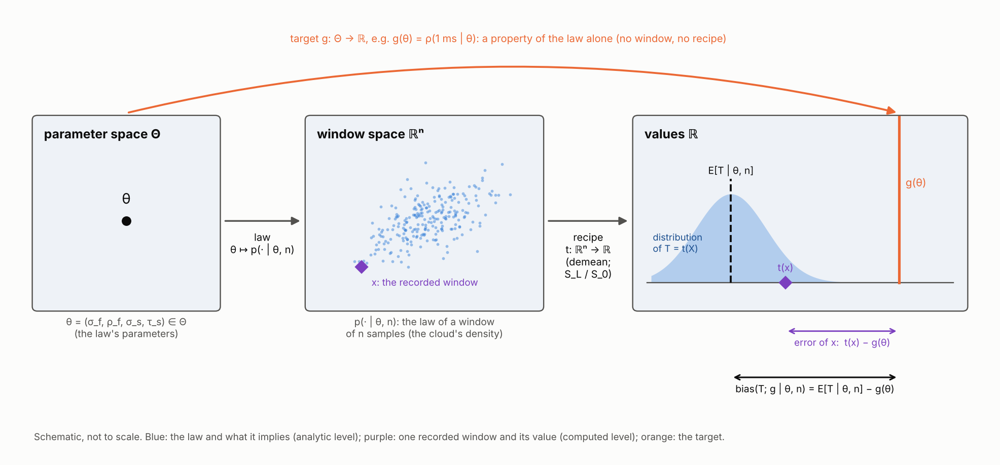
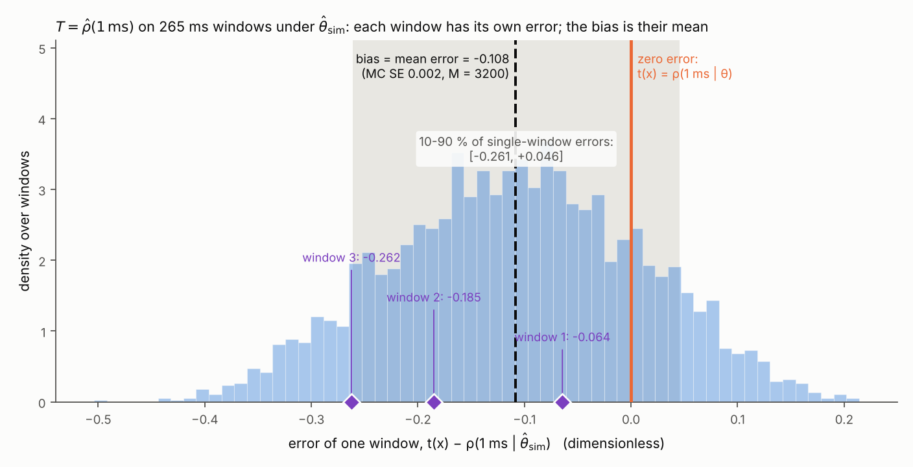
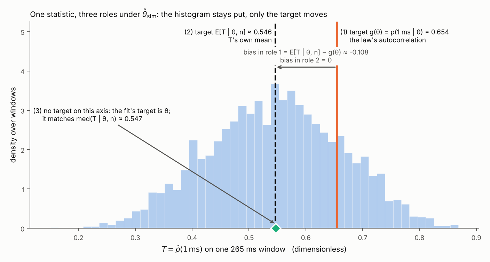
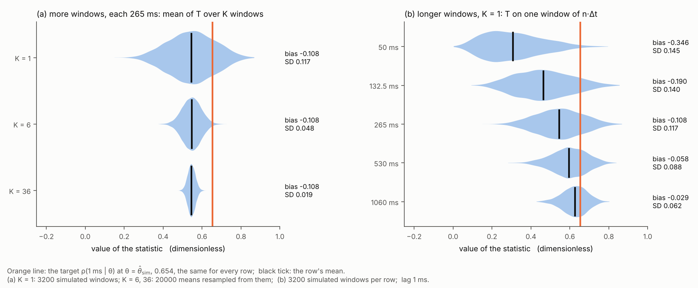
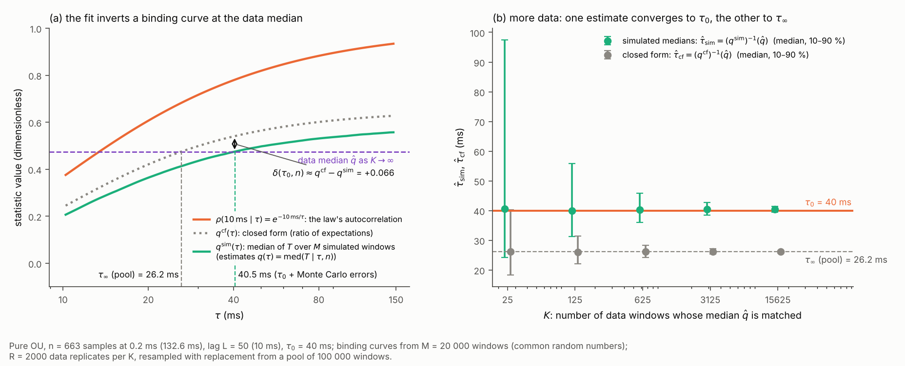

# The bias of a statistic: target, error and level, worked on the Stage-7 sample autocorrelation

**Date:** 2026-10-11

**Project:** Towards EEG, Stage-7 noise law of the I_h-aware passive fit. **Companion to**
`claude/TEEG_Stage7_noise_model_2026-09-28.md` (v3.3, "the topic doc"; its equations are cited TD (n), this
document's own as (n)). **Where it sits:** written to be read before resuming TD §3.5, *Inferring the law*.
**Proposed project path:** `claude/TEEG_bias_of_a_statistic_2026-10-11.md` (not written to project knowledge).

**Corrections carried here.** (i) In the discussion of 2026-10-11 (the statement quoted at 13:34, and the reply to
it), the expectation $\mathbb E[T \mid \theta, n]$ was said to have no closed form; it has no *elementary* one, but
for Gaussian windows it has an exact one-dimensional integral representation, eq. (11) (§3.6). The same applies to
TD §3.4.2's "no closed-form expectation for a two-timescale law". (ii) The bias of the sample autocorrelation was
attributed to demeaning (TD §3.4; the discussion); demeaning is the larger part, 62 % (Monte Carlo SE 1.4 %) in the
worked case, and the ratio itself makes almost all of the rest (§3.5).

**Abstract.** What is the bias of a statistic, what does it need in order to be defined at all, how is it
computed when no elementary formula exists, and what does it mean, and not mean, for the indirect-inference fit of
the Stage-7 noise law (TD §3.5)? Covered: statistic, estimator, target (estimand) and estimate, and the two levels
each object lives on (a property of the law; a number computed from windows); the bias against the error of one
window; one statistic in three roles; where the bias of the textbook sample autocorrelation comes from (each
window's own mean, and the ratio itself) and why more windows do not remove it; computing a bias by Monte Carlo or
by an exact integral, and why the ratio of expectations misses part of it; the bias at an unknown θ (plug-in,
parametric bootstrap) and under a wrong law; why matching medians through the same recipe absorbs a biased
statistic, while the closed-form shortcut leaves a residual bias that more data do not remove. Worked case
throughout: $T = \hat\rho(1\ \text{ms})$ on the 265 ms Long Square pre-window under the cohort law
$\hat\theta_{\rm sim}$; one toy fit (pure OU, one parameter) for §3.8. **Excluded:** Fisher information and
precision bounds (TD §3.4.3), the choice of $M$ and of the statistic set (open within D-033), the per-sweep tilt,
bias-correction methods beyond the parametric bootstrap, and median-unbiasedness beyond one parameter. Sources
consulted: project knowledge (the topic doc v3.3, D-033 of the decision log, passages of Efron & Narasimhan 2020);
full texts retrieved from PubMed Central and read (Morris, White & Crowther 2019; Zeraati, Engel & Levina 2022;
Weltz, Laber & Volfovsky 2024); the output file of the cohort fit of 2026-10-08, for the unrounded $\tau_s$; four
checks and five figures, four of them plotted, run here (`scripts/`); two independent reviews, of a first draft and of
the rewrite, whose findings are corrected in this version. Searches that returned nothing usable: PubMed "indirect inference bias correction simulation" (9 records, none on indirect inference as a method);
three PubMed queries on misspecified models and pseudo-true parameters (0 records each); "least false parameter
misspecification" (1 record, abstract only, not used); "expectation ratio of quadratic forms normal variables"
(0 records); bioRxiv, which has no keyword search, scanned by category over the last 30 days (the first 30
preprints of bioinformatics and of neuroscience): nothing relevant. Data repositories were not queried: no claim here
concerns a dataset.

---

## 1. Notation and Symbols

Status (Provenance model) is given for the objects of the Stage-7 pipeline *as designed in the topic doc* (TD §3.5,
§3.8; the per-cell calibration code is not written), read from that project document, not from code; "checks"
means this document's simulations. Where real cells and simulations differ, both are given, slash-separated.

| Symbol | Name / Meaning | Type & domain | Units | First used in § | Status |
|---|---|---|---|---|---|
| $\theta$; $\Theta$ | noise-law parameters $(\sigma_f, \rho_f, \sigma_s, \tau_s)$; their space $\mathbb R_{>0}\times(0,1)\times\mathbb R_{>0}\times\mathbb R_{>0}$ (as TD) | $\theta \in \Theta$ | mV, --, mV, s | 3.1; $\Theta$ 3.2 | derivation-only (real cells: never known) / configured (simulations: chosen) |
| $\sigma_f, \rho_f$; $\sigma_s, \tau_s$ | fast AR(1): SD, lag-1 coefficient at $\Delta t$; slow OU: SD, correlation time (TD (5b)) | $\mathbb R_{>0}$, $(0,1)$; $\mathbb R_{>0}$, $\mathbb R_{>0}$ | mV, --; mV, s | 3.1 | as $\theta$ |
| $\hat\theta_{\rm sim}$; $\hat\theta_{\rm cf}$ | cohort estimates of $\theta$ by simulated medians and by closed form (TD §3.5.3; computed level) | $\Theta$ | mixed | 3.1; 3.6 | computed |
| $n$; $\Delta t$ | window length; sampling interval (20 µs in the worked case, 0.2 ms in the toy of §3.8) | $\mathbb N_{\ge 2}$; $\mathbb R_{>0}$ | samples; s | 3.1 | configured |
| $L$; $\ell$ | lag of the statistic; physical lag $L\,\Delta t$ | $\{1, \dots, n-1\}$; $\mathbb R_{>0}$ | samples; s | 3.1 | configured |
| $\mathbf X = (X_1, \dots, X_n)$ | a window before it is recorded: random vector (analytic level) | random vector with values in $\mathbb R^n$ | mV | 3.2 | derivation-only |
| $\mathbf x = (x_1, \dots, x_n)$; $j$, $j'$ | a recorded or simulated window, one realization of $\mathbf X$ (computed level); sample indices ($j'$ only in $(D_L)_{jj'}$) | $\mathbb R^n$; $\{1, \dots, n\}$ | mV; -- | 3.2; $j'$ 3.6 | measured |
| $p(\cdot \mid \theta, n)$ | the law of $\mathbf X$: density of an $n$-sample window under $\theta$, for each fixed $(\theta, n)$ (TD (5b)-(6), offset and tilt left out) | probability density on $\mathbb R^n$ | mV$^{-n}$ | 3.2 | analytic |
| $t$, $t_L$ | the recipe: demean, then $S_L/S_0$ (TD (3)); a statistic; defined where $S_0(\mathbf x) > 0$, which holds with probability 1 under the law; $t_L$ when the lag must be shown, $t = t_{50}$ otherwise | map $\{\mathbf x \in \mathbb R^n : S_0(\mathbf x) > 0\} \to [-1, 1]$ | dimensionless | 3.2; $t_L$ 3.5 | computed (applied to measured windows) |
| $T$ | the statistic as a random variable, $T = t(\mathbf X)$ (analytic level); in the worked case $T = \hat\rho(1\ \text{ms})$, $n$ = 13 250 | random variable in $[-1, 1]$ | dimensionless | 3.1 | derivation-only |
| $t(\mathbf x)$ | the statistic's value on one window (computed level); the topic doc's $\hat\rho(L)$ of that window | $[-1, 1]$ | dimensionless | 3.2 | computed |
| $\bar x$; $u_j$ | window mean; $x_j - \bar x$ | $\mathbb R$ | mV | 3.2 | computed |
| $S_0(\mathbf x)$; $S_L(\mathbf x)$ | $\sum_j u_j^2$; $\sum_{j=1}^{n-L} u_j u_{j+L}$; on $\mathbf X$ they are random variables, on $\mathbf x$ numbers | $\mathbb R_{\ge 0}$; $\mathbb R$ | mV² | 3.2 | computed |
| $T^{\circ}$; $q^{\circ}(\theta)$ | the same ratio with the law's true mean, 0, in place of each window's mean (analytic level); its ratio of expectations, $(n-L)\,\rho(\ell \mid \theta)/n$ | random variable in $[-1, 1]$; $\mathbb R$ | dimensionless | 3.5 | derivation-only (the mean is unknown in real data) / measured (checks); analytic |
| $g$ | target (estimand): a property of the law alone | map $\Theta \to \mathbb R$ | as the statistic | 3.2 | analytic (closed form given $\theta$) |
| $\gamma(k \mid \theta)$; $k$ | autocovariance of the law at lag $k$ (TD (6); analytic level), with $\gamma(-k \mid \theta) = \gamma(k \mid \theta)$; generic lag ((2) is written for $k \ge 0$) | $\mathbb R$; $\mathbb Z$ | mV²; samples | 3.2 | analytic |
| $\rho(\ell \mid \theta)$ | the law's autocorrelation at physical lag $\ell$, $\gamma(L \mid \theta)/\gamma(0 \mid \theta)$ (analytic level) | $[-1, 1]$ | dimensionless | 3.1 | analytic |
| $\mathbb E[\cdot \mid \theta, n]$, $\operatorname{Var}$, $\operatorname{SD}$, $\operatorname{Cov}$, $\operatorname{med}$, $\Pr$; $\det$, $\operatorname{tr}$, $^\top$; $\mathcal N(0, I_n)$; $\arg\min$ | expectation, variance, standard deviation, covariance, median, probability over windows drawn from $p(\cdot \mid \theta, n)$ (analytic level); determinant, trace, transpose; the standard normal law on $\mathbb R^n$; the argument at which a function attains its minimum | operators; a law | -- | 3.3 ($\mathbb E$, $\operatorname{Var}$); 3.5 ($\operatorname{Cov}$, $\operatorname{SD}$); 3.6 ($\operatorname{med}$, $\Pr$, $\det$, $\operatorname{tr}$, $^\top$, $\mathcal N$); 3.8 ($\arg\min$) | -- |
| $\operatorname{bias}(T; g \mid \theta, n)$ | $\mathbb E[T \mid \theta, n] - g(\theta)$, eq. (3) (analytic level) | $\mathbb R$, for each fixed $(\theta, n)$ | dimensionless | 3.3 | derivation-only (pipeline) / measured (checks) |
| $e(\mathbf x; g \mid \theta)$ | error of one window, $t(\mathbf x) - g(\theta)$, eq. (4) (computed level; needs $\theta$) | $\mathbb R$ | dimensionless | 3.3 | derivation-only (real cells: $\theta$ unknown) / measured (checks) |
| $\operatorname{MSE}(T; g \mid \theta, n)$ | mean squared error, eq. (6) (analytic level) | $\mathbb R_{\ge 0}$ | dimensionless | 3.3 | derivation-only (pipeline) / measured (checks) |
| $M$; $i$; $\mathbf x^{(i)}$ | number of simulated windows; their index in (10) (in (11), $i$ indexes the eigenpairs of $G_0$ instead); the $i$-th simulated window | $\mathbb N_{\ge 2}$; $\{1, \dots, M\}$; $\mathbb R^n$ | --; --; mV | 3.3; $i$, $\mathbf x^{(i)}$ 3.6 | configured; --; measured |
| $\bar t_M$; $s_M$; $\widehat{\operatorname{bias}}_M$; $\mathrm{SE}_M$ | mean and SD of $t$ over the $M$ simulated windows; the Monte Carlo estimate of the bias; its Monte Carlo standard error, eq. (10) (computed level) | $\mathbb R$; $\mathbb R_{\ge 0}$; $\mathbb R$; $\mathbb R_{>0}$ | dimensionless | $s_M$, $\widehat{\operatorname{bias}}_M$ 3.3; $\bar t_M$ 3.4; $\mathrm{SE}_M$ 3.6 | measured (checks) |
| $q^{\rm cf}(\theta)$ | ratio of expectations $\mathbb E[S_L(\mathbf X) \mid \theta, n]/\mathbb E[S_0(\mathbf X) \mid \theta, n]$, TD (10), at the fixed $n$ of the context | $\mathbb R$ | dimensionless | 3.5 | computed |
| $a$ | per-sweep offset of TD (5a) | $\mathbb R$ | mV | 3.5 | derivation-only (cancels on demeaning) |
| $K$; $k'$ | number of windows averaged, or whose median is matched (5-6 LS pre-windows per cohort cell, TD §3.2.1); window index | $\mathbb N_{\ge 1}$; $\{1, \dots, K\}$ | -- | 3.5 | measured (real cells) / configured (checks) |
| $T_{k'}$; $\bar T_K$ | the statistic on window $k'$ of $K$ independent windows; their mean, eq. (9) (analytic level) | random variables in $[-1, 1]$ | dimensionless | 3.5 | derivation-only |
| $\Gamma(\theta, n)$; $B$; $\mathbf z$; $I_n$ | covariance matrix of a window (as TD); its Cholesky factor, $\Gamma = BB^\top$; the whitened window $B^{-1}\mathbf X$; identity matrix | symmetric positive definite $n\times n$; lower-triangular $n \times n$; random vector, $\mathcal N(0, I_n)$; $n \times n$ | mV²; mV; --; -- | 3.6 | analytic |
| $C$; $D_L$; $\mathbf 1$ | centring matrix $I_n - \mathbf 1\mathbf 1^\top/n$; symmetrised lag-$L$ shift, $(D_L)_{jj'} = \tfrac12$ if $\lvert j - j'\rvert = L$, else 0; all-ones vector | $n \times n$; $n \times n$; $\mathbb R^n$ | -- | 3.6 | analytic |
| $G_0$, $G_L$; $\lambda_i$, $\mathbf v_i$, $i$; $d_i$; $s$ | $B^\top C B$ and $B^\top C D_L C B$; eigenvalues and orthonormal eigenvectors of $G_0$, and their index; $\mathbf v_i^\top G_L \mathbf v_i$; integration variable of (11) | $n\times n$ symmetric; $\mathbb R_{\ge 0}$, $\mathbb R^n$, $\{1, \dots, n\}$; $\mathbb R$; $\mathbb R_{\ge 0}$ | mV²; mV², --, --; mV²; mV⁻² | 3.6 | computed (checks) |
| $c$ | a threshold on the value line, in $\Pr(T \le c \mid \theta, n)$ | $[-1, 1]$ | dimensionless | 3.6 | -- |
| $\widehat{\operatorname{bias}}(\hat\theta)$ | the bias evaluated at a fitted $\hat\theta$, eq. (12) (a plug-in) | $\mathbb R$ | dimensionless | 3.7 | measured (checks) |
| $\hat\theta$; $J^{\rm cf}$ | an estimate of $\theta$; the cost of TD (14) computed with the closed form | $\Theta$; $\mathbb R_{\ge 0}$ | mixed; dimensionless | 3.4; 3.7 | computed |
| $m$; $\hat q_m$; $q_m(\theta)$; $q^{\rm sim}_m(\theta)$; $\omega_m$ | index of a fitted statistic (fourteen in TD (12); the per-cell set is open within D-033); its data median over the recorded windows; its median under $\theta$, $\operatorname{med}(T_m \mid \theta, n_m)$ (analytic level); that median estimated over $M$ simulated windows with common random numbers (computed level); residual scale (TD §3.5.1-3.5.2) | $\{1, \dots, 14\}$; $\mathbb R$; $\mathbb R$; $\mathbb R$; $\mathbb R_{>0}$ | as the statistic | 3.6 ($m$, $q^{\rm sim}_m$); 3.8 | --; measured; derivation-only; measured; configured |
| $T_m$, $n_m$ | statistic $m$ as a random variable; the length of its windows | random variable; $\mathbb N_{\ge 2}$ | --; samples | 3.8 | derivation-only; configured |
| $q^{\rm cf}_m(\theta)$; $\delta_m(\theta, n_m)$ | closed form for statistic $m$; its gap to the binding function, $q^{\rm cf}_m - q_m$, eq. (15) | $\mathbb R$ | as the statistic | 3.6; 3.8 | computed; derivation-only (pipeline) / measured (checks) |
| $\tau$; $\tau_0$; $\tau_\infty$ | the toy's OU correlation time (its whole parameter); its true value; the closed-form fit's limit as $K \to \infty$, eq. (16) | $\mathbb R_{>0}$ | s (quoted in ms) | 3.7; 3.8 | --; configured; computed |
| $\rho(\ell \mid \tau)$ | the toy law's autocorrelation, $\mathrm e^{-\ell/\tau}$ | $(0, 1]$ | dimensionless | 3.7 | analytic |
| $q(\tau)$; $q^{\rm sim}(\tau)$; $q^{\rm cf}(\tau)$ | the toy's binding function $\operatorname{med}(T \mid \tau, n)$ (analytic level); its estimate over $M$ simulated windows (computed level); its closed form | $\mathbb R$ | dimensionless | $q^{\rm sim}$ 3.7; $q$, $q^{\rm cf}$ 3.8 | derivation-only; measured; computed |
| $\hat q$; $\delta(\tau, n)$ | the data median of $T$ over $K$ windows; $q^{\rm cf}(\tau) - q(\tau)$ | $\mathbb R$ | dimensionless | 3.8 | measured; derivation-only / measured (checks, as $q^{\rm cf} - q^{\rm sim}$) |
| $\hat\tau$; $\hat\tau_{\rm sim}$; $\hat\tau_{\rm cf}$ | the toy's estimate by inverting the exact $q$ at $\hat q$, in (14); by inverting $q^{\rm sim}$; by inverting $q^{\rm cf}$ | $\mathbb R_{>0}$ | s | 3.8 | derivation-only; computed; computed |
| $N_{\le}$ | number of the $K$ windows with $T_{k'} \le q(\tau_0)$, in the proof of (14) | $\{0, \dots, K\}$ | -- | 3.8 | derivation-only |
| $R$ | number of replicate data sets per $K$ in the toy | $\mathbb N$ | -- | 3.8 | configured |
| $\Pr(\cdot \mid \text{pool}, q^{\rm sim})$, $\Pr(\cdot \mid \text{pool})$ | in the toy, a probability over the resampling of $K$ windows from the one simulated pool, with the pool (and $q^{\rm sim}$) held fixed; it stands in for $\Pr(\cdot \mid \tau_0, n)$ of fresh windows | probability, $[0, 1]$ | -- | 3.8 | computed (estimated by shares of the $R$ replicates) |

### Conventions

- **Levels** (as in the topic doc's Conventions). A symbol written with "$\mid \theta$" or "$\mid \theta, n$" is a
  property of the law (analytic level); a symbol evaluated on $\mathbf x$, or carrying a hat or a subscript $M$, is a
  number computed from recorded or simulated windows (computed level). Each object with a counterpart on the other
  level has its own symbol: $T$ and $t(\mathbf x)$; $\mathbb E[T \mid \theta, n]$ and $\bar t_M$;
  $\operatorname{Var}(T \mid \theta, n)$ and $s_M^2$; $\operatorname{bias}$ and $\widehat{\operatorname{bias}}_M$;
  $q_m(\theta)$ and $q^{\rm sim}_m(\theta)$; probabilities and the shares of replicates that estimate them. Every move
  between levels is named where it happens ("one realization of", "estimated by", "plugged in for"). One flagged
  exception: inside a probability, in (14), (16) and the statements after them, $\hat q$, $\hat\tau$, $\hat\tau_{\rm sim}$
  and $\hat\tau_{\rm cf}$ are the estimators fed $K$ random windows, so random variables (as $T = t(\mathbf X)$ is);
  in the table of §3.8 they are their values on replicate data.
- **Deviations from the topic doc, flagged.** (i) In TD, $T$ is a window's duration $n\,\Delta t$; here $T$ is the
  statistic $t(\mathbf X)$, as in the discussion of 2026-10-11, and durations are written $n\,\Delta t$ or in ms.
  (ii) TD writes $\hat\rho(L)$ both for one window's number and, inside $\mathbb E[\cdot \mid \theta, n]$ (TD (10)),
  for the random variable; here they are $t(\mathbf x)$ and $T$. (iii) TD defines $q_m(\theta)$ as the value of
  statistic $m$ "under $\theta$ through the pipeline's estimator"; here it is fixed as the median,
  $\operatorname{med}(T_m \mid \theta, n_m)$, which is what simulated medians estimate (TD §3.5.2).
- **Letters that mean something else in the topic doc, flagged.** Here $g$ is the target (TD: the gap between two
  windows, TD (25)); $t$ is the recipe (TD: time); $e$ is the error of one window (TD: the noise $e_j$); $\delta$ is
  the closed form's gap (TD: the tilt span); $\lambda_i$ are eigenvalues (TD: a kick rate); $p$ is the law's density
  (TD: a p-value); $c$ is a threshold (TD: a cell); $B$ is a Cholesky factor (TD: the RMS $B(t \mid \theta)$ of
  TD (15)); $D_L$ is a shift matrix (TD: $D = \sigma^2/\tau$); $\mathbf z$ is a whitened window (TD: $z = T/\tau$);
  $\mathbf v_i$ are eigenvectors (TD: $v(z)$, the visible share); $s$ is an integration variable (TD: the subscript
  for "slow"); $N_{\le}$ is a count of windows (TD: $N$, the pulses averaged into a bundle). None of TD's meanings is
  used here.
- **One index, two uses, declared.** $i$ indexes the simulated windows in (10) and the eigenpairs of $G_0$ in (11);
  the two uses never meet in one formula.
- **A declared abuse of notation.** $q^{\rm cf}(\theta)$, $q^{\circ}(\theta)$, $q(\tau)$, $q^{\rm sim}(\tau)$ and
  $q^{\rm cf}(\tau)$ are written without $n$, which is fixed wherever they appear (13 250 in the worked case, 663 in
  the toy); $\delta(\tau, n)$ keeps it, to stress that the gap is set by the window's length.
- **"Target" has two senses (R6).** Here: the estimand $g(\theta)$. In TD §3.5.3, "the 14 targets $\hat q_m$" are the
  measured values the fit must reproduce; this document calls those the *data medians*.
- **Lags.** $\hat\rho(1\ \text{ms})$ means $L = 1\ \text{ms}/\Delta t = 50$ samples at $\Delta t$ = 20 µs (TD's
  declared abuse of notation).
- **The toy of §3.8.** Its law is a pure OU process indexed by $\tau$ alone, so there every "$\mid \theta$" reads
  "$\mid \tau$" (for example $\operatorname{med}(T \mid \tau, n)$), and $T = \hat\rho(10\ \text{ms})$ on its own
  windows.
- **Units.** Times in seconds in equations, quoted in ms; the statistic is dimensionless.
- **Tags.** Source class, then rating, at the claim: `[KB: file]` (project knowledge), `[FT: DOI or PMC]` (full text
  read), `[RUN: scripts/file]` (this document's scripts, run here), `[SRC: file]` (read from a project file, code or an
  earlier run's output), `[OWN]` (own reasoning), `[TXT]` (textbook, from memory); `[Certain]`, `[Likely]`,
  `[Guessing]`.

---

## 2. Glossary / Jargon

Ordering: alphabetical.

- **Bias.** *Everyday sense differs* (prejudice). The average error of a statistic for a named target under a named
  law, eq. (3); a property of the law, the recipe and the target together, never of one number. The same definition
  applied to an estimate of $\theta$ gives the bias of $\hat\theta$; the closed-form fit's "residual bias" is a
  different, asymptotic quantity (see Residual bias). Operative in §3.3 and §3.8.
- **Binding function.** In indirect inference, the map from the parameters to what the calibration statistic does
  under them, here its median: $\theta \mapsto q_m(\theta)$. The fit inverts it at the data value. §3.8.
- **Calibration statistic.** The statistic whose observed value an indirect-inference fit matches (Weltz et al.); it
  need not be an unbiased estimator of anything. §3.4, §3.8.
- **Cholesky factor.** The lower-triangular $B$ with $BB^\top = \Gamma$ for a positive-definite covariance matrix
  $\Gamma$; used to whiten a Gaussian window. §3.6.
- **Common random numbers.** The same random draws reused for every $\theta$ in a simulation-based fit, so that the
  simulated binding function changes only because $\theta$ changes. §3.8.
- **Demeaning.** Subtracting a window's own mean before computing a statistic; the larger of the two sources of the
  sample autocorrelation's bias here (§3.5).
- **Error.** *Two senses live here.* (i) The error of one window, $t(\mathbf x) - g(\theta)$, eq. (4) (this
  document's default); (ii) the Monte Carlo error of a simulation estimate, always written $\mathrm{SE}_M$ or
  "Monte Carlo error" here. §3.3, §3.6.
- **Estimand, target.** *Two senses, see Conventions.* The quantity a statistic is meant to estimate, a function
  $g$ of the law. §3.2.
- **Estimate.** The number an estimator returns on the recorded data, $t(\mathbf x)$. §3.2.
- **Estimator.** A statistic in the role of estimating a named target; the same recipe is an estimator of
  different targets in different roles. §3.2, §3.4.
- **Indirect inference.** Choosing the parameters under which the model, passed through the same recipe, reproduces
  the observed value of a calibration statistic; Weltz et al. match the expected value, the simulated-medians version
  of our fit the median. §3.8.
- **Law.** The probability distribution windows are drawn from, $p(\cdot \mid \theta, n)$. A law is never
  realized; windows are. §3.2.
- **Level.** Whether an object is a property of a law (analytic level) or a number computed from windows (computed
  level). §1, §3.3.
- **Mean.** *Three senses live here.* The window mean $\bar x$ that demeaning subtracts (§3.2, §3.5); the
  expectation $\mathbb E[\cdot \mid \theta, n]$ over windows drawn from the law (analytic level, §3.3); the average
  $\bar t_M$ over simulated windows that estimates it (computed level, §3.4, §3.6).
- **Mean squared error (MSE).** The mean of the squared error, eq. (6): squared bias plus variance. §3.3, §3.5.
- **Median.** *Three senses, as for the mean.* $\operatorname{med}(\cdot \mid \theta, n)$ of the law (analytic
  level); $\hat q_m$ over a cell's recorded windows; $q^{\rm sim}_m$ over $M$ simulated windows (both computed
  level). §3.4, §3.8.
- **Median-unbiased.** An estimator that falls below its target with probability exactly ½; the median's analogue of
  unbiasedness. §3.8.
- **Misspecification.** The law assumed by a computation is not the law that generated the data. §3.7.
- **Monte Carlo standard error.** The standard deviation a simulation estimate would show over reruns with other
  seeds; for a mean over $M$ draws, $s_M/\sqrt M$. §3.6.
- **Parametric bootstrap.** Simulating data from the law at a fitted $\hat\theta$ to stand in for data from the true
  law; computing a bias at $\hat\theta$ is one use of it. §3.7.
- **Plug-in.** Evaluating a function of $\theta$ at an estimate $\hat\theta$, in place of the unknown $\theta$. §3.7.
- **Precision.** How tightly a statistic concentrates (its SD); set by all the data that enter it, the number of
  windows and their length, whereas the bias, for a given law and recipe, is set by each window's length alone. §3.5.
- **Ratio of expectations.** $\mathbb E[S_L(\mathbf X) \mid \theta, n]/\mathbb E[S_0(\mathbf X) \mid \theta, n]$, used
  in place of $\mathbb E[S_L/S_0 \mid \theta, n]$; exact in its parts, not as a ratio. §3.5, §3.6.
- **Realization.** One drawn value of a random object: $\mathbf x$ of $\mathbf X$, $t(\mathbf x)$ of $T$. §3.2.
- **Recipe.** The fixed computation a statistic performs on a window, here "demean, then $S_L/S_0$"; called the
  pipeline in the discussion of 2026-10-11. §3.2.
- **Residual (asymptotic) bias.** The offset $\tau_\infty - \tau_0$ of the limit of the closed-form estimate from the
  truth, eq. (16): what is left as the number of windows grows without bound. Not the finite-$K$ bias (3) of
  $\hat\tau_{\rm cf}$, which is not computed here. §3.8.
- **Sampling distribution.** The distribution of $T = t(\mathbf X)$ over windows drawn from the law. §3.2.
- **Simulated medians.** Our way of computing the binding function: the median of the pipeline's own estimator over
  $M$ simulated windows of the real length (TD §3.5.2). §3.8.
- **Statistic.** Any function of the data alone, with no unknown parameter in it. §3.2.
- **Unbiased.** Bias zero, for a named target, for every $\theta$ of a stated set and the stated $n$. §3.4.
- **Whitening.** Writing a Gaussian window as $B\mathbf z$ with $\mathbf z$ standard normal, so that its quadratic
  forms become quadratic forms in independent variables. §3.6.

---

## 3. Main body

### 3.1 The problem: "is $\hat\rho(1\ \text{ms})$ biased?" has no answer yet

*This section establishes the four observations that the word "bias", used loosely, cannot reconcile, and fixes
the worked case.*

The everyday picture is simple: a statistic either is biased or is not, a recording shows it, a fit built on a
biased statistic inherits the bias, and more data dilute it. Each part of that picture fails on the statistic the
Stage-7 noise fit is built from, the textbook sample autocorrelation at 1 ms on the 265 ms Long Square pre-window,
$T = \hat\rho(1\ \text{ms})$ (TD (3); D-028), on windows drawn from the cohort law $\hat\theta_{\rm sim}$:

1. **The same windows are biased and unbiased.** Against the law's autocorrelation
   $\rho(1\ \text{ms} \mid \hat\theta_{\rm sim}) = 0.654$ the statistic is biased by $-0.108$ (Monte Carlo estimate);
   against its own mean it is unbiased, exactly (§3.4) [RUN: scripts/check01_bias_mc_vs_closed_form.py; OWN: eq. (3)]
   [Certain].
2. **A recorded window does not show the bias.** 19 % of single windows land above the law's autocorrelation,
   although the statistic is biased low; one window's deviation runs from $-0.261$ to $+0.046$ (10-90 %) (§3.3)
   [RUN: scripts/check01_bias_mc_vs_closed_form.py] [Certain].
3. **More data do not dilute it.** Averaging more windows narrows the spread and leaves the offset; of the two ways
   to add data, only lengthening each window shrinks it (§3.5) [RUN: scripts/fig04_bias_vs_precision.py] [Certain].
4. **A fit built on the biased statistic is not biased by it, unless it takes a shortcut.** In a one-parameter toy,
   matching medians through the same recipe recovers the truth to within its Monte Carlo errors, while the
   closed-form shortcut of the same fit misses it by a margin that more data do not shrink (§3.8) [RUN:
   scripts/fig05_closed_form_residual_bias.py] [Certain, for the toy configuration run].

Four pieces reconcile them: a named target (§3.2, §3.4), two levels, the law and a recorded window (§3.3), the
recipe as the source of the bias (§3.5), and the comparison the fit actually makes (§3.8). In between, §3.6 and §3.7
say how a bias is computed when no elementary formula exists and when $\theta$ is unknown.

**The worked case.** Unless stated otherwise, every number is for $\theta = \hat\theta_{\rm sim} = (\sigma_f, \rho_f,
\sigma_s, \tau_s) = (0.0383\ \text{mV}, 0.179, 0.0547\ \text{mV}, 39.74\ \text{ms})$ [KB: topic doc §3.5.3, which
gives $\tau_s$ = 39.7 ms; SRC: the unrounded 39.74 ms read from `v3/fit.json`, the output of the cohort fit of
2026-10-08 in the check bundle of 2026-10-09; the other three parameters rounded as in the topic doc] [Certain], a
window of $n$ = 13 250 samples at $\Delta t$ = 20 µs (265 ms), the lag
$L = 50$ samples ($\ell = L\,\Delta t = 1$ ms), and the stationary part of the law, TD (5b)-(6): the per-sweep offset
cancels on demeaning (TD §3.3.2), and the tilt lies outside this question.

### 3.2 Statistic, estimator, target, estimate: three spaces and three maps

*This section establishes what is compared with what when a bias is computed, the spaces the objects live in and the
maps between them (Figure 1).*

Before "biased" can mean anything, two things must be kept apart: what the data are fed through, and what one wants
to learn from them.

**The data and the law.** A window, before it is recorded, is random: $\mathbf X = (X_1, \dots, X_n)$, a random vector
with values in $\mathbb R^n$ (analytic level). Its law, for each fixed $\theta \in \Theta$ and window length $n$, is
the density $p(\cdot \mid \theta, n)$ on $\mathbb R^n$ given by the noise law TD (5b)-(6). The window actually
recorded or simulated is one realization of $\mathbf X$: $\mathbf x = (x_1, \dots, x_n) \in \mathbb R^n$ (computed
level). A law is never "realized"; windows are.

**The statistic: a recipe.** A statistic is any function of the data alone, with no unknown parameter in it [TXT].
Here it is the recipe $t$ that demeans the window and divides two sums (TD (2)-(3)):

$$ t(\mathbf x) = \frac{S_L(\mathbf x)}{S_0(\mathbf x)}, \qquad S_0(\mathbf x) = \sum_{j=1}^{n} u_j^2, \qquad S_L(\mathbf x) = \sum_{j=1}^{n-L} u_j\,u_{j+L}, \qquad u_j = x_j - \bar x, \qquad \bar x = \frac1n\sum_{j=1}^{n} x_j. \tag{1} $$

Fed the random window, the recipe returns a random variable, $T = t(\mathbf X)$ (analytic level: it has a
distribution over windows, its *sampling distribution*); fed the recorded window, it returns a number, $t(\mathbf x)$
(computed level), the topic doc's $\hat\rho(1\ \text{ms})$ of that window. The recipe is the same object in both
cases; only what it is fed changes. It is defined where $S_0(\mathbf x) > 0$, which holds with probability 1 under the
law, and there $t(\mathbf x) \in [-1, 1]$: by the Cauchy-Schwarz inequality
$\lvert S_L(\mathbf x)\rvert \le (\sum_{j \le n-L} u_j^2)^{1/2}(\sum_{j > L} u_j^2)^{1/2} \le S_0(\mathbf x)$
[OWN: proof written] [Certain].

**The target.** A target, or estimand, is a property of the law that one wants to know: a map $g: \Theta \to \mathbb
R$. In Morris et al.'s words, "[a]n estimand is usually a parameter of the data generating model, but is occasionally
some other quantity"; in their planning scheme the methods come after it, chosen by asking "whether they are
appropriate for estimand/target identified" [FT: 10.1002/sim.8086] [Certain]. For the worked case the natural target
is the law's autocorrelation at 1 ms,

$$ g(\theta) = \rho(1\ \text{ms} \mid \theta) = \frac{\gamma(50 \mid \theta)}{\gamma(0 \mid \theta)}, \qquad \gamma(k \mid \theta) = \sigma_f^2\,\rho_f^{\,k} + \sigma_s^2\,\mathrm e^{-k\,\Delta t/\tau_s} \quad (k \ge 0), \tag{2} $$

with $\gamma(k \mid \theta)$ the autocovariance of TD (6), so that $g(\hat\theta_{\rm sim}) = 0.654$ [KB: topic doc
eq. (6); RUN: scripts/check01_bias_mc_vs_closed_form.py] [Certain]. A target involves no window and no recipe.

**Estimator and estimate.** A statistic becomes an estimator when a target is named for it, and its value on the
recorded data, $t(\mathbf x)$, is then the estimate. The same recipe can be an estimator of different targets:
"estimator" is a role, not a property of the function (§3.4).

**Three spaces, three maps.** The objects live in three spaces, the parameter space $\Theta$, the window space
$\mathbb R^n$ and the value line $\mathbb R$, joined by three maps: the law, $\theta \mapsto p(\cdot \mid \theta, n)$,
from $\Theta$ to the probability densities on $\mathbb R^n$; the recipe $t$, from the windows with $S_0 > 0$ (almost
all of $\mathbb R^n$) to $[-1, 1] \subset \mathbb R$; and the target $g$, from $\Theta$ to $\mathbb R$ (Figure 1). A bias compares two points of $\mathbb R$ reached from
$\theta$ by different routes: through the law and the recipe, and directly through the target. Nothing in $\Theta$
or $\mathbb R^n$ is compared with anything in $\mathbb R$.

*Figure 1 -- A bias compares two points of the value line reached from θ by two routes, law-then-recipe (the mean of
T over windows) and the target (g(θ)); one recorded window adds a third point, t(x), whose distance to g(θ) is that
window's error [OWN] [Certain, as definitions]; schematic, not to scale; the label t: ℝⁿ → ℝ abbreviates the recipe's
domain, the windows with S₀ > 0 (almost all of ℝⁿ), and its values, in [−1, 1]; `scripts/fig01_spaces_and_maps.py`.*

What a bias can depend on is now fixed, the law, the recipe and the target, and the next section writes it down,
against the one thing it is not: the error of one window.

### 3.3 The bias and the error of one window

*This section establishes the definition of the bias, the error of one recorded window, how the two are related, why
neither can be read off one recording, and the mean squared error (Figure 2).*

The error of a window is where that window's value lands relative to the target; the bias is where the errors land
on average, over every window the law could have produced. The first is a property of one recording. The second is a
property of the law, the recipe and the target, and exists before anything is recorded.

**The bias (analytic level).** For each fixed $\theta \in \Theta$ and $n$,

$$ \operatorname{bias}(T; g \mid \theta, n) \;=\; \mathbb E[T \mid \theta, n] - g(\theta) \;=\; \int_{\mathbb R^n} t(\mathbf x)\,p(\mathbf x \mid \theta, n)\,d\mathbf x \;-\; g(\theta), \tag{3} $$

the definition Morris et al. tabulate for the bias of an estimator: its expected value minus the true value of its
estimand [FT: 10.1002/sim.8086] [Certain]. The expectation $\mathbb E[\cdot \mid \theta, n]$ runs over windows drawn
from $p(\cdot \mid \theta, n)$: no recorded window enters (3).

**The error of one window (computed level).** For a recorded or simulated window $\mathbf x$,

$$ e(\mathbf x; g \mid \theta) \;=\; t(\mathbf x) - g(\theta). \tag{4} $$

**How the two relate.** Adding and subtracting $\mathbb E[T \mid \theta, n]$ in (4) splits every error into the
bias and the window's own fluctuation around the mean; and averaging (4) over windows gives back (3):

$$ e(\mathbf x; g \mid \theta) = \operatorname{bias}(T; g \mid \theta, n) + \bigl(t(\mathbf x) - \mathbb E[T \mid \theta, n]\bigr), \qquad \operatorname{bias}(T; g \mid \theta, n) = \mathbb E\bigl[e(\mathbf X; g \mid \theta) \bigm| \theta, n\bigr] \tag{5} $$

[OWN: eqs. (3)-(4)] [Certain]. Two consequences follow. A recorded window carries one error, a single draw whose
fluctuation term has, in the worked case, a standard deviation about as large as the bias itself (0.117 against
0.108, below): one window cannot reveal the bias. And on real cells, where $\theta$ is unknown, even that one error
cannot be computed, since $g(\theta)$ is unknown: errors and biases are computed under a law, in simulation, where
$\theta$ is chosen [OWN: eqs. (3)-(5)] [Certain].

**Worked case** (Figure 2). Over $M$ = 3200 windows simulated under $\hat\theta_{\rm sim}$, the Monte Carlo estimate
of the bias is $-0.108$ (Monte Carlo standard error 0.002, §3.6); the single-window errors have 10, 50 and 90 %
quantiles $-0.261$, $-0.107$ and $+0.046$; 19.1 % of the windows lie above the target (18 % of the first 2000,
the windows used earlier in the discussion of 2026-10-11); the first three simulated windows give errors of
$-0.064$, $-0.185$ and $-0.262$ [RUN: scripts/check01_bias_mc_vs_closed_form.py; scripts/fig02_error_vs_bias.py]
[Certain, for this configuration].

*Figure 2 -- One window gives one error, a draw from this distribution; the bias is the distribution's mean, estimated
at −0.108, and one window cannot tell it from zero, since the errors spread with an SD of 0.117, as large as the bias,
and 19 % of them lie above zero [RUN: scripts/fig02_error_vs_bias.py; scripts/check01_bias_mc_vs_closed_form.py]
[Certain]; T = ρ̂(1 ms) on 265 ms windows under θ̂_sim, M = 3200 simulated windows, seed 20261011, target
ρ(1 ms | θ̂_sim); plotted; `scripts/fig02_error_vs_bias.py`.*

**Where the values land, and how widely.** The mean of the squared error combines the two: for each fixed
$(\theta, n)$,

$$ \operatorname{MSE}(T; g \mid \theta, n) = \mathbb E\bigl[(T - g(\theta))^2 \bigm| \theta, n\bigr] = \operatorname{bias}(T; g \mid \theta, n)^2 + \operatorname{Var}(T \mid \theta, n), \tag{6} $$

"the sum of the squared bias and variance" (Morris et al.) [FT: 10.1002/sim.8086] [Certain]. For one window of the
worked case, the squared bias is estimated at 0.0117 ($\widehat{\operatorname{bias}}_M^2$) and the variance at
$s_M^2 = 0.0136$ ($s_M = 0.117$): the squared bias makes 46 % of the mean squared error [RUN:
scripts/check01_bias_mc_vs_closed_form.py] [Certain]. Bias and spread are two properties of one sampling
distribution, where it is centred and how wide it is, and §3.5 shows that they respond to different knobs.

The definition (3) has $g$ in it: change $g$, and the bias changes with the windows untouched.

### 3.4 One statistic, three roles: the target decides the bias

*This section establishes that one statistic has different biases for different targets, which targets describe the
noise and which do not, and the role the statistic plays in the fit (Figure 3).*

Nothing in the recipe or in the windows says which target a statistic serves. The same histogram of $T$ serves three
roles, and what its bias is, or whether a bias of $T$ is even the relevant quantity, differs in each (Figure 3).

**Role 1: an estimator of the law's autocorrelation.** With the target (2), the bias is
$\mathbb E[T \mid \hat\theta_{\rm sim}, n] - \rho(1\ \text{ms} \mid \hat\theta_{\rm sim})$, estimated by
$\bar t_M - 0.654 = 0.546 - 0.654 = -0.108$ [RUN: scripts/check01_bias_mc_vs_closed_form.py] [Certain]. This is the
sense in which the literature calls the sample autocorrelation biased: "for a finite-length time-series the values of
the sample autocorrelation systematically deviate from the ground-truth autocorrelation" (Zeraati et al.)
[FT: 10.1038/s43588-022-00214-3] [Certain].

**Role 2: an estimator of its own mean.** With $\mathbb E[T \mid \theta, n]$ itself as the "target", (3) gives
$\mathbb E[T \mid \theta, n] - \mathbb E[T \mid \theta, n] = 0$ for every $\theta$ and every $n$ [OWN: eq. (3)]
[Certain]. The zero is empty. This "target" is not a property of the noise: it depends on the window's length and on
the recipe. Under $\hat\theta_{\rm sim}$ its Monte Carlo estimates are 0.308, 0.464, 0.546, 0.597 and 0.626 for
windows of 50, 132.5, 265, 530 and 1060 ms [RUN: scripts/fig04_bias_vs_precision.py] [Certain]. In the types of §3.2
it is a function of $(\theta, n)$, not a map $g: \Theta \to \mathbb R$. "Unbiased for its own mean" says that the
recipe reproduces itself, and nothing about the noise.

**Role 3: a calibration statistic.** In the fit, TD (12) and TD (14), $T$ estimates neither: its median over the recorded
windows is matched with its model value (§3.8), and the fit's target is $\theta \in \Theta$ itself. $T$'s bias for
$\rho(1\ \text{ms} \mid \theta)$ never enters the fit; what matters there is the bias of $\hat\theta$ for $\theta$
(§3.8). Under $\hat\theta_{\rm sim}$ the Monte Carlo median is 0.547 against the mean 0.546, so the median's
deviation from the target of role 1 is $-0.107$ [RUN: scripts/check01_bias_mc_vs_closed_form.py] [Certain].

*Figure 3 -- The sampling distribution of T is the same in all three roles; only the target moves, so the bias is
about −0.108 (estimated) in role 1 and exactly 0 in role 2, and in role 3 the fit uses the median and targets θ [RUN:
scripts/fig03_three_targets.py] [Certain]; T = ρ̂(1 ms) on 265 ms windows under θ̂_sim, M = 3200 simulated windows,
seed 20261011; the arrow runs from the target to the mean, the direction of a negative bias; plotted;
`scripts/fig03_three_targets.py`.*

Morris et al. warn of exactly this in comparisons of methods: two analyses of one trial "give different mean
estimates, and it would be tempting to conclude that at least one of the methods is biased. However, the two methods
target different estimands" [FT: 10.1002/sim.8086] [Certain]. The verdict: "biased" is incomplete until a target is
named; once one is named, the bias is a number for each $(\theta, n)$, a property of the law, the recipe and the
target together. What remains to explain is why, in role 1, the centre of the histogram sits below the target.

### 3.5 Where the bias comes from: each window's own mean, and the ratio

*This section establishes the two sources of the bias, the exact identities behind them, how much each contributes
in the worked case, and why the bias is set by the window's length and not by the number of windows (Figure 4).*

One would expect a window of 265 ms, almost seven times the slow correlation time, to show that correlation almost
undisturbed. It does not, for two reasons, one in each step of the recipe (1): the window is demeaned with its own
mean, and the statistic is a ratio.

**First source: each window's own mean.** Regardless of how many windows are recorded, if each window is demeaned
with its own mean, every slow excursion that the mean follows is subtracted from that window, so the autocorrelation
is computed from what is left around a reference that moved with the slow component, and the slow component shows
less correlation than it has [OWN] [Likely]. Zeraati et al. identify this as the main source: "This bias arises
primarily due to the deviation of the sample mean from the ground-truth mean. If the ground-truth mean of the process
is known, using the true mean for computing the autocorrelation largely eliminates the bias"
[FT: 10.1038/s43588-022-00214-3] [Certain]. Demeaning also ties all the lags of one window together. Since
$\sum_{j=1}^{n} u_j = 0$ for every window, $0 = (\sum_j u_j)^2 = S_0(\mathbf x) + 2\sum_{L=1}^{n-1} S_L(\mathbf x)$,
and dividing by $S_0(\mathbf x) > 0$,

$$ \sum_{L=1}^{n-1} t_L(\mathbf x) = -\tfrac12 \qquad \text{for every window } \mathbf x \in \mathbb R^n \text{ with } S_0(\mathbf x) > 0 \tag{7} $$

(TD (23)) [OWN: proof written; RUN: scripts/check02_zero_sum.py, 15 windows of three laws, largest
$\lvert\text{sum} + \tfrac12\rvert$ = 7.1 × 10⁻¹⁴] [Certain]. Whatever the law, then, the sample autocorrelation of
a window must go negative somewhere and sum to $-\tfrac12$ over its lags [OWN: from (7)] [Certain]. A law with a long positive
tail has autocorrelations that sum to a large positive number over the same lags, and the difference has to be
absorbed within the window's $n - 1$ lags, so a window only a few correlation times long cannot hold that tail [KB:
topic doc §3.4.2; OWN] [Likely]. Zeraati et al. find the deviation larger "when the timescales are longer or when
multiple timescales are involved" [FT: 10.1038/s43588-022-00214-3] [Certain].

**Second source: the ratio.** The numerator and the denominator of (1) are quadratic forms in the window, so their
expectations are exact, TD (9) [KB: topic doc §3.4.2] [Certain]; but the mean of a ratio is not the ratio of the
means. Since $S_L = T\,S_0$ window by window, for each fixed $(\theta, n)$,

$$ q^{\rm cf}(\theta) = \frac{\mathbb E[S_L(\mathbf X) \mid \theta, n]}{\mathbb E[S_0(\mathbf X) \mid \theta, n]} = \frac{\mathbb E[T\,S_0(\mathbf X) \mid \theta, n]}{\mathbb E[S_0(\mathbf X) \mid \theta, n]} = \mathbb E[T \mid \theta, n] + \frac{\operatorname{Cov}\bigl(S_0(\mathbf X), T \mid \theta, n\bigr)}{\mathbb E[S_0(\mathbf X) \mid \theta, n]} \tag{8} $$

[OWN: derivation written] [Certain]. The ratio of expectations $q^{\rm cf}$ (TD (10)) is the mean of $T$ weighted by
$S_0$; windows in which more of the slow component survives demeaning have both a larger $S_0$ and a larger $T$, so
the covariance is positive and $\mathbb E[T \mid \theta, n]$ sits below $q^{\rm cf}(\theta)$ [OWN] [Likely, as the
mechanism; the sign is checked below].

**How much each contributes.** The same ratio computed with the law's true mean, 0, in place of each window's mean,
$T^{\circ}$, has the ratio of expectations $q^{\circ}(\theta) = (n - L)\,\rho(\ell \mid \theta)/n$, since with a known
mean the numerator's expectation is $(n - L)\,\gamma(L \mid \theta)$ and the denominator's $n\,\gamma(0 \mid \theta)$;
the factor $(n-L)/n = 1 - \ell/(n\,\Delta t)$ is the textbook normalisation's, the one of TD (18) [OWN: derivation;
KB: topic doc eq. (18)] [Certain]. Splitting each bias as in (8), on the 3200 windows of the worked case (for
$T^{\circ}$, $\bar t_M$ and $\widehat{\operatorname{bias}}_M$ are computed with $T^{\circ}$ on the same windows) [RUN:
scripts/check04_exact_mean_and_known_mean.py] [Certain, for this configuration]:

| statistic | ratio of expectations $-\ \rho(1\ \text{ms} \mid \theta)$ (exact) | $\bar t_M -$ ratio of expectations (Monte Carlo) | $\widehat{\operatorname{bias}}_M$ (Monte Carlo) |
|---|---|---|---|
| $T$, each window's own mean (the recipe) | $-0.074$ | $-0.034$ | $-0.108$ |
| $T^{\circ}$, the true mean 0 | $-0.002$ | $-0.039$ | $-0.041$ |

A known mean removes 62 % of the bias (Monte Carlo SE 1.4 %, by the delta method on the paired windows; 62 % again on
3200 fresh windows; per window, $T - T^{\circ}$ averages $-0.067$, SE 0.001). The first column carries the change: it
falls from $-0.074$ to $-0.002$, which is all that the normalisation's factor $(n-L)/n$ contributes; the second, the
ratio's weighting by $S_0$, is about the same either way ($-0.034$ and $-0.039$) [RUN] [Certain, for this
configuration]. Zeraati et al.'s "largely eliminates the bias" was found on their processes; for this law at 265 ms a
known mean removes a little under two thirds [RUN; OWN] [Certain, for this configuration].

**Why no elementary formula follows** (*correction*, see the header). The expectation of the ratio has, as far as we
know, no elementary closed form for a two-timescale law [OWN] [Likely]. In Zeraati et al.'s words, "[t]he expected
value and variance of the autocorrelation bias can be derived analytically in simple cases (e.g., single-timescale
Markov process) [refs.], but become intractable for more general processes with multiple timescales or additional
temporal structure" [FT: 10.1038/s43588-022-00214-3] [Certain]. For a Gaussian window, though, it has an exact
one-dimensional integral representation, (11) in §3.6, so the statement made in the discussion and in TD §3.4.2, "no
closed form", is too strong [OWN: proof in §3.6; RUN: scripts/check04_exact_mean_and_known_mean.py] [Certain].

**Window length, not number of windows.** The bias is a property of one window's sampling distribution, so averaging
windows cannot touch it. For $K$ independent windows of the same law and length, with $T_{k'}$ the statistic on
window $k'$ and $\bar T_K = \frac1K\sum_{k'=1}^{K} T_{k'}$, for each fixed $(\theta, n)$ and every $K \ge 1$,

$$ \mathbb E[\bar T_K \mid \theta, n] = \mathbb E[T \mid \theta, n], \qquad \operatorname{SD}(\bar T_K \mid \theta, n) = \frac{\operatorname{SD}(T \mid \theta, n)}{\sqrt K}, \qquad \operatorname{bias}(\bar T_K; g \mid \theta, n) = \operatorname{bias}(T; g \mid \theta, n). \tag{9} $$

The first equality is linearity of expectation, $\mathbb E[\bar T_K \mid \theta, n] = \frac1K\sum_{k'}\mathbb E[T_{k'}
\mid \theta, n]$; the second holds because the variances of independent terms add,
$\operatorname{Var}(\bar T_K \mid \theta, n) = \frac{1}{K^2}\sum_{k'}\operatorname{Var}(T_{k'} \mid \theta, n)$; the
third follows from the first and (3) [OWN: proof written] [Certain]. The two knobs act as twins (Figure 4). More
windows of the same length leave the centre of the distribution where it is and narrow it: for the mean of $K$ = 1,
6 and 36 windows of 265 ms the estimated bias stays at $-0.108$ while the SD falls from 0.117 to 0.048 and 0.019, as
$0.117/\sqrt K$ predicts. Conversely, a longer window moves the centre toward the target and also narrows it: at
$K = 1$ the estimated bias is $-0.346$, $-0.190$, $-0.108$, $-0.058$ and $-0.029$ for windows of 50, 132.5, 265, 530 and
1060 ms [RUN: scripts/fig04_bias_vs_precision.py] [Certain, for these configurations]. From 132.5 ms on it roughly
halves each time the window doubles, consistent with a bias of order $\tau_s/(n\,\Delta t)$ once the window is
several $\tau_s$ long, as the visible share TD (8) behaves for $n\,\Delta t \gg \tau_s$ [OWN: from TD (8); checked
only at these five lengths] [Likely]. Zeraati et al. report the same direction: "The negative bias decreases for
longer trial durations" [FT: 10.1038/s43588-022-00214-3] [Certain].

*Figure 4 -- Twin knobs: more windows (a) narrow the distribution around E[T | θ, n] without moving it, so the
estimated bias stays at −0.108; longer windows (b) move it toward the target, the estimated bias shrinking from
−0.346 at 50 ms to −0.029 at 1060 ms [RUN: scripts/fig04_bias_vs_precision.py] [Certain]; θ̂_sim, lag 1 ms; (a) K = 1:
the 3200 simulated windows, K = 6 and 36: 20 000 means each, of K windows drawn with replacement from those 3200;
(b) 3200 simulated windows per row; plotted; `scripts/fig04_bias_vs_precision.py`.*

With (6), averaging makes the bias the larger share of the error: for the mean of $K = 6$ windows, the size of a
cell's set of LS pre-windows (5-6 per cell, TD §3.2.1), the squared bias is 84 % of the mean squared error, against
46 % for one window [RUN: scripts/check01_bias_mc_vs_closed_form.py; KB: topic doc §3.2.1] [Certain]. The topic doc
states the same split: bias is set per window, precision by the total observed time (TD §3.4.3) [KB] [Certain].

**No simple cure.** Zeraati et al. note that when the mean is the same in every trial, one mean estimated from the
whole dataset reduces the bias, but that "this assumption does not always hold", and that when it fails the pooled
mean leads to "strong distortions of the autocorrelation shape" [FT: 10.1038/s43588-022-00214-3] [Certain]. The
Stage-7 law gives every sweep its own offset $a$ (TD (5a)) [KB: topic doc §3.3.2], so each window must carry its own
mean [OWN] [Likely]; and even a known mean would leave a bias of $-0.041$ here, almost all of it the ratio's part
[RUN] [Certain]. Within the recipe, the bias is lived with, not removed: §3.7 says what a correction computed at a
fitted law can and cannot do, and §3.8 why the fit does not need one.

The bias is there and its sources are clear, but its size, through $\mathbb E[T \mid \theta, n]$, has no elementary
formula: does it still make sense to compute it?

### 3.6 Computing a bias that has no elementary formula

*This section establishes that such a bias is still a definite number, two ways of computing it (Monte Carlo, and an
exact integral for Gaussian windows), and how much of it the closed-form ratio of expectations recovers.*

"No elementary formula" does not mean "no value". For each fixed $(\theta, n)$, (3) is a definite number, an integral
over windows; a simulation replaces the integral by an average over simulated windows, with an error one chooses
through how many windows one pays for. For $M$ windows $\mathbf x^{(1)}, \dots, \mathbf x^{(M)}$ drawn independently
from $p(\cdot \mid \theta, n)$,

$$ \widehat{\operatorname{bias}}_M = \bar t_M - g(\theta), \qquad \bar t_M = \frac1M\sum_{i=1}^{M} t\bigl(\mathbf x^{(i)}\bigr), \qquad \mathrm{SE}_M = \frac{s_M}{\sqrt M}, \qquad s_M^2 = \frac{1}{M-1}\sum_{i=1}^{M}\bigl(t(\mathbf x^{(i)}) - \bar t_M\bigr)^2, \tag{10} $$

Morris et al.'s estimate of bias and its Monte Carlo standard error [FT: 10.1002/sim.8086] [Certain]. $\bar t_M$ is an
estimate (computed level) of $\mathbb E[T \mid \theta, n]$ (analytic level). Since $\lvert T\rvert \le 1$ (§3.2), $T$
has a finite variance, and $\widehat{\operatorname{bias}}_M$ converges to (3) almost surely as $M \to \infty$, its
error shrinking as $1/\sqrt M$ [TXT: strong law of large numbers and central limit theorem] [Likely]; the table below
shows that rate in the worked case [RUN] [Certain]. Morris et al. describe simulation as the route to the performance of a method "as
opposed to more general analytic (algebraic) results", since "[i]t is not always possible, or may be difficult, to
obtain analytic results", and note that the Monte Carlo standard error "can be assessed and [the number of
repetitions] increased much more cheaply than with other empirical studies" [FT: 10.1002/sim.8086] [Certain].

**Worked case.** Nested subsets of one run (seed 20261011) [RUN: scripts/check01_bias_mc_vs_closed_form.py] [Certain]:

| $M$ | $\bar t_M$ | $\widehat{\operatorname{bias}}_M$ | $\mathrm{SE}_M$ |
|---|---|---|---|
| 200 | 0.5286 | $-0.1258$ | 0.0076 |
| 800 | 0.5399 | $-0.1144$ | 0.0041 |
| 2000 | 0.5444 | $-0.1100$ | 0.0026 |
| 3200 | 0.5462 | $-0.1082$ | 0.0021 |

The standard error halves each time $M$ quadruples. The $-0.110$ of the discussion of 2026-10-11 came from the first
2000 windows of this run, the $M$ = 2000 row. The $M$ = 200 estimate lies 2.2 standard errors of the difference ($-0.0176$ against
0.0080) from the $M$ = 3200 one: unusual (a two-sided probability near 3 %), within the 3-standard-error tolerance
fixed before the run, and a fair picture of how far a 200-window estimate can sit from the converged value [RUN:
scripts/check01_bias_mc_vs_closed_form.py] [Certain].

**An exact expression for Gaussian windows** (*correction*, see the header). Write the window as $\mathbf X = B\mathbf z$,
with $\Gamma(\theta, n) = BB^\top$ the Cholesky factorization of its covariance matrix and
$\mathbf z \sim \mathcal N(0, I_n)$ (whitening). Then $S_0(\mathbf X) = \mathbf z^\top G_0\,\mathbf z$ and
$S_L(\mathbf X) = \mathbf z^\top G_L\,\mathbf z$, with $G_0 = B^\top C B$, $G_L = B^\top C D_L C B$,
$C = I_n - \mathbf 1\mathbf 1^\top/n$ the centring matrix and $D_L$ the symmetrised lag-$L$ shift
($(D_L)_{jj'} = \tfrac12$ if $\lvert j - j'\rvert = L$, 0 otherwise). With $\lambda_i \ge 0$ and $\mathbf v_i$ the
eigenvalues and orthonormal eigenvectors of $G_0$, and $d_i = \mathbf v_i^\top G_L\,\mathbf v_i$, for each fixed
$(\theta, n)$,

$$ \mathbb E[T \mid \theta, n] = \int_0^\infty \prod_{i=1}^{n}\bigl(1 + 2s\lambda_i\bigr)^{-1/2}\;\sum_{i=1}^{n}\frac{d_i}{1 + 2s\lambda_i}\;ds. \tag{11} $$

*Proof.* Since $S_0(\mathbf X) > 0$ with probability 1, $1/S_0 = \int_0^\infty \mathrm e^{-sS_0}\,ds$, and
$\mathbb E[S_L/S_0 \mid \theta, n] = \int_0^\infty \mathbb E\bigl[\mathbf z^\top G_L\mathbf z\,\mathrm e^{-s\,\mathbf z^\top G_0\mathbf z} \bigm| \theta, n\bigr]ds$,
the exchange of integral and expectation being allowed (Fubini) because
$\int_0^\infty \mathbb E\bigl[\lvert S_L\rvert\,\mathrm e^{-sS_0} \bigm| \theta, n\bigr]ds = \mathbb E\bigl[\lvert S_L\rvert/S_0 \bigm| \theta, n\bigr] \le 1$,
by $\lvert S_L\rvert \le S_0$ (§3.2). The inner expectation, over $\mathbf z \sim \mathcal N(0, I_n)$ with $G_0$ and
$G_L$ fixed by $(\theta, n)$, is a Gaussian integral,
$\det(I_n + 2sG_0)^{-1/2}\operatorname{tr}\bigl[(I_n + 2sG_0)^{-1}G_L\bigr]$, which in the eigenbasis of $G_0$ is the
integrand of (11). ∎ [OWN: proof written] [Certain]. It is a classical result for ratios of quadratic forms in normal
variables (Magnus 1986, cited from memory, not read; a PubMed search returned nothing) [TXT] [Likely]. Checked against
Monte Carlo [RUN: scripts/check04_exact_mean_and_known_mean.py] [Certain, for these configurations]: for the toy of
§3.8 (pure OU, $n$ = 663), 0.44963 against 0.44901 (SE 0.00045) over 200 000 windows; for $\hat\theta_{\rm sim}$ on a
50 ms window ($n$ = 2500), 0.30597 against 0.30480 (SE 0.00073) over 40 000 windows, where the ratio of expectations
gives 0.34730. Its cost is the eigendecomposition of an $n \times n$ matrix: seconds at $n$ = 2500, several GB of
memory at the worked case's $n$ = 13 250 [OWN] [Likely]; that, not the absence of a formula, is why Monte Carlo is the
route taken here. By the same whitening, $\Pr(T \le c \mid \theta, n) = \Pr\bigl(\mathbf z^\top(G_L - cG_0)\mathbf z
\le 0\bigr)$ for every $c \in [-1, 1]$, since $S_0 > 0$ almost surely and so $T \le c$ exactly when
$S_L - c\,S_0 \le 0$ [OWN: proof written] [Certain]. The right side is the distribution function of a quadratic form
in normal variables, for which exact numerical methods exist (Imhof 1961, cited from memory, not read) [TXT]
[Likely]; it is a possible route to $\operatorname{med}(T \mid \theta, n)$ without Monte Carlo error, open and not
tried here [OWN] [Guessing].

**The closed form, and how much it recovers.** The ratio of expectations $q^{\rm cf}$ of (8), computed exactly from
TD (9), gives 0.5801 in the worked case, a deviation from the target of $-0.074$, 69 % of the Monte Carlo bias [RUN:
scripts/check01_bias_mc_vs_closed_form.py] [Certain]. What it misses is the covariance term of (8): estimated at
$+0.0339$ by Monte Carlo, against $q^{\rm cf} - \bar t_M = +0.0340$ [RUN] [Certain]. (Computed from sample moments,
(8) holds exactly, so this agreement checks that the analytic $q^{\rm cf}$ of TD (9) matches the ratio of the Monte
Carlo means of $S_L$ and $S_0$, 0.5801 against 0.5801, a difference of 0.01 standard errors; at $\hat\theta_{\rm cf}$
the difference is 0.97 standard errors. It is a check of TD (9), not of (8), which is proved [RUN; OWN] [Certain].)
The closed form also overshoots the median, $q^{\rm cf} -$ the Monte Carlo median $= +0.033$ here; across the ten
autocorrelation statistics of the cohort fit, under $\hat\theta_{\rm sim}$, the overshoot is 0.018-0.065 (TD §3.5.2)
[RUN; KB: topic doc §3.5.2] [Certain]. For windows of 50, 132.5, 265, 530 and 1060 ms its deviation from the target
is 89, 76, 69, 64 and 64 % of the Monte Carlo bias, and its overshoot of the mean $+0.039$, $+0.046$, $+0.034$,
$+0.021$ and $+0.010$ [RUN: scripts/fig04_bias_vs_precision.py] [Certain].

In the pipeline, neither $\mathbb E[T \mid \theta, n]$ nor the bias is ever computed: the fit compares the data
medians with $q^{\rm sim}_m$ or with $q^{\rm cf}_m$ (§3.8) [KB: topic doc §3.5.2]. A bias is computed, as here, to understand the
statistic, and it needs a $\theta$ to be computed at.

### 3.7 The bias at an unknown θ, and under a wrong law

*This section establishes that a computed bias is the bias at the θ plugged in and under the law assumed, which is
the parametric bootstrap's move, and what that means for real cells.*

Equations (3), (10) and (11) need $\theta$; on a real cell $\theta$ is unknown. The bias can only be computed at an
estimate, which stands in for the truth:

$$ \widehat{\operatorname{bias}}(\hat\theta) = \mathbb E[T \mid \hat\theta, n] - g(\hat\theta), \tag{12} $$

a plug-in in both terms, with $\hat\theta$ plugged in for $\theta$. Drawing windows from the fitted law to stand in
for windows from the true law is the parametric bootstrap. Efron & Narasimhan obtain "parametric bootstrap resamples"
by sampling from the parametric density at the fitted parameter (their §4, eqs. (4.4)-(4.5)); their bias-corrected
estimate subtracts from an estimate the gap between the mean of its bootstrap replications and the estimate itself
(their eq. (3.14), stated in §3 for nonparametric resamples); and their "hybrid method" passes parametrically drawn
replications to the program that returns that estimate (their (4.29)) [KB: The automatic construction of bootstrap
confidence intervals.pdf; passages read, not the whole paper] [Certain, as a reading of those passages]. (12) joins
the two moves: windows drawn from the fitted law, and the target at the fitted law, $g(\hat\theta)$, where their
estimate stands; this way of writing it is ours [OWN] [Likely].

**It depends on θ.** Zeraati et al. state it in general: "since the bias depends on the true autocorrelation itself,
which is unknown, it cannot be easily corrected" [FT: 10.1038/s43588-022-00214-3] [Certain]. In the toy of §3.8 the
dependence is strong: the bias (3) of $T = \hat\rho(10\ \text{ms})$, $\mathbb E[T \mid \tau, n] - \rho(10\ \text{ms}
\mid \tau)$ computed exactly by (11), is $-0.170$, $-0.256$, $-0.329$, $-0.381$ and $-0.411$ at $\tau$ = 10, 20, 40,
80 and 150 ms [RUN: scripts/check04_exact_mean_and_known_mean.py] [Certain]; the median deviation the fit meets,
$q^{\rm sim}(\tau) - \rho(10\ \text{ms} \mid \tau)$, is $-0.167$, $-0.242$, $-0.305$, $-0.352$ and $-0.378$ [RUN:
scripts/fig05_closed_form_residual_bias.py] [Certain]. Between the two cohort fits it is weak: $-0.108 \pm 0.002$ at
$\hat\theta_{\rm sim}$ and $-0.103 \pm 0.001$ at $\hat\theta_{\rm cf}$ (target 0.624 there), a difference of 0.0055
(2.2 standard errors) [RUN: scripts/check01_bias_mc_vs_closed_form.py] [Certain]. How far it moves between a cell's
fitted law and its true law is not known here: that needs the sampling distribution of the per-cell $\hat\theta$, not
computed (TD §3.8.2 gives the per-cell precision of the statistics, and notes that a per-cell $\tau_s$ from LS windows
alone carries real uncertainty) [KB: topic doc §3.8.2]. Zeraati et al. say of parametric-bootstrap corrections of direct fits that,
"since the amount of bias depends on the ground-truth timescales, such corrections cannot guarantee accurate estimates
in all cases"; and, of their own bootstrap pre-processing, that it "does not guarantee an accurate bias correction
since the deviation of the direct fit from the ground truth can be larger than the observed deviation between the
bootstrap and direct fit" [FT: 10.1038/s43588-022-00214-3] [Certain].

**It belongs to the law assumed.** The same recipe on the same window length, under the best single AR(1) of TD
§3.5.3 (SD 0.0505 mV, lag-1 coefficient 0.780 per sample, a law that does not fit the cohort: its cost is
$J^{\rm cf}$ = 212 [KB: topic doc §3.5.3]), has a target of 0.000004 and a bias of $-0.0014 \pm 0.0004$, against
$-0.108$ under the two-component law [RUN: scripts/check01_bias_mc_vs_closed_form.py] [Certain]. A computed bias
describes what the recipe does to real windows only if the law assumed is the law of those windows [OWN] [Certain, as
a statement about (3)]. Morris et al.'s worked example shows the same from the side of the fit: an exponential
survival model, misspecified for one data-generating mechanism, estimates the log hazard ratio with a bias toward
the null of "approximately 10% of the true value" [FT: 10.1002/sim.8086] [Certain]. A fit under a wrong law can land
on a compromise; for example, Zeraati et al.'s one-timescale model, fitted to data with two timescales, returns a
timescale "in between the two ground-truth values" [FT: 10.1038/s43588-022-00214-3] [Certain]. In general the limit of a
misspecified fit is called the pseudo-true or least-false parameter, the parameter of the assumed family that the
fit's criterion places nearest to the truth (White 1982, cited from memory, not read; the PubMed searches found no full text
to cite) [TXT] [Likely].

For the Stage-7 fit, then, the bias of $T$ at a cell's fitted law $\hat\theta$ could be computed by (10) and (12), but
it would describe that cell's windows only as far as $\hat\theta$ is close to the cell's true law and the
two-component law is right. The fit avoids the question altogether, which is the subject of the last section.

### 3.8 The bias in the fit: why matching medians absorbs a biased statistic, and where the closed form's residual bias comes from

*This section establishes why the fit needs no correction of the statistic's bias, the exact one-parameter result
behind it, why replacing the binding function by the closed form leaves a residual bias in $\hat\theta$, an offset of
its limit that more data do not shrink, and how large it is in a toy (Figure 5).*

Role 3 of §3.4 said that $T$'s bias never enters the fit. One would still expect a fit fed a statistic biased by
about $-0.108$ to return a biased law. It does not, as long as the model's side of the comparison goes through the same
recipe.

**What the fit compares.** Weltz et al. define the indirect inference estimator as "finding parameter settings under
which the expected value of the calibration statistic matches its observed value", the expectation taken over data
simulated from the model [FT: PMC12448677] [Certain]. The Stage-7 fit (D-033, TD (12)) matches the data medians of
the window statistics, fourteen in the cohort fit of TD §3.5.3, with their model values by least squares; the model
values come either from the closed form or from simulated medians, and D-033 leaves that choice open, as it leaves the
statistic set [KB: topic doc §3.5.1-3.5.3; decision log D-033] [Certain, as a reading of those records]. With
simulated medians the model value is the median under $\theta$ (Conventions, deviation (iii)):

$$ \hat\theta = \arg\min_{\theta \in \Theta} \sum_{m=1}^{14}\Bigl[\frac{q_m(\theta) - \hat q_m}{\omega_m}\Bigr]^2, \qquad q_m(\theta) = \operatorname{med}(T_m \mid \theta, n_m), \tag{13} $$

with $\hat q_m$ the data median of statistic $m$ over the recorded windows, $T_m$ statistic $m$ as a random variable on
windows of $n_m$ samples, and $\omega_m$ its residual scale (TD (12), TD (14)). The binding function
$\theta \mapsto q_m(\theta)$ is what the recipe does under $\theta$, bias included: the comparison is like with like.
Zeraati et al. state the principle for their simulation-based fit: the sample autocorrelations "of the synthetic and
observed data will be affected by a similar statistical bias when their shapes match", and the posteriors "peak close
to the ground-truth timescales as long as the same summary statistic is used for observed and synthetic data"
[FT: 10.1038/s43588-022-00214-3] [Certain]. Weltz et al. show it for means: with a biased maximum-likelihood estimate as
the calibration statistic, "the IIE ... is unbiased for a parameter if the bias of the MLE is linear in the
parameter", and asymptotically it lacks bias terms that the MLE has (their Proposition 1, under an Edgeworth
expansion) [FT: PMC12448677] [Certain, as their result]. Their result is for expected values and a
maximum-likelihood statistic; ours uses medians and the sample autocorrelation, so it does not transfer as such
[FT: PMC12448677; OWN] [Certain], and the median version needs its own argument.

**The exact one-parameter result.** Take one parameter $\tau$ with true value $\tau_0$; $K$ windows, freshly drawn,
independent and identically distributed under the law at $\tau_0$; $T$ continuously distributed; a binding function
$q(\tau) = \operatorname{med}(T \mid \tau, n)$ continuous and strictly increasing, known exactly; $K$ odd; $\hat q$
the median of $T$ over the $K$ recorded windows; and $\hat\tau = q^{-1}(\hat q)$, set to the end of the range of
$\tau$ when $\hat q$ falls outside the range of $q$. Then, for every $\tau_0$ inside the range and every odd $K$,

$$ \Pr(\hat\tau \le \tau_0 \mid \tau_0, n) = \tfrac12 . \tag{14} $$

*Proof.* Because $q$ is increasing, $\hat\tau \le \tau_0$ exactly when $\hat q \le q(\tau_0)$, which for odd $K$
happens exactly when at least $(K+1)/2$ of the $K$ values $T_{k'}$ are $\le q(\tau_0)$. Each $T_{k'}$ is
$\le q(\tau_0)$ with probability ½, by the definition of the median of a continuous law, independently across
windows, so the count $N_{\le}$ of such windows is Binomial($K$, ½), and
$\Pr\bigl(N_{\le} \ge (K+1)/2 \bigm| \tau_0, n\bigr) = \tfrac12$ by the symmetry of that law for odd $K$. ∎ [OWN:
proof written] [Certain]. However biased $T$ is for the law's autocorrelation, $\hat\tau$ is median-unbiased for
$\tau_0$: the bias sits inside $q$ and is inverted away. The
Stage-7 fit has four parameters, fourteen statistics, least squares and a binding function estimated with finite
$M$, so (14) does not carry over to it as a theorem; that the mechanism carries over approximately is an inference
[OWN] [Likely].

**What the closed form changes.** The closed-form shortcut replaces the binding function by $q^{\rm cf}$, which differs
from it by

$$ \delta(\tau, n) = q^{\rm cf}(\tau) - q(\tau) \qquad \bigl(\text{for statistic } m \text{ of the cohort fit: } \delta_m(\theta, n_m) = q^{\rm cf}_m(\theta) - q_m(\theta)\bigr), \tag{15} $$

a fixed function of the parameter and the window length, set by the recipe, not by the data. The closed-form estimate
$\hat\tau_{\rm cf}$ solves $q^{\rm cf}(\hat\tau_{\rm cf}) = \hat q$, with the clipping convention of (14) when $\hat q$
falls outside the range of $q^{\rm cf}$. If $T$ has a unique median with a positive density
there, $\hat q \to q(\tau_0)$ almost surely as $K \to \infty$ (consistency of the sample median [TXT]); so, if
$q^{\rm cf}$ is continuous and strictly increasing and $q(\tau_0)$ lies in its range, almost surely

$$ \hat\tau_{\rm cf} \;\to\; \tau_\infty, \qquad q^{\rm cf}(\tau_\infty) = q(\tau_0), \quad \text{i.e.}\quad q(\tau_\infty) + \delta(\tau_\infty, n) = q(\tau_0), \tag{16} $$

and $\tau_\infty \ne \tau_0$ whenever $\delta(\tau_0, n) \ne 0$, since $\tau_\infty = \tau_0$ would make
$q^{\rm cf}(\tau_0) = q(\tau_0)$ [OWN: derivation, using a textbook limit] [Likely in general; the toy below shows it
for the configuration run, Certain there]. The limit is fixed by $\tau_0$, $n$ and the recipe; $K$ does not appear in
it. The offset $\tau_\infty - \tau_0$ is the residual (asymptotic) bias that more data do not remove (Glossary); it is
not the bias (3) of $\hat\tau_{\rm cf}$ at finite $K$, which is not computed here. At finite odd $K$, the argument of
(14) gives
$\Pr(\hat\tau_{\rm cf} \le \tau_0 \mid \tau_0, n) = \Pr\bigl(\hat q \le q(\tau_0) + \delta(\tau_0, n) \bigm| \tau_0, n\bigr)$,
above ½ when $\delta(\tau_0, n) > 0$ and the distribution function of $\hat q$ increases strictly just above
$q(\tau_0)$ [OWN: proof of (14)] [Certain, under these hypotheses], and tending to 1 as $K$ grows [TXT: consistency of
the sample median] [Likely].

**The toy** (Figure 5): a pure OU process, $T = \hat\rho(10\ \text{ms})$ on windows of $n$ = 663 samples at 0.2 ms
(132.6 ms), $\tau_0$ = 40 ms. There $\rho(10\ \text{ms} \mid \tau_0) = 0.779$, while $\mathbb E[T \mid \tau_0, n] =
0.4496$ by (11), so the bias (3) is $-0.329$, three times the worked case's $-0.108$; the median, 0.4747 over $10^6$
fresh windows (SE 0.0003), deviates by $-0.304$; and $\delta(\tau_0, n)$, estimated as $q^{\rm cf}(\tau_0) -
q^{\rm sim}(\tau_0)$, is $+0.066$ [RUN: scripts/check04_exact_mean_and_known_mean.py;
scripts/fig05_closed_form_residual_bias.py] [Certain]. The binding function is estimated by $q^{\rm sim}$ from $M$ =
20 000 windows with common random numbers, on 150 values of $\tau$ from 5 to 300 ms, where both curves are increasing.
For each $K$, $R$ = 2000 data replicates are formed by drawing $K$ windows with replacement from one pool of 100 000
windows simulated at $\tau_0$ [RUN: scripts/fig05_closed_form_residual_bias.py] [Certain, for this configuration]:

| $K$ | $\hat\tau_{\rm sim}$: median [10-90 %] (ms) | share of replicates with $\hat\tau_{\rm sim} \le \tau_0$ | $\hat\tau_{\rm cf}$: median [10-90 %] (ms) | share with $\hat\tau_{\rm cf} \le \tau_0$ |
|---|---|---|---|---|
| 25 | 40.62 [24.26, 97.43] | 0.487 | 26.24 [18.30, 40.24] | 0.897 |
| 125 | 39.97 [31.33, 55.85] | 0.504 | 25.97 [22.10, 31.43] | 0.998 |
| 625 | 40.33 [36.00, 45.87] | 0.467 | 26.12 [24.28, 28.27] | 1.000 |
| 3125 | 40.41 [38.43, 42.68] | 0.414 | 26.15 [25.32, 27.09] | 1.000 |
| 15 625 | 40.48 [39.43, 41.42] | 0.283 | 26.18 [25.76, 26.58] | 1.000 |

The shares are frequencies over resampling from the one pool, through the one simulated curve: they estimate
$\Pr(\hat\tau_{\rm sim} \le \tau_0 \mid \text{pool}, q^{\rm sim})$ and $\Pr(\hat\tau_{\rm cf} \le \tau_0 \mid \text{pool})$,
probabilities with the pool and $q^{\rm sim}$ held fixed, which stand in for $\Pr(\cdot \mid \tau_0, n)$ of fresh
windows. At $K$ = 25, 2.3 % of the data medians lie above the top of $q^{\rm sim}$ and are set to
300 ms [RUN] [Certain]: the binding curve flattens as $\tau$ grows, so few windows bound $\tau$ poorly from above, the
toy's version of the topic doc's poorly bounded upper side of $\tau_s$ (TD §3.5.3) [KB; OWN: the analogy] [Likely].
The closed-form estimate converges to $\tau_\infty$ = 26.1 ms, computed against the reference median below (26.2 ms
against the pool's median, the limit of these replicates, as plotted): a residual (asymptotic) bias
$\tau_\infty - \tau_0$ of $-13.9$ ms ($-35$ %), and the median of $\hat\tau_{\rm cf}$ stays there
from $K$ = 25 to 15 625, as (16) says; the median of the simulated-medians estimate stays within 0.7 ms of $\tau_0$
for every $K$ [RUN: scripts/fig05_closed_form_residual_bias.py] [Certain, for this configuration]. Its share below
$\tau_0$ is near ½ at $K$ = 25 and 125 (0.487, 0.504) and drifts below it from $K$ = 625 on (0.467, 0.414, 0.283).
The cause is two Monte Carlo errors that, in this design, do not shrink with $K$, and that show once the data's
spread falls to their size. Their sum needs no reference: the limit of $\hat\tau_{\rm sim}$, the pool's median inverted
through $q^{\rm sim}$, is 40.47 ms, $+0.47$ ms from $\tau_0$ [RUN: scripts/fig05_closed_form_residual_bias.py]
[Certain, for this configuration]. Against a reference median from $10^6$ fresh windows (SE 0.0003, i.e. 0.09 ms in
$\tau$), $q^{\rm sim}$, estimated from $M$ = 20 000 windows, sits 0.0011 below it, $+0.38 \pm 0.09$ ms of the offset
[RUN] [Certain, for this configuration]; the fixed pool's median sits 0.0003 above it, $+0.09 \pm 0.09$ ms, not
distinguishable from zero [RUN] [Likely]. (14) holds for the exact $q$ and fresh data; with fresh data only
$q^{\rm sim}$'s error, fixed by $M$, would remain [OWN] [Likely]. This is the topic doc's
open point on $M$: the Monte Carlo error must be small against the per-cell statistical uncertainty (TD §3.5.3,
§5 (d)) [KB].

*Figure 5 -- The fit inverts a binding curve at the data median: the simulated-median curve q^sim(τ) crosses the
data's limit at τ₀ (to within the Monte Carlo errors) however far it lies below the law's autocorrelation, while the
closed-form curve q^cf(τ), δ above it, crosses there at τ_∞ (a); so more data make one estimate converge to τ₀ and the
other to τ_∞ (b) [RUN: scripts/fig05_closed_form_residual_bias.py] [Certain, for this configuration]; pure OU,
n = 663 samples at 0.2 ms, lag 10 ms, τ₀ = 40 ms, M = 20 000; R = 2000 data replicates per K, resampled with
replacement from a pool of 100 000 windows, whose median sets the plotted limits (τ_∞ (pool) = 26.2 ms, against
26.1 ms from the reference median); plotted;
`scripts/fig05_closed_form_residual_bias.py`.*

**What carries over to the cohort fit, and what does not.** The size does not: the toy's $\delta(\tau_0, n)$ belongs
to a shorter window and a pure OU [OWN] [Likely]. In the cohort fit the closed form overshoots the Monte Carlo medians
under $\hat\theta_{\rm sim}$ by 0.018-0.065 across the ten autocorrelation statistics, an estimate of
$\delta_m(\hat\theta_{\rm sim}, n_m)$ (TD §3.5.2), and the two cohort estimates differ in $\tau_s$ by 3.1 ms (36.6
against 39.7 ms), inside the simulated-medians fit's Monte Carlo spread over five draws, 35.6-45.6 ms at $M$ = 300 LS
windows [KB: topic doc
§3.5.2-3.5.3] [Certain, as figures of the topic doc]. The residual bias of the closed form in the cohort fit has
therefore not been isolated from that Monte Carlo error. Which of the two binding functions the per-cell fit uses,
and with which $M$, is the open choice within D-033 (TD §5 (d)) [KB: topic doc §5]. TD §3.5.2-3.5.3 is this section
with fourteen statistics and four parameters; it is where the reading picks up.

### 3.9 What the bias is commonly confused with

*This section establishes the distinctions that the discussion of 2026-10-11 needed, each stated sharply.*

- **Bias against error.** The bias (3) is an average over windows under a law, defined before any window is recorded;
  the error (4) is one window's deviation, a draw whose spread is about as large as the bias in the worked case
  (§3.3).
- **Bias against spread.** Where the sampling distribution is centred against how wide it is: one is set by the
  window's length and the recipe, the other also by the number of windows; (6) adds them, (9) separates them (§3.5).
- **Demeaning against the ratio.** Two sources of one bias: here a known mean removes 62 % (SE 1.4 %) of it; of the $-0.041$
  that remains, the ratio's weighting by $S_0$ makes $-0.039$ and the normalisation's factor $(n-L)/n$ $-0.002$
  (§3.5).
- **The bias of $T$ against the bias of $\hat\theta$.** A biased calibration statistic does not make the fit biased;
  replacing the binding function by an approximation leaves a residual (asymptotic) bias (§3.8).
- **Mean bias against median bias.** (3) uses the mean; the fit compares medians; the two deviations are about
  $-0.108$ and $-0.107$ in the worked case (Monte Carlo), $-0.329$ (exact) and $-0.304$ in the toy, and the closed
  form must be judged against the median the fit uses (§3.4, §3.6, §3.8).
- **"Unbiased for its own mean".** True of every statistic, and empty: that "target" moves with the window's length
  (§3.4).
- **Bias against misspecification.** A bias is computed under a law; whether that law is the data's is a separate
  claim (§3.7).
- **Bias against Monte Carlo error.** $\mathrm{SE}_M$ is the error of computing the bias by simulation, not the bias
  (§3.6); in the fit, the binding function's Monte Carlo error is a second, separate source of error in $\hat\theta$
  (§3.8).
- **"No closed form", "no elementary formula" and "undefined".** The expectation of the ratio has, as far as we know,
  no elementary formula, has an exact integral for Gaussian windows, and is in any case a definite number for each
  $(\theta, n)$ (§3.5-3.6).
- **"The realized law".** A category error: a law is never realized; windows are, and the recipe is applied in (3)
  to all of them at once, weighted by the law (§3.2-3.3).
- **"Target" against "targets $\hat q_m$".** The estimand $g(\theta)$ against the data medians the fit must reproduce
  (Conventions).

---

## 4. References / further reading

1. Morris, T. P., White, I. R. & Crowther, M. J. (2019). Using simulation studies to evaluate statistical methods.
   *Statistics in Medicine* 38, 2074-2102. [FT: [10.1002/sim.8086](https://doi.org/10.1002/sim.8086); PMC6492164],
   retrieved through PubMed Central and read in full. Used for: the estimand and its place before the methods
   (Table 1), bias and its Monte Carlo estimate and standard error (Table 6), the MSE decomposition, simulation where
   analytic results are unavailable, a misspecified method's bias.
2. Zeraati, R., Engel, T. A. & Levina, A. (2022). A flexible Bayesian framework for unbiased estimation of
   timescales. *Nature Computational Science* 2, 193-204. [FT: [10.1038/s43588-022-00214-3](https://doi.org/10.1038/s43588-022-00214-3);
   PMC9835171], retrieved through PubMed Central and read in full. Used for: the bias of the sample autocorrelation,
   its main source in the sample mean, its intractability for several timescales, its dependence on the true
   autocorrelation, the limits of parametric-bootstrap correction, the same statistic on synthetic and observed data,
   a one-timescale fit to two timescales.
3. Weltz, J., Laber, E. & Volfovsky, A. (2024). Hidden population estimation with indirect inference and auxiliary
   information. *Proceedings of Machine Learning Research* 244, 3730-3746. [FT: [PMC12448677](https://pmc.ncbi.nlm.nih.gov/articles/PMC12448677/);
   PMID 40978080], retrieved through PubMed Central and read in full (re-read today for the quotations). Used for: the definition of the indirect inference estimator,
   and the bias of the IIE with a biased calibration statistic.
4. Efron, B. & Narasimhan, B. (2020). The automatic construction of bootstrap confidence intervals. *Journal of
   Computational and Graphical Statistics*; author manuscript in PubMed Central. [KB: The automatic construction of
   bootstrap confidence intervals.pdf], passages of §3 (eq. (3.14)) and §4 (eqs. (4.1)-(4.5), (4.29)) read through the
   project search, not the whole paper. Used for: the parametric bootstrap from a fitted law, and the bootstrap bias
   correction.
5. Project documents [KB]: `claude/TEEG_Stage7_noise_model_2026-09-28.md` v3.3 (its equations (2)-(3), (5a)-(6),
   (8)-(10), (12), (14), (15), (18), (23); its §3.2.1, §3.3.2, §3.4, §3.5.1-3.5.3, §3.8.2, §5; D-028 as summarised there);
   `TEEG_decisions_and_ideas_log.md`, D-033. Earlier output read [SRC]: `v3/fit.json` of the check bundle
   `TEEG_noise_theory_checks_2026-10-09` (the cohort fits of 2026-10-08), for the unrounded $\tau_s$ of
   $\hat\theta_{\rm sim}$.
6. From memory, not read [TXT]: the definition of a statistic (a function of the sample alone); the strong law of
   large numbers and the central limit theorem; the strong consistency of the sample median; Magnus, J. R. (1986), on the exact
   moments of a ratio of quadratic forms in normal variables (details unverified); Imhof, J. P. (1961), on the
   distribution of quadratic forms in normal variables (details unverified); White, H. (1982), Maximum likelihood
   estimation of misspecified models, *Econometrica* (details unverified). Proved in the text: the Cauchy-Schwarz bound
   of §3.2, (5), (7), (8), (9), (11), (14), and the step from consistency to (16).
7. **Searches run (2026-10-11).** PubMed: "Using simulation studies to evaluate statistical methods[Title]" (122
   records; Morris et al. retrieved by its PMC identifier); "Monte Carlo standard error bias estimate simulation study
   statistical methods" (118 records, none read); Zeraati by title words (1 record, read); "indirect inference bias
   correction simulation" (9 records, none on indirect inference as an estimation method); "\"indirect
   inference\"[Title/Abstract] AND (auxiliary OR simulated OR simulation)" (5 records: Weltz et al. read; de Oliveira
   & Jaqaman 2019, *Biophys J*, not read); "misspecified model pseudo-true parameter Kullback-Leibler maximum
   likelihood", "model misspecification \"pseudo-true\" estimator converges" and "misspecified model Kullback-Leibler
   closest parameter estimator limit" (0 records each); "\"least false\" parameter misspecification" (1 record: Lu,
   Goldberg & Fine 2012, *Biometrika*; the connector returned the abstract only, not used); "expectation ratio of
   quadratic forms normal variables" (0 records). bioRxiv (no keyword search): the first 30 preprints of the last 30
   days in bioinformatics and in neuroscience, nothing relevant. Data repositories: not queried, because no claim here
   concerns a dataset.
8. **Review.** An independent agent re-ran every script (all logs reproduced) and checked numbers, derivations,
   quotations, notation and figures of the first draft; its findings (the toy's bias stated through the median, a
   mislabelled check of (8), "no closed form", the share of demeaning, the toy's pool error, rounding, level and
   notation slips, figure labels) are corrected in this version. A second review of the rewrite (same agent; logs and
   figures reproduced byte for byte) found a cross-reference broken by the renumbering, the θ-dependence of §3.7 shown
   with medians, "residual bias" undefined, a split of the Monte Carlo errors stated more firmly than its evidence, a
   missing clipping rule and Monte Carlo error, and notation and tag slips; all are corrected here.

### Figure sources

- Figure 1: `scripts/fig01_spaces_and_maps.py`; data: none, schematic shapes (seed 3 for the drawn cloud).
- Figure 2: `scripts/fig02_error_vs_bias.py`; data: none, simulation of TD (5b)-(6) at $\hat\theta_{\rm sim}$,
  $n$ = 13 250, $L$ = 50, $M$ = 3200, seed 20261011 (log `scripts/logs/fig02.txt`).
- Figure 3: `scripts/fig03_three_targets.py`; data: the same simulation as Figure 2 (log `scripts/logs/fig03.txt`).
- Figure 4: `scripts/fig04_bias_vs_precision.py`; data: the same law; (a) $K$ = 1: the 3200 windows of Figure 2;
  $K$ = 6, 36: 20 000 means each, resampled with replacement from them (seed 7); (b) 3200 windows per duration, seed
  20261011 (log `scripts/logs/fig04.txt`).
- Figure 5: `scripts/fig05_closed_form_residual_bias.py`; data: none, simulation of a pure OU (log
  `scripts/logs/check03.txt`).

### Check sources

- Check 1 (§3.1, §3.3-3.7; eqs. (3), (6), (8), (10), (12)): `scripts/check01_bias_mc_vs_closed_form.py`;
  $\hat\theta_{\rm sim}$ ($M$ = 3200, seed 20261011), $\hat\theta_{\rm cf}$ ($M$ = 6400, seed 20261012), best single
  AR(1) ($M$ = 1600, seed 20261013); $n$ = 13 250, $L$ = 50. Results: the biases of §3.6's table and §3.7; the
  single-window errors of §3.3 (share above the target 0.191, and 0.1815 over the first 2000 windows); the nested
  difference between $M$ = 200 and 3200, 2.2 standard errors; the covariance term of (8); TD (9) against Monte Carlo
  means, differences of at most 1.74 standard errors; prediction (agreement within 3 standard errors; standard error
  halving as $M$ quadruples) met. Log `scripts/logs/check01.txt`.
- Check 2 (§3.5, eq. (7)): `scripts/check02_zero_sum.py`; 5 windows each of $\hat\theta_{\rm sim}$, the best single
  AR(1) and white noise, $n$ = 13 250, seed 20261015; largest $\lvert\text{sum} + \tfrac12\rvert$ = 7.1 × 10⁻¹⁴
  against a tolerance of 10⁻⁹. Log `scripts/logs/check02.txt`.
- Check 3 (§3.7-3.8, eqs. (14)-(16)): `scripts/fig05_closed_form_residual_bias.py`; pure OU, $\Delta t$ = 0.2 ms,
  $n$ = 663, $L$ = 50, $\tau_0$ = 40 ms; binding curves on 150 values of $\tau$ from 5 to 300 ms (both increasing,
  asserted), $M$ = 20 000 (seed 2); data pool of 100 000 windows (seed 1), resampled for $K$ = 25-15 625, $R$ = 2000
  (seed 3); reference median from $10^6$ fresh windows (seed 4). Results: the table of §3.8, the split of the limit's
  offset, the median deviations of §3.7; predictions met (simulated medians centred on $\tau_0$, the share near ½ up
  to the Monte Carlo errors; closed form converging to $\tau_\infty$). Log `scripts/logs/check03.txt`.
- Check 4 (§3.5-3.8; eqs. (8), (11)): `scripts/check04_exact_mean_and_known_mean.py`; (a) the integral (11) for
  the toy and for $\hat\theta_{\rm sim}$ on 50 ms windows, against 200 000 (seed 11) and 40 000 (seed 12) Monte Carlo
  windows: differences of 1.4 and 1.6 standard errors; (b) own mean against true mean on the 3200 windows of Check 1:
  the table of §3.5, the share a known mean removes (0.619, delta-method SE 0.014) and the same share on 3200 fresh
  windows (seed 20261016: 0.620, SE 0.014); (c) the toy's exact bias (3) via (11) at $\tau$ = 10-150 ms (§3.7).
  Predictions met (agreement within 3 standard errors; a known mean removes part, not all, of the bias; the two runs
  agree, 0.05 SE apart). Log `scripts/logs/check04.txt`.
- To rerun everything (about 2-3 min): `cd scripts && bash run_all.sh`; each script also runs on its own from inside
  `scripts/` (`python3 <script>`), and needs numpy, scipy and matplotlib only.
