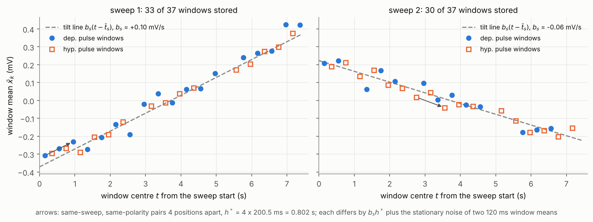
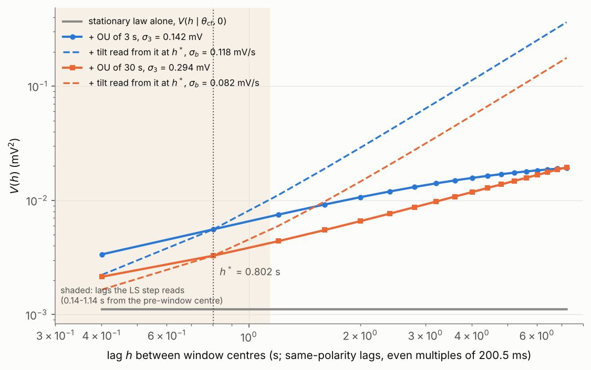
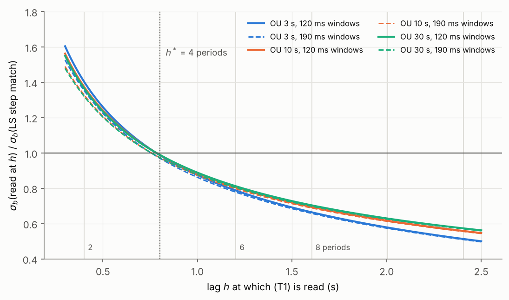
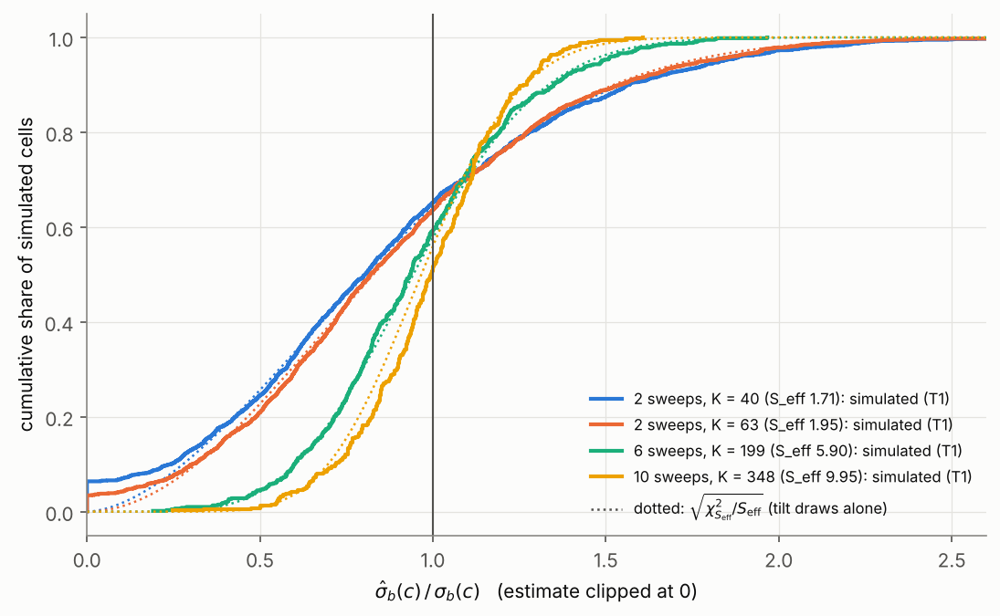
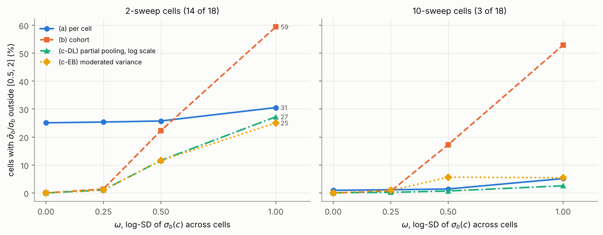

# The per-sweep tilt of the Stage-7 noise law: why it is there, how $\sigma_b(c)$ is read from the SS window means, and how far two sweeps can fix it

**Date:** 2026-10-26

**Abstract.** The Stage-7 twins carry their real cell's recording noise, and part of that noise is a variance at the scale of seconds that the law's 37 ms component cannot produce. The project carries it with a per-sweep linear tilt $b_{c,s}$, drawn for every sweep $s$ of cell $c$ from $\mathcal N(0, \sigma_b(c)^2)$ (D-034), and reads $\sigma_b(c)$ from the semivariogram of the Square Subthreshold (SS) window means at one lag, $h^*$ = 4 onset periods = 0.802 s (the estimator (T1), D-034.1). The question this document answers is the one the 2026-10-23 finding left: what (T1) measures, under which assumptions it is right, how precisely the 2 SS sweeps of 14 of the 18 L3_exc cells can fix $\sigma_b(c)$, what depends on it, and what the three ways of giving each twin its $\sigma_b$ (per cell, one cohort value, partial pooling across cells) do. **Covered:** why a tilt and not a creep or a third OU; the two levels of the tilt (the draws $b_{c,s}$ and their SD $\sigma_b(c)$); the window-mean semivariogram and the identities (T1) rests on; what (T1) estimates; the tilt inside the fit's simulator and why $\hat\theta$ hardly depends on it; what a tilt can and cannot reproduce, and why $h^*$ = 4 periods also holds for the 120 ms windows of $t_{\rm SS}$ = 80 ms; the sampling distribution with 2, 6 and 10 sweeps and why its width is a limit of the data, not of the estimator; the twins' Long Square baseline; the random-effects (DerSimonian-Laird) and empirical-Bayes forms of partial pooling, checked on an 18-cell cohort; what the Long Square tail says about how much $\sigma_b$ differs between cells. **Excluded:** the window-start rule and its transient test (the next explanation); the per-sweep stage of D-076 except as the precedent for shrinkage; the generator code (Block 5); the $I_h$ fit. Sources consulted: project knowledge (the noise topic doc v3.4 §3.2.5, §3.3.2, §3.6; the decision log D-017 note 4, D-034, D-051, D-073, D-076; the noise handoff §3, §4.6), the repository's SPEC §2.3, §2.4, §3, §8 and the code of `noise_law`, `noise_windows`, `noise_cell_stats`, `noise_fit` and of statsmodels' meta-analysis module; PubMed full texts of DerSimonian & Laird 2015 and Veroniki et al. 2016; PubMed abstracts only of Verbeke, Lesaffre & Brant 1998, Smyth 2004 and Phipson et al. 2016; checks check01-check05 run for this document, and checks B and C of 2026-10-23. Searches that returned nothing: PubMed "empirical Bayes moderated variance few degrees of freedom limma hyperparameter", "limma empirical Bayes variance moderation squeezes gene-wise variances", "semi-variogram linear mixed model random slopes serial correlation measurement error", "variance shrinkage small sample sizes empirical Bayes inverse gamma prior moderated t", "meta-analysis of variation log standard deviation lnSD sampling variance" (0 records each); bioRxiv, neuroscience, last 30 days (30 preprints): nothing relevant. No data repository was queried: every data claim here rests on the project's own inspection of the archive (SPEC §3, the cluster runs of 2026-10-01 and 2026-10-20/21); the Synapse connector is not available in this session.

---

## 1. Notation and Symbols

Status (Provenance model): **analytic** (closed form from a fixed choice), **configured** (set by a decision or a default), **computed** (a deterministic function of data or simulation), **derivation-only** (appears only in the argument, never evaluated by the pipeline), **not verified**. Where the status differs between the real cells and the twins or the checks, both are given, slash-separated. Statuses are read from the code on branch `sci/noise-fit` (Blocks 2-4) **[CODE: noise_law.py, noise_cell_stats.py, noise_fit.py, specs/SPEC.md]**.

| Symbol | Name / Meaning | Type & domain | Units | First used in § | Status |
|---|---|---|---|---|---|
| $c$; $\mathcal C$ | a real L3_exc cell; the cohort of 18 cells | element of $\mathcal C$; finite set | -- | 3.1 | -- |
| $s$; $S(c)$ | an SS sweep of cell $c$; the number of SS sweeps of $c$ (2 in 14 cells, 6 in one, 10 in three) | $s \in \{1, \dots, S(c)\}$; $\mathbb N_{\ge 1}$ | -- | 3.2 | computed (archive) |
| $p$ | position of a pulse in its sweep's 37-pulse train, 0-based; depolarising at even $p$ | $\{0, \dots, 36\}$ | -- | 3.3 | computed (archive) |
| $k$; $K(c)$ | index of a stored SS window; the number of stored windows of $c$ (37-348) | $\{1, \dots, K(c)\}$; $\mathbb N$ | -- | 3.3 | computed (archive) |
| $\Delta t$; $P$ | sampling interval (20 µs); SS onset period, 10025 samples = 200.5 ms | $\mathbb R_{>0}$; $\mathbb N$ | s; samples | 3.2 | configured (data: SPEC §3) |
| $t$; $t_j$; $\bar t_{c,s}$ | time; time of sample $j$ from the start of a trace; mid-time of sweep $s$ of $c$ | $\mathbb R$ | s | 3.2 | -- |
| $e_j$; $e^{\rm stat}_j$ | total injected noise at sample $j$ of a trace; its stationary part (fast AR(1) + slow OU) | $\mathbb R$ | mV | 3.2 | analytic (law) / simulated |
| $a_{c,s}$ | per-sweep offset | $\mathbb R$ | mV | 3.2 | derivation-only (cancels everywhere) |
| $b_{c,s}$ | the tilt of sweep $s$ of cell $c$: one draw per sweep, the slope of a line centred on $\bar t_{c,s}$ (realised-draw level) | $\mathbb R$ | mV/s | 3.2 | real: derivation-only (not estimated by the pipeline; estimable, §3.7) / simulator: $\sigma_b\,\xi$, drawn |
| $\xi_{c,s}$ | unit draw of the tilt (`UnitDraws.tilt`) | $\mathcal N(0,1)$ | -- | 3.2 | simulated |
| $\sigma_b(c)$ | SD of the law the tilts of cell $c$ are drawn from (analytic level: a parameter of the per-cell law) | $\mathbb R_{\ge 0}$ | mV/s | 3.2 | real: derivation-only (never known) / twins: configured from $\tilde\sigma_b(c)$ (Block 5, not built) |
| $\hat\sigma_b(c)$ | the estimate of $\sigma_b(c)$ by (T1), clipped at 0 (computed level) | $\mathbb R_{\ge 0}$ | mV/s | 3.4 | computed (`noise_fit.tilt_from_semivariogram`, Block 4; not yet run on real cells) |
| $\hat\sigma_b(c)^2_{\rm u}$ | the same before clipping | $\mathbb R$ | (mV/s)$^2$ | 3.4 | computed (checks) |
| $\tilde\sigma_b(c)$ | the value a twin would receive under an option of §3.9 | $\mathbb R_{\ge 0}$ | mV/s | 3.9 | option (a): $=\hat\sigma_b(c)$, built / (b), (c): not implemented |
| $T_{\rm sw}$; $\sigma_\delta$ | duration of a generated trace; SD of the tilt's span $b\,T_{\rm sw}$, the generator's `drift_sigma_mV` | $\mathbb R_{>0}$; $\mathbb R_{\ge 0}$ | s; mV | 3.2 | configured (generator) |
| $\theta$; $\theta_{\rm cf}$; $\hat\theta_c$ | stationary law $(\sigma_f, \rho_f, \sigma_s, \tau_s)$; the cohort closed-form law (0.0380 mV, 0.175, 0.0508 mV, 36.6 ms) used in the checks; cell $c$'s fitted law | $\Theta = \mathbb R_{>0}\times(0,1)\times\mathbb R_{>0}\times\mathbb R_{>0}$ | mV, --, mV, s | 3.2 | analytic (law) / configured (checks) / computed (Block 4) |
| $\sigma_s, \tau_s$ | SD and correlation time of the slow OU component | $\mathbb R_{>0}$ | mV; s | 3.1 | part of $\theta$ |
| $t_{\rm SS}$; $T$; $m$ | start of the enlarged window after a pulse (80 ms here); its duration $[t_{\rm SS}, 200)$ ms = 120 ms; its samples (6000) | $\mathbb R$; $\mathbb R_{>0}$; $\mathbb N$ | ms; s; samples | 3.3 | configured (D-076 floor; the transient test may raise it) |
| $\bar x_{c,k}$; $t^{\rm c}_{c,k}$ | mean of the enlarged window $k$ of $c$ after the per-polarity mean window is subtracted (D-051.1); the time of that window's centre in its sweep | $\mathbb R$; $\mathbb R$ | mV; s | 3.3 | computed |
| $h$; $h^*$; $h_2$, $h_4$ | lag between two window centres in one sweep; the calibration lag, 4 periods = 0.802 s; the same-polarity lags of 2 and 4 periods (0.401 s, $h_4 = h^*$) | $\mathbb R_{>0}$ | s | 3.3; $h_2, h_4$ 3.6 | configured (provisional default, D-051) |
| $\mathcal P_c$; $(k, k')$; $s(k)$ | the pairs of windows of $c$ in the same sweep and of the same polarity whose positions differ by 4; one such pair; the sweep it lies in | finite set of index pairs | -- | 3.3 | computed |
| $N_s(c)$; $N(c)$; $\lambda_s(c)$ | pairs of $\mathcal P_c$ in sweep $s$; their total; the pair share $N_s(c)/N(c)$ | $\mathbb N$; $\mathbb N$; $[0,1]$ | -- | 3.4 | computed (`n_pairs`) / $\lambda$: derivation-only |
| $D_{c,k}$; $d_{c,k}$ | difference of the two window means of pair $(k,k')$; its stationary part | $\mathbb R$ | mV | 3.3 | computed / derivation-only |
| $V(h \mid \theta, \sigma_b)$ | semivariogram of two window means $h$ apart in one sweep, under the law (analytic level) | $\mathbb R_{\ge 0}$ | mV$^2$ | 3.3 | analytic (`noise_law.semivariogram`, exact for the sampled law) |
| $V_0(\theta)$ | the floor $V(h^* \mid \theta, 0)$ | $\mathbb R_{>0}$ | mV$^2$ | 3.3 | analytic |
| $\hat V_c(h)$ | half the mean squared $D_{c,k}$ over $\mathcal P_c$ (computed level) | $\mathbb R_{\ge 0}$ | mV$^2$ | 3.3 | computed (`noise_cell_stats.window_mean_semivariogram`) |
| $\overline{b^2}_c$ | the realised pair-weighted mean square of the cell's tilts, $\sum_s \lambda_s(c)\, b_{c,s}^2$ | $\mathbb R_{\ge 0}$ | (mV/s)$^2$ | 3.4 | derivation-only |
| $S_{\rm eff}(c)$ | effective number of tilt draws behind $\hat\sigma_b(c)$, $N(c)^2/\sum_s N_s(c)^2$ | $[1, S(c)]$ | -- | 3.7 | derivation-only / computed in the checks |
| $\chi^2_\nu$; $\nu$; $\psi$, $\psi_1$ | chi-square law with $\nu$ degrees of freedom; a generic degrees-of-freedom value; digamma and trigamma functions | law on $\mathbb R_{\ge 0}$; $\mathbb R_{>0}$; maps $\mathbb R_{>0} \to \mathbb R$ | -- | 3.7 | analytic |
| $\mathcal N(0, \cdot)$ | normal law with mean 0 and the variance given | law on $\mathbb R$ | -- | 3.2 | analytic |
| $\hat u$ | the fit coordinates $(\log\hat\sigma_f, \hat\rho_f, \log\hat\sigma_s, \log\hat\tau_s)$ of a fitted law (computed level) | $\mathbb R^4$ | log mV, --, log mV, log s | 3.5 | computed (Block 4) |
| $\bar g_h$, $\Delta v_h$, $\kappa_\tau$ | the $I_h$ density, the shift of its activation curve, the scale of its time constant (three of the six fitted parameters) | $\mathbb R_{\ge 0}$; $\mathbb R$; $\mathbb R_{>0}$ | S/cm$^2$; mV; -- | 3.1 | fitted by the $I_h$ fit (not this document) |
| $\bar x_{\rm pre}$ | mean of the 265 ms Long Square pre-window | $\mathbb R$ | mV | 3.6 | computed |
| $e_3(t)$ | the stand-in OU's value at time $t$ | $\mathbb R$ | mV | 3.6 | derivation-only |
| $\sigma_3, \tau_3$; $V_3(h)$; $B_3(t)$ | SD and correlation time of a stand-in OU for the variance at seconds (3, 10, 30 s); its excess semivariogram; its baseline-subtracted point error $t$ after a Long Square onset | $\mathbb R_{>0}$; $\mathbb R_{\ge 0}$; $\mathbb R_{\ge 0}$ | mV, s; mV$^2$; mV | 3.6 | derivation-only (a stand-in, not part of the law) |
| $t_{\rm on}$; $t_{\rm pre}$ | Long Square step onset; centre of its 265 ms pre-window, $t_{\rm on} - 0.1375$ s | $\mathbb R$ | s | 3.6 | computed (archive geometry) |
| $\Delta_{\rm end}$; $s_c$ | Long Square tail change of one sweep (end-window mean minus pre-window mean, 6.89 s apart); its SD in cell $c$ (check05's model) | $\mathbb R$; $\mathbb R_{>0}$ | mV | 3.1, 3.9 | computed (cluster, 2026-10-01) / derivation-only |
| $\omega$; $z_c$ | log-SD of $\sigma_b(c)$ across the cells of the cohort (analytic level, the checks' heterogeneity); the standard-normal draw that sets cell $c$'s $\sigma_b(c) = 0.1\,\mathrm e^{\omega z_c}$ mV/s in check04 | $\mathbb R_{\ge 0}$; $\mathcal N(0,1)$ | -- | 3.9 | derivation-only / configured in check04 |
| $C$ | number of cells pooled (18) | $\mathbb N$ | -- | 3.9 | -- |
| $y_c$; $v_c$; $\nu_c$ | DL "effect" of cell $c$, $\log\hat\sigma_b(c)^2$ corrected for its chi-square bias; its sampling variance; its degrees of freedom $S_{\rm eff}(c)$ | $\mathbb R$; $\mathbb R_{>0}$; $\mathbb R_{>0}$ | -- | 3.9 | not implemented (checks only) |
| $\mu$; $\Omega^2$; $\hat\Omega^2$, $\hat\mu$ | mean and between-cell variance of $\log\sigma_b(c)^2$ in the random-effects model ($\Omega = 2\omega$); their DerSimonian-Laird estimates | $\mathbb R$; $\mathbb R_{\ge 0}$ | -- | 3.9 | derivation-only / computed in the checks |
| $\bar y_w$; $\hat y_c$ | the inverse-variance-weighted mean of the $y_c$; cell $c$'s shrunk value of $y_c$ | $\mathbb R$ | -- | 3.9 | checks only |
| $w_c$; $Q$ | inverse-variance weight $1/v_c$; Cochran's statistic | $\mathbb R_{>0}$; $\mathbb R_{\ge 0}$ | -- | 3.9 | checks only |
| $d_0$; $s_0^2$ | prior degrees of freedom and scale of the empirical-Bayes (moderated-variance) form | $(0, \infty]$; $\mathbb R_{>0}$ | --; (mV/s)$^2$ | 3.9 | checks only |
| $\mathbb E$, $\operatorname{Var}$, $\operatorname{Cov}$ | expectation, variance, covariance over the random quantities named at each use (the noise with the tilts fixed, the tilts, or both) | operators | -- | 3.3 | -- |

### Conventions

- **Units.** Voltages in mV, times in s (ms in prose where clearer), slopes in mV/s, so $\sigma_b(c)^2$ is in (mV/s)$^2$. One onset period is $P\,\Delta t$ = 0.2005 s; "4 periods" is $h^*$ = 0.802 s.
- **Levels.** A symbol written "$\mid \theta$" is a property of the law (analytic level); a hat marks a number computed from data or simulation (computed level); a tilde marks the value handed to a twin. The tilts $b_{c,s}$ sit on a level of their own, the **realised draws**: random variables of the law $\mathcal N(0, \sigma_b(c)^2)$ when the law is discussed, fixed numbers once a sweep has been recorded. Every move between levels is named where it happens.
- **Two random-effect levels.** $b_{c,s}$ is a random effect of the sweep within a cell (a random slope); in §3.9 the cells' $\log\sigma_b(c)^2$ are themselves random effects of the cell within the cohort. The two are never the same object.
- **Renamings and labels.** The law is (L1) of the SPEC = (D-017.1) of the log = eq. (5a) of the noise topic doc. The estimator is "(T1)" of SPEC §2.4 = (D-034.1) of the log = eq. (26) of the topic doc; with parentheses it is an equation label, not the roadmap's theory stage T1 (this document is the study material of roadmap stage **T8**). D-076.1 writes the between-sweep variance of its shrinkage $\hat\tau^2(c)$; the between-cell variance here is $\Omega^2$, to keep $\tau$ for $\tau_s$ and $\tau_3$. The topic doc writes the window means $\bar x_{(1)}, \bar x_{(2)}$; here they carry their cell and index, $\bar x_{c,k}$.
- **Logs** are natural. **Equations** are numbered (1)-(17) in order of appearance. $\langle f(t) \rangle_{t \in [0,1]}$ is the average of $f$ over the 1 s Long Square step, $t$ measured from the onset.
- **Checks.** Unless stated, a check plugs the true law $\theta_{\rm cf}$ into (T1) where the pipeline would plug $\hat\theta_c$; the effect of $\hat\theta_c$'s error is treated separately (§3.7). Drop positions of stored windows are drawn at random in the checks (the real ones are in each cell's `trace_qc_results.csv` on the cluster).

---

## 2. Glossary / Jargon

Ordered alphabetically.

- **Cochran's $Q$.** The inverse-variance-weighted sum of squared deviations of the study estimates from their weighted mean; its excess over its expectation under homogeneity is what the DerSimonian-Laird estimator turns into a between-study variance. Operative in §3.9.
- **Cohort value (option b).** One $\sigma_b$ for all cells, pooled from every cell's estimate. Operative in §3.9.
- **Creep.** *Flag: also called "drift" in the topic doc.* A baseline change that is roughly linear across a sweep and continues through the step. Not found in any L3_exc cell (§3.1). *The generator's `drift_sigma_mV` is $\sigma_\delta$, the tilt's span (§3.2), a different object.*
- **DerSimonian-Laird (DL).** The random-effects method of meta-analysis: each study's estimate is a true effect plus sampling error, the true effects vary around a mean, and their variance is estimated by the method of moments (§3.9).
- **Effective number of draws, $S_{\rm eff}(c)$.** How many independent tilts (T1) effectively averages, when sweeps contribute unequal numbers of pairs (§3.7).
- **Empirical Bayes; moderated variance.** Estimating each unit's variance as a compromise between its own estimate and a prior fitted to all units; in the limma family, the per-gene variances "shrunk" towards a pooled value. Operative in §3.9.
- **Enlarged window.** The late part $[t_{\rm SS}, 200)$ ms of each stored SS pulse window, where the pulse response has died out (D-034, D-051); the transient test sets $t_{\rm SS}(c)$ (not treated here). §3.3.
- **Heterogeneity (between-cell).** Variation of $\sigma_b(c)$ from cell to cell beyond what each cell's sampling error explains. *Not* the noise of one sweep. §3.9.
- **Method of moments.** Estimating a parameter by setting a statistic equal to its expectation under the model and solving. §3.9.
- **OU (Ornstein-Uhlenbeck) process.** Stationary Gaussian process with autocorrelation $\mathrm e^{-|h|/\tau}$. The law's slow component is one (37 ms); a seconds-scale OU is used here only as a stand-in for the unknown shape of the variance at seconds. §3.1, §3.6.
- **Pair (same-polarity pair).** Two stored windows of the same sweep and the same pulse polarity whose positions in the train differ by 4. §3.3.
- **Partial pooling (shrinkage).** *Flag: "pooling" has two senses; complete pooling is option (b), partial pooling option (c).* Each cell's estimate is pulled towards the cohort's by a weight that depends on how noisy the cell's estimate is relative to how much cells really differ. §3.9.
- **Random effect; random slope.** A quantity drawn anew for each unit (sweep, cell) from a common law. The tilt is a random slope per sweep. §3.2.
- **Realised value.** The number a random variable took in one recording. A cell's two tilts are two realised values; $\sigma_b(c)$ is a property of the law they came from. §3.2.
- **Semivariogram.** Half the mean squared difference of a quantity at two times as a function of their separation; here of window means in one sweep. A standard diagnostic of serial correlation in longitudinal mixed models. §3.3.
- **Square Subthreshold (SS).** The Allen protocol of 0.5 ms current pulses of $\pm$200 pA; in the archive's cells each sweep is a train of 37 pulses, 200.5 ms onset to onset, alternating from depolarising. §3.3.
- **Step-averaged match.** The criterion that sets the tilt so that the twin's Long Square baseline error, squared and averaged over the 1 s step, equals the real cell's. §3.6.
- **Tilt.** *Flag: in the diameter workstream "tilt" is a branch's inclination (D-019, D-024); unrelated.* Here: the per-sweep linear term $b_{c,s}(t - \bar t_{c,s})$ of the noise law. §3.2.
- **Twin.** The synthetic copy of a real cell (same morphology, protocol and noise law, known parameters) on which the Stage-7 gate tests the fitter. §3.1.
- **Variance at seconds.** The baseline variance at lags of about a second and more that the law's stationary part cannot produce, seen in the Long Square tail. §3.1.
- **Wander.** A slow stationary fluctuation that returns towards the cell's mean level, as against a creep. §3.1.

---

## 3. The tilt, from the problem to the choice the project faces

### 3.1 The problem: variance at seconds that a 37 ms process cannot carry

*This section establishes what the tilt is for: a measured excess of baseline variance at seconds, in almost every cell, whose shape is unknown and which is not a creep.*

The Stage-7 gate asks whether the six-parameter $I_h$ fit recovers known truth from synthetic twins, and a twin is only a fair test if it carries noise as hard as its real cell's: a twin with cleaner noise than its cell would pass a gate the real data fail **[KB: claude/TEEG_Stage7_noise_model_2026-09-28.md §3.1.1, citing D-011 (iii)]**. The law fitted to each cell's windows has a fast AR(1) part and one slow OU part with a correlation time near 37 ms **[KB: topic doc §3.3.1, §3.5.3]**, and the windows it is fitted to are at most 265 ms long. The naive expectation is that such a law also describes the baseline over the seconds that a Long Square sweep lasts. It does not. On the cluster run of 2026-10-01 the Long Square tail change $\Delta_{\rm end}$ -- the mean of the last 500 ms of the stored sweep minus the mean of the pre-window, 6.89 s apart -- had per-cell medians of 0.048-0.620 mV (cohort median 0.128 mV), while under the cohort laws a per-cell median of 5-6 sweeps has a 99th percentile of 0.046-0.056 mV; 17 or 18 of the 18 cells lie above it **[KB: TEEG_decisions_and_ideas_log.md D-017 note 4; claude/TEEG_Stage7_noise_handoff_2026-10-01.md §4.6]** [Certain].

Two readings of that excess were possible, and the same run separated them. A **creep** (a baseline that keeps moving in the direction it had in the pre-window) would make $\Delta_{\rm end}$ agree in sign with the pre-window's own slope almost always; a stationary **wander** of any timescale agrees about half the time. The signs agreed in 53 of 104 sweeps (binomial $p$ = 0.92), against 0.49-0.53 expected for a wander of 37 ms to 30 s and near 1 for a creep **[KB: D-017 note 4]** [Certain]. So the excess is a slow wander, and if it is stationary noise it must sit at correlation times of about 3 s or more: an OU of 0.3 s or 1 s sized to the 6.89 s change would have raised the cohort's 265 ms window SD from the measured 0.0594 mV to 0.098 or 0.072 mV **[KB: D-017 note 4; topic doc §3.6.3]** [Certain]. Its shape -- an OU of seconds, a random walk, something else -- is not known **[KB: topic doc §3.6.3; handoff §4.6]**.

Why the twins must carry it: the Long Square loss is scored over the whole 1 s step after the pre-window mean is subtracted, so any baseline change after the pre-window enters the residual on exactly the timescale on which the $I_h$ density $\bar g_h$, the shift $\Delta v_h$ of its activation curve and the scale $\kappa_\tau$ of its time constant are identified **[KB: topic doc §3.1.2, §3.6.2]**. The SD of the step-mean baseline error is 0.031 mV from the 37 ms component and 0.049-0.070 mV from a seconds-scale OU matched to the 6.89 s change **[KB: D-017 note 4; topic doc §3.6.3]** [Certain]: the variance at seconds is the larger term.

### 3.2 The move: a per-sweep random tilt, and the two levels it lives on

*This section establishes the object: the tilt as a random slope drawn once per sweep, and the difference between a sweep's tilt and the spread of tilts in a cell.*

The project's answer (D-034, the user's decision of 2026-10-08) is to add to every sweep a straight line of random slope, drawn anew for each sweep, instead of a third OU component or a per-sweep choice of model order **[KB: D-034]**. In words: each sweep of a cell gets its own small linear drift, up or down, with a size typical of that cell; over the seconds of a sweep, a line of random slope adds variance that grows with the time separation, which is what the Long Square tail showed. Formally, for one trace of cell $c$ sampled at $t_j = j\,\Delta t$, with mid-time $\bar t_{c,s}$,

$$ e_j = e^{\rm stat}_j + a_{c,s} + b_{c,s}\,(t_j - \bar t_{c,s}), \qquad b_{c,s} \sim \mathcal N\bigl(0, \sigma_b(c)^2\bigr) \ \text{iid over } s, \tag{1} $$

with $e^{\rm stat}_j$ the fast AR(1) plus slow OU of law $\theta$ and $a_{c,s}$ an offset that cancels in every statistic **[CODE: specs/SPEC.md §2.1 (L1); noise_law.py]**. The generator sets the span of the line over a generated trace of duration $T_{\rm sw}$, so

$$ \sigma_\delta = \sigma_b(c)\,T_{\rm sw} \tag{2} $$

is its `drift_sigma_mV` **[KB: D-034 Statement]**.

Two levels must be kept apart from here on (R8). $b_{c,s}$ is **one draw** per sweep: in a recorded sweep it is a fixed, unknown number (realised-draw level). $\sigma_b(c)$ is the **SD of the law** those draws come from (analytic level): a property of the cell, which no single sweep contains. A cell with 2 SS sweeps has exactly two realised tilts. That is why D-073 and D-076 keep $\sigma_b(c)$ per cell while calibrating other parameters per sweep: it is "a spread across sweeps, not a property of one sweep" **[KB: D-073 comment (b); D-076 (i)]** [Certain].

Two alternatives were set aside, each for a stated reason. A third OU component cannot be identified inside a window: within 265 ms a seconds-scale OU shows only through $\sigma_3^2/\tau_3$, and an exact-likelihood BIC never detected it per sweep or per cell **[KB: topic doc §3.5.4]**. And a tilt calibrated from each Long Square pre-window's own slope would come out more than an order of magnitude too large **[KB: D-017 note 4; D-034 Status]** [Certain]: a 265 ms window's slope reads the local course of the wander, which the following seconds do not continue (§3.1) **[OWN]** [Likely]. The tilt is therefore calibrated where many windows of one sweep span seconds: the SS trains.

### 3.3 Measuring a tilt you never see directly: the window-mean semivariogram

*This section establishes the measurement: within one SS sweep the difference of two window means isolates the tilt from everything that does not grow with time, exactly.*

An SS sweep is a train of 37 pulses, 200.5 ms onset to onset, alternating in polarity from a depolarising first pulse; the archive stores each pulse's $(-10, +200)$ ms window, minus those its trace QC dropped (6-50 % of a cell's pulses, median 27 %) **[CODE: specs/SPEC.md §3, data inspected on the cluster 2026-10-20/21]** [Certain]. The late part $[t_{\rm SS}, 200)$ ms of each window -- 120 ms at $t_{\rm SS}$ = 80 ms -- is the enlarged noise window, and each window has its polarity's mean window subtracted (D-051.1) **[KB: D-051 (iv); D-076 (ii)]**. Within a sweep, then, the 37 window means sample the baseline every 200.5 ms for about 7.2 s. Figure 1 shows one simulated cell: the means scatter around the sweep's tilt line.

*Figure 1 -- Within one SS sweep the enlarged-window means scatter around that sweep's tilt line, and a same-polarity pair four positions apart differs by $b_{c,s} h^*$ plus the stationary noise of two 120 ms window means [OWN: eq. (4); RUN: scripts/check01_tilt_identities.py (i)] [Certain]; one simulated 2-sweep cell, law $\theta_{\rm cf}$, planted tilts +0.10 and -0.06 mV/s, no pulse response, raw window means (the per-polarity subtraction cancels in every same-polarity difference, check01 (ii)); plotted: scripts/fig01_window_means.py.*

The move is to look only at **differences of window means within one sweep**. Regardless of the offset $a_{c,s}$, of the sweep's absolute level and of the per-polarity mean window, if two windows lie in the same sweep and have the same polarity, then their difference contains none of those, because each is a constant common to both windows. What the difference does contain is the stationary noise of the two windows and the tilt, and the tilt enters exactly: the mean of a line over a window is the line's value at the window's centre, so for windows centred at $t^{\rm c}_{c,k}$,

$$ \frac1m\sum_{j \in \text{window } k} b_{c,s}\,(t_j - \bar t_{c,s}) = b_{c,s}\,\bigl(t^{\rm c}_{c,k} - \bar t_{c,s}\bigr), \tag{3} $$

and the difference of a pair $(k, k')$ whose centres are $h$ apart is

$$ D_{c,k} = \bar x_{c,k'} - \bar x_{c,k} = b_{c,s(k)}\,h + d_{c,k}, \tag{4} $$

with $d_{c,k}$ the difference of the stationary parts **[OWN: eqs. (1), (3); RUN: scripts/check01_tilt_identities.py (i)]**. The check simulated one cell twice from the same unit draws, with and without tilts, through the pipeline's own simulator and window functions: every $D_{c,k}$ differed from its tilt-free twin by $b_{c,s} h$ to within 1.6e-16 mV [Certain]; eq. (3) makes this exact for any window and any tilt [Certain]. It also confirmed that the per-polarity subtraction leaves $\hat V_c$ unchanged (relative difference 4e-14) and that the pairs counted here are exactly those of `noise_cell_stats.window_mean_semivariogram` **[RUN: scripts/check01_tilt_identities.py (ii)]** [Certain].

Squaring (4) and averaging over the stationary noise and the tilt, the tilt and the noise being independent, gives the semivariogram of two window means $h$ apart in one sweep:

$$ V(h \mid \theta, \sigma_b) = \tfrac12\,\mathbb E\bigl[D^2\bigr] = V(h \mid \theta, 0) + \tfrac12\,\sigma_b^2\,h^2, \tag{5} $$

for each fixed $\theta$ and every $h$ at which the two windows do not overlap **[OWN: eq. (4); KB: topic doc eq. (25), D-034 Statement]** [Certain]. The first term is the stationary law's own semivariogram, which the code computes exactly for the sampled law from its autocovariance **[CODE: noise_law.semivariogram]**. For the 37 ms component it **saturates**: once the gap between two 120 ms windows exceeds a few $\tau_s$, the two window means are uncorrelated and $V(h \mid \theta, 0)$ is simply the variance of one window mean. Under $\theta_{\rm cf}$ with 120 ms windows, $V(h \mid \theta_{\rm cf}, 0)$ is 1.1124e-3 mV$^2$ at 2 periods and 1.1125e-3 at 4 periods, a difference of 1.0e-7 **[RUN: scripts/check03_sampling_distribution.py]** [Certain]. The tilt term, conversely, grows as $h^2$ without bound: at $\sigma_b$ = 0.1 mV/s and $h^*$ = 0.802 s it is 3.2e-3 mV$^2$, three times the floor **[OWN: eq. (5)]** [Certain]. The simulated mean of $\hat V_c(h^*)$ over 1500 tilt-free cells, 1.1300e-3 $\pm$ 1.0e-5 mV$^2$, agreed with $V(h^* \mid \theta_{\rm cf}, 0)$ = 1.1125e-3 mV$^2$ within 1.7 SE **[RUN: scripts/check01_tilt_identities.py (iii)]** [Certain].

The same construction is the empirical semi-variogram used in longitudinal data analysis to read the serial-correlation structure of residuals within subjects, and its extension to models with random effects other than intercepts -- random slopes among them -- makes the model non-stationary **[ABS: 10.1002/(sici)1097-0258(19980630)17:12<1391::aid-sim851>3.0.co;2-4 (Verbeke, Lesaffre & Brant 1998, abstract only)]** [Likely]. Here the sweep plays the subject, and the tilt is the random slope.

### 3.4 The estimator (T1) and what it actually estimates

*This section establishes what number (T1) returns: an unbiased estimate of $\sigma_b(c)^2$ over the law of the tilts, but, for a given recording, an estimate of the mean square of the cell's few realised tilts.*

Equation (5) at one lag solves for the tilt's variance. Replacing the expectation by the cell's average over its pairs, and the law by the cell's fitted law, gives the estimator of SPEC §2.4:

$$ \hat V_c(h^*) = \frac{1}{2N(c)}\sum_{k \in \mathcal P_c} D_{c,k}^2, \qquad \hat\sigma_b(c)^2 = \max\Bigl\{0,\ \frac{2\,\bigl[\hat V_c(h^*) - V(h^* \mid \hat\theta_c, 0)\bigr]}{h^{*2}}\Bigr\}, \tag{6} $$

where $\mathcal P_c$ holds the pairs of the same sweep and polarity four positions apart, $N(c)$ their number, and the clip at 0 is the code's (flag `tilt_clipped`) **[CODE: specs/SPEC.md §2.4; noise_fit.tilt_from_semivariogram; noise_cell_stats.window_mean_semivariogram]**. Four positions apart is the shortest same-polarity lag after 2 (polarity alternates, so only even position differences pair windows of one polarity), and it is 4 × 200.5 ms = 0.802 s; why that lag, §3.6.

What does (6) estimate? Insert (4) into (6) with $\hat\theta_c = \theta$ and average over the stationary noise **only**, holding the cell's realised tilts fixed. The cross term $b\,d$ averages to zero and $\tfrac12\mathbb E[d^2]$ is the floor, so

$$ \mathbb E\bigl[\hat\sigma_b(c)^2_{\rm u} \,\big|\, b_{c,1}, \dots, b_{c,S(c)}\bigr] = \sum_{s=1}^{S(c)} \lambda_s(c)\, b_{c,s}^2 \equiv \overline{b^2}_c, \qquad \lambda_s(c) = \frac{N_s(c)}{N(c)}, \tag{7} $$

for the unclipped estimate $\hat\sigma_b(c)^2_{\rm u}$ **[OWN: eqs. (4), (6)]**. In words: (T1) reads the pair-weighted mean square of the tilts this cell happened to draw. Averaging (7) over the law of the tilts, $\mathbb E[\hat\sigma_b(c)^2_{\rm u}] = \sigma_b(c)^2$: unbiased. Check01 (iv) fixed two tilts, $b$ = (0.13, -0.04) mV/s, and averaged over 1500 noise draws: 0.008456 $\pm$ 0.000062 against $\overline{b^2}_c$ = 0.008485 (mV/s)$^2$ **[RUN: scripts/check01_tilt_identities.py (iv)]** [Certain]. The unconditional unbiasedness holds in every layout simulated: mean $\hat\sigma_b^2_{\rm u}/\sigma_b^2$ of 1.013, 1.012, 0.997 and 1.027 for 2 sweeps ($K$ 40 and 63), 6 and 10 sweeps, each within 1.3 SE of 1 **[RUN: scripts/check03_sampling_distribution.py (b)]** [Certain].

The consequence is the 2026-10-23 finding, now stated as a theorem rather than an observation: however many pairs a sweep holds, a cell contributes **$S(c)$ draws** of $b$, and (T1) can be no better than the mean square of those draws. For 14 of the 18 cells $S(c) = 2$ **[CODE: specs/SPEC.md §3]**. How wide that makes the estimate is §3.7.

### 3.5 The tilt inside the fit: alternated with $\hat\theta$, and why $\hat\theta$ hardly depends on it

*This section establishes where $\hat\sigma_b(c)$ enters the per-cell fit and why its error does not propagate into $\hat\theta_c$.*

The fit matches the cell's window statistics with the medians of the same statistics computed on simulated cells (indirect inference, D-033), and the simulator must produce windows as the real ones are produced, tilt included. D-051 (iii) therefore draws $b \sim \mathcal N(0, \hat\sigma_b(c)^2)$ for every simulated sweep, shares it among that sweep's windows, and recomputes $\hat\sigma_b(c)$ by (6) after every solve with the current $\hat\theta$; $\sigma_b$ is never a free parameter of the cost, so the stop rule on $\hat\theta$ tests the joint fixed point **[KB: D-051 (iii)]**. Block 4 realises this: after each solve, (6) with $V(h^* \mid \hat\theta_k, 0)$; the reported pair is $(\hat\theta, \hat\sigma_b)$ re-read at the solution **[CODE: specs/SPEC.md §2.3 (f), (g)]**.

Why the error of $\hat\sigma_b(c)$ hardly matters for $\hat\theta_c$: the statistics are computed on demeaned windows, and a line of slope $b$ over a window of duration $T$ adds only $b^2 T^2/12$ to the window's demeaned variance. At $\sigma_b$ = 0.1 mV/s over 120 ms that is 1.2e-5 mV$^2$, 0.41 % of the window's expected demeaned variance under $\theta_{\rm cf}$ **[RUN: scripts/check01_tilt_identities.py (v)]** [Certain] (D-051's 1-2.4 % was for 190-265 ms windows at 0.08-0.12 mV/s **[KB: D-051 Why (iii)]**). Check C of 2026-10-23 measured the consequence: running the simulator at $\sigma_b$ = 0 or 0.17 mV/s instead of the data's 0.1 moved the linearised $\hat u = (\log\hat\sigma_f, \hat\rho_f, \log\hat\sigma_s, \log\hat\tau_s)$ by at most 0.18 of its SD, SD($\hat u$) = (0.005, 0.007, 0.082, 0.206) on the fixture cell **[RUN: scripts/check_findings_2026-10-23.py (C)]** [Certain, for the fixture layout; Likely for the other layouts, whose $\hat u$ is more precise but whose tilt share is the same]. What rests on $\hat\sigma_b(c)$ is therefore not $\hat\theta_c$ but the twins (§3.8).

### 3.6 A tilt matches the variance at seconds at one lag only: choosing $h^*$

*This section establishes what (T1) means when the variance at seconds is not a straight line, and that 4 periods is the lag at which the twin's tilt carries the Long Square step's baseline error, for the 120 ms windows of $t_{\rm SS}$ = 80 ms as for the 190 ms windows of the topic doc.*

The tilt is a deliberate simplification: §3.1 showed a slow wander, not a straight line. The problem this creates is one of shape. A tilt's semivariogram grows as $h^2$; an OU's grows at most linearly in $h$ and saturates at the variance of a window mean **[KB: D-034 Why (1); OWN: eq. (5)]** [Certain]. Matched at one lag, the two curves cross there and part everywhere else: the tilt carries too little variance at shorter lags and too much at longer ones. Figure 2 shows it for two stand-in OUs.

*Figure 2 -- A tilt matched to a seconds-scale OU at $h^*$ (what (T1) does when the variance at seconds is an OU) equals it at $h^*$ only: at 0.401 s $V$ is 0.0022 mV$^2$ with the tilt against 0.0034 with the OU of 3 s, at 7.218 s 0.36 against 0.019 [OWN: eq. (5); CODE: noise_law.semivariogram; RUN: scripts/fig02_semivariogram.py] [Certain]; 120 ms windows, stationary law $\theta_{\rm cf}$, OUs of 3 s (0.142 mV) and 30 s (0.294 mV) sized to the cohort's 6.89 s change in the topic doc §3.6.3; plotted from formulas: scripts/fig02_semivariogram.py.*

Because the tilt cannot match everywhere, the lag must be chosen where it matters: where the Long Square loss reads the baseline. The pre-window mean is centred at $t_{\rm pre} = t_{\rm on} - 0.1375$ s, and the step runs 1 s, so the loss reads baseline differences at 0.14-1.14 s from the pre-window centre **[KB: D-034 comment (a); topic doc §3.6.5]**. Measured from the step onset $t_{\rm on}$, a tilt's baseline error at time $t$ in the step is $b\,(t + 0.1375\ {\rm s})$, so its square averaged over the step is $\sigma_b^2 \times 0.48974$ s$^2$ and its step mean is $b \times 0.6375$ s:

$$ \bigl\langle (b\,(t + 0.1375))^2 \bigr\rangle_{t \in [0,1]} = \sigma_b^2\,\frac{1.1375^3 - 0.1375^3}{3} = 0.48974\,\sigma_b^2, \qquad \bigl\langle b\,(t + 0.1375) \bigr\rangle_{t\in[0,1]} = 0.6375\,b \tag{8} $$

**[OWN: eq. (1); RUN: scripts/check02_lag_choice.py]** [Certain]. For a stand-in OU $(\sigma_3, \tau_3)$ the same error has variance

$$ B_3(t)^2 = \sigma_3^2 + \operatorname{Var}(\bar x_{\rm pre}) - 2\operatorname{Cov}\bigl(e_3(t), \bar x_{\rm pre}\bigr), \tag{9} $$

the pre-window being $[-270, -5]$ ms from onset **[KB: topic doc eq. (15)]**. The **step match** sets $\sigma_b$ so that the two step-averaged squared errors agree (the criterion of the D-034 note of 2026-10-08 **[KB: D-034 note]**), and what (T1) **reads** at lag $h$ from such an OU is

$$ \sigma_b^{\rm match} = \sqrt{\langle B_3(t)^2\rangle_{t \in [0,1]} / 0.48974}, \qquad \sigma_b^{\rm read}(h) = \sqrt{2\,V_3(h)}\,/\,h, \tag{10} $$

with $V_3(h)$ the OU's own semivariogram of two window means (topic doc eq. (25)) **[OWN: eqs. (5), (8), (9)]**. Check02 computed both in closed form, checked against `noise_law.semivariogram_continuous` (relative difference 5.5e-15) and against numerical quadrature of (9) (1.9e-13) **[RUN: scripts/check02_lag_choice.py (b)]** [Certain]. It reproduces the topic doc's 190 ms numbers: $\sigma_b^{\rm match}$ = 0.083-0.119 mV/s and $\sigma_b^{\rm read}$(0.8 s) = 0.081-0.116 mV/s over OUs of 3-30 s, tilt-to-OU point error 0.47-0.49 at onset and 1.20-1.23 at the end of the step **[RUN: scripts/check02_lag_choice.py (a); KB: topic doc §3.6.5]** [Certain]; at 1.0 s it gives 12-14 % less than the match where the topic doc says 12-13 % (a small discrepancy, largest at the 3 s OU, 13.8 %; not traced).

The finding for the windows now in use (D-076 fixed $t_{\rm SS} \ge$ 80 ms, so 120 ms windows) is in Figure 3. The ratio $\sigma_b^{\rm read}(h)/\sigma_b^{\rm match}$ at the available same-polarity lags of 2, 4, 6 and 8 periods is 1.37-1.40, **0.987-0.989**, 0.79-0.81 and 0.66-0.70 for OUs of 3-30 s; it crosses 1 at 0.782-0.783 s (0.755-0.756 s with 190 ms windows) **[RUN: scripts/check02_lag_choice.py]** [Certain, for these three OUs; Likely for any OU of 3-30 s, since the curves are nested in $\tau_3$]. Four periods remains the right lag: within 1.3 % of the step match, closer than with 190 ms windows (2.6-3.1 %), while the neighbouring lags would be off by +37-40 % or -19-21 %.

*Figure 3 -- Reading (T1) at 4 periods gives the tilt that carries the Long Square step's baseline error, within 1.3 % for 120 ms windows and 3.1 % for 190 ms windows, whatever the OU between 3 and 30 s; 2 or 6 periods would be off by about +40 % or -20 % [OWN: eqs. (8)-(10); RUN: scripts/check02_lag_choice.py] [Certain]; the variance at seconds taken as one OU, the stationary law fitted correctly; plotted from formulas: scripts/fig03_lag_ratio.py.*

Two hypotheses carry this result and are stated where they bind (R2). It assumes the variance at seconds is OU-like between 3 and 30 s; a random walk or a resonance would need its own computation **[OWN]** [Guessing about other shapes]. And it assumes the stationary part of $\hat\theta_c$ is right, so that the floor $V(h^* \mid \hat\theta_c, 0)$ subtracts exactly the stationary part. The price of the choice is said in D-034 comment (a): matched to the step, the twin's tilt over-predicts the variance at longer lags, so the twin's post-step stretch carries too much drift -- read only by the report-only rebound residuals **[KB: D-034 comment (a)]**. A **two-lag estimator**, $2[\hat V_c(h_4) - \hat V_c(h_2)]/(h_4^2 - h_2^2)$ with $h_2$ = 0.401 s and $h_4 = h^*$, would need no $\hat\theta_c$ (the floor cancels between the lags, which differ by 1.0e-7 mV$^2$, above), and under a pure tilt it is unbiased and almost as precise as (T1) (mean ratio 1.015 and 2.5/50/97.5 % of 0.00/0.79/2.08 against 0.00/0.80/2.04 for 2 sweeps, $K$ = 40) **[RUN: scripts/check03_sampling_distribution.py (e)]** [Certain]; but under an OU at seconds it reads the curvature rather than the level and returns 0.80-0.83 of the step match **[RUN: scripts/check02_lag_choice.py]** [Certain]. It trades the dependence on $\hat\theta_c$ for a dependence on the shape, and the shape is the less known of the two.

### 3.7 How precisely a cell's sweeps fix $\sigma_b(c)$

*This section establishes the sampling distribution of $\hat\sigma_b(c)$ for the L3_exc layouts, splits it into its parts, and shows that its width with two sweeps is set by the data, not by the estimator.*

The plain version first. Estimating a spread from two draws is like estimating how variable heights are in a population from two people: whatever the instrument, two numbers cannot fix a variance. Here the two draws are the cell's two realised tilts, and they are measured very well -- the problem is only that there are two.

Formally, insert (4) into (6) and separate the terms (unclipped; $\hat\theta_c = \theta$; $V_0 = V(h^* \mid \theta, 0)$):

$$ \hat\sigma_b(c)^2_{\rm u} = \underbrace{\sum_s \lambda_s(c)\,b_{c,s}^2}_{\text{tilt draws}} + \underbrace{\frac{2}{N(c)\,h^*}\sum_{k \in \mathcal P_c} b_{c,s(k)}\,d_{c,k}}_{\text{cross}} + \underbrace{\frac{1}{N(c)\,h^{*2}}\sum_{k \in \mathcal P_c}\bigl(d_{c,k}^2 - 2V_0\bigr)}_{\text{noise}} \tag{11} $$

**[OWN: eqs. (4), (6)]**. Over the law of the tilts the first term has mean $\sigma_b(c)^2$ and variance $2\sigma_b(c)^4\sum_s\lambda_s(c)^2$; matching it to a scaled chi-square of equal mean and variance gives

$$ \frac{\sum_s \lambda_s(c)\,b_{c,s}^2}{\sigma_b(c)^2} \approx \frac{\chi^2_{S_{\rm eff}(c)}}{S_{\rm eff}(c)}, \qquad S_{\rm eff}(c) = \frac{1}{\sum_s \lambda_s(c)^2} = \frac{N(c)^2}{\sum_s N_s(c)^2} \le S(c), \tag{12} $$

exact in distribution when the sweeps hold equal pair counts **[OWN: moment matching; TXT: a sum of $S$ squared standard normals is $\chi^2_S$]** [Likely as an approximation; its quality is in the check below]. If the stationary differences $d_{c,k}$ were independent with variance $2V_0$, the other two terms would add variances of about $8\sigma_b(c)^2 V_0/(N h^{*2})$ and $8V_0^2/(N h^{*4})$ **[OWN: eq. (11)]** [Likely: the $d_{c,k}$ of overlapping pairs are correlated].

Check03 measured all of it on the pipeline's own simulated windows, at $\theta_{\rm cf}$, $\sigma_b(c)$ = 0.1 mV/s and $t_{\rm SS}$ = 80 ms **[RUN: scripts/check03_sampling_distribution.py (b), (c)]** [Certain, for these layouts, this law and $\sigma_b$]:

| Layout (random drops) | pairs per sweep | $S_{\rm eff}$ | $\hat\sigma_b/\sigma_b$: 2.5 / 50 / 97.5 % | $\sqrt{\chi^2_{S_{\rm eff}}/S_{\rm eff}}$ | clipped at 0 | Var($\hat\sigma^2_{b,\rm u}/\sigma_b^2$): total = tilt + cross + noise |
|---|---|---|---|---|---|---|
| 2 sweeps, $K$ = 40 | 5, 12 | 1.71 | 0.00 / 0.80 / 2.04 | 0.12 / 0.80 / 1.99 | 6.4 % | 1.300 = 1.242 + 0.049 + 0.017 |
| 2 sweeps, $K$ = 63 | 28, 20 | 1.95 | 0.00 / 0.82 / 1.96 | 0.15 / 0.83 / 1.93 | 3.5 % | 1.087 = 1.064 + 0.007 + 0.007 |
| 6 sweeps, $K$ = 199 | 20-30 | 5.90 | 0.41 / 0.93 / 1.59 | 0.45 / 0.94 / 1.56 | 0 | 0.363 = 0.353 + 0.002 + 0.002 |
| 10 sweeps, $K$ = 348 | 25-31 | 9.95 | 0.55 / 1.00 / 1.38 | 0.57 / 0.97 / 1.43 | 0 | 0.173 = 0.170 + 0.001 + 0.001 |

(covariances between the terms make up the rest; they are at most 0.010). The tilt draws are 95-98 % of the variance in every layout, and the chi-square of (12) describes the spread except for the mass at zero that the noise adds when the realised tilts are small (Figure 4). The checks of 2026-10-23 on other random layouts gave the same picture (95 % ranges 0.00-1.95 with 2 sweeps, 0.42-1.56 with 6, 0.59-1.44 with 10) **[RUN: scripts/check_findings_2026-10-23.py (B)]** [Certain]. Note the level: $\hat\sigma_b(c)^2$ is unbiased, $\hat\sigma_b(c)$ is not -- its median is 0.80-0.83 of $\sigma_b(c)$ with 2 sweeps **[RUN: as above]** [Certain], as Jensen's inequality and the skewed law of a two-draw mean square lead one to expect **[TXT]**.

*Figure 4 -- With two SS sweeps, $\hat\sigma_b(c)$ is spread over 0 to twice $\sigma_b(c)$ (95 %), and the spread is that of the realised tilts alone, $\sqrt{\chi^2_{S_{\rm eff}}/S_{\rm eff}}$ (dotted), apart from a 3.5-6.4 % mass at zero; with ten sweeps it narrows to 0.55-1.38 [RUN: scripts/check03_sampling_distribution.py] [Certain]; $\theta_{\rm cf}$, $\sigma_b$ = 0.1 mV/s, $t_{\rm SS}$ = 80 ms, (T1) at the true law, 2000/2000/600/400 simulated cells; plotted: scripts/fig04_sampling.py.*

**The limit is the data's, not the estimator's.** Suppose the realised tilts were observed exactly. For a generic set of $S$ independent draws from $\mathcal N(0, \sigma_b^2)$ -- here $S = S(c)$ and $\sigma_b = \sigma_b(c)$, the $(c)$ dropped in (13) only -- the Fisher information on $v = \sigma_b^2$ is $S/(2\sigma_b^4)$ -- per draw the log-density is $-\tfrac12\log(2\pi v) - b^2/(2v)$, whose second derivative in $v$ is $1/(2v^2) - b^2/v^3$, of expectation $-1/(2v^2)$ -- so every unbiased estimator has

$$ \operatorname{Var}\bigl(\hat\sigma_b^2\bigr) \ge \frac{2\,\sigma_b^4}{S}, \tag{13} $$

attained by $\frac1S\sum_s b_s^2 \sim \sigma_b^2\,\chi^2_S/S$ **[OWN: the derivation just given; TXT: the Cramér-Rao bound]** [Certain]. (T1)'s variance with 2 sweeps is 9 % ($K$ = 63) and 30 % ($K$ = 40) above this bound; the excess comes from unequal pair counts, $S_{\rm eff} < 2$ (1.95 and 1.71: +3 % and +17 %), and from the cross and noise terms (+6 % and +11 %) **[RUN: scripts/check03_sampling_distribution.py (b)]** [Certain]. Weighting the sweeps equally instead of by their pairs would remove the first part at the cost of a noisier sparse sweep (not checked) **[OWN: eq. (12)]** [Likely]. And the tilts are in fact observed almost exactly: the least-squares slope of each sweep's window means on time, with one intercept per polarity, recovered the realised $b_{c,s}$ with an RMS error of 0.0027-0.0036 mV/s, 3-4 % of $\sigma_b$; the mean square of those slopes had the spread of $\chi^2_S/S$ (2.5/50/97.5 % of 0.17/0.82/1.93 against 0.16/0.83/1.92 for $S$ = 2) **[RUN: scripts/check03_sampling_distribution.py (f)]** [Certain]. No unbiased estimator built on one cell's sweeps can do better than (13); only information from outside the cell -- other cells -- can (§3.9).

**The floor.** When $\sigma_b(c)$ is small, the noise term of (11) dominates. With $\sigma_b(c)$ = 0, the SD of $\hat\sigma_b(c)^2_{\rm u}$ is 0.0013 and 0.0008 (mV/s)$^2$ with 2 sweeps ($K$ 40, 63), 0.0005 with 6 and 0.0003 with 10, and its 95th percentile corresponds to a tilt SD of 0.048, 0.038, 0.029 and 0.024 mV/s; at true $\sigma_b(c)$ of 0.025, 0.05, 0.1 and 0.2 mV/s a 2-sweep cell ($K$ = 40) is clipped to zero in 39, 20, 6.4 and 1.6 % of cases **[RUN: scripts/check03_sampling_distribution.py (c)]** [Certain]. A 2-sweep cell cannot tell a $\sigma_b(c)$ below about 0.04-0.05 mV/s from none.

**The error of $\hat\theta_c$.** The floor subtracted in (6) is computed at the fitted law, so its error enters too. $\log V(h^* \mid \theta, 0)$ has gradient 2.00 in $\log\sigma_s$ and 0.64 in $\log\tau_s$ at $\theta_{\rm cf}$ (120 ms windows); with the SDs of $\hat u$ from check C, the SD of $\log V(h^* \mid \hat\theta_c, 0)$ is 0.03-0.30 (0.21 if $\log\hat\sigma_s$ and $\log\hat\tau_s$ are uncorrelated; their correlation was not printed on 2026-10-23), i.e. an error of 0.0001-0.0010 (mV/s)$^2$ in $\hat\sigma_b(c)^2$ **[RUN: scripts/check03_sampling_distribution.py (d)]** [Certain for the linearised bound; Likely as the real size, since the correlation is bracketed, not measured]. That is comparable to the floor of a 2-sweep cell and 1-10 % of $\sigma_b^2$ at 0.1 mV/s: small against the chi-square spread, which check04 confirms (§3.9).

### 3.8 What rests on $\sigma_b(c)$: the twins' Long Square baseline

*This section establishes what an error in $\tilde\sigma_b(c)$ does: it scales the twin's dominant baseline error at the lags where $I_h$ is identified.*

By (8), a twin's Long Square step carries a step-mean baseline error of SD $0.6375\,\tilde\sigma_b(c)$ s from its tilt: 0.064 mV at 0.1 mV/s, against 0.031 mV from the 37 ms component **[OWN: eq. (8); KB: D-017 note 4]** [Certain]. In a twin, then, the tilt is the larger baseline error at the step's lags, and a factor-2 error in $\tilde\sigma_b(c)$ is a factor-2 error in it. Too small, and the twin is cleaner than its cell: the gate is optimistic for that cell, the failure D-011 (iii) warns against; too large, and the gate is pessimistic **[KB: topic doc §3.1.1; OWN]** [Likely]. How such errors bias the $I_h$ parameters -- a baseline that rises during a hyperpolarising step looks like sag -- is argued in the topic doc §3.6.2 and was not simulated **[KB: topic doc §3.6.2]** [Guessing about its size]. This is also why the per-cell $\sigma_b$ question is the user's, not a detail: it decides how realistic each twin's hardest noise term is.

### 3.9 Three ways to give each twin its $\sigma_b$: per cell, cohort, partial pooling

*This section establishes what the three options do, the theory of the partial-pooling option, how they compare on an 18-cell cohort with the L3_exc sweep counts, and what the data say about how different the cells are.*

**The three options.** (a) **Per cell**: $\tilde\sigma_b(c) = \hat\sigma_b(c)$, as D-034 says and Block 4 implements **[KB: D-034; CODE: noise_fit.py]**; unbiased in $\sigma_b^2$, but for a 2-sweep cell it is the two-draw estimate of §3.7. (b) **Cohort**: one value for all cells, pooled from all; it borrows the 64 SS sweeps of the cohort (pooled under a common $\sigma_b$: 95 % range 0.82-1.17, **[RUN: scripts/check_findings_2026-10-23.py (B)]** [Certain]) but is wrong for every cell that differs from the cohort. (c) **Partial pooling**: each cell's estimate pulled towards the cohort's by a weight that is large when the cell's estimate is noisy and small when the cells really differ. Option (c) is the same idea D-076 adopted for $\sigma_s$ per sweep, with DerSimonian-Laird **[KB: D-076 (i), D-076.1]**.

**The random-effects model.** DerSimonian and Laird's method treats each study's observed effect as a true but random effect plus a within-study sampling error whose variance is taken as fixed and known; the variance of the observed effects is the variation of the true effects plus the within-study variance; the between-study variance is estimated by the method of moments and the mean by a weighted mean with weights inverse to the assumed variances **[FT: 10.1016/j.cct.2015.09.002 (DerSimonian & Laird 2015)]** [Certain]. The estimator equates Cochran's $Q$ with its expectation and truncates negative values at zero **[FT: 10.1002/jrsm.1164 (Veroniki et al. 2016)]** [Certain]. Written out, for $C$ cells with effects $y_c$ and known variances $v_c$,

$$ w_c = \frac1{v_c},\quad \bar y_w = \frac{\sum_c w_c y_c}{\sum_c w_c},\quad Q = \sum_c w_c\,(y_c - \bar y_w)^2,\quad \hat\Omega^2 = \max\Bigl\{0,\ \frac{Q - (C-1)}{\sum_c w_c - \sum_c w_c^2/\sum_c w_c}\Bigr\}, \tag{14} $$

**[TXT: the DL estimator; CODE: statsmodels.stats.meta_analysis._fit_tau_mm, read, whose expectation term reduces to $C - 1$ for these weights]** [Certain]; the random-effects mean $\hat\mu$ is the mean weighted by $1/(v_c + \hat\Omega^2)$, and each cell's shrunk estimate is

$$ \hat y_c = \hat\mu + \frac{\hat\Omega^2}{\hat\Omega^2 + v_c}\,\bigl(y_c - \hat\mu\bigr), \tag{15} $$

the form of D-076.1 **[KB: D-076.1; TXT: best linear unbiased predictor of a random effect]**. In words: if the cells' spread $Q$ is no larger than their sampling noise predicts, $\hat\Omega^2 = 0$ and every cell gets the cohort value; if it is much larger, each keeps its own.

**The transplant check (R3).** DL was established for study estimates that are approximately normal with known within-study variances; bias in it "is not inherent to the estimator per se, but depends on how well sampling variances are estimated", and can also come from a correlation between the estimates and their variances **[FT: 10.1002/jrsm.1164]** [Certain]. $\hat\sigma_b(c)^2$ on its natural scale fails both: its sampling variance $2\sigma_b(c)^4/S_{\rm eff}(c)$ depends on the unknown $\sigma_b(c)$ -- estimated by plugging in the cell's own value, it correlates with the estimate -- and it is far from normal with two draws. On the log scale both problems shrink: by (12), $\log\hat\sigma_b(c)^2 - \log\sigma_b(c)^2 \approx \log(\chi^2_\nu/\nu)$, whose mean and variance are known from the layout alone,

$$ y_c = \log\hat\sigma_b(c)^2 - \bigl[\psi(\nu_c/2) - \log(\nu_c/2)\bigr], \qquad v_c = \psi_1(\nu_c/2), \qquad \nu_c = S_{\rm eff}(c), \tag{16} $$

so the within-cell variance is known without $\sigma_b(c)$, and $y_c$ estimates $\log\sigma_b(c)^2$ without bias under (12) **[OWN: eq. (12); TXT: moments of a log-chi-square; RUN: scripts/check04_pooling_options.py, Monte Carlo of the moments for $\nu$ = 2, 6, 10, within 3 SE]** [Likely: exact only under (12); the noise term of (11) and the clip break it in the lower tail]. For $\nu = 2$ the bias is -0.577 and the variance 1.645; for $\nu = 10$, -0.103 and 0.221 **[RUN: as above]** [Certain]. Two pieces are the assistant's choices and are flagged: a non-positive $\hat\sigma_b(c)^2_{\rm u}$ has no log, so it is floored at the cell's noise-only SD of (T1) before the log [Guessing about its effect beyond the check]; and the log-normal shape of the between-cell spread is an assumption [Guessing].

An implementation note follows from reading the library: statsmodels 0.15's `combine_effects(method_re="dl")` returns the **unclipped** moment estimate and uses it, when negative, in its random-effects weights (negative weights on a homogeneous toy) **[RUN: scripts/check04_pooling_options.py; CODE: statsmodels.stats.meta_analysis]** [Certain]. Any use of it -- here, and in Block 4b's D-076.1 for $\sigma_s$ -- must clip $\hat\Omega^2$ at 0 itself and compute $\hat\mu$ with the clipped value, as D-076 already requires **[KB: D-076 "What it implies"]**.

**The empirical-Bayes alternative.** For variances estimated with few degrees of freedom the genomics literature uses a conjugate empirical-Bayes model, in which each unit's variance is shrunk towards a pooled estimate; it gives far more stable inference when replicates are few **[ABS: 10.2202/1544-6115.1027 (Smyth 2004, abstract only)]** [Likely], and its hyperparameter estimate can be dominated by a few units with very large or very small variances unless robustified **[ABS: 10.1214/16-AOAS920 (Phipson et al. 2016, abstract only; full text in PMC, not read)]** [Likely]. Its form here, with a scaled-inverse-chi-square prior of $d_0$ degrees of freedom and scale $s_0^2$ fitted from the moments of $\log\hat\sigma_b(c)^2$, is

$$ \tilde\sigma_b(c)^2 = \frac{d_0\,s_0^2 + \nu_c\,\hat\sigma_b(c)^2}{d_0 + \nu_c} \tag{17} $$

**[TXT: conjugate posterior; OWN: the moment fit as implemented in scripts/tilt_common.py, written from the method's description, not from Smyth's text]** [Likely].

**The comparison.** Check04 built an 18-cell cohort with the L3_exc layouts -- 14 cells of 2 sweeps (stored $K$ 37-69 each, $S_{\rm eff}$ 1.63-2.00 with random drops), one of 6, three of 10 -- drew $\sigma_b(c) = 0.1\,\mathrm e^{\omega z_c}$ mV/s with $z_c \sim \mathcal N(0,1)$, simulated each cell's (T1) from the pipeline's windows, applied the four options, and scored each cell's $\tilde\sigma_b(c)/\sigma_b(c)$ over 4000 cohorts **[RUN: scripts/check04_pooling_options.py]** [Certain, for this design]:

| $\omega$ (log-SD of $\sigma_b(c)$ across cells) | 2-sweep cells off by more than a factor 2: (a) / (b) / (c-DL) / (c-EB) | zeros under (a) | 10-sweep cells off by more than ×2: (a) / (b) / (c-DL) / (c-EB) | DL's $\hat\Omega^2 = 0$ |
|---|---|---|---|---|
| 0 | 25.1 / 0.0 / 0.0 / 0.0 % | 4.6 % | 1.0 / 0.0 / 0.1 / 0.0 % | 89 % of cohorts |
| 0.25 | 25.4 / 1.4 / 1.0 / 1.0 % | 5.1 % | 1.1 / 0.6 / 0.2 / 0.9 % | 56 % |
| 0.5 | 25.7 / 22.3 / **11.6** / 11.6 % | 6.5 % | 1.4 / 17.3 / **0.7** / 5.6 % | 11 % |
| 1.0 | 30.5 / 59.4 / **27.2** / 25.0 % | 10.4 % | 5.1 / 52.9 / **2.6** / 5.4 % | 0 % |
| 0.5, $\sigma_b$ median 0.05 mV/s | 32.8 / 22.4 / 17.0 / 19.6 % | 17.2 % | 5.5 / 16.8 / 2.7 / 17.0 % | 30 % |
| 0.5, with $\hat\theta_c$'s error (SD of log floor 0.21) | 26.8 / 21.7 / 11.6 / 11.5 % | 7.8 % | 3.5 / 16.5 / 1.8 / 5.0 % | 12 % |

The median $|\log(\tilde\sigma_b/\sigma_b)|$ tells the same story (2-sweep cells at $\omega$ = 0.5: 0.38 / 0.38 / 0.29 / 0.29) **[RUN: scripts/check04_pooling_options.py]** [Certain]. Figure 5 draws the first four rows.

*Figure 5 -- By the share of cells off by more than a factor 2, partial pooling on the log scale (c-DL) is never worse than the better of per-cell (a) and cohort (b) for the 2-sweep cells, matches or beats (a) for the 10-sweep cells, and never returns a zero tilt; complete pooling fails as soon as cells differ [RUN: scripts/check04_pooling_options.py] [Certain, for this design]; 18 cells with the L3_exc sweep counts, $\theta_{\rm cf}$ in every cell, $\sigma_b(c) = 0.1\,\mathrm e^{\omega z_c}$ mV/s, (T1) at the true law, 4000 cohorts; plotted: scripts/fig05_pooling.py.*

Three readings follow. When the cells share one $\sigma_b$ ($\omega$ = 0), the cohort value and both pooled forms are right to 6-9 % (median $|\log(\tilde\sigma_b/\sigma_b)|$ of 0.06-0.09), and the per-cell estimate is off by more than a factor 2 in a quarter of the 2-sweep cells **[RUN: as above]** [Certain]. When cells differ ($\omega \ge$ 0.5), the cohort value is the worst option and the pooled forms halve the per-cell failure rate at $\omega$ = 0.5; at $\omega$ = 1 all options fail a quarter or more of the 2-sweep cells, because two draws cannot fix a value that varies that much and the cohort cannot supply it **[RUN: as above]** [Certain]. And between the two pooled forms, the DL form on the log scale is as good for 2-sweep cells and better for 10-sweep cells (2.6 % against 5.4 % at $\omega$ = 1), so (17) brings nothing over (15)-(16) here **[RUN: as above]** [Certain]. The verdict depends on the metric being symmetric. By the RMS of the relative error, which weighs a factor-3 overestimate (cost 2) more than a zero (cost 1), the per-cell option wins for 2-sweep cells once $\omega \ge$ 0.5 (0.52 against 0.57 at 0.5; 0.66 against 1.49 at 1), because pooling pulls the low-$\sigma_b$ cells up (median ratio 1.07-1.17) where the per-cell estimate pulls them to zero **[RUN: as above]** [Certain]. An upward error makes a twin noisier than its cell, the conservative side for the gate in the sense of D-011 (iii) **[KB: topic doc §3.1.1]** [Likely]. DL's $\hat\Omega^2$ is 0 in 89 % of cohorts when $\omega$ = 0 and still in 56 % when $\omega$ = 0.25: with 18 cells, 14 of them two-draw, a modest heterogeneity is often not seen, and the method then falls back to the cohort value -- which is harmless when the heterogeneity it misses is small, as the table shows. This matches the literature's warning that between-study variance estimates "are particularly inaccurate when the number of studies included in a meta-analysis is small" **[FT: 10.1002/jrsm.1164]** [Certain], and DL's own statement that heterogeneity tests are often underpowered and the random-effects approach can be used whether or not heterogeneity is present **[FT: 10.1016/j.cct.2015.09.002]** [Certain].

**How different are the cells?** The answer decides between the rows, and the only per-cell evidence available before the SS semivariograms are computed on real cells is the Long Square tail of §3.1. If $\Delta_{\rm end}$ had one SD for all cells, the 18 per-cell medians of 5-6 half-normal values would have a largest-to-median ratio of 4.84 or more with probability 1.0e-5, and a largest-to-smallest ratio of 12.9 or more with probability 0.037 -- the observed values **[RUN: scripts/check05_ls_tail_spread.py; KB: the three order statistics, D-017 note 4]** [Certain]. One common variance at seconds is therefore rejected. With a log-normal spread of per-cell SDs, the observed largest-to-smallest ratio is the median outcome at $\omega \approx$ 0.5 and inside the 5-95 % band for $\omega$ of 0.2-0.9; the largest-to-median ratio favours the upper half of that range (probability 0.11 at $\omega$ = 0.5, 0.51 at 0.8) **[RUN: scripts/check05_ls_tail_spread.py]** [Certain for the computation; Guessing as an estimate of $\omega$ for $\sigma_b$: three order statistics only, a 6.89 s lag rather than $h^*$, the stationary part's own differences between cells included, and the two high cells (526785799, 571430815 **[KB: D-017 note 4]**) may be outliers rather than the tail of a log-normal]. On that evidence the cohort sits in the $\omega \approx$ 0.5-1 rows, where (c-DL) halves the per-cell failure rate ($\omega$ = 0.5) or still slightly improves on it ($\omega$ = 1), and the cohort value is the worst.

**Verdict.** Partial pooling on the log scale by DerSimonian-Laird, eqs. (14)-(16) with $\hat\Omega^2$ clipped at 0, is the option that is never far from the best and never gives a twin zero tilt **[RUN: scripts/check04_pooling_options.py]** [Certain, for the design checked; Likely beyond it]. It makes concrete the recommendation of 2026-10-23 (partial pooling across cells **[KB: claude/TEEG_Stage7_noise_handoff_2026-10-01.md, row 2026-10-23 (later)]**) by fixing the scale, the known within-cell variances and the clip. It does not make the 2-sweep cells precise: at the heterogeneity the Long Square tail suggests, 12-27 % of them would still carry a tilt SD off by more than a factor 2. The choice -- (a), (b) or (c), and if (c), whether the floor rule and the log-normal assumption are acceptable -- is the user's (SPEC §8) **[CODE: specs/SPEC.md §8]**. Whichever is chosen, the real cells' $\hat\sigma_b(c)$, once Block 3 runs on the archive, will replace the Long Square proxy as the evidence on $\omega$.

### 3.10 What the tilt is commonly confused with

*This section establishes the distinctions that the preceding sections rely on, stated once each.*

- **$b_{c,s}$, $\sigma_b(c)$, $\sigma_\delta$.** A sweep's realised slope (mV/s); the SD of the law it was drawn from (mV/s); the SD of the line's span over a generated trace, $\sigma_b(c) T_{\rm sw}$ (mV), the generator's `drift_sigma_mV` (§3.2). A real SS sweep's $b_{c,s}$ is measurable to 3-4 % of $\sigma_b$ (§3.7) but is not what a twin needs: the twin draws its own.
- **A tilt and a creep.** The tilt is a random slope with mean zero across sweeps, a model of the variance at seconds; a creep is a systematic continuation of the pre-window trend, which the Long Square tail excluded (§3.1). The topic doc's "drift" means the creep.
- **"Unbiased".** $\hat\sigma_b(c)^2$ is unbiased over the law of the tilts; $\hat\sigma_b(c)$ is biased low (median 0.80-0.83 of $\sigma_b(c)$ with 2 sweeps), and for a given recording $\hat\sigma_b(c)^2$ estimates $\overline{b^2}_c$, the cell's realised mean square, not $\sigma_b(c)^2$ (§3.4, §3.7).
- **An imprecise estimator and imprecise data.** The 2-sweep spread is the bound (13) of the data, which (T1) approaches within 9-30 % in variance (§3.7); no unbiased estimator from the same cell's sweeps can go below it.
- **The Long Square pre-window slope.** Not an estimate of $b$: over 265 ms it reads the local course of the wander, which does not continue, and would overstate the tilt more than tenfold (§3.2).
- **$\hat V_c(h)$ and $V(h \mid \theta, \sigma_b)$.** A number computed from one cell's pairs, and a property of the law (§3.3); (T1) moves from the first to the second by plugging $\hat\theta_c$ into the floor, a step whose error is bounded in §3.7.
- **Two random effects.** The tilt is a random effect of the sweep within a cell; in option (c) $\log\sigma_b(c)^2$ is a random effect of the cell within the cohort (§3.9). DL's "between-study variance" is $\Omega^2$ here, not the OU time constant $\tau_s$.
- **"(T1)" and "T1".** The SPEC's equation label, and roadmap theory stage T1 (the passive cable model); this document is the material of roadmap stage T8.

---

## 4. References / further reading

**Project knowledge base.**
1. `claude/TEEG_Stage7_noise_model_2026-09-28.md`, v3.4 -- the noise law and its inference; §3.1.1-3.1.2, §3.2.5, §3.3.2, §3.5.3-3.5.4, §3.6.1-3.6.5 used here. [KB: claude/TEEG_Stage7_noise_model_2026-09-28.md]
2. `TEEG_decisions_and_ideas_log.md` -- D-011 (iii), D-017 note 4, D-033, D-034 (with its note of 2026-10-08), D-051 (iii)-(iv), D-073, D-076 (i), D-076.1. [KB: TEEG_decisions_and_ideas_log.md]
3. `claude/TEEG_Stage7_noise_handoff_2026-10-01.md` -- §3 update (c), §4.6. [KB: claude/TEEG_Stage7_noise_handoff_2026-10-01.md]

**Peer-reviewed, full text read (according to PubMed / PubMed Central).**
4. DerSimonian, R. & Laird, N. (2015). Meta-analysis in clinical trials revisited. *Contemp Clin Trials* 45 (Pt A), 139-145. PMC4639420. [DOI](https://doi.org/10.1016/j.cct.2015.09.002) [FT: 10.1016/j.cct.2015.09.002] (the connector's text lacks the equations; statements used are from the prose).
5. Veroniki, A. A., Jackson, D., Viechtbauer, W. et al. (2016; online 2015). Methods to estimate the between-study variance and its uncertainty in meta-analysis. *Res Synth Methods* 7, 55-79. PMC4950030. [DOI](https://doi.org/10.1002/jrsm.1164) [FT: 10.1002/jrsm.1164] (read in full; the connector's text lacks the equations).

**Peer-reviewed, abstract only (flagged; no number used).**
6. Verbeke, G., Lesaffre, E. & Brant, L. J. (1998). The detection of residual serial correlation in linear mixed models. *Stat Med* 17, 1391-1402. [DOI](https://doi.org/10.1002/(sici)1097-0258(19980630)17:12<1391::aid-sim851>3.0.co;2-4) [ABS: 10.1002/(sici)1097-0258(19980630)17:12<1391::aid-sim851>3.0.co;2-4]
7. Smyth, G. K. (2004). Linear models and empirical Bayes methods for assessing differential expression in microarray experiments. *Stat Appl Genet Mol Biol* 3, Article 3. [DOI](https://doi.org/10.2202/1544-6115.1027) [ABS: 10.2202/1544-6115.1027]
8. Phipson, B., Lee, S., Majewski, I. J., Alexander, W. S. & Smyth, G. K. (2016). Robust hyperparameter estimation protects against hypervariable genes and improves power to detect differential expression. *Ann Appl Stat* 10, 946-963. PMC5373812 (full text available, not read). [DOI](https://doi.org/10.1214/16-AOAS920) [ABS: 10.1214/16-AOAS920]

**Code and records read.** [CODE]
9. Repository `Leonardodm00/Towards-EEG`, branch `sci/noise-fit` (Blocks 2-4, commits to `e75bdea`): `Passive Features/HPC script/Ih Fit/specs/SPEC.md` §2.1, §2.3 (f)-(h), §2.4, §3, §8; `noise_law.py` (`simulate_traces`, `semivariogram`, `semivariogram_continuous`); `noise_windows.py` (`enlarged_windows`, `subtract_mean_response`); `noise_cell_stats.py` (`window_mean_semivariogram`); `noise_fit.py` (`tilt_from_semivariogram`, `CellLayout`). statsmodels 0.15.0, `stats/meta_analysis.py` (`combine_effects`, `_fit_tau_mm`).

**Textbook, from memory.** [TXT] The chi-square law of a sum of squared standard normals and the moment-matched (Satterthwaite-type) chi-square approximation; the mean and variance of the log of a chi-square variable (digamma, trigamma); the Cramér-Rao bound for the variance of a normal law; Jensen's inequality; the DerSimonian-Laird moment estimator in closed form and the best linear unbiased predictor of a random effect; the conjugate (scaled-inverse-chi-square) posterior of a normal variance. Not read: DerSimonian & Laird's original 1986 paper; Satterthwaite 1946.

### Figure sources

- Figure 1: `scripts/fig01_window_means.py`; data: one cell simulated with `tilt_common` (the repository's simulator), $\theta_{\rm cf}$, layout 2 × 37 with 11 dropped, tilts +0.10 and -0.06 mV/s, seed 20261030.
- Figure 2: `scripts/fig02_semivariogram.py`; none: formulas, `noise_law.semivariogram` at $\theta_{\rm cf}$ and eq. (25) of the topic doc for OUs (3 s, 0.142 mV) and (30 s, 0.294 mV), 120 ms windows.
- Figure 3: `scripts/fig03_lag_ratio.py`; none: formulas of check02, OUs of 3, 10, 30 s, windows of 120 and 190 ms.
- Figure 4: `scripts/fig04_sampling.py`; data: `results/check03_ratios.npz` written by check03 (b).
- Figure 5: `scripts/fig05_pooling.py`; data: `results/check04_results.npz` written by check04.

### Check sources

All scripts are standalone, import the repository's Blocks 2-4 (path in `TEEG_IH_FIT`, default the sandbox clone [corrected 2026-10-28: in the repository copy, `Ih Fit/dev/2026-10-26_tilt_sigma_b/`, the default is the Ih Fit folder three levels above `scripts/`, D-097]), read their parameters from one config block, and state their predictions in their docstrings; logs are in `results/`. Shared code: `scripts/tilt_common.py`; simulated data: `scripts/make_banks.py` (`ref`: 2000/2000/600/400 cells of 2, 2, 6, 10 sweeps; `cohort`: 300 cells for each of the 18 L3_exc layouts; seed 20261026; about 7 and 8 min).

- Check 1 (§3.3, eqs. (3)-(5); §3.4, eq. (7); §3.5): `scripts/check01_tilt_identities.py`; $\theta_{\rm cf}$, 2 sweeps, $K$ = 40, seed 20261026, 1500 cells; tilt exact to 1.6e-16 mV; subtraction cancels (4e-14); mean $\hat V_c$ within 1.7 SE of the exact floor; $\overline{b^2}_c$ recovered within 0.5 SE; line share 0.41 %. All five predictions held.
- Check 2 (§3.6, eqs. (8)-(10)): `scripts/check02_lag_choice.py`; formulas, no random numbers; the topic doc's 190 ms numbers reproduced; ratio at 4 periods 0.987-0.989 (120 ms). The first run's quadrature oracle (square domain) agreed only to 1.9e-9 and failed its 1e-9 tolerance; with the domain split at the integrand's kink it agrees to 1.9e-13.
- Check 3 (§3.6 two-lag estimator; §3.7, eqs. (11)-(13)): `scripts/check03_sampling_distribution.py` on the `ref` banks; $\theta_{\rm cf}$, $\sigma_b$ = 0.1 mV/s, seed 20261027; (d) is a linearised bound from check C's SD($\hat u$), the full recomputation of (d) (about 3 min) was stopped and not run. All predictions held.
- Check 4 (§3.9, eqs. (14)-(17)): `scripts/check04_pooling_options.py` on the `cohort` banks; 4000 cohorts per scenario, seed 20261028; statsmodels' unclipped $\hat\Omega^2$ asserted; log-chi-square moments within 3 SE.
- Check 5 (§3.9): `scripts/check05_ls_tail_spread.py`; half-normal model of $|\Delta_{\rm end}|$, 200000 cohorts (homogeneous) and 40000 per $\omega$, seed 20261029.
- Checks B and C of 2026-10-23 (§3.5, §3.7, §3.9): `scripts/check_findings_2026-10-23.py` (as delivered on 2026-10-23; results in `results/results_2026-10-23.txt`).
