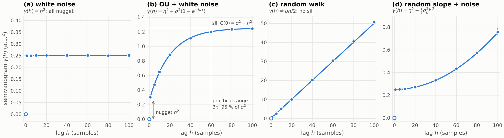
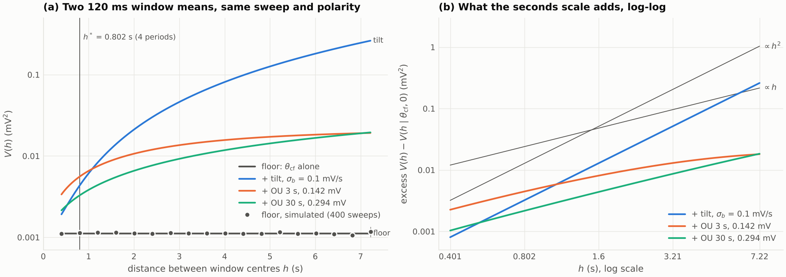

# The semivariogram: what it measures, what its shape says, and how the noise fit used it on the SS window means

**Date:** 2026-11-13

**Abstract.** Brief, by request. The question: what the semivariogram is, why it can see variance slower than a noise window when the autocovariance cannot, how its shape tells a stationary wander from a random walk from a random tilt, how it is estimated, and how the Stage-7 noise fit used it on the Short Square (SS) window means to carry the variance at seconds by a per-sweep tilt (D-034), and where that use stands since D-102 and D-107. Covered: the definition; its relation to the autocovariance; nugget, sill and range; the four shapes; the classical (Matheron) estimator against the autocovariance computed with the record's own mean; the semivariogram of window means and the Allan variance as a special case of it; the project's use, with a worked case at the project's layout. Excluded: kriging and variogram-model fitting (permissible models, weighted least squares), robust estimators, spatial anisotropy, and the precision and pooling of the tilt SD $\sigma_b(c)$, which the tilt study of 2026-10-26 treats (§3.6 points to it). Sources consulted: the decision log (D-017, D-034 and its notes, D-051, D-076, D-095, D-102, D-107, D-111, D-124), the SPEC (§2.4, §3), the topic doc v3 (§3.4.1, §3.6), the tilt study, and the code (`noise_law.py`, `noise_cell_stats.py`, `main` at `77b0bb7`), all in the repository; PubMed full texts: Davis & Curriero 2019, Soler & Blangero 2003, Marschallinger et al. 2021, Morgan & Saleh 2021; abstract only: Verbeke et al. 1998, and Goovaerts 2008, whose PMC full text came back empty; two checks by computation run here (`scripts/check01_generic.py`, `scripts/check02_window_means.py`). Searches that returned nothing: PubMed "variogram Matheron estimator time series", "semi-variogram serial correlation stationary Gaussian process longitudinal measurement error", "intrinsic stationarity variogram covariance function geostatistics tutorial", "variogram AND Ornstein-Uhlenbeck", "Allan variance cluster averages gyroscope random walk bias instability" (0 hits each); bioRxiv: the connector has no keyword search, and the 30 newest neuroscience preprints (last 30 days) held none on the topic. No data repository was queried: the one claim about data, the SS layout, was read from the project's archive files on the cluster (SPEC §3).

## 1. Notation and Symbols

| Symbol | Name / Meaning | Type & domain | Units | First used in § | Status |
|---|---|---|---|---|---|
| $X(t)$ | a random process, its value at time $t$ (generic; the recording noise in §3.5-3.6) | real random variable for each $t$ | a.u.; mV in §3.5-3.6 | 3.1 | -- |
| $t$ | time | $\mathbb R$ (s), or $\mathbb Z$ (samples) in §3.2-3.4 | s or samples | 3.1 | -- |
| $h$ | lag: the separation of two readings (for window means, of the windows' centres) | $h \ge 0$ | s or samples | 3.1 | -- |
| $\gamma(h)$; $\gamma_X(h)$ | semivariogram of $X$ (analytic level: a property of the process's law); subscript names the process when two are in play | map $[0, \infty) \to [0, \infty)$ | a.u.$^2$ | 3.1 | -- |
| $\mu$ | mean of a stationary $X$ | $\mathbb R$ | a.u. | 3.2 | -- |
| $C(h)$ | autocovariance of a stationary $X$, $\operatorname{Cov}(X(t), X(t+h))$ (analytic level) | even map $\mathbb R \to \mathbb R$; $C(0)$ the variance | a.u.$^2$ | 3.2 | -- |
| $\eta^2$ | variance of an independent white noise added to $X$: the nugget | $\eta^2 \ge 0$ | a.u.$^2$ | 3.2 | -- |
| $\sigma^2,\ \tau$ | variance (the partial sill) and correlation time of an Ornstein-Uhlenbeck (OU) process | $\sigma^2 \ge 0$, $\tau > 0$ | a.u.$^2$; s or samples | 3.2 | -- |
| $q$ | increment variance per unit time of a random walk | $q > 0$ | a.u.$^2$ per s or per sample | 3.3 | -- |
| $Y(t)$ | the stationary part of a process with offset and tilt, eq. (6) | real random variable for each $t$ | a.u. | 3.3 | -- |
| $a,\ b$ | offset and slope (the tilt) of one record, each drawn once per record, independent of $Y$ | real random variables | a.u.; a.u. per unit time (mV/s) | 3.3 | -- |
| $\bar t$ | mid-time of the record | $\mathbb R$ | s or samples | 3.3 | -- |
| $\sigma_b^2$ | $\mathbb E[b^2]$, the variance of $b$ when $\mathbb E[b] = 0$ (law level) | $\sigma_b \ge 0$ | (a.u. per unit time)$^2$; (mV/s)$^2$ from §3.5 | 3.3 | configured in the checks: 0.01 per sample (Figure 1), 0.1 mV/s (§3.6) |
| $n$ | number of samples in one record | $\mathbb N$, $n \ge 2$ | -- | 3.4 | -- |
| $i, j, t, u$ | sample indices within one record, $1, \dots, n$ ($t$ doubles as the time in samples) | $\lbrace 1, \dots, n \rbrace$ | -- | 3.4 | -- |
| $x_1, \dots, x_n$ | one record: realised values at $n$ equally spaced times (realised level) | $\mathbb R^n$ | a.u. | 3.4 | -- |
| $\bar x$ | the record's mean (computed level) | $\mathbb R$ | a.u. | 3.4 | -- |
| $\hat\gamma(h)$ | the classical (Matheron) estimate of $\gamma(h)$ (computed level) | $[0, \infty)$ | a.u.$^2$ | 3.4 | -- |
| $N(h)$ | number of pairs of readings $h$ apart within records | $\mathbb N$ | -- | 3.4 | -- |
| $\hat C_{\rm own}(h)$ | sample autocovariance with the record's own mean (computed level) | $\mathbb R$ | a.u.$^2$ | 3.4 | -- |
| $z_t$ | $\sum_{u=1}^{n} C(t - u)$, the covariance of $x_t$ with the record's sum (analytic level) | $\mathbb R$ | a.u.$^2$ | 3.4 | -- |
| $T_1, T_2$; $T$; $m$; $\Delta t$ | durations of two windows; their common duration; samples per window; sampling interval ($T = m\,\Delta t$) | $T > 0$; $m \in \mathbb N$; $\Delta t > 0$ | s; --; s | 3.5 | $T$, $m$ configured by the window start (120 ms, 6000 when the window starts at its 80 ms minimum); $\Delta t$ measured: 20 us (50 kHz) |
| $\bar x_{(1)},\ \bar x_{(2)}$; $\bar x_k$ | means of two windows of one record; of window $k$ (realised level) | $\mathbb R$ | mV | 3.5 | computed on real windows (Block 3, for the tilt reading); simulated in the checks |
| $\theta = (\sigma_f, \rho_f, \sigma_s, \tau_s)$ | stationary part of the project's noise law (L1): fast AR(1) SD and lag-1 coefficient at 50 kHz, slow OU SD and correlation time | $\sigma_f, \sigma_s \ge 0$, $\rho_f \in (0, 1)$, $\tau_s > 0$ | mV, --, mV, s | 3.5 | -- |
| $\theta_{\rm cf}$ | the reference law (0.0380 mV, 0.175, 0.0508 mV, 36.6 ms) | as $\theta$ | as $\theta$ | 3.5 | configured (the law of the SPEC's test fixtures and of the dev checks) |
| $V(h \mid \theta, \sigma_b)$ | semivariogram of two window means of one sweep $h$ apart, under the law (analytic level) | $[0, \infty)$ | mV$^2$ | 3.5 | analytic: `noise_law.semivariogram` (Block 2); called by its smoke test and the dev checks, by no pipeline stage |
| $\mathrm{AV}(T)$ | Allan variance at averaging time $T$ (analytic level) | $[0, \infty)$ | mV$^2$ | 3.5 | -- |
| $c$; $s$ | index of a real cell; index of one of its sweeps | labels | -- | 3.6 | -- |
| $t_{\rm SS}(c)$ | start of cell $c$'s SS noise windows after each pulse: max(80 ms, the start read from the decay of the response) | $[80, 200)$ ms | ms | 3.6 | computed (Block 3; D-111) |
| $P$ | SS onset period, pulse to pulse: 10025 samples = 200.5 ms | $\mathbb N$ (samples) | samples; s | 3.6 | measured (archive files, SPEC §3) |
| $L$ | lag in periods; same polarity: $L$ even | $\lbrace 2, 4, \dots, 36 \rbrace$ | -- | 3.6 | -- |
| $h^*$ | calibration lag of (D-034.1): 4 periods = 0.802 s | $h^* > 0$ | s | 3.6 | configured (D-051; SPEC §2.4) |
| $\hat V_c(h)$ | cell $c$'s computed counterpart of $V$: half the mean squared difference over its same-sweep, same-polarity pairs (computed level) | $[0, \infty)$ | mV$^2$ | 3.6 | computed by `noise_cell_stats.window_mean_semivariogram`: LEGACY, unused by the pipeline since D-102/D-107 |
| $\hat\theta_c$ | cell $c$'s fitted law | as $\theta$ | as $\theta$ | 3.6 | computed (Block 4's fit) |
| $\sigma_b(c),\ \hat\sigma_b(c)$ | tilt SD of cell $c$ (law level); its estimate by (D-034.1) (computed level) | $[0, \infty)$ | mV/s | 3.6 | derivation-only since D-102/D-107: nothing in the pipeline evaluates them |
| $b_{c,s}$ | realised tilt of real sweep $s$ of cell $c$ (realised level) | $\mathbb R$ | mV/s | 3.6 | its per-sweep reading is computed in Block 3 and copied into the twins (D-102, D-107) |

### Conventions

Lags are in samples in the generic examples of §3.2-3.4 (a.u. = arbitrary units) and in seconds from §3.5 on. $\mathbb E$, Var and Cov are taken over the process's law (analytic level); a hat marks a number computed from data or simulation (computed level), and "realised" marks one draw. In the checks, SE is the Monte Carlo standard error, from the spread of the per-record (or per-sweep) estimates across independent records, and $z$ = (estimate - prediction)/SE. Status, where a row has one, is the status of the object in the Ih Fit pipeline on `main` at `77b0bb7`. Short source names: *log* = `docs/project/TEEG_decisions_and_ideas_log.md`; *topic doc* = `docs/project/claude/TEEG_Stage7_noise_model_2026-09-28.md` (v3); *tilt study* = `Ih Fit/dev/2026-10-26_tilt_sigma_b/TEEG_tilt_sigma_b_2026-10-26.md`; *SPEC* = `Ih Fit/specs/SPEC.md`; *Ih Fit* = `Passive Features/HPC script/Ih Fit`.

## 2. Glossary / Jargon

Ordering: by first appearance; the concepts build on each other.

- **Lag** -- the separation $h$ between the two readings compared. Operative in §3.1.
- **Semivariogram** -- half the mean squared difference of two readings $h$ apart, as a function of $h$, eq. (1). Operative in §3.1.
- **Variogram** -- two live senses: in Matheron's convention twice the semivariogram, $2\gamma(h)$; in much applied writing the semivariogram itself. This document says "semivariogram" for $\gamma$ throughout and checks a source's definition for the factor ½. Operative in §3.1, §3.7.
- **Intrinsic stationarity** -- the hypothesis behind eq. (1): the increments $X(t+h) - X(t)$ have mean 0 and a variance that depends on $h$ only. Weaker than stationarity: a random walk has it. Operative in §3.1.
- **Second-order (weak) stationarity** -- constant mean, and a covariance that depends on the lag only, $C(h)$. Operative in §3.2.
- **Autocovariance** -- $C(h) = \operatorname{Cov}(X(t), X(t+h))$ for a stationary process: how much two readings $h$ apart share. Operative in §3.2.
- **Nugget** -- the jump of the semivariogram at the origin: variance that is uncorrelated at any nonzero lag (measurement noise, or structure faster than the sampling). Named in mining, where it was the gold nugget. Operative in §3.2.
- **Sill** -- the plateau of a stationary semivariogram, equal to the variance $C(0)$; the **partial sill** is the sill minus the nugget. Operative in §3.2.
- **Range** -- the lag beyond which two readings are effectively uncorrelated; for an exponential (OU) shape, the **practical range** $3\tau$, where 95 % of the partial sill is reached. Everyday sense differs: not the spread (max minus min) of the data. Operative in §3.2.
- **Kriging** -- the geostatistical best linear unbiased prediction of a value at an unsampled place from the sampled ones, built on a covariance model. Operative in §3.2 (in passing).
- **Ornstein-Uhlenbeck (OU) process** -- the stationary Gaussian process with $C(h) = \sigma^2 e^{-|h|/\tau}$; sampled every $\Delta t$ it is an AR(1) with coefficient $e^{-\Delta t/\tau}$. Operative in §3.2.
- **AR(1)** -- first-order autoregressive process: each sample is $\rho$ times the previous one plus an independent Gaussian innovation; the project's fast noise component is one, with $\rho_f$ = 0.175 at 50 kHz in $\theta_{\rm cf}$. Operative in §3.5.
- **Random walk** -- a process whose increments over disjoint intervals are independent, with variance proportional to the interval; its variance grows without bound. Operative in §3.3.
- **Tilt (random slope)** -- a straight line $b\,(t - \bar t)$ drawn once per record, with a random slope $b$; the project's per-sweep tilt (D-034). Operative in §3.3.
- **Classical (Matheron) estimator** -- the empirical semivariogram, eq. (7): the average of half squared differences over the pairs at each lag. Operative in §3.4.
- **Support; regularised semivariogram** -- the support is the length (or area) over which a value is averaged; the semivariogram of averages over a support is the regularised semivariogram. Operative in §3.5.
- **Allan variance** -- half the mean squared difference of consecutive averages over a time $T$, as a function of $T$; from frequency metrology, used to see drift. Operative in §3.5.
- **SS (Short Square) sweep** -- here a train of 37 brief current pulses, 200.5 ms apart, alternating between depolarising and hyperpolarising (**polarity**); the noise is read in each pulse's late window, once the response has decayed. Operative in §3.6.
- **Long Square (LS) sweep** -- a 1 s current step; the I_h fit reads its response after subtracting the mean of a 265 ms pre-step window, so a baseline drift during the step enters the fit (topic doc §3.1.2, §3.6.2). Operative in §3.6.
- **Cohort** -- the 18 human L3 excitatory cells of the Allen Cell Types data on which the noise fit runs (log D-124). Operative in §3.6.
- **Variance at seconds** -- the baseline change over seconds that windows of at most 265 ms cannot see (the cohort's median change over 6.89 s is 0.128 mV, log D-034); a **creep** is a continuing one-sign drift, a **wander** a stationary slow fluctuation (topic doc §3.6.1). Operative in §3.6.
- **Twins; Stage 7** -- synthetic copies of real cells, with known truth, on which the recovery of the I_h fit (I_h: the hyperpolarisation-activated current) is tested; their noise must be the real cell's. Operative in §3.6.
- **Block n** -- a module of the Ih Fit noise pipeline as the SPEC numbers them: Block 2 the noise law (`noise_law.py`), Block 3 the window statistics and tilt readings (`noise_windows.py`, `noise_cell_stats.py`), Block 4 the per-cell fit. Operative in §3.5.
- **Floor** -- this document's name for $V(h \mid \theta, 0)$ at the SS lags: the part of the window-mean semivariogram that the stationary law gives. Operative in §3.5.
- **D-nnn; (L1); (D-034.1)** -- decisions of the log; (L1) is the SPEC's equation of the noise law; (D-034.1) the tilt calibration of D-034, eq. (11) here. **Roadmap T8** -- the theory topic "The tilt and the semivariogram" of roadmap allen-mtg-fit. Operative in §3.6.

## 3. Main body

### 3.1 What the semivariogram measures, and why the noise fit needed it

*This section establishes the definition and the problem it answers.*

The noise fit needs to know how much a sweep's baseline changes over seconds. The natural tool, the autocovariance $C(h)$ -- how alike two readings $h$ apart are -- fails here twice. It is defined around the process's mean, which has to be estimated: inside a noise window of 120 or 265 ms the window's own mean takes up most of the variance of any component much slower than the window, so a window statistic barely sees it **[KB: topic doc §3.4.1]**. And if the slow part is a random walk or a tilt, the process has no stationary covariance at all: its variance changes with $t$ **[OWN: §3.3]**. The semivariogram replaces "how alike" by "how different": half the mean squared change between two readings $h$ apart. A change needs neither a mean nor a finite variance, only that its law depend on $h$ alone:

$$ \gamma(h) = \tfrac12\,\mathbb E\bigl[(X(t+h) - X(t))^2\bigr], \qquad h \ge 0,\ \text{for every } t. \tag{1} $$

Equation (1) returns one non-negative number per lag, in squared units of $X$ (mV$^2$ for a voltage): the average squared change over a separation $h$, halved. $X(t+h) - X(t)$ is the increment over the lag; squaring counts changes of either sign; $\mathbb E$ averages over the process's law, not over one record (the estimate from data is §3.4); the ½ is a convention that makes $\gamma$ end at the variance rather than at twice it (§3.2). The notation hides the hypothesis that the right-hand side does not depend on $t$, intrinsic stationarity; without it $\gamma$ would carry a $t$. The quantity comes from Matheron's geostatistics, where $2\gamma$ is the variogram **[TXT]** [Likely]. The same construction, squared differences of residuals within one individual plotted against their time lag, is the empirical semi-variogram of longitudinal data analysis, used there as an informal check of a covariance model **[FT: 10.1186/1471-2156-4-S1-S87]** [Certain].

### 3.2 Stationary processes: $\gamma = C(0) - C(h)$, and the nugget, sill and range

*This section establishes that for a stationary process the semivariogram is the covariance read upside down, and names its three features.*

For a stationary process, nothing is lost by switching tools: the semivariogram starts at 0, where a reading is compared with itself, and rises to the variance as the two readings forget each other.

$$ \gamma(h) = C(0) - C(h), \qquad \text{for every } h \ge 0 \text{ and every second-order stationary } X. \tag{2} $$

Equation (2) computes the semivariogram from the covariance: $C(0)$ is the variance of one reading, $C(h)$ the part two readings $h$ apart share, and $\gamma(h)$ the part they do not. The mean $\mu$ appears nowhere: it cancels in the difference. Proof: $X(t+h) - X(t)$ has mean 0 and variance $C(0) + C(0) - 2C(h)$; halve **[OWN: proof]** [Certain]. Geostatistics uses the same relation to turn a fitted semivariogram into the covariance matrix that kriging needs **[FT: 10.1007/s11004-019-09791-y; the retrieved text strips the formula's symbols, the relation is read from its words]**.

The OU process has $C(h) = \sigma^2 e^{-|h|/\tau}$ **[TXT]**, so by (2), and with an independent white noise of variance $\eta^2$ added (a measurement noise),

$$ \gamma(h) = \sigma^2\bigl(1 - e^{-h/\tau}\bigr) \quad \text{(OU)}, \tag{3} $$

$$ \gamma(h) = \eta^2 + \sigma^2\bigl(1 - e^{-h/\tau}\bigr) \ \text{ for } h > 0, \qquad \gamma(0) = 0 \quad \text{(OU + white noise)}. \tag{4} $$

Equation (3) rises from 0 with slope $\sigma^2/\tau$ and saturates at $\sigma^2$ once $h$ exceeds a few $\tau$. Equation (4) adds the white noise: it is uncorrelated at every nonzero lag, so any two distinct readings differ by it with variance $2\eta^2$, half of which is the constant $\eta^2$, while at $h = 0$ a reading minus itself is 0. The three features of Figure 1b follow **[OWN: eq. (4)]** [Certain]: the **nugget** $\eta^2$, the jump at the origin; the **sill** $C(0) = \sigma^2 + \eta^2$, the plateau, of which $\sigma^2$ is the partial sill; the **range**, the lag of decorrelation, here the practical range $3\tau$ where $1 - e^{-3}$ = 0.950 of $\sigma^2$ is reached. Applied geostatistics reads empirical semivariograms through exactly these parameters, a nugget, a sill and a range **[FT: 10.1007/s11004-019-09791-y; 10.3390/brainsci11010090]**. A check simulated 400 records of 4000 samples ($\sigma^2$ = 1, $\tau$ = 20 samples, $\eta^2$ = 0.25): the estimate of §3.4 matched (4) at $h$ = 1, 5, 20, 60, 160 within 1.4 SE, and white noise alone gave $\eta^2$ at $h$ = 1, 10, 100 within 1.4 SE **[RUN: scripts/check01_generic.py A, B]** [Certain] for that configuration.

One property of (3) is used in §3.6: the OU's semivariogram of single readings never grows faster than $h$. Its log-log slope is $\mathrm d\ln\gamma/\mathrm d\ln h = x/(e^x - 1) \le 1$ with $x = h/\tau$, since $e^x - 1 \ge x$ **[OWN: eq. (3)]** [Certain].

### 3.3 Beyond stationarity: the random walk and the random tilt

*This section establishes the semivariogram of two processes that have no stationary covariance, and that the shape of $\gamma$ classifies the process.*

Two processes with no stationary variance still have a semivariogram, and it is precisely what sets them apart. A random walk's increments over an interval $h$ have variance $qh$, so

$$ \gamma(h) = \tfrac12\,q\,h \quad \text{(random walk)}. \tag{5} $$

Equation (5) is half the increment variance $qh$: linear in the lag, without a sill. The walk's own variance $q\,t$ (counting time from the walk's start) grows with time, so $C(h)$ does not exist as a function of $h$ alone **[OWN]** [Certain]. In a check the semivariogram estimate stayed at $qh/2$ = 5 at $h$ = 10 for records of 500 and of 4000 samples, while the sample autocovariance at the same lag, computed with each record's own mean, grew 9.0-fold between the two lengths **[RUN: scripts/check01_generic.py C, G]** [Certain].

A tilt adds to a stationary $Y$ a line drawn once per record, $X(t) = Y(t) + a + b\,(t - \bar t)$, with $a$ and $b$ independent of $Y$. The increment is $X(t+h) - X(t) = Y(t+h) - Y(t) + b\,h$: the offset $a$ cancels, and the line contributes $b$ times the lag. Squaring and averaging, the cross term vanishes because $b$ is independent of $Y$'s increment, whose mean is 0:

$$ \gamma_X(h) = \gamma_Y(h) + \tfrac12\,\mathbb E[b^2]\,h^2 = \gamma_Y(h) + \tfrac12\,\sigma_b^2\,h^2 \quad \text{(tilt, } \mathbb E[b] = 0\text{)}. \tag{6} $$

Equation (6) computes the semivariogram of the tilted process: the stationary part's own $\gamma_Y(h)$, plus a parabola whose curvature is the tilt's mean square **[OWN: proof above]** [Certain]. It hides one hypothesis that matters in practice: the two readings come from the same record, since across records the offsets and slopes differ. The check confirmed (5) and (6) at three lags each within 1.1 SE, and that per-record offsets of SD 10 change the estimate by 5e-16 relative, roundoff only **[RUN: scripts/check01_generic.py C, D, E]** [Certain].

*Figure 1 -- The shape of $\gamma(h)$ names the process: flat after the origin for white noise (all nugget), rising to the sill $C(0)$ for an OU, linear without bound for a random walk, quadratic for a random slope [OWN: eqs. (3)-(6); RUN: scripts/fig01_shapes.py, 32 dots within 1.9 SE of their formulas] [Certain]; lines: the formulas (analytic level); dots: the estimate (7) averaged over simulated records (200 records of 2000 samples; 2000 of 300 in (d)), ± 2 SE; open circle: $\gamma(0) = 0$; $\eta^2$ = 0.25, $\sigma^2$ = 1, $\tau$ = 20, $q$ = 1, $\sigma_b$ = 0.01 per sample; each panel its own y-scale; plotted: scripts/fig01_shapes.py.*

So the growth of $\gamma$ at long lags classifies the process, as Figure 1 shows: no growth beyond the origin (white noise), growth to a plateau (stationary, e.g. OU), linear growth without bound (random walk), quadratic growth (a slope per record) **[OWN: eqs. (3)-(6)]** [Certain]. Mixtures read the same way, because the semivariogram of a sum of independent components is the sum of theirs (the cross terms of the increments average to zero), as (4) and (6) already used **[OWN]** [Certain]. What remains is to read $\gamma$ from data.

### 3.4 Estimating it: the classical estimator, and why it beats the autocovariance on short records

*This section establishes the estimator, its unbiasedness, and its advantage over the autocovariance computed with the record's own mean.*

The estimate replaces the expectation in (1) by the average over the pairs of readings that are $h$ apart in the data, each pair taken within one record:

$$ \hat\gamma(h) = \frac{1}{2N(h)} \sum_{(i, j):\ t_j - t_i = h} (x_j - x_i)^2. \tag{7} $$

Equation (7) computes, for one lag, half the average squared difference over the $N(h)$ within-record pairs at that lag (computed level); in one record of $n$ equally spaced samples $N(h) = n - h$. Each squared difference has expectation $2\gamma(h)$ under intrinsic stationarity, so $\hat\gamma(h)$ is unbiased for $\gamma(h)$ **[OWN: eqs. (1), (7)]** [Certain]. No mean is estimated anywhere, so an offset per record cancels exactly (check01 E, above). The name and the attribution to Matheron are textbook **[TXT]** [Likely].

The autocovariance computed with the record's own mean is not so lucky. Its exact expectation is

$$ \mathbb E\bigl[\hat C_{\rm own}(h)\bigr] = C(h) - \frac{\sum_{t=1}^{n-h} z_t + \sum_{t=h+1}^{n} z_t}{n\,(n-h)} + \operatorname{Var}(\bar x), \qquad z_t = \sum_{u=1}^{n} C(t-u),\quad \operatorname{Var}(\bar x) = \frac{1}{n^2}\sum_{t=1}^{n} z_t, \tag{8} $$

for each fixed $n$ and each $0 \le h < n$, with $\hat C_{\rm own}(h) = \frac{1}{n-h}\sum_{t=1}^{n-h}(x_t - \bar x)(x_{t+h} - \bar x)$. Equation (8) computes the bias of demeaning: $z_t / n$ is the covariance of reading $t$ with the record's mean, the middle term removes it for both readings of each pair, and $\operatorname{Var}(\bar x)$ puts back the mean's own variance; at lags short against the record the net effect is close to $-\operatorname{Var}(\bar x)$ **[OWN; equal to eq. (9) of the topic doc divided by $n - h$, as `noise_law.expected_sl` computes it]**. For an OU record of $n = 5\tau$ = 100 samples ($\sigma^2$ = 1, $\tau$ = 20), $\operatorname{Var}(\bar x)$ = 0.321: over 20000 records the simulated $\hat C_{\rm own}(0)$ averaged 0.674 against the true variance 1, matching (8)'s 0.679 ($z$ = -1.9), and $\hat C_{\rm own}$ matched (8) at $h$ = 5 and 20 too (within 2.0 SE), while $\hat\gamma(h)$ at $h$ = 1, 5, 20 was unbiased within 2.0 SE; the code's `expected_sl` reproduced (8) to 9e-15 **[RUN: scripts/check01_generic.py F0-F2]** [Certain]. This is the window-level face of the topic doc's "demeaning hides slow variance" **[KB: topic doc §3.4.1]**.

What the estimator does not give for free is precision: neighbouring pairs share readings and are correlated, $N(h)$ shrinks as $h$ grows, and a term drawn once per record, such as a tilt, is estimated from as many draws as there are records (§3.7). In longitudinal data the same within-subject estimator serves as a diagnostic of the serial correlation **[FT: 10.1186/1471-2156-4-S1-S87]**, and it has been extended to non-stationary models with random effects other than intercepts **[ABS: 10.1002/(sici)1097-0258(19980630)17:12<1391::aid-sim851>3.0.co;2-4, abstract only]** [Likely] -- a random slope is such an effect, and the tilt of §3.3 is a random slope whose subject is the sweep **[OWN]**.

### 3.5 Averaging first: the semivariogram of window means

*This section establishes what averaging over a window does to the semivariogram, and that at the project's lags the whole stationary law becomes a flat floor.*

The project does not difference single samples but the means of two noise windows. Averaging over a window before differencing divides down everything faster than the window, so what is left is the semivariogram of window means. For two windows of durations $T_1$ and $T_2$ in one record, centres $h$ apart, under the law (L1) with stationary part $\theta$ and tilt SD $\sigma_b$:

$$ V(h \mid \theta, \sigma_b) = \tfrac12\,\mathbb E\bigl[(\bar x_{(2)} - \bar x_{(1)})^2\bigr] = \tfrac12\Bigl[\operatorname{Var}(\bar x_{(1)} \mid \theta) + \operatorname{Var}(\bar x_{(2)} \mid \theta) - 2\operatorname{Cov}(\bar x_{(1)}, \bar x_{(2)} \mid \theta)\Bigr] + \tfrac12\,\sigma_b^2\,h^2. \tag{9} $$

Equation (9) computes the analytic window-mean semivariogram in mV$^2$. The bracket is eq. (2) applied to window means: each window mean's variance, in which a white or fast component is divided roughly by the number of samples in the window, minus twice the part the two means share through the slow component. The last term is (6) carried over exactly, because the mean of a line over a window is the line's value at the window's centre, so the tilt moves the two means by exactly $b\,h$; the offset cancels within the record. The notation hides two hypotheses: both windows lie in one record, and, for the continuous-time closed form of the OU terms, the windows do not overlap, $h \ge (T_1 + T_2)/2$ **[KB: topic doc eq. (25); CODE: Ih Fit/noise_law.py `semivariogram` (exact for the sampled law, any offset), `semivariogram_continuous` (the closed form; it raises on overlap)]** [Certain]. In geostatistics this is the regularised semivariogram, the semivariogram of averages over a support; going back from block averages to the point-support semivariogram is a deconvolution, and the point-support nugget can never be fully validated from block data **[ABS: PMID 18725997 (Goovaerts 2008), abstract only; the PMC full text came back empty]** [Likely].

At the project's numbers the effect is complete. Under $\theta_{\rm cf}$, a 120 ms window at 50 kHz has $\operatorname{Var}(\bar x \mid \theta_{\rm cf})$ = 1.1125e-3 mV$^2$, of which the fast AR(1) contributes a share of 3.1e-4; and at every same-polarity SS lag (§3.6, $h \ge$ 0.401 s) $V(h \mid \theta_{\rm cf}, 0)$ equals that variance within 9.3e-5 relative **[RUN: scripts/check02_window_means.py (b)]** [Certain]. The reason is that the 37 ms OU has forgotten itself before the shortest lag: two same-polarity windows are at least 0.281 s apart, edge to edge, which is 7.7 $\tau_s$, where the OU's correlation $e^{-0.281/0.0366}$ has fallen to 5e-4 **[OWN: arithmetic, run here]** [Certain]. Seen at these lags, the entire stationary law is a nugget; this document calls it the **floor**.

The **Allan variance** is the same object read along another axis. It is computed as one half the mean squared difference of consecutive averages over a time $T$ **[FT: 10.1371/journal.pone.0262028]** [Certain], so its expectation is eq. (9) for two adjacent windows of one length:

$$ \mathrm{AV}(T) = \tfrac12\,\mathbb E\bigl[(\bar x_{k+1} - \bar x_k)^2\bigr] = V(h = T \mid \theta, 0) \quad \text{with } T_1 = T_2 = T, \tag{10} $$

where $\bar x_k$ and $\bar x_{k+1}$ are consecutive, non-overlapping $T$-averages. Equation (10) computes one number per averaging time; the Allan variance varies $T$ at $h = T$, the project's $V$ varies $h$ at fixed $T$ **[OWN: eqs. (9), (10)]**. At $T$ = 120 ms under $\theta_{\rm cf}$, 60 simulated stationary traces gave 9.19e-4 ± 0.20e-4 mV$^2$ against $V(T \mid \theta_{\rm cf}, 0)$ = 8.90e-4 (z = 1.4) **[RUN: scripts/check02_window_means.py (d)]** [Certain]. The Allan variance was designed to measure drift and is suited to identifying low-frequency noise such as mechanical drift **[FT: 10.1371/journal.pone.0262028]** -- the job the window-mean semivariogram does for the noise fit.

### 3.6 In the project: the SS window means, the tilt, and where it stands

*This section establishes how D-034 used the window-mean semivariogram, works the calibration through at the project's layout, and states what remains of it since D-102 and D-107.*

**The setting.** The Stage-7 twins carry their real cell's recording noise, modelled by law (L1): a fast AR(1) and a slow OU (the stationary part $\theta$), plus a per-sweep offset $a$ and a per-sweep tilt $b$ **[KB: log D-017, D-034]**. The tilt is there for the variance at seconds, which no noise window of at most 265 ms can see **[KB: log D-034]**. The SS sweeps give the long view: one sweep is a train of 37 pulses $P$ = 200.5 ms apart, alternating in polarity from a depolarising first pulse **[CODE: SPEC §3, which records the project's archive files of the cohort inspected on the cluster 2026-10-20/21]** [Likely], and each pulse's noise window is $[t_{\rm SS}(c), 200)$ ms after its onset, starting once the response has decayed and never before 80 ms, so 120 ms long when it starts at 80 ms **[KB: log D-076, D-095, D-111]**. Within one sweep the 37 window means sample the baseline every 200.5 ms over 7.2 s. Only pairs of the same sweep and the same polarity are differenced, so that a common vector per sweep and polarity, such as the subtracted median window, cancels: $L$ is even, $h = L P$ = 0.401, 0.802, ..., 7.218 s, and a sweep with all its windows holds $37 - L$ pairs at lag $L$ **[CODE: Ih Fit/noise_cell_stats.py `window_mean_semivariogram`; OWN]** [Certain].

**What D-034 did with it.** The cell's computed semivariogram at one lag, minus the floor its fitted law predicts, was turned into a tilt variance by inverting the $\tfrac12\sigma_b^2h^2$ term of (9):

$$ \hat\sigma_b(c)^2 = \frac{2\,\bigl[\hat V_c(h^*) - V(h^* \mid \hat\theta_c, 0)\bigr]}{h^{*2}}, \qquad h^* = 4P = 0.802 \text{ s}. \tag{11} $$

Equation (11) is (D-034.1) **[KB: log D-034]**: $\hat V_c(h^*)$ is the cell's half mean squared difference over its pairs four periods apart (computed level); $V(h^* \mid \hat\theta_c, 0)$ is the floor under the cell's fitted law (analytic level, evaluated at a computed $\hat\theta_c$); their difference is the excess; $2/h^{*2}$ converts an excess in mV$^2$ to a slope variance in (mV/s)$^2$; the code clipped a negative result at 0 **[KB: tilt study §3.4]**. Why 4 periods: read this way, the tilt matches the Long Square step's step-averaged baseline error for a seconds-scale OU of 3-30 s to 0.987-0.989 with 120 ms windows **[KB: log D-034, note of 2026-10-26, run there with the tilt study's scripts]** [Likely].

**A worked case.** Under $\theta_{\rm cf}$ with $\sigma_b$ = 0.1 mV/s, the floor at $h^*$ is 1.1125e-3 mV$^2$ and the tilt adds $\tfrac12 \times 0.1^2 \times 0.802^2$ = 3.216e-3 mV$^2$, 2.89 times the floor, so $V(h^* \mid \theta_{\rm cf}, 0.1)$ = 4.329e-3 mV$^2$, and (11) with $\hat V_c = V$ and $\hat\theta_c = \theta_{\rm cf}$ returns 0.1 mV/s exactly **[RUN: scripts/check02_window_means.py (c)]** [Certain]. On 400 sweeps simulated with an independent simulator, the estimate at $h^*$ was 1.135e-3 ± 0.016e-3 mV$^2$ without the tilt (z = 1.4), and over all 18 even lags within 1.7 SE of the floor; with the tilt it was 4.92e-3 ± 0.28e-3 against 4.33e-3 (z = 2.1), every lag about 2 SE high together, because the 400 tilts drawn had a mean square of 1.17 $\sigma_b^2$. Applied to these sweeps with the true $\theta$, (11) returned 0.01184 (mV/s)$^2$ against the realised mean square 0.01174 (difference within 1.7 SE) **[RUN: scripts/check02_window_means.py (a), (c)]** [Certain]: the semivariogram reads the draws a set of records happened to get, not the law they came from. This is the tilt study's eq. (7): given a cell's realised tilts, the expectation of (11) is their pair-weighted mean square **[KB: tilt study §3.4]**.

*Figure 2 -- At the SS lags the stationary law $\theta_{\rm cf}$ is a flat floor, the variance of one 120 ms window mean, so whatever lies above it is variance at seconds, and its growth names its kind: exactly $\propto h^2$ for a tilt, close to $\propto h$ and bending down for a seconds-scale OU [CODE: Ih Fit/noise_law.py `semivariogram`; RUN: scripts/check02_window_means.py (b), (e)] [Certain] for these parameters. Two windows $[80, 200)$ ms after their pulses, same sweep and polarity, $h = L \times$ 200.5 ms, $L$ = 2, ..., 36; curves: eq. (9) exact for the sampled law (analytic level), the floor $V(h \mid \theta_{\rm cf}, 0)$, plus a tilt $\sigma_b$ = 0.1 mV/s (the tilt study's reference value), or an OU of 3 s, 0.142 mV, or of 30 s, 0.294 mV (the topic doc's stand-ins, sized in its §3.6.3 to the cohort's 6.89 s change under its own cohort law, (0.0383 mV, 0.179, 0.0547 mV, 39.7 ms), here added to $\theta_{\rm cf}$); dots: the floor estimated on 400 simulated sweeps, ± 2 SE (computed level); (a) $V(h)$, log scale; (b) the excess over the floor, log-log, with $\propto h$ and $\propto h^2$ guides; plotted: scripts/fig02_window_mean_semivariogram.py.*

**Why the law carries a tilt.** Figure 2 is D-034's argument in one picture. A tilt's excess grows as $h^2$ (log-log slope 2 to 8e-15), a seconds-scale OU's at most about as $h$: for point readings (3)'s slope is at most 1 (§3.2); for window means it reaches 1.05 (3 s) and 1.10 (30 s) at the shortest lag, then falls to 0.24 and 0.89 at 7.2 s **[RUN: scripts/check02_window_means.py (e)]** [Certain]. The slope above 1 at the shortest lag comes from the averaging: for $T \ll h \ll \tau$ the OU's window-mean excess is close to $\sigma^2 (h - T/3)/\tau$, a line shifted by a third of the window, whose log-log slope $h/(h - T/3)$ is 1.111 at $h$ = 0.401 s **[OWN: Taylor expansion of eq. (9)'s OU terms]** [Likely]; for an OU of 3000 s, where $h \ll \tau$ holds well, the exact point slope at 0.401 s is 1.1107 against the limit 1.1108 **[RUN: scripts/check02_window_means.py (f)]** [Certain]. So a tilt can match a wander at one lag only **[KB: log D-034, Why (1)]**, which is why the calibration lag was put near the lags the Long Square loss reads, 0.14-1.14 s after the pre-step window's centre: proposed in D-034's comment (a), $h^*$ = 0.8 s set provisionally by D-051, its match confirmed for 120 ms windows by the tilt study **[KB: log D-034, D-051; tilt study §3.6]**. And the Long Square tail analysis (D-017 note 4) had found no continuing creep, the signs of the sweeps' changes split 53/104 **[KB: log D-034, Why (1)]**. The shape itself is identifiable per cell only with many sweeps: with 17 SS sweeps the 10-90 % bands of $\hat V_c$(1 s) separate a 3 s from a 30 s OU, with 2 sweeps they overlap (190 ms windows, under the topic doc's cohort law) **[KB: log D-034, note of 2026-10-08 (later, 2), run there]** [Likely].

**Where it stands.** Since D-102 (2026-10-28) each twin sweep carries the realised tilt $b_{c,s}$ of its own real sweep and no statistic of the tilt is computed; D-107 (2026-10-29) did the same in the fit's simulator, so (11), its alternation with $\hat\theta_c$ and the semivariogram left the fit -- and, on the reading of D-102 recorded in D-107, were not kept as a report-only diagnostic either **[KB: log D-102, D-107]**. In the code, `noise_cell_stats.window_mean_semivariogram` is marked LEGACY and kept for the dev checks, and `noise_law.semivariogram` remains in Block 2; both are called only by the smoke tests (`smoke_noise_law.py` M4-M5; `smoke_noise_windows.py` W7, marked legacy) and the dev checks **[CODE: Ih Fit/noise_cell_stats.py, Ih Fit/noise_law.py, `main` at `77b0bb7`]** [Certain]. The law itself -- the variance at seconds carried by a per-sweep tilt -- stands **[KB: log D-034, status]**, and the semivariogram is the argument for its shape and the subject of roadmap T8, "The tilt and the semivariogram", open **[CODE: specs/roadmap/allen-mtg-fit.yaml]**.

### 3.7 Where it misleads, and what it is confused with

*This section establishes the misreadings to avoid, each once.*

**Failure modes.**

- *Pairs across records or across polarity.* Across sweeps the offsets differ, and across polarity whatever differs between the two polarities' windows -- the residual pulse response, the vector subtracted from each -- stays in the difference; either adds an excess that is not variance at seconds **[OWN]** [Likely]. Hence same sweep, same polarity, even $L$, in the code **[CODE: Ih Fit/noise_cell_stats.py]** [Certain].
- *A common trend looks like a random slope.* By (6) the semivariogram reads $\mathbb E[b^2] = \operatorname{Var}(b) + \mathbb E[b]^2$, so a drift of one sign in every record adds the same $h^2$ term as random tilts **[OWN: eq. (6)]** [Certain]. In the project, the Long Square tail's balanced signs are what exclude a common creep **[KB: log D-034; D-017 note 4]**.
- *Few records.* A term drawn once per record is estimated from as many draws as there are records: with two SS sweeps, (11) rests on two tilt draws (95 % range of $\hat\sigma_b/\sigma_b$ from 0.00 to 1.96-2.04 with two sweeps, 0.55-1.38 with ten, at $\theta_{\rm cf}$ and $\sigma_b$ = 0.1 mV/s) **[KB: log D-034, note of 2026-10-26; tilt study §3.7]** [Likely].
- *Long lags.* Pairs thin out, one per sweep at $L$ = 36: in check02 the floor's SE was 1.5e-5 mV$^2$ at $L$ = 2 and 8.4e-5 at $L$ = 36, 1.4 % and 7.6 % of the floor **[RUN: scripts/check02_window_means.py (a)]** [Certain].
- *Increments whose law changes along the record.* Eq. (1) presumes that the law of the increments depends on $h$ only; a transient, or a change of recording state partway through, breaks that, and $\hat\gamma(h)$ then averages over regimes it cannot separate **[OWN]** [Likely].
- *Overlapping windows.* The closed form of the OU terms of (9) holds for $h \ge (T_1 + T_2)/2$ only; the exact sampled form handles any offset **[CODE: Ih Fit/noise_law.py]** [Certain].

**Not to be confused with.**

- *Variogram and semivariogram*: a factor 2, and authors differ on which they call which (Glossary) **[TXT]** [Likely].
- *Semivariogram and autocovariance*: the same information for a stationary process, eq. (2); different estimators, and only the semivariogram exists for a random walk or a tilted record (§3.3, §3.4).
- *$V(h \mid \theta, \sigma_b)$ and $\hat V_c(h)$*: a property of the law (analytic level) and a number computed from one cell's pairs (computed level); (11) crosses between them by plugging $\hat\theta_c$ into the floor.
- *Allan variance and window-mean semivariogram*: the same object at $h = T$, eq. (10), read as a function of $T$ instead of $h$.
- *Semivariogram and variance of the differences*: (1) and (7) use the raw mean square of the increments, not their variance around the mean increment, which is why a common trend enters (failure modes above).
- *"Range"*: the lag of decorrelation, not the spread of the data (Glossary).

## 4. References / further reading

1. Davis BJK, Curriero FC. Development and evaluation of geostatistical methods for non-Euclidean-based spatial covariance matrices. *Math Geosci* 2019;51:767-791. [doi:10.1007/s11004-019-09791-y](https://doi.org/10.1007/s11004-019-09791-y) **[FT: PMC6905632, via PubMed]** -- the semivariogram-covariance relation under stationarity, and the range, partial sill and nugget parameterisation.
2. Soler JMP, Blangero J. Longitudinal familial analysis of blood pressure involving parametric (co)variance functions. *BMC Genet* 2003;4 Suppl 1:S87. [doi:10.1186/1471-2156-4-S1-S87](https://doi.org/10.1186/1471-2156-4-S1-S87) **[FT: PMC1866527, via PubMed]** -- the empirical semi-variogram within individuals as a check of a covariance model.
3. Marschallinger R, Tur C, Marschallinger H, Sellner J. A R-script for generating multiple sclerosis lesion pattern discrimination plots. *Brain Sci* 2021;11:90. [doi:10.3390/brainsci11010090](https://doi.org/10.3390/brainsci11010090) **[FT: PMC7830121, via PubMed]** -- the empirical variogram over the pairs at each lag, and its sill and range, in a neuroimaging application.
4. Morgan IL, Saleh OA. Tweezepy: a Python package for calibrating forces in single-molecule video-tracking experiments. *PLoS One* 2021;16:e0262028. [doi:10.1371/journal.pone.0262028](https://doi.org/10.1371/journal.pone.0262028) **[FT: PMC8719779, via PubMed]** -- the Allan variance as one half the mean squared difference of consecutive averages, and its use for drift.
5. Verbeke G, Lesaffre E, Brant LJ. The detection of residual serial correlation in linear mixed models. *Stat Med* 1998;17:1391-1402. [doi:10.1002/(sici)1097-0258(19980630)17:12<1391::aid-sim851>3.0.co;2-4](https://doi.org/10.1002/(sici)1097-0258(19980630)17:12<1391::aid-sim851>3.0.co;2-4) **[ABS: abstract only; no PMC full text]** -- Diggle's (1988) empirical semi-variogram extended to models with random slopes.
6. Goovaerts P. Kriging and semivariogram deconvolution in the presence of irregular geographical units. *Math Geol* 2008;40:101-128. PMID 18725997 **[ABS: abstract only; PMC2518693 returned no text]** -- the regularised semivariogram of block averages and its deconvolution.
7. Matheron G. Principles of geostatistics. *Econ Geol* 1963;58:1246-1266; Cressie NAC. *Statistics for Spatial Data*, rev. ed., Wiley 1993; Diggle PJ. An approach to the analysis of repeated measurements. *Biometrics* 1988;44:959-971 **[TXT: from memory, not read here]** -- the origin of the variogram, the standard text, the longitudinal semi-variogram.
8. The project, repository `Leonardodm00/Towards-EEG`, `main` at `77b0bb7` **[KB; CODE]**: the log, D-017, D-034 (with its notes of 2026-10-08 (later, 2) and 2026-10-26), D-051, D-076, D-095, D-102, D-107, D-111, D-124; the topic doc v3, §3.1.2, §3.4.1, §3.6 and eq. (25); the tilt study, §3.3-3.7; the SPEC, §2.4 and §3; `Ih Fit/noise_law.py`, `Ih Fit/noise_cell_stats.py`, `Ih Fit/smoke_noise_law.py`; roadmap `specs/roadmap/allen-mtg-fit.yaml` (T8). The checks behind the brief chat answers of 2026-10-28 on the semivariogram, the nugget and second-order stationarity, `Ih Fit/dev/2026-10-28_tilt_explanation/check08`-`check11`, test the claims of check01 A-E with other seeds.

### Figure sources

- Figure 1: `scripts/fig01_shapes.py` (with `scripts/viz_style.py`); data: none -- formulas (3)-(6) with $\eta^2$ = 0.25, $\sigma^2$ = 1, $\tau$ = 20, $q$ = 1, slope SD 0.01 per sample, and records simulated with seed 20261115; log `results/fig01_shapes.log`.
- Figure 2: `scripts/fig02_window_mean_semivariogram.py` (with `scripts/viz_style.py`); data: none -- eq. (9) through `noise_law.semivariogram` at $\theta_{\rm cf}$, 120 ms windows, the SS layout; dots from `results/check02_window_means.json` (check02); run check02 first.

### Check sources

- Check 1 (§3.2-3.4, eqs. (3)-(8)): `scripts/check01_generic.py`; white noise, OU + white noise, random walk, random slope, offsets, short OU records, random-walk record lengths; 400-20000 records per part, seed 20261113; result 25 of 25 PASS, every Monte Carlo comparison within 2.0 SE (tolerance 3.5), offsets 5e-16, (8) against `noise_law.expected_sl` 9e-15; log `results/check01_generic.log`; about 3 s.
- Check 2 (§3.5-3.6, eqs. (9)-(11)): `scripts/check02_window_means.py`; the SS layout (37 pulses, 200.5 ms, windows [80, 200) ms, 50 kHz), $\theta_{\rm cf}$, $\sigma_b$ = 0.1 mV/s, offsets SD 1 mV, 400 sweeps and 60 Allan traces of 12 s, an independent simulator (`scipy.signal.lfilter`), seed 20261114; result 16 of 16 PASS: estimates within 1.7 SE (no tilt) and 2.1 SE (tilt) at all 18 even lags (tolerance 3.5), the floor flat to 9.3e-5, the tilt term exact to 1e-12, (11) against the realised mean square within 1.7 SE, the Allan variance within 1.4 SE, the OU slopes as predicted to 0.005, and part (f), added after the first run of (a)-(e) with its band fixed before its own first run, 1.1107 in [1.109, 1.113]; writes `results/check02_window_means.json`; log `results/check02_window_means.log`; about 9 s.
