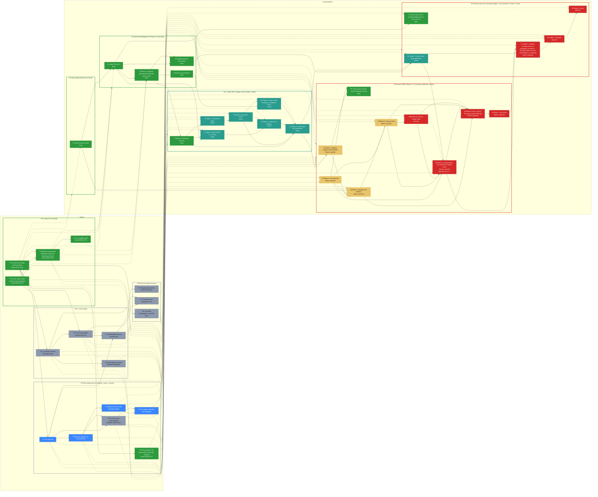

# Roadmap -- Allen MTG cell fitting: passive fit, I_h fit, noise law, recovery gate (Passive Features/HPC script)

Generated by `specs/roadmap/roadmap.py render` from `specs/roadmap/allen-mtg-fit.yaml`; do not edit. Branch `main` at `ace6568` (2026-10-29); synced 2026-10-29T16:26:03+00:00 from chat.

## Legend

| State | Colour | Meaning |
|---|---|---|
| planned (implementation) | #d62828 | not implemented |
| local (implementation) | #f77f00 | implemented, not pushed |
| pushed (implementation) | #e9c46a | pushed, not tested |
| testing (implementation) | #3a86ff | independent tester running |
| tested (implementation) | #2a9d8f | tester passed, HPC run missing |
| running (implementation) | #8338ec | HPC job running |
| failing (implementation) | #b5174e | tester or HPC failure on the current code |
| done (implementation) | #2d9a3d | pushed, tested, HPC run done |
| open (theory) | #8d99ae | not started |
| studying (theory) | #3a86ff | being studied |
| closed (theory) | #2d9a3d | closed |

A dashed border marks a stage whose dependency is not in place (a block that is planned, local or failing; a topic not closed). Theory and implementation progress independently: the dotted edges between them are links, not conditions. REVISE marks a stage that has to change because of a decision taken on the other side.

## Theory

| Stage | Group | Status | Closed | Decision | Depends on | Linked blocks | Revise | Summary |
|---|---|---|---|---|---|---|---|---|
| TG1 Passive fit |  | closed |  |  |  |  |  | The passive cable model and how its three parameters are fitted to the Allen recordings: the model, the data, the optimiser and its uncertainty, the validation gate. |
| TG2 Recording noise |  | open |  |  |  |  |  | The noise each real sweep carries and how a synthetic twin gets the same: the law, the window statistics, the indirect-inference fit, the tilt, the per-sweep calibration, the archive's own selection. |
| TG3 I_h fit |  | open |  |  |  |  |  | Adding the h-current to the fitted model: kinetics and their two fitted knobs, rest balance and dendritic distribution, the six-parameter protocol and loss, identifiability and the recovery gate. |
| TG4 Not yet tackled |  | open |  |  |  |  |  | Topics the chats have named but never studied: temperature transfer of the kinetics, the corrected morphologies as the fit's input, and how the campaign's arms are compared. |
| T1 Passive cable model and the three parameters | TG1 | closed | 2026-10-23 |  |  | G2, I1, I2, I3, I4 |  | What C_m, R_m and R_a mean on a reconstructed arbour, the spine factor F on the distal membrane (F = 1.9 for L2/L3), and why a brief pulse carries C_m while a long step carries R_m and the time constant. |
| T2 The Allen recordings and the archive | TG1 | closed | 2026-10-23 |  |  | G1, I0, I1, I7 |  | The Square Subthreshold and Long Square protocols, the liquid-junction correction, what the Phase-0 writer stores per cell, and how sweeps become bundles and roles. |
| T3 Bayesian optimisation, likelihood profile and bootstrap intervals | TG1 | closed | 2026-10-23 |  | T1, T2 | G2, I1, I2, I3, I4, I10 |  | How the fit searches the three log-parameters with a Gaussian-process optimiser, how a profile over one axis reads the loss landscape, and how Phase 3's bootstrap gives each parameter an interval. |
| T4 The validation gate | TG1 | closed | 2026-10-23 |  | T3 | G2, I1, I2, I3, I4 |  | The absolute-mV gate that compares a held-out step with the training fit, why its two sides must use the same window, and what Allen's own R_in and tau_m can and cannot confirm. |
| T5 The noise law | TG2 | studying |  |  | T2 | G4, N1, N2, NT, N3, N4, N4b, N5, N6, N7, I13 |  | A fast AR(1) part, a slow Ornstein-Uhlenbeck part, and a per-sweep offset and tilt: what each term is, its autocovariance, and what the 265 ms and SS windows can and cannot see of it. |
| T6 Window statistics are not parameters | TG2 | studying |  |  | T5 | G4, N1, N2, NT, N3, N4, N4b, N5, N6, N7 |  | Why a window's SD and textbook autocorrelation depend on the window length and the estimator, the visible share of a slow component, and the closed-form moments that start the fit. |
| T7 Indirect inference with simulated weights | TG2 | studying |  |  | T6 | G4, N1, N2, NT, N3, N4, N4b, N5, N6, N7 |  | Matching the cell's statistics to the medians of simulated windows, with the inverse of the simulated covariance as weight, iterated to a fixed point; what the S0-S3 checks test about it. |
| T8 The tilt and the semivariogram | TG2 | open |  |  | T5, T6 | G4, N1, N2, NT, N3, N4, N4b, N5, N6, N7 | from N5 D-102: the twins no longer use sigma_b(c): the realised per-sweep tilts are copied, so the pooling options studied here are off the twins' path; from N4 D-107: the fit drops the tilt SD and (T1) too: sigma_b(c) is estimated nowhere | Why the variance at seconds is carried by a per-sweep linear tilt rather than a third noise component; how its spread sigma_b(c) is read from the window-mean semivariogram at one lag (4 periods, 0.802 s) and why that lag matches the Long Square step; why two SS sweeps fix sigma_b(c) only to about a factor 2 (two tilt draws), and what per-cell, cohort and partially pooled (DerSimonian-Laird) values do for the twins. |
| T9 Per-sweep calibration and shrinkage | TG2 | studying |  |  | T7, T8 | G4, N1, N2, NT, N3, N4, N4b, N5, N6, N7 |  | What one sweep can identify of the law (the fast pair well, the slow SD roughly, the slow timescale not), and how a random-effects shrinkage lets each twin sweep carry its own real sweep's noise. |
| T10 The archive's SS layout and the trace-QC selection | TG2 | closed | 2026-10-21 | D-072 | T2 | G4, N1, N2, NT, N3, N4, N4b, N5, N6, N7 |  | Each SS sweep is a 37-pulse train, 200.5 ms onset to onset; the stored windows are those that passed the writer's shape test; what that selection does to the noise statistics and why no shape test is added. |
| T11 I_h kinetics and the two fitted knobs | TG3 | open |  |  | T1 | G3, I5, I6, I7, I8, I9, I10, I11 |  | The Kole/Hay and the Rich (human) activation curves, the shift of the activation curve and the scale of its time constant as fitted parameters, and what the published values anchor. |
| T12 Rest balance and the dendritic distribution | TG3 | open |  |  | T11 | G3, I5, I6, I7, I8, I9, I10, I11 |  | Why the leak reversal is shifted so that the resting potential is an exact stationary state once I_h is inserted, and the uniform law against the Eyal/Hay exponential law. |
| T13 The six-parameter protocol and loss | TG3 | open |  |  | T2, T11 | G3, I5, I6, I7, I8, I9, I10, I11 |  | The role table of the Long Square steps, the full-step window, the sag fraction as the signal that separates R_m from the h-conductance, and the loss's finite crash penalty. |
| T14 Identifiability and the recovery gate | TG3 | open |  |  | T13, T5 | G5, I12, I13, S7, S8, S9 |  | Whether six parameters are identified from these protocols, and the gate that tests it on synthetic twins: the error measures, the tolerances (the assistant's, unowned) and the cohort size (20, no power calculation). |
| T15 Temperature and the transfer of kinetics | TG4 | open |  |  | T11 |  |  | The Allen recordings are at 34 C, the human kinetics come from 32-34 C recordings and neither .mod file has a Q10: what a temperature mismatch does to the fitted time-constant scale. |
| T16 Corrected morphologies as the fit's input | TG4 | open |  |  | T1 | S8 |  | How the diameter-corrected arbours (the diameter-pipeline roadmap) change membrane area, electrotonic distance and therefore C_m and the sag, and whether F = 1.9 still holds on them. |
| T17 Comparing the campaign's arms | TG4 | open |  |  | T13, T14 | S8, S9 |  | How to decide that I_h improved the fit: baseline run B against the passive full-step control and the six-parameter arm on the identical protocol, with Phase-3 intervals, and what the population read-out may claim. |

## Implementation

| Stage | Group | Blocks | Status | Why | Last change | Tester | HPC | Depends on | Theory (open) | Revise | Summary |
|---|---|---|---|---|---|---|---|---|---|---|---|
| G1 Data archive (Phase 0) |  |  | done | group: least advanced member is done |  |  |  |  | T2 |  | The Colab writer that downloads each Allen cell, repairs its morphology, extracts the SS pulses and LS sweeps and applies the trace QC. |
| G2 Passive fit (Biological Fit, Phases 1-3) |  |  | done | group: least advanced member is done |  |  |  |  | T1, T3, T4 |  | The production passive fit: loader, Bayesian-optimisation fit with the gate, Phase 2.5 and the bootstrap, and the synthetic benchmark that tested it. |
| G3 I_h fitter (Ih Fit, Stages 0-6) |  |  | tested | group: least advanced member is tested |  |  |  |  | T11 (open), T12 (open), T13 (open) |  | The six-parameter fitter built as an edited copy of the monolith: the regression harness, the mechanism layer, the loader, the parameter vector, the protocol, Phase 3 and the orchestrator. |
| G4 Noise fit (SPEC Blocks 1-7) |  |  | planned | group: least advanced member is planned |  |  |  |  | T5 (open), T6 (open), T7 (open), T8 (open), T9 (open), T10 |  | The per-cell and per-sweep fit of the recording-noise law that the twins inject: statistics, simulator, windows, fit, generator term, driver and record. |
| G5 Recovery gate and campaign (Stages 7-9) |  |  | planned | group: least advanced member is planned |  |  |  |  | T14 (open) |  | The synthetic twins and the gate that decides whether the fitter recovers a known truth, then the campaign on the real cells and its record. |
| I0 Phase-0 archive writer | G1 |  | done | set by hand: the archive exists on davinci and Drive (18 L3_exc cells, 2026-06-19) and every cell carries its QC table (cluster check 2026-10-21, D-072); no SPEC entry |  |  |  |  | T2 |  | Downloads a cell with AllenSDK, repairs the SWC, checks electrical viability, cuts the SS pulse windows and LS sweeps, runs the trace QC and writes specimen_<id>/ (ss_pulses.npz, ls_sweeps.npz, metadata.json, trace_qc_*). |
| I1 Loader (Phase 1) | G2 |  | done | set by hand: used by run B and byte-identical oracle of the regression gate (PASS on a real cell, davinci 2026-10-20); no SPEC entry |  |  |  | I0 | T2, T1, T3, T4 |  | Reads a specimen folder into CellData: LJP-corrected bundles of SS pulses by polarity and LS sweeps by amplitude, the NEURON model from the SWC with the spine factor. |
| I2 Phase 2: Bayesian-optimisation fit with the gate (run B) | G2 |  | done | set by hand: run B produced on davinci (pipeline_outputs/dt01ls60, D-006 Q9, D-012 Sources); no SPEC entry |  |  |  | I1 | T1, T3, T4 |  | Fits (C_m, R_m, R_a) per cell with skopt's Gaussian-process optimiser on the SS pulses and the two smallest hyperpolarising steps (dt 0.1 ms, 60 ms window), applies the absolute-mV gate and writes phase2_results.csv. |
| I3 Phase 2.5 and Phase 3 | G2 |  | done | set by hand: run A (dt01ls60ph25) on davinci with Phase 2.5; Phase 3 in the monolith (D-006 Q8, D-007 C5); no SPEC entry |  |  |  | I2 | T3, T1, T4 |  | Phase 2.5 refits C_m and R_m with R_a fixed at the cohort median; Phase 3 gives bootstrap confidence intervals on a subset of cells (B = 200, local GP refits). |
| I4 Synthetic passive benchmark | G2 |  | done | set by hand: the user ran the passive-only synthetic recovery (2026-10-26: 'the same synthetic check ... that I've done with the passive parameters only', D-083); no SPEC entry |  |  |  | I1, I2 | T1, T3, T4 |  | Generates synthetic cells of known passive parameters on real morphologies, fits them with the production fitter and aggregates the recovery; the source of the Stage-7 generator. |
| I5 Stage 0: regression harness | G3 |  | done | set by hand: PASS bit-for-bit on the real cell 508282493 on davinci 2026-10-20 (max/dL/ = 0 over 20 points, x and fun identical) and after every stage in the sandbox; no SPEC entry |  |  |  | I2 | T11 (open), T12 (open), T13 (open) |  | Fits the same archived cell with the old and the new folder under run B's configuration and asserts the loss, the optimiser's x and fun identical to 1e-12; re-run after every stage. |
| I6 Stage 1: mechanism layer | G3 |  | tested | set by hand: smoke_ih_fit S1-S13 12/12 on davinci 2026-10-20 (G8); never used on a real cell in a campaign; no SPEC entry |  |  |  | I5 | T11 (open), T12 (open), T13 (open) |  | The two h-current mechanisms with the shift and scale knobs (mod/Ih.mod, mod/Ih_human.mod), the Python reference kinetics, attach/set/balance helpers and the sag metrics. |
| I7 Stage 2: loader for the I_h protocol | G3 |  | tested | set by hand: smoke S7 and S13 on davinci 2026-10-20 (G8); check_dep_sweeps.py never run on real sweeps; no SPEC entry |  |  |  | I1, I5 | T2, T13 (open), T11 (open), T12 (open) |  | The loader admits every hyperpolarising step, builds the spike-free depolarising steps as the validation set (the Allen action-potential rule, D-016), records V_trough and takes an optional corrected-SWC folder. |
| I8 Stage 3: parameter vector | G3 |  | tested | set by hand: smoke S6 on davinci 2026-10-20 (G8), regression gate still bit-for-bit; no SPEC entry |  |  |  | I6 | T11 (open), T12 (open), T13 (open) |  | ParamSpec: the ordered axes, boxes, per-axis log or linear coordinate, the skopt dimensions and the apply step (passive, I_h, rest balance in that order); the 3-D spec reproduces the old search space exactly. |
| I9 Stage 4: protocol and windows | G3 |  | tested | set by hand: smoke S7, S11 on davinci 2026-10-20 (G8); no SPEC entry |  |  |  | I7, I8 | T13 (open), T11 (open), T12 (open) |  | The LS role table (train, validate, report-only), the step and sweep windows and the sub-window RMSDs; the legacy cap and window survive only as the run-B path. |
| I10 Stage 5: Phase 3 over the generic parameter vector | G3 |  | tested | set by hand: smoke S8 on davinci 2026-10-20 (G8); no SPEC entry |  |  |  | I3, I8 | T3, T11 (open), T12 (open), T13 (open) |  | The bootstrap and the profile keyed on the result's own ParamSpec, so the linear axis is not exponentiated and the spec reaches the workers; the profile in more than three dimensions is an upper bound. |
| I11 Stage 6: orchestrator and submission | G3 |  | tested | set by hand: smoke S11, S12 on davinci 2026-10-20 (G8); runs end to end on synthetic cells (R8); no real cell fitted yet; no SPEC entry |  |  |  | I5, I8, I9, I10 | T13 (open), T11 (open), T12 (open) |  | run_ih_fit.py with the three arms (baseline_runB, passive_fullstep, ih6), the per-cell liveness check of the loss, ls_roles.csv and ls_diagnostics.csv, and submit_ih_fit.sh with the nrnivmodl guard. |
| N1 Block 1: textbook sample autocorrelation | G4 | 1 | pushed | no tester report covers commit e8ed84e (last report 2026-10-07 at 7a49a28) | e8ed84e 2026-10-18 | PASS WITH ISSUES 7a49a28 (outdated) |  | I11 | T6 (open), T5 (open), T7 (open), T8 (open), T9 (open), T10 |  | One wrapper, noise_stats.sample_acf, computes the textbook autocorrelation through statsmodels; the fitter's two lag-1 estimators and the noise table go through it (D-028, D-029). |
| N2 Block 2: the noise law | G4 | 2 | pushed | no tester report covers commit b981938 (last report 2026-10-07 at 7a49a28) | b981938 2026-10-29 | PASS WITH ISSUES 7a49a28 (outdated) |  |  | T5 (open), T8 (open), T6 (open), T7 (open), T9 (open), T10 |  | The law's simulator from unit draws (continuous sweeps, tilt and offset) and its closed-form moments, the exact window-mean semivariogram and the continuous oracle (noise_law.py). |
| NT Cluster gates and the archive inspection (tools) | G4 |  | done | set by hand: 13/13, VERDICT SETTLED on davinci 2026-10-20 (logs ~/ih_fit_gate_logs/20261020_175303); smoke T1-T8; a SPEC tools section, not a block |  |  |  | N1, N2 | T5 (open), T6 (open), T7 (open), T8 (open), T9 (open), T10 |  | cluster_gates_noise_fit.sh runs every cluster-side check of the noise-fit blocks (G0-G12) and prints a verdict; noise_fit_gates.py reads the SS sweep structure of the archive. |
| N3 Block 3: windows and statistics | G4 | 3 | pushed | no tester report covers commit 7672ffc (last report 2026-10-07 at 7a49a28) | 7672ffc 2026-10-29 | PASS WITH ISSUES 7a49a28 (outdated) |  | N1, N2, I0 | T6 (open), T10, T5 (open), T7 (open), T8 (open), T9 (open) |  | Cuts the enlarged SS windows and the LS windows of a real cell at the archive's own layout (D-072), subtracts the per-polarity mean response and computes the D-051 statistics per window, per sweep and per cell. |
| N4 Block 4: the per-cell fit | G4 | 4 | pushed | no tester report covers commit fb6fec9 (last report 2026-10-07 at 7a49a28) | fb6fec9 2026-10-29 | PASS WITH ISSUES 7a49a28 (outdated) |  | N2, N3 | T7 (open), T8 (open), T5 (open), T6 (open), T9 (open), T10 |  | Indirect inference per cell: the Harrell-Davis binding function on simulated continuous sweeps, the iterated inverse-covariance weights, the tilt's SD alternated with the law, three starts (D-048 to D-051, D-056). |
| N4b Block 4b: the per-sweep stage | G4 |  | planned | step of the plan: no blocks defined yet (roadmap.py add block ... --parent N4b) |  |  |  | N4 | T9 (open), T5 (open), T6 (open), T7 (open), T8 (open), T10 |  | For each real sweep, the fast pair and the slow SD estimated on that sweep alone (the slow timescale held at the cell's), the slow SD shrunk towards the cell by the random-effects weight; the laws each twin sweep will carry (D-076 (i)). |
| N5 Block 5: the generator's law and the per-sweep twins | G4 | 5 | planned | no entry in SPEC.md for Block 5 |  |  |  | N2, N4, N4b, I12 | T5 (open), T9 (open), T6 (open), T7 (open), T8 (open), T10 | from ? D-102: each twin sweep carries its real sweep's realised tilt b_hat(c,s) instead of a draw from sigma_b(c); LS sweeps' tilts open; from ? D-107: the LS twins' tilts: the line through the real sweep's pre-window and end-window means | The OU term and the tilt in synthetic_ground_truth.add_recording_noise, each twin sweep calibrated on its own real sweep (D-073) with the real cell's LS amplitudes and 37-pulse SS sweeps at the stored positions; manifest columns back-filled. |
| N6 Block 6: driver, the S0-S3 checks and the PBS job | G4 | 6 | planned | no entry in SPEC.md for Block 6 |  |  |  | N3, N4, N4b, N5 | T7 (open), T5 (open), T6 (open), T8 (open), T9 (open), T10 |  | run_noise_fit.py fits the law for every cell of a group and writes the noise table; the sens_* scripts run the in-silico checks S0-S3 with their fixed predictions (D-055); one PBS job on davinci. |
| N7 Block 7: the record | G4 | 7 | planned | no entry in SPEC.md for Block 7 |  |  |  | N6 | T5 (open), T6 (open), T7 (open), T8 (open), T9 (open), T10 |  | The fitted laws and flags written into the Stage-7 manifest and the noise table, the S0-S3 report, and the decision-log and plan entries that close the noise prerequisite. |
| I12 Stage 7 as built: twins, report and driver | G5 |  | tested | set by hand: smoke_ih_recovery R1-R14 14/14 on davinci 2026-10-20 (G10); the gate itself never run; no SPEC entry |  |  |  | I4, I11 | T14 (open) |  | The manifest with the kinetic truths and the false-positive control, the generator at each twin's real acquisition, the pure recovery report with the gate arithmetic, and run_ih_recovery.py which fits through run_ih_fit.main() itself (D-011 to D-016). |
| I13 Noise table and LS baseline diagnostics (D-012 to D-017) | G5 |  | done | set by hand: run on L3_exc on davinci (noise tables 2026-09-23 and 09-28, lsqc 2026-10-01; D-016, D-017, handoff s.4.6); no SPEC entry |  |  |  | I1 | T5 (open), T14 (open) |  | noise_calibration.py measures each real cell's per-sweep noise and the LS pre-window structure; ls_baseline_qc.py reads the baseline across the sweep (creep or wander); both ran on L3_exc and shaped the law. |
| S7 Stage 7: synthetic recovery of the six parameters on davinci -- the gate before any real-cell fit (Block 8, to specify) | G5 | 8 | planned | no entry in SPEC.md for Block 8 |  |  |  | I12, N5, N7 | T14 (open) |  | Twins of the L3_exc cells, each on its own real morphology, with its own fitted recording noise and its own stimulation protocol, are given chosen values of the six parameters (C_m, R_m, R_a, g_h, the activation shift and the time-constant scale; a quarter with no I_h as a false-positive control); the same fitter and optimiser are run on them on davinci and the gate checks that the chosen values come back. It is the six-parameter version of the passive-only synthetic check (I4); no real cell is fitted with the six parameters before its verdict (D-083). |
| S8 Stage 8: campaign | G5 |  | planned | set by hand: not started: waits for the gate's verdict and the diameter-corrected SWCs (D-013); no SPEC entry |  |  |  | S7 | T14 (open), T16 (open), T17 (open) |  | The three arms on the real cells, first the diameter-corrected ones (one-cell dry run, then the set), then every excitatory group; per-cell parameters, gate columns, Phase-3 intervals and the population read-out. |
| S9 Stage 9: record | G5 |  | planned | set by hand: not started |  |  |  | S8 | T17 (open), T14 (open) |  | The decision naming the estimate of record, the guide updated, the plan's 'I_h as nuisance' paragraph retired. |

