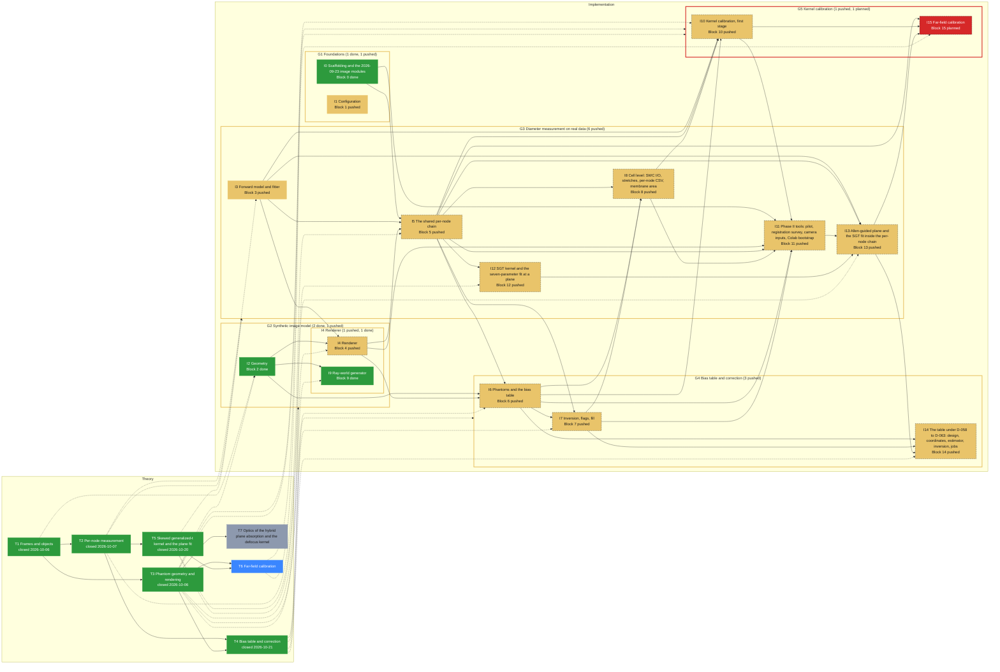

# Roadmap -- Allen dendrite-diameter re-measurement (allen_diameter)

Generated by `specs/roadmap/roadmap.py render` from `specs/roadmap/diameter-pipeline.yaml`; do not edit. Branch `sci/diameter-pipeline` at `68dab1a` (2026-10-22); synced 2026-10-22T15:52:47+00:00 from chat.

## Legend

| State | Colour | Meaning |
|---|---|---|
| planned (implementation) | #d62828 | not implemented |
| local (implementation) | #f77f00 | implemented, not pushed |
| pushed (implementation) | #e9c46a | pushed, not tested |
| testing (implementation) | #3a86ff | independent tester running |
| tested (implementation) | #2a9d8f | tester passed, HPC run missing |
| running (implementation) | #8338ec | HPC job running |
| failing (implementation) | #b5174e | tester or HPC failure on the current code |
| done (implementation) | #2d9a3d | pushed, tested, HPC run done |
| open (theory) | #8d99ae | not started |
| studying (theory) | #3a86ff | being studied |
| closed (theory) | #2d9a3d | closed |

A dashed border marks a stage whose prerequisites are not met (theory not closed, or an earlier implementation stage not done).

## Theory

| Stage | Group | Status | Closed | Decision | Depends on | Feeds | Summary |
|---|---|---|---|---|---|---|---|
| T1 Frames and objects |  | closed | 2026-10-06 |  |  | I2 | Stack, node and camera frames; the objects the measurement works on (SPEC 2.1). |
| T2 Per-node measurement |  | closed | 2026-10-07 | D-030 | T1 | G3, I3, I5 | Profile sampling, focus rule, path, background and the tube fit at a node (SPEC 2.2, handoff Eqs. 1-5, 9). |
| T3 Phantom geometry and rendering |  | closed | 2026-10-06 |  | T1 | G2, G5, I2, I4, I9, I10 | Synthetic tubes, the blur kernel, the JPEG tables and the FFT renderer (SPEC 2.3, impl-handoff S1-S5, procedure Eqs. 5-6). |
| T4 Bias table and correction |  | closed | 2026-10-21 | D-071 | T2, T3 | G4, I6, I7, I14 | The table design, the local linear estimator and the inversion (SPEC 2.4, procedure Eqs. 1-3, 7, mathematics Eqs. 19-21). |
| T5 Skewed generalized-t kernel and the plane fit |  | closed | 2026-10-20 | D-064 | T2 | G3, I12, I13 | The SGT family, the seven-parameter fit at a plane and the Allen-guided plane iteration (Blocks 12-13). |
| T6 Far-field calibration |  | studying |  |  | T3, T5 | G5, I15 | The far scan and far fit that give Block 4's kernel its continuation slope (Block 15, S2b of the 2026-10-20 plan). |
| T7 Optics of the hybrid plane absorption and the defocus kernel |  | open |  |  | T3 |  | The optics needed to build the hybrid renderer: each slice's absorbed light taken from the condenser's rays (NA 1.4, n_oil 1.515, averaged over directions), then every image plane rendered by applying the defocus kernel to it, and the chain after it (I-004). |

## Implementation

| Stage | Group | Blocks | Status | Why | Last change | Tester | HPC | Needs | Summary |
|---|---|---|---|---|---|---|---|---|---|
| G1 Foundations |  |  | pushed | group: least advanced member is pushed |  |  |  |  | The image-access modules imported from the 2026-09-23 code and the configuration every block reads. |
| G2 Synthetic image model |  |  | pushed | group: least advanced member is pushed |  |  |  | T3 | Everything that turns a tube geometry into a rendered brightfield stack: geometry, blur kernel, JPEG tables, FFT renderer and the ray-world alternative. |
| G3 Diameter measurement on real data |  |  | pushed | group: least advanced member is pushed |  |  |  | T2, T5 | The per-node chain from an Allen stack to a diameter: profiles, focus, path, background, the tube fit, the SGT plane fit, the Allen-guided plane iteration, the cell-level run and the Phase II tools. |
| G4 Bias table and correction |  |  | pushed | group: least advanced member is pushed |  |  |  | T4 | Rendered phantoms, the bias table, its inversion and the corrected diameters; the production table runs on davinci. |
| G5 Kernel calibration |  |  | planned | group: least advanced member is planned |  |  |  | T3, T6 | The calibration of the blur kernel on real nodes: first stage on the pilot, then the far-field scan and fit. |
| I0 Scaffolding and the 2026-09-23 image modules | G1 | 0 | done | tester PASS WITH ISSUES on 7a49a28 | c12dd66 2026-10-06 | PASS WITH ISSUES 7a49a28 |  |  | Package layout and the four image modules (fetch, align, measure, plot) imported byte-identical from the September code, with their own test suites. |
| I1 Configuration | G1 | 1 | pushed | no tester report covers commit 779bec0 (last report 2026-10-07 at 7a49a28) | 779bec0 2026-10-21 | PASS WITH ISSUES 7a49a28 (outdated) |  |  | The dataclasses that hold every parameter of the pipeline, their defaults from the decisions, validation and the JSON round trip. |
| I2 Geometry | G2 | 2 | done | tester PASS WITH ISSUES on 7a49a28 | be38d90 2026-10-06 | PASS WITH ISSUES 7a49a28 |  | T1, T3 | Tube geometry in the stack frame: axes, headings, offsets and the sections a phantom is built from (S1-S6). |
| I3 Forward model and fitter | G3 | 3 | pushed | no tester report covers commit 4759c5f (last report 2026-10-07 at 7a49a28) | 4759c5f 2026-10-13 | PASS WITH ISSUES 7a49a28 (outdated) |  | T2 | The analytic profile of a blurred tube (handoff Eqs. 10-11) and the least-squares fitter that recovers diameter, centre and background from a measured profile. |
| I4 Renderer | G2 | 4 | pushed | no tester report covers commit 132f56f (last report 2026-10-07 at 7a49a28) | 132f56f 2026-10-07 | PASS WITH ISSUES 7a49a28 (outdated) |  | T3, I2, I3 | Renders a geometry into a synthetic stack: the defocusing kernel, the camera model, the JPEG tables and the FFT convolution; the ray-world generator (I9) is its alternative absorption model. |
| I5 The shared per-node chain | G3 | 5 | pushed | no tester report covers commit f4ac106 (last report 2026-10-07 at 7a49a28) | f4ac106 2026-10-21 | PASS WITH ISSUES 7a49a28 (outdated) |  | T2, I0, I3, I4 | The chain run on every node, real or synthetic: profile sampling, focus rule, path, background estimate and the fit, orchestrated by node_pipeline. |
| I6 Phantoms and the bias table | G4 | 6 | pushed | no tester report covers commit 779bec0 (last report 2026-10-07 at 7a49a28) | 779bec0 2026-10-21 | PASS WITH ISSUES 7a49a28 (outdated) |  | T4, I2, I4, I5 | Draws phantom tubes, renders and measures them, and estimates the bias table from the replicates; the production table is a PBS array on davinci. |
| I7 Inversion, flags, fill | G4 | 7 | pushed | no tester report covers commit 779bec0 (last report 2026-10-07 at 7a49a28) | 779bec0 2026-10-21 | PASS WITH ISSUES 7a49a28 (outdated) |  | T4, I5, I6 | Inverts the bias table to correct a measured diameter, flags the nodes the table cannot correct, and fills them from their neighbours. |
| I8 Cell level: SWC I/O, stretches, per-node CSV, membrane area | G3 | 8 | pushed | no tester report covers commit 779bec0 (last report 2026-10-07 at 7a49a28) | 779bec0 2026-10-21 | PASS WITH ISSUES 7a49a28 (outdated) |  | I5, I6, I7 | Runs a whole cell: reads the Allen SWC, picks the stretches, measures every node, writes the per-node CSV and the corrected SWC, and compares the membrane area with Allen's radii. |
| I9 Ray-world generator | I4 | 9 | done | tester PASS WITH ISSUES on 7a49a28 | 5343424 2026-10-06 | PASS WITH ISSUES 7a49a28 |  | T3, I2 | The ray-tracing absorption model selected by RendererConfig.absorption = ray_world, an independent check of the analytic renderer. |
| I10 Kernel calibration, first stage | G5 | 10 | pushed | no tester report covers commit e9682a5 (last report 2026-10-07 at 7a49a28) | e9682a5 2026-10-21 | PASS WITH ISSUES 7a49a28 (outdated) |  | T3, I3, I5, I6, I8 | Fits the growth of the core width with distance from focus on thin real nodes, to calibrate the renderer's kernel (procedure Eq. 4). |
| I11 Phase II tools: pilot, registration survey, camera inputs, Colab bootstrap | G3 | 11 | pushed | no tester report covers commit 1aed5d6 (last report 2026-10-07 at 7a49a28) | 1aed5d6 2026-10-21 | PASS WITH ISSUES 7a49a28 (outdated) |  | I0, I4, I5, I6, I7, I8, I10 | The tools that prepare the production run on real data: the pilot measurement, the registration survey, the camera and JPEG-table inputs, and the Colab notebook bootstrap. |
| I12 SGT kernel and the seven-parameter fit at a plane | G3 | 12 | pushed | no tester report covers commit 779bec0 (last report 2026-10-07 at 7a49a28) | 779bec0 2026-10-21 | PASS WITH ISSUES 7a49a28 (outdated) |  | T5, I5 | The skewed generalized-t blur family and the seven-parameter fit of a single plane's profile (D-052 to D-054). |
| I13 Allen-guided plane and the SGT fit inside the per-node chain | G3 | 13 | pushed | no tester report covers commit 779bec0 (last report 2026-10-07 at 7a49a28) | 779bec0 2026-10-21 | PASS WITH ISSUES 7a49a28 (outdated) |  | T5, I3, I5, I11, I12 | The plane iteration guided by Allen's diameter, the shared scene and square, and the SGT fit at the chosen plane, wired into measure_node. |
| I14 The table under D-058 to D-063: design, coordinates, estimator, inversion, jobs | G4 | 14 | pushed | no tester report covers commit 779bec0 (last report 2026-10-07 at 7a49a28) | 779bec0 2026-10-21 | PASS WITH ISSUES 7a49a28 (outdated) |  | T4, I6, I7, I13 | The redesigned bias table: the draw design and coordinates, the local linear estimator, the inversion, and the PBS array that produces it. |
| I15 Far-field calibration | G5 | 15 | planned | SPEC.md status: drafted (Block 15) |  |  |  | T6, I5, I10, I13 | The far scan over nodes far from focus and the far fit that fix the kernel's continuation slope (S2b, D-026). |

