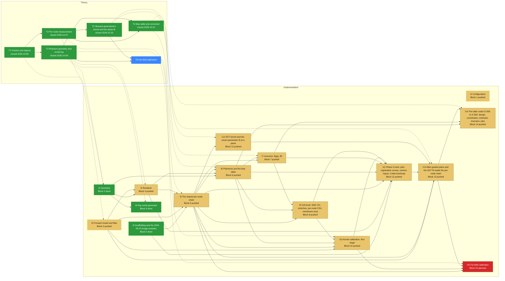

# Roadmap -- Allen dendrite-diameter re-measurement (allen_diameter)

Generated by `specs/roadmap/roadmap.py render` from `specs/roadmap/diameter-pipeline.yaml`; do not edit. Branch `sci/diameter-pipeline` at `659e544` (2026-10-22); synced 2026-10-22T13:19:31+00:00 from chat.

## Legend

| State | Colour | Meaning |
|---|---|---|
| planned (implementation) | #d62828 | not implemented |
| local (implementation) | #f77f00 | implemented, not pushed |
| pushed (implementation) | #e9c46a | pushed, not tested |
| testing (implementation) | #3a86ff | independent tester running |
| tested (implementation) | #2a9d8f | tester passed, HPC run missing |
| running (implementation) | #8338ec | HPC job running |
| failing (implementation) | #b5174e | tester or HPC failure on the current code |
| done (implementation) | #2d9a3d | pushed, tested, HPC run done |
| open (theory) | #8d99ae | not started |
| studying (theory) | #3a86ff | being studied |
| closed (theory) | #2d9a3d | closed |

A dashed border marks a stage whose prerequisites are not met (theory not closed, or an earlier implementation stage not done).

## Theory

| Stage | Status | Closed | Decision | Depends on | Feeds |
|---|---|---|---|---|---|
| T1 Frames and objects | closed | 2026-10-06 |  |  | I2 |
| T2 Per-node measurement | closed | 2026-10-07 | D-030 | T1 | I3, I5 |
| T3 Phantom geometry and rendering | closed | 2026-10-06 |  | T1 | I2, I4, I9, I10 |
| T4 Bias table and correction | closed | 2026-10-21 | D-071 | T2, T3 | I6, I7, I14 |
| T5 Skewed generalized-t kernel and the plane fit | closed | 2026-10-20 | D-064 | T2 | I12, I13 |
| T6 Far-field calibration | studying |  |  | T3, T5 | I15 |

## Implementation

| Stage | Blocks | Status | Why | Last change | Tester | HPC | Needs |
|---|---|---|---|---|---|---|---|
| I0 Scaffolding and the 2026-09-23 image modules | 0 | done | tester PASS WITH ISSUES on 7a49a28 | c12dd66 2026-10-06 | PASS WITH ISSUES 7a49a28 |  |  |
| I1 Configuration | 1 | pushed | no tester report covers commit 779bec0 (last report 2026-10-07 at 7a49a28) | 779bec0 2026-10-21 | PASS WITH ISSUES 7a49a28 (outdated) |  |  |
| I2 Geometry | 2 | done | tester PASS WITH ISSUES on 7a49a28 | be38d90 2026-10-06 | PASS WITH ISSUES 7a49a28 |  | T1, T3 |
| I3 Forward model and fitter | 3 | pushed | no tester report covers commit 4759c5f (last report 2026-10-07 at 7a49a28) | 4759c5f 2026-10-13 | PASS WITH ISSUES 7a49a28 (outdated) |  | T2 |
| I4 Renderer | 4 | pushed | no tester report covers commit 132f56f (last report 2026-10-07 at 7a49a28) | 132f56f 2026-10-07 | PASS WITH ISSUES 7a49a28 (outdated) |  | T3, I2, I3 |
| I5 The shared per-node chain | 5 | pushed | no tester report covers commit f4ac106 (last report 2026-10-07 at 7a49a28) | f4ac106 2026-10-21 | PASS WITH ISSUES 7a49a28 (outdated) |  | T2, I0, I3, I4 |
| I6 Phantoms and the bias table | 6 | pushed | no tester report covers commit 779bec0 (last report 2026-10-07 at 7a49a28) | 779bec0 2026-10-21 | PASS WITH ISSUES 7a49a28 (outdated) |  | T4, I2, I4, I5 |
| I7 Inversion, flags, fill | 7 | pushed | no tester report covers commit 779bec0 (last report 2026-10-07 at 7a49a28) | 779bec0 2026-10-21 | PASS WITH ISSUES 7a49a28 (outdated) |  | T4, I5, I6 |
| I8 Cell level: SWC I/O, stretches, per-node CSV, membrane area | 8 | pushed | no tester report covers commit 779bec0 (last report 2026-10-07 at 7a49a28) | 779bec0 2026-10-21 | PASS WITH ISSUES 7a49a28 (outdated) |  | I5, I6, I7 |
| I9 Ray-world generator | 9 | done | tester PASS WITH ISSUES on 7a49a28 | 5343424 2026-10-06 | PASS WITH ISSUES 7a49a28 |  | T3, I2 |
| I10 Kernel calibration, first stage | 10 | pushed | no tester report covers commit e9682a5 (last report 2026-10-07 at 7a49a28) | e9682a5 2026-10-21 | PASS WITH ISSUES 7a49a28 (outdated) |  | T3, I3, I5, I6, I8 |
| I11 Phase II tools: pilot, registration survey, camera inputs, Colab bootstrap | 11 | pushed | no tester report covers commit 1aed5d6 (last report 2026-10-07 at 7a49a28) | 1aed5d6 2026-10-21 | PASS WITH ISSUES 7a49a28 (outdated) |  | I0, I4, I5, I6, I7, I8, I10 |
| I12 SGT kernel and the seven-parameter fit at a plane | 12 | pushed | no tester report covers commit 779bec0 (last report 2026-10-07 at 7a49a28) | 779bec0 2026-10-21 | PASS WITH ISSUES 7a49a28 (outdated) |  | T5, I5 |
| I13 Allen-guided plane and the SGT fit inside the per-node chain | 13 | pushed | no tester report covers commit 779bec0 (last report 2026-10-07 at 7a49a28) | 779bec0 2026-10-21 | PASS WITH ISSUES 7a49a28 (outdated) |  | T5, I3, I5, I11, I12 |
| I14 The table under D-058 to D-063: design, coordinates, estimator, inversion, jobs | 14 | pushed | no tester report covers commit 779bec0 (last report 2026-10-07 at 7a49a28) | 779bec0 2026-10-21 | PASS WITH ISSUES 7a49a28 (outdated) |  | T4, I6, I7, I13 |
| I15 Far-field calibration | 15 | planned | SPEC.md status: drafted (Block 15) |  |  |  | T6, I5, I10, I13 |

