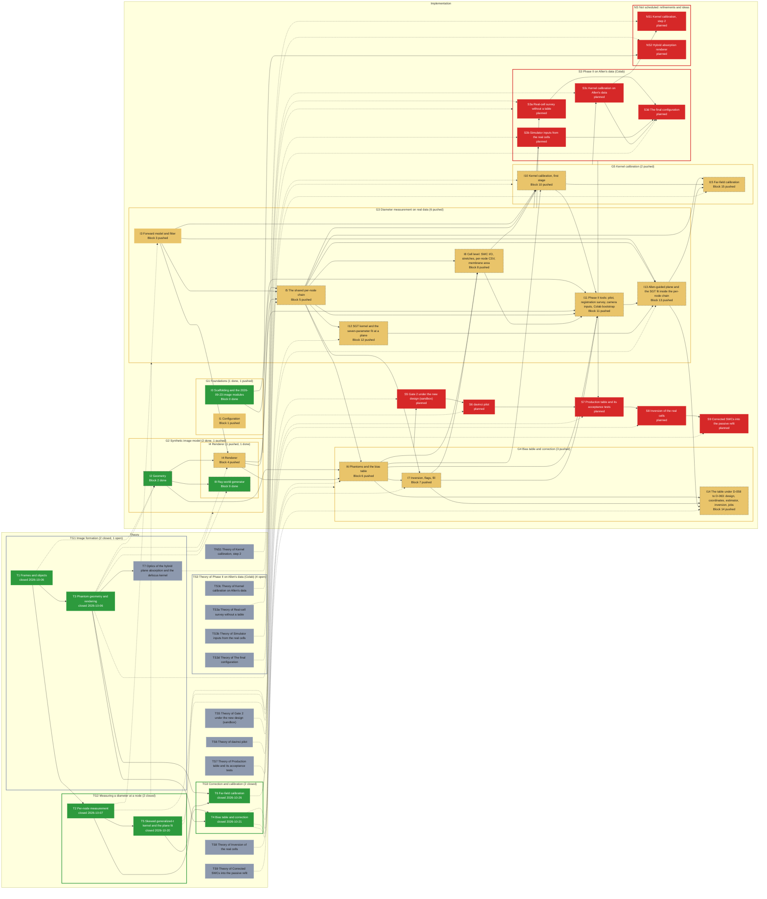

# Roadmap -- Allen dendrite-diameter re-measurement (allen_diameter)

Generated by `specs/roadmap/roadmap.py render` from `specs/roadmap/diameter-pipeline.yaml`; do not edit. Branch `sci/diameter-pipeline` at `c410c95` (2026-10-26); synced 2026-10-26T08:25:02+00:00 from chat.

## Legend

| State | Colour | Meaning |
|---|---|---|
| planned (implementation) | #d62828 | not implemented |
| local (implementation) | #f77f00 | implemented, not pushed |
| pushed (implementation) | #e9c46a | pushed, not tested |
| testing (implementation) | #3a86ff | independent tester running |
| tested (implementation) | #2a9d8f | tester passed, HPC run missing |
| running (implementation) | #8338ec | HPC job running |
| failing (implementation) | #b5174e | tester or HPC failure on the current code |
| done (implementation) | #2d9a3d | pushed, tested, HPC run done |
| open (theory) | #8d99ae | not started |
| studying (theory) | #3a86ff | being studied |
| closed (theory) | #2d9a3d | closed |

A dashed border marks a stage whose prerequisites are not met (theory not closed, or an earlier implementation stage not done).

## Theory

| Stage | Group | Status | Closed | Decision | Depends on | Feeds | Summary |
|---|---|---|---|---|---|---|---|
| TG1 Image formation |  | open |  |  |  | G2 | How a dendrite in the stack becomes the image we measure: frames, the phantom and its rendering, and the optics of absorption and defocus. |
| TG2 Measuring a diameter at a node |  | closed |  |  |  | G3 | What is extracted from the image at one node and how: the per-node chain, the tube fit and the SGT plane fit. |
| TG3 Correction and calibration |  | closed |  |  |  | G4, G5 | How a measured diameter is corrected and the kernel calibrated: the bias table and inversion, the far-field calibration. |
| T1 Frames and objects | TG1 | closed | 2026-10-06 |  |  | I2 | Stack, node and camera frames; the objects the measurement works on (SPEC 2.1). |
| T2 Per-node measurement | TG2 | closed | 2026-10-07 | D-030 | T1 | I3, I5 | Profile sampling, focus rule, path, background and the tube fit at a node (SPEC 2.2, handoff Eqs. 1-5, 9). |
| T3 Phantom geometry and rendering | TG1 | closed | 2026-10-06 |  | T1 | I2, I4, I9, I10 | Synthetic tubes, the blur kernel, the JPEG tables and the FFT renderer (SPEC 2.3, impl-handoff S1-S5, procedure Eqs. 5-6). |
| T4 Bias table and correction | TG3 | closed | 2026-10-21 | D-071 | T2, T3 | I6, I7, I14 | The table design, the local linear estimator and the inversion (SPEC 2.4, procedure Eqs. 1-3, 7, mathematics Eqs. 19-21). |
| T5 Skewed generalized-t kernel and the plane fit | TG2 | closed | 2026-10-20 | D-064 | T2 | I12, I13 | The SGT family, the seven-parameter fit at a plane and the Allen-guided plane iteration (Blocks 12-13). |
| T6 Far-field calibration | TG3 | closed | 2026-10-26 |  | T3, T5 | I15 | The far scan and far fit that give Block 4's kernel its continuation slope (Block 15, S2b of the 2026-10-20 plan). |
| T7 Optics of the hybrid plane absorption and the defocus kernel | TG1 | open |  |  | T3 | NS2 | The optics needed to build the hybrid renderer: each slice's absorbed light taken from the condenser's rays (NA 1.4, n_oil 1.515, averaged over directions), then every image plane rendered by applying the defocus kernel to it, and the chain after it (I-004). |
| TS3 Theory of Phase II on Allen's data (Colab) |  | open |  |  |  | S3 | What the real cells must tell us before the table is built: whether the phantoms cover them, the simulator's inputs, the kernel on real nodes, and which values freeze the final configuration. |
| TS3a Theory of Real-cell survey without a table | TS3 | open |  |  |  | S3a | Whether the phantoms cover the real nodes -- the share of each bin of d_hat whose mu_hat d_hat and alpha_hat fall inside the phantoms' band, with the pass rule fixed before the run -- and whether the SGT fit's shape on thick nodes in focus matches rendered phantoms of the same size. |
| TS3b Theory of Simulator inputs from the real cells | TS3 | open |  |  |  | S3b | How the phantoms' ranges and nuisances are read from real data: d_max and the line and block lengths from Allen's radii, the jitter of the trace from the registration offsets, the camera chain and its JPEG tables. |
| TS3c Theory of Kernel calibration on Allen's data | TS3 | open |  |  |  | S3c | How to read the calibration on real nodes: the width-by-plane figures, whether the near table and the far straight line hold, the anchor's and the slope's SE, and what the selection's counts say about the two sets (D-074, D-077 to D-081). |
| TS3d Theory of The final configuration | TS3 | open |  |  |  | S3d | Which values enter the production configuration and its simulation and estimator hashes, what freezes the table, and when it has to be rebuilt (D-061 (f), D-067.1, procedure s.3.11). |
| TS5 Theory of Gate 2 under the new design (sandbox) |  | open |  |  |  | S5 | What gate 2 tests -- rendered phantoms of known d corrected by a table built with the same simulator -- and what it cannot test: the simulator itself (procedure s.3.10). |
| TS6 Theory of davinci pilot |  | open |  |  |  | S6 | How the pilot's time per realization sizes the array (draws per task, walltime), and how its failure-rate curve by region sets max_failure_rate (D-054 (iii), D-062.2). |
| TS7 Theory of Production table and its acceptance tests |  | open |  |  |  | S7 | Reading the full table -- the bias factor with its SE by draw, the scatter, the failure rate, the support and the off-support flags -- and what can falsify it: blur consistency, sigma_r(0), kernel shape and truncation, above and below focus, depth, cross-section, mu, heading, real against synthetic profiles, end to end with an alternative generator. |
| TS8 Theory of Inversion of the real cells |  | open |  |  |  | S8 | What the inversion gives on Allen's nodes and how far to trust it: the flags (out of domain, off support, high failure), the fill from the neighbours, the corrected diameter's uncertainty (D5, D-030, D-063). |
| TS9 Theory of Corrected SWCs into the passive refit |  | open |  |  |  | S9 | The subproject's question: run B gives L2/L3 membrane capacitance 2-3 times the reference value, Allen's radii being suspected too thin; how the corrected area enters the refit, and what else could produce the excess (SPEC section 1). |
| TNS1 Theory of Kernel calibration, step 2 |  | open |  |  |  | NS1 | The width-diameter trade-off the first stage leaves, what to match (the mean profiles or the core widths) and at which d and mu to render each calibration node (procedure s.3.4 step 2, SPEC section 8). |

## Implementation

| Stage | Group | Blocks | Status | Why | Last change | Tester | HPC | Needs | Summary |
|---|---|---|---|---|---|---|---|---|---|
| G1 Foundations |  |  | pushed | group: least advanced member is pushed |  |  |  |  | The image-access modules imported from the 2026-09-23 code and the configuration every block reads. |
| G2 Synthetic image model |  |  | pushed | group: least advanced member is pushed |  |  |  | TG1 | Everything that turns a tube geometry into a rendered brightfield stack: geometry, blur kernel, JPEG tables, FFT renderer and the ray-world alternative. |
| G3 Diameter measurement on real data |  |  | pushed | group: least advanced member is pushed |  |  |  | TG2 | The per-node chain from an Allen stack to a diameter: profiles, focus, path, background, the tube fit, the SGT plane fit, the Allen-guided plane iteration, the cell-level run and the Phase II tools. |
| G4 Bias table and correction |  |  | pushed | group: least advanced member is pushed |  |  |  | TG3 | Rendered phantoms, the bias table, its inversion and the corrected diameters; the production table runs on davinci. |
| G5 Kernel calibration |  |  | pushed | group: least advanced member is pushed |  |  |  | TG3 | The calibration of the blur kernel on real nodes: first stage on the pilot, then the far-field scan and fit. |
| I0 Scaffolding and the 2026-09-23 image modules | G1 | 0 | done | tester PASS WITH ISSUES on 7a49a28 | c12dd66 2026-10-06 | PASS WITH ISSUES 7a49a28 |  |  | Package layout and the four image modules (fetch, align, measure, plot) imported byte-identical from the September code, with their own test suites. |
| I1 Configuration | G1 | 1 | pushed | no tester report covers commit 24eb687 (last report 2026-10-07 at 7a49a28) | 24eb687 2026-10-23 | PASS WITH ISSUES 7a49a28 (outdated) |  |  | The dataclasses that hold every parameter of the pipeline, their defaults from the decisions, validation and the JSON round trip. |
| I2 Geometry | G2 | 2 | done | tester PASS WITH ISSUES on 7a49a28 | be38d90 2026-10-06 | PASS WITH ISSUES 7a49a28 |  | T1, T3 | Tube geometry in the stack frame: axes, headings, offsets and the sections a phantom is built from (S1-S6). |
| I3 Forward model and fitter | G3 | 3 | pushed | no tester report covers commit 4759c5f (last report 2026-10-07 at 7a49a28) | 4759c5f 2026-10-13 | PASS WITH ISSUES 7a49a28 (outdated) |  | T2 | The analytic profile of a blurred tube (handoff Eqs. 10-11) and the least-squares fitter that recovers diameter, centre and background from a measured profile. |
| I4 Renderer | G2 | 4 | pushed | no tester report covers commit 132f56f (last report 2026-10-07 at 7a49a28) | 132f56f 2026-10-07 | PASS WITH ISSUES 7a49a28 (outdated) |  | T3, I2, I3 | Renders a geometry into a synthetic stack: the defocusing kernel, the camera model, the JPEG tables and the FFT convolution; the ray-world generator (I9) is its alternative absorption model. |
| I5 The shared per-node chain | G3 | 5 | pushed | no tester report covers commit f4ac106 (last report 2026-10-07 at 7a49a28) | f4ac106 2026-10-21 | PASS WITH ISSUES 7a49a28 (outdated) |  | T2, I0, I3, I4 | The chain run on every node, real or synthetic: profile sampling, focus rule, path, background estimate and the fit, orchestrated by node_pipeline. |
| I6 Phantoms and the bias table | G4 | 6 | pushed | no tester report covers commit 779bec0 (last report 2026-10-07 at 7a49a28) | 779bec0 2026-10-21 | PASS WITH ISSUES 7a49a28 (outdated) |  | T4, I2, I4, I5 | Draws phantom tubes, renders and measures them, and estimates the bias table from the replicates; the production table is a PBS array on davinci. |
| I7 Inversion, flags, fill | G4 | 7 | pushed | no tester report covers commit 779bec0 (last report 2026-10-07 at 7a49a28) | 779bec0 2026-10-21 | PASS WITH ISSUES 7a49a28 (outdated) |  | T4, I5, I6 | Inverts the bias table to correct a measured diameter, flags the nodes the table cannot correct, and fills them from their neighbours. |
| I8 Cell level: SWC I/O, stretches, per-node CSV, membrane area | G3 | 8 | pushed | no tester report covers commit 779bec0 (last report 2026-10-07 at 7a49a28) | 779bec0 2026-10-21 | PASS WITH ISSUES 7a49a28 (outdated) |  | I5, I6, I7 | Runs a whole cell: reads the Allen SWC, picks the stretches, measures every node, writes the per-node CSV and the corrected SWC, and compares the membrane area with Allen's radii. |
| I9 Ray-world generator | I4 | 9 | done | tester PASS WITH ISSUES on 7a49a28 | 5343424 2026-10-06 | PASS WITH ISSUES 7a49a28 |  | T3, I2 | The ray-tracing absorption model selected by RendererConfig.absorption = ray_world, an independent check of the analytic renderer. |
| I10 Kernel calibration, first stage | G5 | 10 | pushed | no tester report covers commit cd80081 (last report 2026-10-07 at 7a49a28) | cd80081 2026-10-23 | PASS WITH ISSUES 7a49a28 (outdated) |  | T3, I3, I5, I6, I8 | Fits the growth of the core width with distance from focus on thin real nodes, to calibrate the renderer's kernel (procedure Eq. 4). |
| I11 Phase II tools: pilot, registration survey, camera inputs, Colab bootstrap | G3 | 11 | pushed | no tester report covers commit 1aed5d6 (last report 2026-10-07 at 7a49a28) | 1aed5d6 2026-10-21 | PASS WITH ISSUES 7a49a28 (outdated) |  | I0, I4, I5, I6, I7, I8, I10 | The tools that prepare the production run on real data: the pilot measurement, the registration survey, the camera and JPEG-table inputs, and the Colab notebook bootstrap. |
| I12 SGT kernel and the seven-parameter fit at a plane | G3 | 12 | pushed | no tester report covers commit 24eb687 (last report 2026-10-07 at 7a49a28) | 24eb687 2026-10-23 | PASS WITH ISSUES 7a49a28 (outdated) |  | T5, I5 | The skewed generalized-t blur family and the seven-parameter fit of a single plane's profile (D-052 to D-054). |
| I13 Allen-guided plane and the SGT fit inside the per-node chain | G3 | 13 | pushed | no tester report covers commit 24eb687 (last report 2026-10-07 at 7a49a28) | 24eb687 2026-10-23 | PASS WITH ISSUES 7a49a28 (outdated) |  | T5, I3, I5, I11, I12 | The plane iteration guided by Allen's diameter, the shared scene and square, and the SGT fit at the chosen plane, wired into measure_node. |
| I14 The table under D-058 to D-063: design, coordinates, estimator, inversion, jobs | G4 | 14 | pushed | no tester report covers commit 24eb687 (last report 2026-10-07 at 7a49a28) | 24eb687 2026-10-23 | PASS WITH ISSUES 7a49a28 (outdated) |  | T4, I6, I7, I13 | The redesigned bias table: the draw design and coordinates, the local linear estimator, the inversion, and the PBS array that produces it. |
| I15 Far-field calibration | G5 | 15 | pushed | no tester report covers commit cd80081 (last report 2026-10-07 at 7a49a28) | cd80081 2026-10-23 | PASS WITH ISSUES 7a49a28 (outdated) |  | T6, I5, I10, I13 | The far scan over nodes far from focus and the far fit that fix the kernel's continuation slope (S2b, D-026). |
| S3 Phase II on Allen's data (Colab) |  |  | planned | step of the plan: no blocks defined yet (roadmap.py add block ... --parent S3) |  |  |  | TS3 | The runs on the real cells that come before the production table (S3 of the plan of 2026-10-20; D-065, D-067): the coverage survey, the simulator's inputs, the kernel calibration on Allen's nodes and the final configuration. |
| S3a Real-cell survey without a table | S3 |  | planned | step of the plan: no blocks defined yet (roadmap.py add block ... --parent S3a) |  |  |  | TS3a, G3 | Block 13's chain on every cell in Colab, without a table: mu_hat d_hat and alpha_hat per bin of d_hat against the phantoms' band, and the thick-node check of the SGT fit against rendered phantoms; decides the mu range (D-065, D-059.1). The survey cell is still to write. |
| S3b Simulator inputs from the real cells | S3 |  | planned | step of the plan: no blocks defined yet (roadmap.py add block ... --parent S3b) |  |  |  | TS3b, G3 | Allen's radii across cells for d_max and the line and block lengths, the registration offsets for the trace's jitter, the camera chain and its JPEG tables (Cells 3b, 5 and 6 over the cells; D-024 (iii) and (vii), D-065). |
| S3c Kernel calibration on Allen's data | S3 |  | planned | step of the plan: no blocks defined yet (roadmap.py add block ... --parent S3c) |  |  |  | TS3c, G5 | Cell 7 on the real nodes (Blocks 10 and 15): the near table to 0.84 um with its anchor and SE, the far slope with its interval, and the figures read before the slope is set. |
| S3d The final configuration | S3 |  | planned | step of the plan: no blocks defined yet (roadmap.py add block ... --parent S3d) |  |  |  | TS3d, S3a, S3b, S3c | The decisions of the real-data runs written into config_production.json (Cell 8): the mu range, d_max and the lengths, the jitter, the camera chain, the kernel table and its slope; the production table is built on it alone (D-067.1). |
| S5 Gate 2 under the new design (sandbox) |  |  | planned | step of the plan: no blocks defined yet (roadmap.py add block ... --parent S5) |  |  |  | TS5, G4 | A reduced table with Block 14's design, then phantoms from independent seeds corrected by it: every mean d_tilde / d within 0.10 of 1 (configs/gate2_reduced.json; gate 2 last passed 2026-10-06 under the old estimator). |
| S6 davinci pilot |  |  | planned | step of the plan: no blocks defined yet (roadmap.py add block ... --parent S6) |  |  |  | TS6, S5 | The table job on the cluster for the first time: byte checks, the dry run, the two-draw probe, then about 20 draws x 10 realizations on a provisional configuration -- the time per realization, the array sizing and the failure-rate curve. |
| S7 Production table and its acceptance tests |  |  | planned | step of the plan: no blocks defined yet (roadmap.py add block ... --parent S7) |  |  |  | TS7, S3, S6 | The full table on davinci on the final configuration (about 10^5 draws x 10 realizations, the merge, the per-draw file), then the checks of procedure s.3.10 that can falsify it and the coverage of the real survey (D-062.2, D-067.1). |
| S8 Inversion of the real cells |  |  | planned | step of the plan: no blocks defined yet (roadmap.py add block ... --parent S8) |  |  |  | TS8, S7 | run_cell.py with the production table on every cell: each node corrected at its own (phi, mu_hat d_hat), flagged where the table cannot correct it and filled from its neighbours; the per-node CSV and the shares flagged and filled per cell (the code is Blocks 7 and 14.5). |
| S9 Corrected SWCs into the passive refit |  |  | planned | step of the plan: no blocks defined yet (roadmap.py add block ... --parent S9) |  |  |  | TS9, S8 | The corrected reconstruction.swc of every cell, with its membrane-area ratio against Allen's radii, handed to the I_h fitter's --swc-dir for the Cm refit (D-013); the refit itself runs in the passive-fit pipeline. |
| NS Not scheduled: refinements and ideas |  |  | planned | step of the plan: no blocks defined yet (roadmap.py add block ... --parent NS) |  |  |  |  | Steps the plan does not schedule yet, kept apart so that the scheduled steps keep their colours. |
| NS1 Kernel calibration, step 2 | NS |  | planned | step of the plan: no blocks defined yet (roadmap.py add block ... --parent NS1) |  |  |  | TNS1, S3c | Tune sigma_r at the plane offsets so that rendered thin phantoms reproduce the real profiles (procedure s.3.4 step 2, not built); whether it is needed is decided after the calibration on Allen's data. |
| NS2 Hybrid absorption renderer | NS |  | planned | step of the plan: no blocks defined yet (roadmap.py add block ... --parent NS2) |  |  |  | T7, G2 | A new absorption mode for Block 4: each slice's absorbed light from the condenser's rays, then the defocus kernel on every image plane (I-004); inside the simulation hash. |

