# Roadmap -- Allen dendrite-diameter re-measurement (allen_diameter)

Generated by `specs/roadmap/roadmap.py render` from `specs/roadmap/diameter-pipeline.yaml`; do not edit. Branch `sci/diameter-pipeline` at `44e95e3` (2026-10-28); synced 2026-10-28T14:53:12+00:00 from chat.

```mermaid
flowchart LR
    classDef planned fill:#d62828,color:#ffffff,stroke:#d62828
    classDef local fill:#f77f00,color:#1a1a1a,stroke:#f77f00
    classDef pushed fill:#e9c46a,color:#1a1a1a,stroke:#e9c46a
    classDef testing fill:#3a86ff,color:#ffffff,stroke:#3a86ff
    classDef tested fill:#2a9d8f,color:#ffffff,stroke:#2a9d8f
    classDef running fill:#8338ec,color:#ffffff,stroke:#8338ec
    classDef failing fill:#b5174e,color:#ffffff,stroke:#b5174e
    classDef done fill:#2d9a3d,color:#ffffff,stroke:#2d9a3d
    classDef open fill:#8d99ae,color:#1a1a1a,stroke:#8d99ae
    classDef studying fill:#3a86ff,color:#ffffff,stroke:#3a86ff
    classDef closed fill:#2d9a3d,color:#ffffff,stroke:#2d9a3d
    classDef blocked stroke-dasharray:5 3,stroke:#333
    subgraph theory["Theory"]
        direction TB
        subgraph grp_TG1["TG1 Image formation (2 closed, 1 open)"]
            direction TB
            T1["T1 Frames and objects<br/>closed 2026-10-06"]:::closed
            T3["T3 Phantom geometry and rendering<br/>closed 2026-10-06"]:::closed
            T7["T7 Optics of the hybrid plane absorption and the defocus kernel"]:::open
        end
        subgraph grp_TG2["TG2 Measuring a diameter at a node (2 closed)"]
            direction TB
            T2["T2 Per-node measurement<br/>closed 2026-10-07"]:::closed
            T5["T5 Skewed generalized-t kernel and the plane fit<br/>closed 2026-10-20"]:::closed
        end
        subgraph grp_TG3["TG3 Correction and calibration (3 closed, 2 open, 1 studying)"]
            direction TB
            subgraph grp_T4["T4 Bias table and correction (2 closed, 1 studying)"]
                direction TB
                T4.1["T4.1 The table's design<br/>closed 2026-10-21"]:::closed
                T4.2["T4.2 Step 4: the grid value and its SE<br/>closed 2026-10-27"]:::closed
                T4.3["T4.3 Step 5: the cubic read-out and the inversion"]:::studying
            end
            T6["T6 Far-field calibration<br/>closed 2026-10-26"]:::closed
            T8["T8 Uncertainty and flags of the corrected diameter"]:::open
            T10["T10 Kernel calibration, step 2: the width-diameter trade-off"]:::open
        end
        T9["T9 Membrane area and the Cm refit"]:::open
        T1 --> T2
        T1 --> T3
        T2 --> T4.1
        T3 --> T4.1
        T4.1 --> T4.2
        T4.2 --> T4.3
        T2 --> T5
        T3 --> T6
        T5 --> T6
        T3 --> T7
        grp_T4 --> T8
        T6 --> T10
    end
    subgraph impl["Implementation"]
        direction TB
        subgraph grp_G1["G1 Foundations (1 done, 1 pushed)"]
            direction TB
            I0["I0 Scaffolding and the 2026-09-23 image modules<br/>Block 0 done"]:::done
            I1["I1 Configuration<br/>Block 1 pushed"]:::pushed
        end
        subgraph grp_G2["G2 Synthetic image model (2 done, 1 pushed)"]
            direction TB
            I2["I2 Geometry<br/>Block 2 done"]:::done
            subgraph grp_I4["I4 Renderer (1 pushed, 1 done)"]
                direction TB
                I4["I4 Renderer<br/>Block 4 pushed"]:::pushed
                I9["I9 Ray-world generator<br/>Block 9 done"]:::done
            end
        end
        subgraph grp_G3["G3 Diameter measurement on real data (6 pushed)"]
            direction TB
            I3["I3 Forward model and fitter<br/>Block 3 pushed"]:::pushed
            I5["I5 The shared per-node chain<br/>Block 5 pushed"]:::pushed
            I8["I8 Cell level: SWC I/O, stretches, per-node CSV, membrane area<br/>Block 8 pushed"]:::pushed
            I11["I11 Phase II tools: pilot, registration survey, camera inputs, Colab bootstrap<br/>Block 11 pushed"]:::pushed
            I12["I12 SGT kernel and the seven-parameter fit at a plane<br/>Block 12 pushed"]:::pushed
            I13["I13 Allen-guided plane and the SGT fit inside the per-node chain<br/>Block 13 pushed"]:::pushed
        end
        subgraph grp_G4["G4 Bias table and correction (3 pushed)"]
            direction TB
            I6["I6 Phantoms and the bias table<br/>Block 6 pushed"]:::pushed
            I7["I7 Inversion, flags, fill<br/>Block 7 pushed"]:::pushed
            I14["I14 The table under D-058 to D-063: design, coordinates, estimator, inversion, jobs<br/>Block 14 pushed"]:::pushed
        end
        subgraph grp_G5["G5 Kernel calibration (2 pushed)"]
            direction TB
            I10["I10 Kernel calibration, first stage<br/>Block 10 pushed"]:::pushed
            I15["I15 Far-field calibration<br/>Block 15 pushed"]:::pushed
        end
        subgraph grp_S3["S3 Phase II on Allen's data (Colab) (4 pushed)"]
            direction TB
            subgraph grp_S3a["S3a Real-cell survey without a table (1 pushed)"]
                direction TB
                I17["I17 S3a: node sample, coverage of the phantoms' band, diameters by layer and class<br/>Block 17 pushed"]:::pushed
            end
            subgraph grp_S3b["S3b Simulator inputs from the real cells (1 pushed)"]
                direction TB
                I18["I18 S3b: d_max, the node jitter and the camera across cells<br/>Block 18 pushed"]:::pushed
            end
            subgraph grp_S3c["S3c Kernel calibration on Allen's data (1 pushed)"]
                direction TB
                I19["I19 S3c: one defocus kernel pooled across cells; the law by cell<br/>Block 19 pushed"]:::pushed
            end
            S3d["S3d The final configuration<br/>planned"]:::planned
            I16["I16 S3's cell programme: pool, acquisition check, selection, alignment, projection check<br/>Block 16 pushed"]:::pushed
        end
        S5["S5 Gate 2 under the new design (sandbox)<br/>planned"]:::planned
        S6["S6 davinci pilot<br/>planned"]:::planned
        S7["S7 Production table and its acceptance tests<br/>planned"]:::planned
        S8["S8 Inversion of the real cells<br/>planned"]:::planned
        S9["S9 Corrected SWCs into the passive refit<br/>planned"]:::planned
        subgraph grp_NS["NS Not scheduled: refinements and ideas"]
            direction TB
            NS1["NS1 Kernel calibration, step 2<br/>planned"]:::planned
        end
        subgraph grp_HR["HR Hybrid absorption renderer (1 pushed)"]
            direction TB
            I21["I21 Hybrid absorption: each slab's light from the condenser's rays, then the kernel<br/>Block 21 pushed"]:::pushed
        end
        I2 --> I4
        I3 --> I4
        I0 --> I5
        I3 --> I5
        I4 --> I5
        I2 --> I6
        I4 --> I6
        I5 --> I6
        I5 --> I7
        I6 --> I7
        I5 --> I8
        I6 --> I8
        I7 --> I8
        I2 --> I9
        I3 --> I10
        I5 --> I10
        I6 --> I10
        I8 --> I10
        I0 --> I11
        I4 --> I11
        I5 --> I11
        I6 --> I11
        I7 --> I11
        I8 --> I11
        I10 --> I11
        I5 --> I12
        I3 --> I13
        I5 --> I13
        I11 --> I13
        I12 --> I13
        I6 --> I14
        I7 --> I14
        I13 --> I14
        I5 --> I15
        I10 --> I15
        I13 --> I15
        grp_G3 --> grp_S3a
        grp_G3 --> grp_S3b
        grp_G5 --> grp_S3c
        grp_S3a --> S3d
        grp_S3b --> S3d
        grp_S3c --> S3d
        grp_HR --> S3d
        grp_G4 --> S5
        S5 --> S6
        grp_S3 --> S7
        S6 --> S7
        S7 --> S8
        S8 --> S9
        grp_S3c --> NS1
        grp_G2 --> grp_HR
        I0 --> I16
        I11 --> I16
        I16 --> I17
        I13 --> I17
        I16 --> I18
        I17 --> I18
        I11 --> I18
        I16 --> I19
        I17 --> I19
        I10 --> I19
        I15 --> I19
        I4 --> I21
        I9 --> I21
    end
    grp_TG1 -.-> grp_G2
    grp_TG2 -.-> grp_G3
    grp_TG3 -.-> grp_G4
    grp_TG3 -.-> grp_G5
    T1 -.-> I2
    T3 -.-> I2
    T2 -.-> I3
    T3 -.-> I4
    T2 -.-> I5
    grp_T4 -.-> I6
    grp_T4 -.-> I7
    T3 -.-> I9
    T3 -.-> I10
    T5 -.-> I12
    T5 -.-> I13
    grp_T4 -.-> I14
    T6 -.-> I15
    T6 -.-> grp_S3c
    grp_T4 -.-> S5
    T8 -.-> S8
    grp_T4 -.-> S8
    T9 -.-> S9
    T10 -.-> NS1
    T7 -.-> grp_HR
    T6 -.-> I19
    T7 -.-> I21
    class T8 blocked
    style grp_TG1 stroke:#8d99ae,stroke-width:3px
    style grp_TG2 stroke:#2d9a3d,stroke-width:3px
    style grp_T4 stroke:#3a86ff,stroke-width:3px
    style grp_TG3 stroke:#8d99ae,stroke-width:3px
    style grp_G1 stroke:#e9c46a,stroke-width:3px
    style grp_I4 stroke:#e9c46a,stroke-width:3px
    style grp_G2 stroke:#e9c46a,stroke-width:3px
    style grp_G3 stroke:#e9c46a,stroke-width:3px
    style grp_G4 stroke:#e9c46a,stroke-width:3px
    style grp_G5 stroke:#e9c46a,stroke-width:3px
    style grp_S3a stroke:#e9c46a,stroke-width:3px
    style grp_S3b stroke:#e9c46a,stroke-width:3px
    style grp_S3c stroke:#e9c46a,stroke-width:3px
    style grp_S3 stroke:#e9c46a,stroke-width:3px
    style grp_NS stroke:#d62828,stroke-width:3px
    style grp_HR stroke:#e9c46a,stroke-width:3px
```

## Legend

| State | Colour | Meaning |
|---|---|---|
| planned (implementation) | #d62828 | not implemented |
| local (implementation) | #f77f00 | implemented, not pushed |
| pushed (implementation) | #e9c46a | pushed, not tested |
| testing (implementation) | #3a86ff | independent tester running |
| tested (implementation) | #2a9d8f | tester passed, HPC run missing |
| running (implementation) | #8338ec | HPC job running |
| failing (implementation) | #b5174e | tester or HPC failure on the current code |
| done (implementation) | #2d9a3d | pushed, tested, HPC run done |
| open (theory) | #8d99ae | not started |
| studying (theory) | #3a86ff | being studied |
| closed (theory) | #2d9a3d | closed |

A dashed border marks a stage whose dependency is not in place (a block that is planned, local or failing; a topic not closed). Theory and implementation progress independently: the dotted edges between them are links, not conditions. REVISE marks a stage that has to change because of a decision taken on the other side.

## Theory

| Stage | Group | Status | Closed | Decision | Depends on | Linked blocks | Revise | Summary |
|---|---|---|---|---|---|---|---|---|
| TG1 Image formation |  | open |  |  |  | G2, I2, I4, I9 |  | How a dendrite in the stack becomes the image we measure: frames, the phantom and its rendering, and the optics of absorption and defocus. |
| TG2 Measuring a diameter at a node |  | closed |  |  |  | G3, I3, I5, I8, I11, I12, I13 |  | What is extracted from the image at one node and how: the per-node chain, the tube fit and the SGT plane fit. |
| TG3 Correction and calibration |  | open |  |  |  | G4, G5, I6, I7, I10, I14, I15 |  | How a measured diameter is corrected and the kernel calibrated: the bias table and inversion, the far-field calibration. |
| T1 Frames and objects | TG1 | closed | 2026-10-06 |  |  | I2 |  | Stack, node and camera frames; the objects the measurement works on (SPEC 2.1). |
| T2 Per-node measurement | TG2 | closed | 2026-10-07 | D-030 | T1 | I3, I5 |  | Profile sampling, focus rule, path, background and the tube fit at a node (SPEC 2.2, handoff Eqs. 1-5, 9). |
| T3 Phantom geometry and rendering | TG1 | closed | 2026-10-06 |  | T1 | I2, I4, I9, I10 |  | Synthetic tubes, the blur kernel, the JPEG tables and the FFT renderer (SPEC 2.3, impl-handoff S1-S5, procedure Eqs. 5-6). |
| T4 Bias table and correction | TG3 | studying |  |  |  | I6, I7, I14, S5, S8 |  | The table design, the local linear estimator and its SE, the read-out and the inversion (SPEC 2.4, procedure Eqs. 1-3, 7, mathematics Eqs. 19-21). |
| T4.1 The table's design | T4 | closed | 2026-10-21 | D-071 | T2, T3 |  |  | What the table is built from and what it estimates: G draws x n_real realizations of a phantom cylinder, the target b at the fitted third coordinate ln(mu_hat d_hat), the failure count (D-024, D-057 to D-063.1). |
| T4.2 Step 4: the grid value and its SE | T4 | closed | 2026-10-27 |  | T4.1 |  |  | How each grid value is estimated (local linear fit), its bias and its noise at fixed rows, and the SE the table reports: the by-draw sandwich, as Block 14.4 codes it (residuals about the cubic read-out). |
| T4.3 Step 5: the cubic read-out and the inversion | T4 | studying |  |  | T4.2 |  |  | Reading the table between grid points (the tensor cubic spline and the SE read there) and inverting it at a real node: the root, its flags, and the error budget and SE of the corrected diameter. |
| T5 Skewed generalized-t kernel and the plane fit | TG2 | closed | 2026-10-20 | D-064 | T2 | I12, I13 |  | The SGT family, the seven-parameter fit at a plane and the Allen-guided plane iteration (Blocks 12-13). |
| T6 Far-field calibration | TG3 | closed | 2026-10-26 |  | T3, T5 | I15, S3c, I19 |  | The far scan and far fit that give Block 4's kernel its continuation slope (Block 15, S2b of the 2026-10-20 plan). |
| T7 Optics of the hybrid plane absorption and the defocus kernel | TG1 | open |  |  | T3 | HR, I21 |  | The optics needed to build the hybrid renderer: each slice's absorbed light taken from the condenser's rays (NA 1.4, n_oil 1.515, averaged over directions), then every image plane rendered by applying the defocus kernel to it, and the chain after it (I-004). |
| T8 Uncertainty and flags of the corrected diameter | TG3 | open |  |  | T4 | S8 |  | What the inversion gives on Allen's nodes and how far to trust it: the flags (out of domain, off support, high failure), the fill from the neighbours, the corrected diameter's uncertainty (D5, D-030, D-063). |
| T9 Membrane area and the Cm refit |  | open |  |  |  | S9 |  | The subproject's question: run B gives L2/L3 membrane capacitance 2-3 times the reference value, Allen's radii being suspected too thin; how the corrected area enters the refit, and what else could produce the excess (SPEC section 1). |
| T10 Kernel calibration, step 2: the width-diameter trade-off | TG3 | open |  |  | T6 | NS1 |  | The width-diameter trade-off the first stage leaves, what to match (the mean profiles or the core widths) and at which d and mu to render each calibration node (procedure s.3.4 step 2, SPEC section 8). |

## Implementation

| Stage | Group | Blocks | Status | Why | Last change | Tester | HPC | Depends on | Theory (open) | Revise | Summary |
|---|---|---|---|---|---|---|---|---|---|---|---|
| G1 Foundations |  |  | pushed | group: least advanced member is pushed |  |  |  |  |  |  | The image-access modules imported from the 2026-09-23 code and the configuration every block reads. |
| G2 Synthetic image model |  |  | pushed | group: least advanced member is pushed |  |  |  |  | TG1 (open) |  | Everything that turns a tube geometry into a rendered brightfield stack: geometry, blur kernel, JPEG tables, FFT renderer and the ray-world alternative. |
| G3 Diameter measurement on real data |  |  | pushed | group: least advanced member is pushed |  |  |  |  | TG2 |  | The per-node chain from an Allen stack to a diameter: profiles, focus, path, background, the tube fit, the SGT plane fit, the Allen-guided plane iteration, the cell-level run and the Phase II tools. |
| G4 Bias table and correction |  |  | pushed | group: least advanced member is pushed |  |  |  |  | TG3 (open) |  | Rendered phantoms, the bias table, its inversion and the corrected diameters; the production table runs on davinci. |
| G5 Kernel calibration |  |  | pushed | group: least advanced member is pushed |  |  |  |  | TG3 (open) |  | The calibration of the blur kernel on real nodes: first stage on the pilot, then the far-field scan and fit. |
| I0 Scaffolding and the 2026-09-23 image modules | G1 | 0 | done | tester PASS WITH ISSUES on 7a49a28 | c12dd66 2026-10-06 | PASS WITH ISSUES 7a49a28 |  |  |  |  | Package layout and the four image modules (fetch, align, measure, plot) imported byte-identical from the September code, with their own test suites. |
| I1 Configuration | G1 | 1 | pushed | no tester report covers commit 4ef6d8e (last report 2026-10-07 at 7a49a28) | 4ef6d8e 2026-10-28 | PASS WITH ISSUES 7a49a28 (outdated) |  |  |  |  | The dataclasses that hold every parameter of the pipeline, their defaults from the decisions, validation and the JSON round trip. |
| I2 Geometry | G2 | 2 | done | tester PASS WITH ISSUES on 7a49a28 | be38d90 2026-10-06 | PASS WITH ISSUES 7a49a28 |  |  | T1, T3, TG1 (open) |  | Tube geometry in the stack frame: axes, headings, offsets and the sections a phantom is built from (S1-S6). |
| I3 Forward model and fitter | G3 | 3 | pushed | no tester report covers commit 4759c5f (last report 2026-10-07 at 7a49a28) | 4759c5f 2026-10-13 | PASS WITH ISSUES 7a49a28 (outdated) |  |  | T2, TG2 |  | The analytic profile of a blurred tube (handoff Eqs. 10-11) and the least-squares fitter that recovers diameter, centre and background from a measured profile. |
| I4 Renderer | G2 | 4 | pushed | no tester report covers commit 2572e15 (last report 2026-10-07 at 7a49a28) | 2572e15 2026-10-27 | PASS WITH ISSUES 7a49a28 (outdated) |  | I2, I3 | T3, TG1 (open) |  | Renders a geometry into a synthetic stack: the defocusing kernel, the camera model, the JPEG tables and the FFT convolution; the ray-world generator (I9) is its alternative absorption model. |
| I5 The shared per-node chain | G3 | 5 | pushed | no tester report covers commit f4ac106 (last report 2026-10-07 at 7a49a28) | f4ac106 2026-10-21 | PASS WITH ISSUES 7a49a28 (outdated) |  | I0, I3, I4 | T2, TG2 |  | The chain run on every node, real or synthetic: profile sampling, focus rule, path, background estimate and the fit, orchestrated by node_pipeline. |
| I6 Phantoms and the bias table | G4 | 6 | pushed | no tester report covers commit cdba78a (last report 2026-10-07 at 7a49a28) | cdba78a 2026-10-28 | PASS WITH ISSUES 7a49a28 (outdated) |  | I2, I4, I5 | T4 (open), TG3 (open) |  | Draws phantom tubes, renders and measures them, and estimates the bias table from the replicates; the production table is a PBS array on davinci. |
| I7 Inversion, flags, fill | G4 | 7 | pushed | no tester report covers commit 76365a3 (last report 2026-10-07 at 7a49a28) | 76365a3 2026-10-28 | PASS WITH ISSUES 7a49a28 (outdated) |  | I5, I6 | T4 (open), TG3 (open) |  | Inverts the bias table to correct a measured diameter, flags the nodes the table cannot correct, and fills them from their neighbours. |
| I8 Cell level: SWC I/O, stretches, per-node CSV, membrane area | G3 | 8 | pushed | no tester report covers commit 779bec0 (last report 2026-10-07 at 7a49a28) | 779bec0 2026-10-21 | PASS WITH ISSUES 7a49a28 (outdated) |  | I5, I6, I7 | TG2 |  | Runs a whole cell: reads the Allen SWC, picks the stretches, measures every node, writes the per-node CSV and the corrected SWC, and compares the membrane area with Allen's radii. |
| I9 Ray-world generator | I4 | 9 | done | tester PASS WITH ISSUES on 7a49a28 | 5343424 2026-10-06 | PASS WITH ISSUES 7a49a28 |  | I2 | T3, TG1 (open) |  | The ray-tracing absorption model selected by RendererConfig.absorption = ray_world, an independent check of the analytic renderer. |
| I10 Kernel calibration, first stage | G5 | 10 | pushed | no tester report covers commit 28790c3 (last report 2026-10-07 at 7a49a28) | 28790c3 2026-10-28 | PASS WITH ISSUES 7a49a28 (outdated) |  | I3, I5, I6, I8 | T3, TG3 (open) |  | Fits the growth of the core width with distance from focus on thin real nodes, to calibrate the renderer's kernel (procedure Eq. 4). |
| I11 Phase II tools: pilot, registration survey, camera inputs, Colab bootstrap | G3 | 11 | pushed | no tester report covers commit 424a510 (last report 2026-10-07 at 7a49a28) | 424a510 2026-10-26 | PASS WITH ISSUES 7a49a28 (outdated) |  | I0, I4, I5, I6, I7, I8, I10 | TG2 |  | The tools that prepare the production run on real data: the pilot measurement, the registration survey, the camera and JPEG-table inputs, and the Colab notebook bootstrap. |
| I12 SGT kernel and the seven-parameter fit at a plane | G3 | 12 | pushed | no tester report covers commit 4ef6d8e (last report 2026-10-07 at 7a49a28) | 4ef6d8e 2026-10-28 | PASS WITH ISSUES 7a49a28 (outdated) |  | I5 | T5, TG2 |  | The skewed generalized-t blur family and the seven-parameter fit of a single plane's profile (D-052 to D-054). |
| I13 Allen-guided plane and the SGT fit inside the per-node chain | G3 | 13 | pushed | no tester report covers commit 4ef6d8e (last report 2026-10-07 at 7a49a28) | 4ef6d8e 2026-10-28 | PASS WITH ISSUES 7a49a28 (outdated) |  | I3, I5, I11, I12 | T5, TG2 |  | The plane iteration guided by Allen's diameter, the shared scene and square, and the SGT fit at the chosen plane, wired into measure_node. |
| I14 The table under D-058 to D-063: design, coordinates, estimator, inversion, jobs | G4 | 14 | pushed | no tester report covers commit cdba78a (last report 2026-10-07 at 7a49a28) | cdba78a 2026-10-28 | PASS WITH ISSUES 7a49a28 (outdated) |  | I6, I7, I13 | T4 (open), TG3 (open) |  | The redesigned bias table: the draw design and coordinates, the local linear estimator, the inversion, and the PBS array that produces it. |
| I15 Far-field calibration | G5 | 15 | pushed | no tester report covers commit 28790c3 (last report 2026-10-07 at 7a49a28) | 28790c3 2026-10-28 | PASS WITH ISSUES 7a49a28 (outdated) |  | I5, I10, I13 | T6, TG3 (open) |  | The far scan over nodes far from focus and the far fit that fix the kernel's continuation slope (S2b, D-026). |
| S3 Phase II on Allen's data (Colab) |  |  | pushed | group: least advanced member is pushed |  |  |  |  |  |  | The runs on the real cells that come before the production table (S3 of the plan of 2026-10-20; D-065, D-067): the coverage survey, the simulator's inputs, the kernel calibration on Allen's nodes and the final configuration. |
| S3a Real-cell survey without a table | S3 |  | pushed | group: least advanced member is pushed |  |  |  | G3 |  |  | Block 13's chain on each selected cell's node sample in Colab (Cell 13): mu_hat d_hat and alpha_hat per bin of d_hat against the phantoms' band, the share inside, and the diameters by layer and class; decides the mu range (D-065, D-059.1, D-085.4-5). The thick-node check is dropped until the renderer is the right one (D-085.6). |
| S3b Simulator inputs from the real cells | S3 |  | pushed | group: least advanced member is pushed |  |  |  | G3 |  |  | Over the selected cells in Colab (Cell 14): d_max as the largest Allen dendrite diameter (D-086), the trace's jitter from the registration offsets (D-085.8), one camera setting (D-085.9) -- suggestions for Cell 8. |
| S3c Kernel calibration on Allen's data | S3 |  | pushed | group: least advanced member is pushed |  |  |  | G5 | T6 |  | One defocus kernel calibrated on near- and far-field nodes pooled across cells, 10 to 30 per set (D-088; Cell 15), tested first on the pilot with Cell 7 (D-088.2); the near table to 0.84 um with its anchor and SE, the far slope with its interval, the points and residuals by cell (D-090.2). |
| S3d The final configuration | S3 |  | planned | step of the plan: no blocks defined yet (roadmap.py add block ... --parent S3d) |  |  |  | S3a, S3b, S3c, HR |  |  | The decisions of the real-data runs written into config_production.json (Cell 8): the mu range, d_max and the lengths, the jitter, the camera chain, the kernel table and its slope; the production table is built on it alone (D-067.1). |
| S5 Gate 2 under the new design (sandbox) |  |  | planned | step of the plan: no blocks defined yet (roadmap.py add block ... --parent S5) |  |  |  | G4 | T4 (open) |  | A reduced table with Block 14's design, then phantoms from independent seeds corrected by it: every mean d_tilde / d within 0.10 of 1 (configs/gate2_reduced.json; gate 2 last passed 2026-10-06 under the old estimator). |
| S6 davinci pilot |  |  | planned | step of the plan: no blocks defined yet (roadmap.py add block ... --parent S6) |  |  |  | S5 |  |  | The table job on the cluster for the first time: byte checks, the dry run, the two-draw probe, then about 20 draws x 10 realizations on a provisional configuration -- the time per realization, the array sizing and the failure-rate curve. |
| S7 Production table and its acceptance tests |  |  | planned | step of the plan: no blocks defined yet (roadmap.py add block ... --parent S7) |  |  |  | S3, S6 |  |  | The full table on davinci on the final configuration (about 10^5 draws x 10 realizations, the merge, the per-draw file), then the checks of procedure s.3.10 that can falsify it and the coverage of the real survey (D-062.2, D-067.1). |
| S8 Inversion of the real cells |  |  | planned | step of the plan: no blocks defined yet (roadmap.py add block ... --parent S8) |  |  |  | S7 | T8 (open), T4 (open) |  | run_cell.py with the production table on every cell: each node corrected at its own (phi, mu_hat d_hat), flagged where the table cannot correct it and filled from its neighbours; the per-node CSV and the shares flagged and filled per cell (the code is Blocks 7 and 14.5). |
| S9 Corrected SWCs into the passive refit |  |  | planned | step of the plan: no blocks defined yet (roadmap.py add block ... --parent S9) |  |  |  | S8 | T9 (open) |  | The corrected reconstruction.swc of every cell, with its membrane-area ratio against Allen's radii, handed to the I_h fitter's --swc-dir for the Cm refit (D-013); the refit itself runs in the passive-fit pipeline. |
| NS Not scheduled: refinements and ideas |  |  | planned | step of the plan: no blocks defined yet (roadmap.py add block ... --parent NS) |  |  |  |  |  |  | Steps the plan does not schedule yet, kept apart so that the scheduled steps keep their colours. |
| NS1 Kernel calibration, step 2 | NS |  | planned | step of the plan: no blocks defined yet (roadmap.py add block ... --parent NS1) |  |  |  | S3c | T10 (open) |  | Tune sigma_r at the plane offsets so that rendered thin phantoms reproduce the real profiles (procedure s.3.4 step 2, not built); whether it is needed is decided after the calibration on Allen's data. |
| HR Hybrid absorption renderer |  |  | pushed | group: least advanced member is pushed |  |  |  | G2 | T7 (open) |  | The renderer actually used (D-084), scheduled 2026-10-27 (D-091; was NS2): a new absorption mode for Block 4 -- each slice's absorbed light from the condenser's rays (NA 1.4, n_oil 1.515, averaged over directions), then the calibrated defocus kernel on every image plane (I-004); inside the simulation hash, so every table is rendered with it; S3d waits for it (D-085.11). Built 2026-10-27 as Block 21 (I21), the default not switched: its dark-stain planes go below zero (D-092, SPEC section 8). |
| I16 S3's cell programme: pool, acquisition check, selection, alignment, projection check | S3 | 16 | pushed | no tester report covers commit cdba78a (last report 2026-10-07 at 7a49a28) | cdba78a 2026-10-28 | PASS WITH ISSUES 7a49a28 (outdated) |  | I0, I11 |  |  | Allen's human cells with a reconstruction, each cell's plane spacing and pixel size checked, 5 cells per class and layer (16.1); every selected cell's global alignment and the resumable per-cell runner (16.2); what Allen's projections are, checked in Colab (16.3, D-090.1). |
| I17 S3a: node sample, coverage of the phantoms' band, diameters by layer and class | S3a | 17 | pushed | no tester report covers commit cdba78a (last report 2026-10-07 at 7a49a28) | cdba78a 2026-10-28 | PASS WITH ISSUES 7a49a28 (outdated) |  | I16, I13 |  |  | Each aligned cell's node sample (stratified by Allen's 2r, or every dendrite node) measured by Block 13's chain; the share of nodes inside the phantoms' band per bin of d_hat; the diameters by layer and class (D-085.4-6). |
| I18 S3b: d_max, the node jitter and the camera across cells | S3b | 18 | pushed | no tester report covers commit cdba78a (last report 2026-10-07 at 7a49a28) | cdba78a 2026-10-28 | PASS WITH ISSUES 7a49a28 (outdated) |  | I16, I17, I11 |  |  | Allen's dendrite diameters per cell and d_max (D-086), the registration survey's offsets pooled into the jitter SDs (D-085.8), the camera setting from the nodes' background (D-085.9): suggestions for Cell 8. |
| I19 S3c: one defocus kernel pooled across cells; the law by cell | S3c | 19 | pushed | no tester report covers commit 28790c3 (last report 2026-10-07 at 7a49a28) | 28790c3 2026-10-28 | PASS WITH ISSUES 7a49a28 (outdated) |  | I16, I17, I10, I15 | T6 |  | Each cell's calibration scans (at most 5 per set), pooled round-robin to 30 per set with at least 10 (D-088, D-089); Block 10's and 15's fits on the pool; the near and far points and their residuals by cell (19.5, D-090.2). |
| I21 Hybrid absorption: each slab's light from the condenser's rays, then the kernel | HR | 21 | pushed | no tester report covers commit 2572e15 (last report 2026-10-07 at 7a49a28) | 2572e15 2026-10-27 | PASS WITH ISSUES 7a49a28 (outdated) |  | I4, I9 | T7 (open) |  | Block 4's absorption mode 'hybrid' (Block 21; the renderers doc's Eqs. 13-14; D-084, D-092): every ray's own history and path per unit depth, averaged over Block 9's NA 1.4 cone at the middle of each slab's inside part, then the calibrated kernel. Smoke-tested; the default is still the partition. Its planes go below zero in dark stain and it costs 4-50 times the partition per phantom, so the switch waits for the user (SPEC section 8). |

